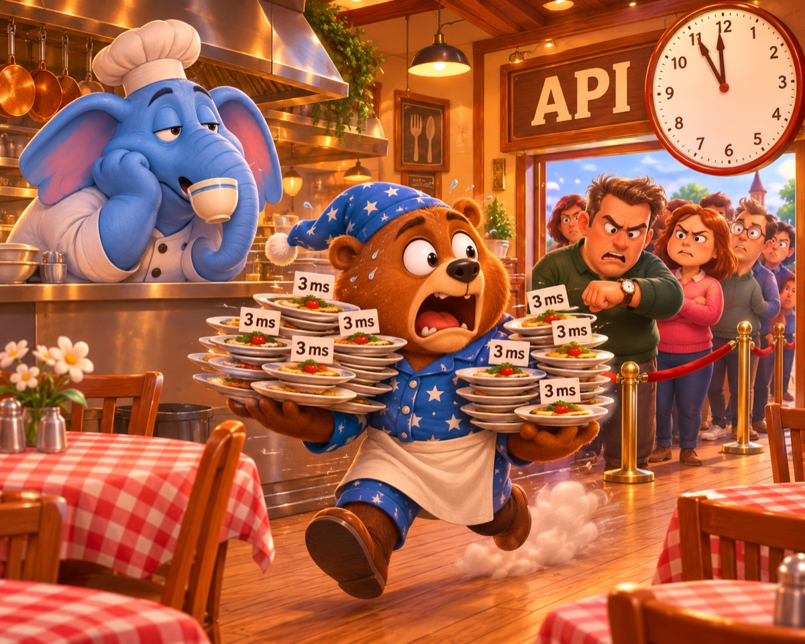
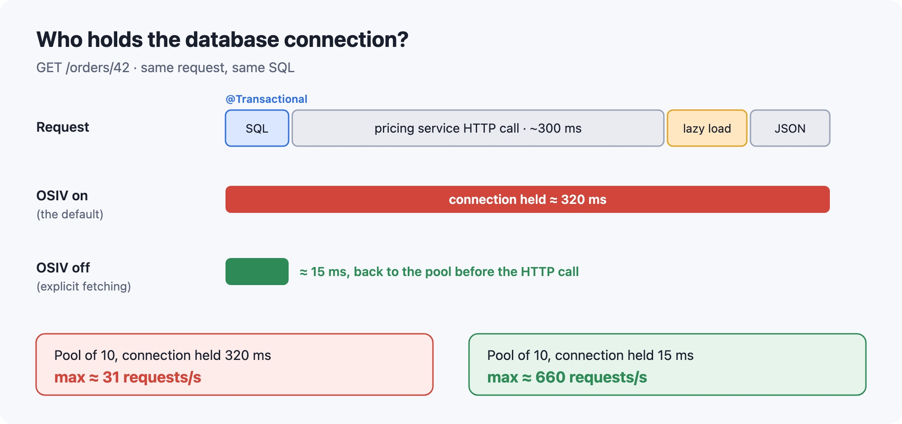
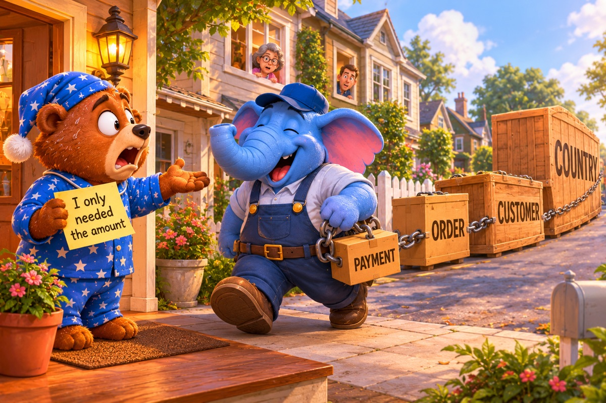
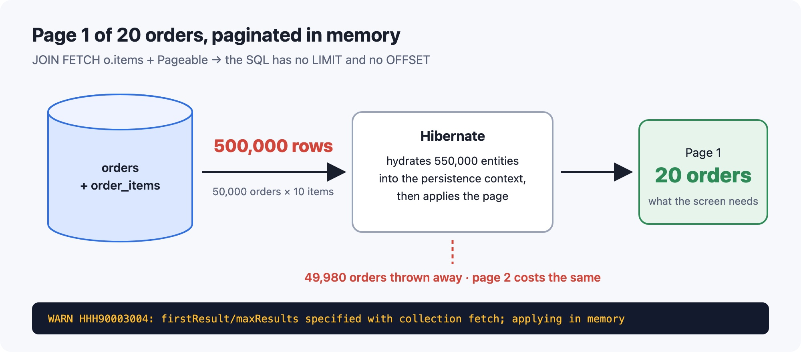
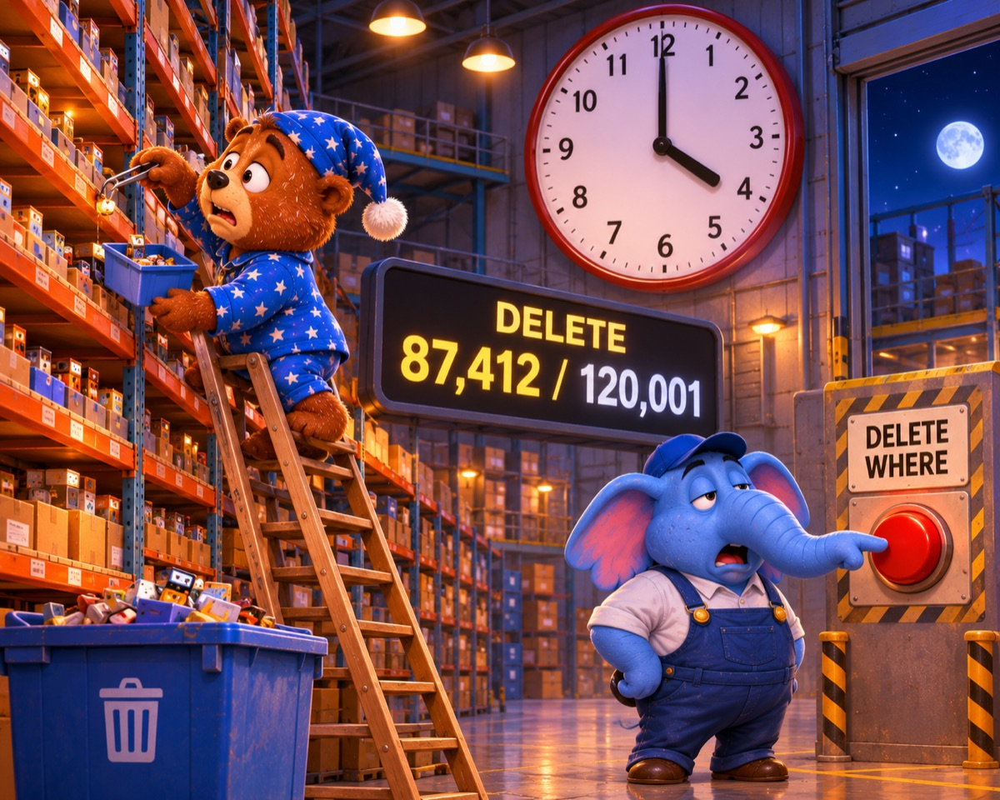
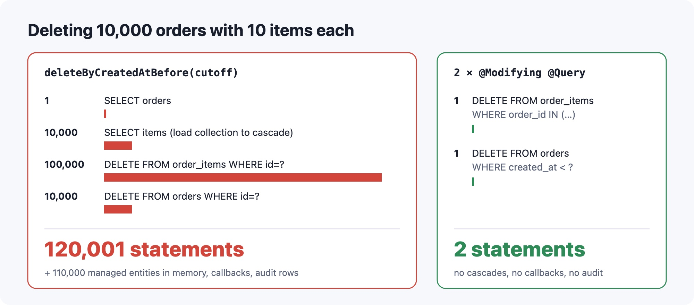

*Everything works in dev. Then production gets real data.*



Here's how it usually goes. Spring Boot app, Spring Data JPA, Postgres behind it. Every query in the log takes 3 ms. The database is bored. And yet the API is slow, the connection pool runs dry at lunchtime, and the nightly export job is still running at breakfast.

Nobody wrote a slow query. Hibernate just did a lot of things nobody asked it to do, very quickly, many times.

In [5 PostgreSQL Mistakes I See in Every Spring Boot App](/posts/5-postgresql-mistakes-i-see-in-every-spring-boot-app/) I covered the database side, including the cartesian product you get from `JOIN FETCH` on several collections and `IDENTITY` quietly turning off batch inserts. This one is about the JPA side: five defaults and habits I find in almost every Spring Boot codebase I review, and what each of them actually makes Hibernate do.

The examples use Spring Boot 4, Hibernate ORM 7 and Java 21, with SQL logging on:

```properties
logging.level.org.hibernate.SQL=DEBUG
logging.level.org.hibernate.orm.jdbc.bind=TRACE
```

### Mistake 1: Leaving Open Session in View on


Here's an endpoint that looks completely harmless:

```java
@RestController
@RequestMapping("/orders")
class OrderController {

    private final OrderService orderService;
    private final PricingClient pricingClient;

    OrderController(OrderService orderService, PricingClient pricingClient) {
        this.orderService = orderService;
        this.pricingClient = pricingClient;
    }

    @GetMapping("/{id}")
    OrderView get(@PathVariable Long id) {
        Order order = orderService.findOrder(id);                                   // @Transactional, ~5 ms
        BigDecimal delivery = pricingClient.estimateDelivery(order.getShippingCountry()); // HTTP call, ~300 ms
        return OrderView.from(order, delivery);                                     // walks order.getItems()
    }
}
```

The service method is `@Transactional(readOnly = true)` and does one `findById`. The transaction is over the moment it returns. So the connection goes back to the pool, right?

No. `spring.jpa.open-in-view` is `true` by default, so Spring registers an `OpenEntityManagerInViewInterceptor` for every web request. It opens the `EntityManager` when the request starts and closes it after the response is written. Spring also configures Hibernate to hold on to the JDBC connection once it has one, until the session closes. Here's the log:

```
select o1_0.id,o1_0.created_at,c1_0.id,c1_0.email,c1_0.name,o1_0.shipping_country,o1_0.status from orders o1_0 left join customers c1_0 on c1_0.id=o1_0.customer_id where o1_0.id=?
                                  -- transaction committed, connection still held
                                  -- ~300 ms waiting for the pricing service
select i1_0.order_id,i1_0.id,i1_0.price,i1_0.product_id,i1_0.quantity from order_items i1_0 where i1_0.order_id=?
```

The second query runs from `OrderView.from()` in the controller, outside any transaction, because the session is still open and the lazy `items` collection can still load. If you return the entity directly, Jackson does the same thing during serialization.

Now the arithmetic. The request does about 15 ms of SQL but holds a connection for about 320 ms. HikariCP's default pool has 10 connections, so the whole service tops out at 10 / 0.32 s ≈ **31 requests per second**. With the connection held only for the SQL it would be around 660. At 50 requests per second, threads start queueing for a connection, and 30 seconds later:

```
HikariPool-1 - Connection is not available, request timed out after 30000ms (total=10, active=10, idle=0, waiting=42)
```

Meanwhile, `pg_stat_activity` shows your ten connections as `idle`. The database isn't slow. It's waiting for you.



**The fix:** turn it off, and load everything the response needs inside the service:

```properties
spring.jpa.open-in-view=false
```

```java
public interface OrderRepository extends JpaRepository<Order, Long> {

    @EntityGraph(attributePaths = {"customer", "items"})
    Optional<Order> findWithCustomerAndItemsById(Long id);
}
```

```java
@Transactional(readOnly = true)
public OrderDetails findOrder(Long id) {
    Order order = orderRepository.findWithCustomerAndItemsById(id).orElseThrow();
    return OrderDetails.from(order);   // map to a DTO while the session is still open
}
```

The first thing you'll see after switching it off is `LazyInitializationException` in places you didn't know were lazy-loading. That's the point. Each one is a hidden query that used to run from a controller or a JSON serializer. Fetch it explicitly in the service, and it stops being hidden.

**How to check your app:**

- If you never set the property, Spring Boot tells you at startup: `spring.jpa.open-in-view is enabled by default. Therefore, database queries may be performed during view rendering.`
- Compare HikariCP's `hikaricp.connections.usage` metric (how long a connection is held) with your SQL time. If usage is 10× the query time, something is holding connections.

**Read more:** [Spring Boot reference: Open EntityManager in View](https://docs.spring.io/spring-boot/reference/data/sql.html#data.sql.jpa-and-spring-data.open-entity-manager-in-view)

### Mistake 2: Trusting the default fetch type on @ManyToOne



Collections are lazy by default. To-one associations aren't. The JPA spec says `@ManyToOne` and `@OneToOne` are `EAGER` unless you say otherwise, and most entities I see never say otherwise:

```java
// Payment.java
@Entity
@Table(name = "payments")
public class Payment {

    @Id
    @GeneratedValue(strategy = GenerationType.SEQUENCE)
    private Long id;

    @ManyToOne                          // EAGER by default
    @JoinColumn(name = "order_id")
    private Order order;

    @Enumerated(EnumType.STRING)
    private PaymentStatus status;

    private BigDecimal amount;
}
```

```java
// Order.java
@Entity
@Table(name = "orders")
public class Order {

    @Id
    @GeneratedValue(strategy = GenerationType.SEQUENCE)
    private Long id;

    @ManyToOne                          // EAGER by default
    @JoinColumn(name = "customer_id")
    private Customer customer;

    @OneToMany(mappedBy = "order")      // LAZY by default
    private List<OrderItem> items = new ArrayList<>();

    @Enumerated(EnumType.STRING)
    private OrderStatus status;

    private String shippingCountry;
    private Instant createdAt;
}
```

`paymentRepository.findById(42L)` gives you a chain of joins:

```sql
select p1_0.id,p1_0.amount,o1_0.id,o1_0.created_at,c1_0.id,c1_0.email,c1_0.name,o1_0.shipping_country,o1_0.status,p1_0.status
from payments p1_0
left join orders o1_0 on o1_0.id=p1_0.order_id
left join customers c1_0 on c1_0.id=o1_0.customer_id
where p1_0.id=?
```

For one row that's tolerable, and that's why nobody notices. But the chain grows every time someone adds a to-one anywhere above it. Add `Customer.country` and every `findById` on `Payment` now joins four tables.

The real damage shows up with a query. Here's a retry job that needs pending payments, just their IDs and amounts:

```java
List<Payment> findAllByStatus(PaymentStatus status);
```

JPQL doesn't turn `EAGER` mappings into joins. Hibernate runs the query you wrote, and then, because it promised to load `order` eagerly, it loads every order with a separate select:

```
select p1_0.id,p1_0.amount,p1_0.order_id,p1_0.status from payments p1_0 where p1_0.status=?
select o1_0.id,o1_0.created_at,c1_0.id,c1_0.email,c1_0.name,o1_0.shipping_country,o1_0.status from orders o1_0 left join customers c1_0 on c1_0.id=o1_0.customer_id where o1_0.id=?
select o1_0.id,o1_0.created_at,c1_0.id,c1_0.email,c1_0.name,o1_0.shipping_country,o1_0.status from orders o1_0 left join customers c1_0 on c1_0.id=o1_0.customer_id where o1_0.id=?
... 498 more
```

500 pending payments, **501 queries**, and the code never calls `getOrder()` once. It's N+1 without a single lazy load, which is why people don't recognize it.

**The fix:** `LAZY` on every to-one, no exceptions, then fetch explicitly where you actually need the parent:

```java
@ManyToOne(fetch = FetchType.LAZY)
@JoinColumn(name = "order_id")
private Order order;
```

```java
@Query("""
    select p from Payment p
    join fetch p.order o
    join fetch o.customer
    where p.status = :status
    """)
List<Payment> findAllWithOrderAndCustomerByStatus(PaymentStatus status);
```

Fetch-joining to-ones is cheap: still one row per payment, no multiplication. (Collections are a different story. That's the cartesian product from the PostgreSQL article.) And if hydration cost is new to you, [The Dehydration Problem in Hibernate](/posts/when-one-fast-query-becomes-a-production-nightmare-the-dehydration-problem-in-hibernate/) explains why loading entities you don't use is expensive even when the SQL is fast.

One trap: on the inverse side of a `@OneToOne` (the one with `mappedBy`), Hibernate can't know whether the related row exists without querying, so it may load it eagerly even with `LAZY`. Map the association from the owning side only, or share the primary key with `@MapsId`.

**How to check your app:**

```bash
grep -rn -E "@(ManyToOne|OneToOne)" src/main/java | grep -v "LAZY"
```

Then make the query count part of a test. Turn on statistics in the test profile:

```properties
spring.jpa.properties.hibernate.generate_statistics=true
```

```java
import static org.assertj.core.api.Assertions.assertThat;

import jakarta.persistence.EntityManagerFactory;
import org.hibernate.SessionFactory;
import org.hibernate.stat.Statistics;
import org.junit.jupiter.api.Test;
import org.springframework.beans.factory.annotation.Autowired;
import org.springframework.boot.test.context.SpringBootTest;

@SpringBootTest
class PaymentQueryCountTest {

    @Autowired PaymentRepository paymentRepository;
    @Autowired EntityManagerFactory entityManagerFactory;

    @Test
    void loadingPendingPaymentsIsOneQuery() {
        Statistics stats = entityManagerFactory.unwrap(SessionFactory.class).getStatistics();
        stats.clear();

        paymentRepository.findAllByStatus(PaymentStatus.PENDING);

        assertThat(stats.getPrepareStatementCount()).isEqualTo(1);
    }
}
```

I'll reuse this test for the next mistakes. It's the cheapest performance test you'll ever write.

**Read more:** [Hibernate ORM 7 User Guide: Fetching](https://docs.hibernate.org/orm/7.0/userguide/html_single/Hibernate_User_Guide.html#fetching)

### Mistake 3: Paginating a JOIN FETCH of a collection


An order list screen, 20 per page, with items, because the screen shows them:

```java
@Query(value = """
        select o from Order o
        join fetch o.items
        where o.status = :status
        """,
       countQuery = "select count(o) from Order o where o.status = :status")
Page<Order> findWithItemsByStatus(OrderStatus status, Pageable pageable);
```

Called with `PageRequest.of(0, 20, Sort.by("createdAt").descending())`. Here's the SQL:

```sql
select o1_0.id,o1_0.created_at,o1_0.customer_id,o1_0.shipping_country,o1_0.status,
       i1_0.order_id,i1_0.id,i1_0.price,i1_0.product_id,i1_0.quantity
from orders o1_0
join order_items i1_0 on o1_0.id=i1_0.order_id
where o1_0.status=?
order by o1_0.created_at desc
```

No `LIMIT`. No `OFFSET`. And that's deliberate: a `LIMIT 20` in SQL would cut rows, not orders. Twenty rows might be two orders with ten items each, or one order cut in half. So Hibernate fetches everything, builds every entity, and does the pagination in memory. The only trace is a warning:

```
WARN  HHH90003004: firstResult/maxResults specified with collection fetch; applying in memory
```

This is the behavior up to Hibernate 7.3. Starting with 7.4, the docs say the limit is applied in memory only when the database doesn't support `LIMIT` inside a subquery, so on newer versions check your SQL log before assuming you're affected.

With 50,000 open orders and 10 items each, page 1 of 20 orders loads **500,000 rows**. They go over the network, Hibernate hydrates 550,000 entities into the persistence context, keeps 20 orders, and throws the rest away. Page 2 costs exactly the same. In dev, with 30 orders, it's instant.



**The fix:** page the IDs, then fetch the entities by ID.

```java
@Query("select o.id from Order o where o.status = :status")
Page<Long> findIdsByStatus(OrderStatus status, Pageable pageable);

@Query("select o from Order o join fetch o.items where o.id in :ids")
List<Order> findWithItemsByIdIn(Collection<Long> ids);
```

```java
@Transactional(readOnly = true)
public Page<Order> findOrders(OrderStatus status, Pageable pageable) {
    Page<Long> ids = orderRepository.findIdsByStatus(status, pageable);
    Map<Long, Order> byId = orderRepository.findWithItemsByIdIn(ids.getContent()).stream()
            .collect(Collectors.toMap(Order::getId, Function.identity()));
    return ids.map(byId::get);   // keeps the sort order of the ID page
}
```

Now the database does the paging:

```
select o1_0.id from orders o1_0 where o1_0.status=? order by o1_0.created_at desc offset ? rows fetch first ? rows only
select count(o1_0.id) from orders o1_0 where o1_0.status=?
select o1_0.id,...,i1_0.quantity from orders o1_0 join order_items i1_0 on o1_0.id=i1_0.order_id where o1_0.id in (?,?,?,...)
```

Three queries and about 200 rows instead of 500,000. Since Hibernate 6, duplicate roots from a fetch join are removed automatically, so you don't need `distinct` in the second query.

The other option is to not fetch-join the collection at all. Page the orders normally and let batch fetching load the items for the whole page in one `IN` query:

```java
@BatchSize(size = 50)
@OneToMany(mappedBy = "order")
private List<OrderItem> items = new ArrayList<>();
```

Or globally with `hibernate.default_batch_fetch_size`, which I covered in the [PostgreSQL article](/posts/5-postgresql-mistakes-i-see-in-every-spring-boot-app/).

**How to check your app:** make Hibernate fail instead of warn, at least in tests:

```properties
spring.jpa.properties.hibernate.query.fail_on_pagination_over_collection_fetch=true
```

And search your production logs for `HHH90003004` today. If it's there, it's been there for a while.

**Read more:** [Hibernate ORM 7 User Guide: Limits and offsets](https://docs.hibernate.org/orm/7.0/userguide/html_single/Hibernate_User_Guide.html#hql-limit-offset)

### Mistake 4: Deleting with derived deleteBy...() methods



I mentioned this one in the [PostgreSQL article](/posts/5-postgresql-mistakes-i-see-in-every-spring-boot-app/), from the database's point of view. Here's what happens before the `DELETE` even reaches the database.

The orders aggregate, mapped the way most aggregates are:

```java
@OneToMany(mappedBy = "order", cascade = CascadeType.ALL, orphanRemoval = true)
private List<OrderItem> items = new ArrayList<>();
```

And a nightly purge that reads like plain English:

```java
public interface OrderRepository extends JpaRepository<Order, Long> {

    long deleteByCreatedAtBefore(Instant cutoff);
}
```

```java
@Transactional
public void purgeOrdersOlderThan(Instant cutoff) {
    orderRepository.deleteByCreatedAtBefore(cutoff);
}
```

Spring Data doesn't turn that into `DELETE ... WHERE`. It selects the orders, then calls `EntityManager.remove()` on each one. `remove()` cascades to `items`, and to cascade, Hibernate first has to load each collection. Then, at flush, every row gets its own `DELETE`:

```
select o1_0.id,o1_0.created_at,o1_0.customer_id,o1_0.shipping_country,o1_0.status from orders o1_0 where o1_0.created_at<?
select i1_0.order_id,i1_0.id,i1_0.price,i1_0.product_id,i1_0.quantity from order_items i1_0 where i1_0.order_id=?
... 9,999 more
delete from order_items where id=?
... 99,999 more
delete from orders where id=?
... 9,999 more
```

For 10,000 orders with 10 items each, that adds up fast:



Plus 110,000 managed entities in memory, plus every `@PreRemove` callback, plus an Envers audit row per deleted entity if you use Envers. Setting `hibernate.jdbc.batch_size` groups the deletes into fewer round trips, but the selects, the memory and the statement count stay the same. And on the Postgres side you now have 110,000 dead tuples to vacuum. [Your DELETE + INSERT Is Burning PostgreSQL's CPU](/posts/your-delete-insert-is-burning-postgresqls-cpu-here-s-what-s-actually-happening-on-the-page/) shows what that does on the page.

**The fix:** bulk deletes, children first:

```java
public interface OrderRepository extends JpaRepository<Order, Long> {

    @Modifying(flushAutomatically = true, clearAutomatically = true)
    @Query("""
        delete from OrderItem i
        where i.order.id in (select o.id from Order o where o.createdAt < :cutoff)
        """)
    int deleteItemsOfOrdersCreatedBefore(Instant cutoff);

    @Modifying(flushAutomatically = true, clearAutomatically = true)
    @Query("delete from Order o where o.createdAt < :cutoff")
    int deleteOrdersCreatedBefore(Instant cutoff);
}
```

```java
@Transactional
public int purgeOrdersOlderThan(Instant cutoff) {
    orderRepository.deleteItemsOfOrdersCreatedBefore(cutoff);
    return orderRepository.deleteOrdersCreatedBefore(cutoff);
}
```

Two statements. But a bulk delete is fast precisely because it skips everything JPA normally does, so know what you're giving up:

- **No cascades.** Nothing else gets deleted for you. If `payments` references `orders`, you get a foreign key violation, or orphans if there's no FK. Delete in the right order yourself, or let the database cascade: `ON DELETE CASCADE` on the FK plus `@OnDelete(action = OnDeleteAction.CASCADE)` on `OrderItem.order`, and then you only delete orders.
- **No lifecycle callbacks.** `@PreRemove`, entity listeners and Envers don't run. In regulated domains, where the audit trail is a compliance requirement, check with whoever owns that requirement before you switch.
- **No persistence context.** Entities already loaded in this session don't know they were deleted. `clearAutomatically = true` clears the context after the delete, and `flushAutomatically = true` writes pending changes first, so the clear doesn't throw them away.

For millions of rows, delete in chunks instead of one giant statement. The PostgreSQL article has the pattern.

**How to check your app:** `grep -rn -E "(delete|remove)(All)?By|deleteAll\(" src/main/java`, then run the statistics test from Mistake 2 around your purge with 3 orders of 2 items each. If `getPrepareStatementCount()` says 13 instead of 2, you've found it.

**Read more:** [Spring Data JPA: Derived delete queries](https://docs.spring.io/spring-data/jpa/reference/jpa/query-methods.html#jpa.modifying-queries.derived-delete)

### Mistake 5: Loading managed entities just to read them


A nightly export: one day of orders to CSV. Streaming, so it must be memory-safe, right?

```java
public interface OrderRepository extends JpaRepository<Order, Long> {

    Stream<Order> streamByCreatedAtBetween(Instant from, Instant to);

    Stream<Order> streamByCreatedAtBefore(Instant cutoff);
}
```

```java
@Transactional
public void exportDay(Instant from, Instant to) {
    try (Stream<Order> orders = orderRepository.streamByCreatedAtBetween(from, to)) {
        orders.forEach(order -> csv.write(order.getId(), order.getStatus(), order.getCreatedAt()));
    }
}
```

Every `Order` you load is a managed entity. For each one, Hibernate keeps the entity itself, an entry in the persistence context, and a snapshot: a copy of every field's value at load time, used for dirty checking. The stream doesn't change that. Entities stay in the persistence context until the transaction ends, whether you still hold a reference or not.

So for 1,000,000 orders you hold **2,000,000 objects** (entities plus snapshots) until commit. Then the flush at commit compares every field of every entity against its snapshot, to update nothing. And if the loop runs any JPQL query, Hibernate auto-flushes before it, which means dirty-checking everything loaded so far. Every time. That's how a linear job becomes quadratic.

**The fix:** read DTOs when you only read.

```java
public record OrderExportRow(Long id, OrderStatus status, Instant createdAt) {}
```

```java
@Query("""
    select new com.example.orders.OrderExportRow(o.id, o.status, o.createdAt)
    from Order o
    where o.createdAt >= :from and o.createdAt < :to
    """)
@QueryHints(@QueryHint(name = HibernateHints.HINT_FETCH_SIZE, value = "1000"))
Stream<OrderExportRow> streamExportRows(Instant from, Instant to);
```

No managed entities, no snapshots, no dirty checking. Memory stays flat. The fetch size matters too: without it, the Postgres JDBC driver reads the entire result set into memory before your stream sees the first row. (It only streams inside a transaction, with auto-commit off.)

The other tools, for the cases where you need entities:

- **`@Transactional(readOnly = true)`.** Spring marks the Hibernate session read-only and sets flush mode to manual, so entities load without snapshots and nothing is flushed at commit. They still sit in the persistence context, though. Good for normal read endpoints, not enough on its own for a million rows.
- **`flush()` + `clear()` every few hundred entities** when the job modifies what it loads:

```java
@Transactional
public void recalculateTotals(Instant cutoff) {
    int processed = 0;
    try (Stream<Order> orders = orderRepository.streamByCreatedAtBefore(cutoff)) {
        for (Order order : (Iterable<Order>) orders::iterator) {
            order.recalculateTotal();
            if (++processed % 500 == 0) {
                entityManager.flush();
                entityManager.clear();
            }
        }
    }
}
```

- **`StatelessSession`** for pure batch work: no persistence context, no snapshots, no cascades, no lazy loading. You call `update()` yourself, and it runs outside Spring's transaction management.

**How to check your app:** run the job in staging with statistics on and look at the session metrics Hibernate logs at the end:

```properties
spring.jpa.properties.hibernate.generate_statistics=true
logging.level.org.hibernate.engine.internal.StatisticalLoggingSessionEventListener=INFO
```

For the export above, you'll see something like this:

```
Session Metrics {
    ...
    1843000000 nanoseconds spent executing 1 flushes (flushing a total of 1000000 entities and 1000000 collections);
}
```

If a read-only job flushes a million entities, it's loading entities it should be reading as DTOs.

**Read more:** [Spring Data JPA: Projections](https://docs.spring.io/spring-data/jpa/reference/repositories/projections.html)

### Bonus: Lombok's @Data on entities


```java
@Data
@Entity
@Table(name = "orders")
public class Order { /* customer, items, ... */ }
```

Then, somewhere in a service:

```java
log.debug("Saving order {}", order);
```

`@Data` generates a `toString()` that prints every field. Printing `items` initializes the lazy collection, and printing each item's lazy `product` initializes that too. An order with 50 items: **51 queries from one log line**. If `OrderItem` also has `@Data`, its `toString()` prints `order`, which prints `items`, which prints `order`, and you get a `StackOverflowError`. And all of this only happens when DEBUG is on, which is exactly when you're investigating a production problem.

The generated `equals()` and `hashCode()` are just as bad: they use every field, so they touch lazy associations, and the hash code changes when the ID is assigned on persist, which loses the entity inside a `HashSet`.

Use `@Getter` and `@Setter`, and write these three yourself:

```java
@Override
public boolean equals(Object o) {
    if (this == o) return true;
    if (!(o instanceof Order other)) return false;
    return id != null && id.equals(other.getId());
}

@Override
public int hashCode() {
    return getClass().hashCode();
}

@Override
public String toString() {
    return "Order{id=" + id + ", status=" + status + "}";
}
```

**Read more:** [Hibernate ORM 7 User Guide: Implementing equals() and hashCode()](https://docs.hibernate.org/orm/7.0/userguide/html_single/Hibernate_User_Guide.html#mapping-model-pojo-equalshashcode)

### A quick checklist

- Is `spring.jpa.open-in-view=false` set explicitly?
- Does every `@ManyToOne` and `@OneToOne` say `fetch = FetchType.LAZY`?
- Is `HHH90003004` anywhere in your production logs?
- Any derived `deleteBy...()` or `deleteAll()` on tables with more than a few thousand rows?
- Do your export and batch jobs read DTOs, or a million managed entities?
- Is there a query-count test for your three busiest endpoints?

None of these are Hibernate bugs. Every one is a default, or a convenience method, doing exactly what it was designed to do, on data it was never tested with. If you fixed these and want the next layer down, [5 PostgreSQL Mistakes I See in Every Spring Boot App](/posts/5-postgresql-mistakes-i-see-in-every-spring-boot-app/) covers what the database does with the queries Hibernate sends, [The Dehydration Problem in Hibernate](/posts/when-one-fast-query-becomes-a-production-nightmare-the-dehydration-problem-in-hibernate/) goes deep on hydration cost, and [5 Spring Boot Mistakes I See in Every Codebase](/posts/5-spring-boot-mistakes-i-see-in-every-codebase/) covers the transaction boundaries all of this depends on.
