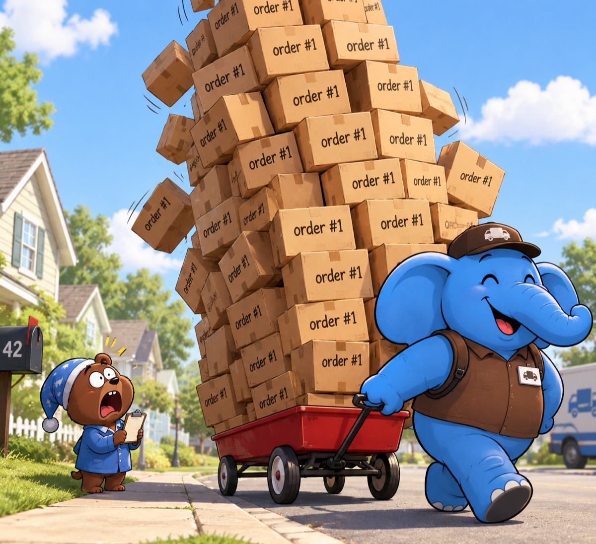

*Your ORM is lying to you a little. Here's where.*


Here's how it usually goes. Spring Boot app, Spring Data JPA, Postgres behind it. Everything is fast in dev, because dev has 200 rows. Staging is fine too. Then production hits a few million rows and suddenly the database CPU is at 90%, a deploy hangs for ten minutes, and someone in Slack asks "did anyone change anything?"

Usually nobody changed anything. The problem was there from day one, it just needed data to show up.

I keep running into the same five issues in pretty much every Spring Boot + Postgres codebase I look at. None of them are exotic. They're all "the defaults did something you didn't expect" kind of problems. Let's go through them.

### Mistake 1: Assuming Postgres indexes your foreign keys


Quick quiz. You have this:

```java
@Entity
public class Order {
    @Id
    private Long id;

    @ManyToOne(fetch = FetchType.LAZY)
    @JoinColumn(name = "customer_id")
    private Customer customer;
}
```

and the migration has `customer_id BIGINT REFERENCES customer(id)`. Is there an index on `order.customer_id`?

Nope.

Postgres automatically creates indexes for `PRIMARY KEY` and `UNIQUE` constraints, and that's it. A foreign key is just a constraint. It makes sure the referenced row exists, but it does nothing to make lookups by that column fast. If you came from MySQL this one hurts, because InnoDB *does* create an index for every foreign key, so lots of people just assume every database does.

Hibernate won't save you either. Even with `ddl-auto=update` (please don't do that in prod) it creates the FK constraint and no index.

**Where it bites you, part one: reads.** Every `findByCustomerId`, every lazy load of `customer.getOrders()`, every join from customer to orders is a sequential scan on `order`. At 10k rows you won't notice. At 50 million you will.

**Where it bites you, part two: deletes.** This is the sneaky one. When you delete a customer, Postgres has to check that no order still points to it. Internally it runs something like this for **every deleted row**:

```sql
SELECT 1 FROM "order" WHERE customer_id = $1 FOR KEY SHARE;
```

No index means a full scan of `order` per deleted customer. Delete 1,000 customers and you get 1,000 sequential scans of your biggest table. With `ON DELETE CASCADE` it's the same story, Postgres still has to find the child rows somehow. The worst part is that `EXPLAIN` on your `DELETE` won't show it, because the check runs inside a trigger. You just see a delete that "randomly" takes 40 seconds. (`EXPLAIN ANALYZE` does show trigger time at the bottom, look for `RI_ConstraintTrigger`.)

**The fix:** Index your FK columns. Not necessarily all of them, a tiny lookup table that never gets deleted from is fine without one, but that should be a decision you actually made, not something you forgot.

Here's a query that finds foreign keys whose column isn't the leading column of any index (it covers single-column FKs, which is 95% of what JPA produces):

```sql
SELECT c.conrelid::regclass AS table_name,
       a.attname            AS fk_column,
       c.conname            AS constraint_name
FROM pg_constraint c
JOIN pg_attribute a
  ON a.attrelid = c.conrelid AND a.attnum = c.conkey[1]
WHERE c.contype = 'f'
  AND NOT EXISTS (
      SELECT 1 FROM pg_index i
      WHERE i.indrelid = c.conrelid
        AND i.indkey[0] = c.conkey[1]
  )
ORDER BY 1;
```

Run it on your prod database. I'd honestly be surprised if it comes back empty.

Then add the indexes in a migration, and do it with `CONCURRENTLY` (more on why in mistake 5):

```sql
CREATE INDEX CONCURRENTLY idx_order_customer_id ON "order" (customer_id);
```

### Mistake 2: Fetching the whole object graph in one query



This one starts with good intentions. Someone reads about the N+1 problem, gets scared (fair), and decides everything should be loaded in one query.

```java
@Query("""
    SELECT o FROM Order o
    JOIN FETCH o.items
    JOIN FETCH o.payments
    WHERE o.createdAt > :since
    """)
List<Order> findRecentWithEverything(Instant since);
```

First thing that happens: Hibernate throws `MultipleBagFetchException: cannot simultaneously fetch multiple bags`. Somebody googles it, the top answer says "change `List` to `Set`", they do it, the exception goes away, and everyone moves on.

The exception was actually trying to help. Here's what the database sends back now. An order with 50 items and 20 payments isn't 1 row, or 71 rows. It's **50 × 20 = 1,000 rows**, because SQL joins multiply. Every item row gets repeated for every payment. Load 200 orders like that and Postgres is shipping 200,000 wide rows over the network, all carrying the same order columns again and again.

Then Hibernate has to deal with them. For every single row it reads the result set, builds the entity key, checks the persistence context, finds "oh, I already have this one", and throws the duplicate away. That's what hydration costs: you pay CPU and memory for thousands of rows just to end up with a few hundred objects. I wrote a whole deep dive on this, [The Dehydration Problem in Hibernate](/posts/when-one-fast-query-becomes-a-production-nightmare-the-dehydration-problem-in-hibernate/), but the short version is this: **the query looks fast in `pg_stat_statements` and your app is slow anyway**, because the time goes into moving and deduplicating rows, not into executing the SQL.

And it grows with every join you add. Add `JOIN FETCH o.shipments` with 5 shipments and you're at 5,000 rows per order.

**The fix:** Fetch at most one collection per query. Load the rest separately:

```java
List<Order> orders = orderRepository.findRecentWithItems(since);   // JOIN FETCH items
orderRepository.findWithPayments(orders);                           // JOIN FETCH payments WHERE o IN :orders
```

Since both queries run in the same persistence context, Hibernate fills `payments` into the `Order` instances it already has. You get two queries and 50 + 20 rows per order, instead of one query and 1,000 rows.

Even easier, turn on batch fetching globally and let lazy collections load in chunks:

```properties
spring.jpa.properties.hibernate.default_batch_fetch_size=50
```

Now touching `order.getPayments()` loads payments for up to 50 orders in one `IN (...)` query. You get roughly N/50 queries instead of N+1, and no cartesian product.

And if this is a read-only screen or an API response, skip entities entirely and use a DTO projection. No persistence context, no dirty checking, no hydration of stuff you don't need.

**How to spot it:** turn on `hibernate.generate_statistics` in staging and look for queries where rows fetched is way higher than entities loaded. Or look in `pg_stat_statements` for queries with a huge `rows / calls` ratio.

### Mistake 3: Treating DELETE as free


In your head, `DELETE` makes data go away. In Postgres it doesn't, at least not right away.

Because of [MVCC](/posts/mvcc-invisible-superpower-inside-every-query/), a deleted row stays on the page. Postgres just marks it as dead for transactions that start after yours. The space comes back only after vacuum cleans it up. Until then every index still points to it, sequential scans still read it, and the table is exactly as big as before.

So a few Spring patterns that look totally innocent are actually expensive.

**`deleteAll()` and derived `deleteBy...` methods.** Spring Data JPA's `deleteAll()` doesn't run `DELETE FROM table`. It loads every entity into memory and then removes them one by one. Same for `deleteByStatus(...)`: it selects first, then deletes each row separately, firing cascades and lifecycle callbacks on the way. For 100k rows that's 100k `DELETE` statements plus a heap full of entities.

```java
repository.deleteAll();          // SELECT * + N deletes
repository.deleteAllInBatch();   // one DELETE statement
```

If you don't need the JPA lifecycle, use `deleteAllInBatch()` or a `@Modifying @Query("delete from ...")`.

**The "replace the collection" pattern.** This one is everywhere:

```java
order.getItems().clear();
order.getItems().addAll(newItems);   // with orphanRemoval = true
```

Every time the order is saved, Hibernate deletes all the old item rows and inserts new ones, even if 49 of the 50 items didn't change. That's 49 dead tuples and 49 new tuples for nothing, plus index entries for all of them. Do it on a hot path and you get a table that bloats constantly and autovacuum that never gets to rest. I measured exactly this, down to the page level, in [Your DELETE + INSERT Is Burning PostgreSQL's CPU](/posts/your-delete-insert-is-burning-postgresqls-cpu-here-s-what-s-actually-happening-on-the-page/). Spoiler: diffing the collection and only touching changed rows makes a huge difference.

**The nightly cleanup job.** Everyone has one:

```sql
DELETE FROM event_log WHERE created_at < now() - interval '90 days';
```

As a single statement on a big table, this:

- creates millions of dead tuples in one go
- writes a huge burst of WAL, so your replicas fall behind
- holds one long transaction, and as long as it's open, vacuum can't clean dead rows anywhere in the database that are newer than its snapshot
- then autovacuum kicks in on a giant table and chews CPU and I/O for an hour, right when morning traffic starts

**The fix:** Delete in batches, with each batch committed in its own transaction:

```java
public void purgeOldEvents(Instant cutoff) {
    int deleted;
    do {
        deleted = tx.execute(status -> jdbc.update("""
            DELETE FROM event_log
            WHERE id IN (
                SELECT id FROM event_log
                WHERE created_at < ?
                LIMIT 5000
            )
            """, Timestamp.from(cutoff)));
    } while (deleted > 0);
}
```

`tx` is a `TransactionTemplate`. Don't put `@Transactional` on the method, or the whole loop becomes one big transaction again and you're back where you started. And yes, `created_at` needs an index, otherwise every batch does a full scan.

For time-based data, the real fix is **partitioning**. Partition `event_log` by month, and cleanup becomes `DROP TABLE event_log_2026_07`. That's a metadata operation: no dead tuples, no vacuum, basically instant. If you're throwing away the whole table, `TRUNCATE` does the same thing for you.

And for tables that churn a lot, tune autovacuum per table instead of living with the defaults (which wait until 20% of the table is dead):

```sql
ALTER TABLE order_item SET (autovacuum_vacuum_scale_factor = 0.02);
```

Keep an eye on `n_dead_tup` and `last_autovacuum` in `pg_stat_user_tables`. If dead tuples keep climbing and vacuum never catches up, you've found your CPU problem.

### Mistake 4: Using IDENTITY and wondering why batch inserts are slow


Every tutorial shows this:

```java
@Id
@GeneratedValue(strategy = GenerationType.IDENTITY)
private Long id;
```

Works fine. Looks clean. And it silently **turns off JDBC insert batching**.

Here's why. With `IDENTITY` the database generates the id during the `INSERT`. But Hibernate needs the id as soon as you call `persist()`, because that's how it tracks the entity in the persistence context. So it can't queue inserts and send them in a batch. It has to run each insert right away and read back the generated key.

So you set `hibernate.jdbc.batch_size=50`, call `saveAll()` with 10,000 entities, and get... 10,000 separate round trips. The batch setting is just ignored. No warning, nothing in the logs unless you go looking.

**The fix:** Switch to a sequence with a proper allocation size:

```java
@Id
@GeneratedValue(strategy = GenerationType.SEQUENCE, generator = "order_seq")
@SequenceGenerator(name = "order_seq", sequenceName = "order_id_seq", allocationSize = 50)
private Long id;
```

Now Hibernate calls `nextval` once, gets a block of 50 ids, hands them out in memory, and can batch the inserts freely.

The important part: **the database sequence has to use the same increment**:

```sql
ALTER SEQUENCE order_id_seq INCREMENT BY 50;
```

If they don't match, recent Hibernate versions refuse to start (which is good). Older ones would happily hand out overlapping ids across instances and you'd find out from duplicate key errors in prod. Good news if your table uses `bigserial`: the sequence already exists (`<table>_<column>_seq`), you just point the generator at it and change the increment. No data migration needed.

Then turn batching on properly:

```properties
spring.jpa.properties.hibernate.jdbc.batch_size=50
spring.jpa.properties.hibernate.order_inserts=true
spring.jpa.properties.hibernate.order_updates=true
```

And add `reWriteBatchedInserts=true` to your JDBC URL. With it, the Postgres driver rewrites a batch into multi-row `INSERT ... VALUES (...), (...), (...)` statements, which is noticeably faster again.

```
jdbc:postgresql://db:5432/app?reWriteBatchedInserts=true
```

Yes, you'll get gaps in your ids when an instance restarts and throws away the rest of its block. That's fine. Ids are identifiers, not row counters. If someone needs them to have no gaps, that's a different column.

### Mistake 5: Migrations that lock your hottest table


Flyway or Liquibase runs on startup, applies a migration, and the app starts. Easy. Until the migration is this:

```sql
ALTER TABLE "order" ADD COLUMN source VARCHAR(50);
```

That's harmless, right? On Postgres 11+ adding a nullable column is instant, it only touches metadata.

Except it still needs an `ACCESS EXCLUSIVE` lock on the table, even if just for a millisecond. And if a long-running query (say, a 3-minute analytics report) is reading from `order` at that moment, the `ALTER` has to wait. Here's the bad part: **while it waits, every new query on `order` queues up behind it**, even simple `SELECT`s. Lock requests in Postgres are first-come-first-served, so nothing can jump ahead of the waiting `ALTER`. Your one-millisecond migration just made the most important table in your system unavailable for three minutes.

In Kubernetes it gets worse. The new pod is stuck on the migration, the readiness probe fails, the liveness probe kills the pod, a new pod starts, tries the migration again, and the whole thing repeats.

**Always set a lock timeout in migrations:**

```sql
SET lock_timeout = '5s';
ALTER TABLE "order" ADD COLUMN source VARCHAR(50);
```

If it can't get the lock within 5 seconds, it fails fast instead of taking production down with it. Retry the deploy when it's quieter.

Then there's the list of operations that are slow and locking on top of that:

**`CREATE INDEX` without `CONCURRENTLY`** blocks all writes to the table for as long as the index takes to build. On a big table that can be many minutes. Use `CREATE INDEX CONCURRENTLY`. It's slower, but writes keep going. Catch: it can't run inside a transaction, and Flyway wraps every migration in one. Put it in its own migration file and Flyway will notice and run it outside a transaction (it refuses to mix it with other statements unless you set `mixed=true`). In Liquibase use `runInTransaction="false"` on the changeset. If a concurrent build fails, it leaves an `INVALID` index behind, so drop it and try again.

**Adding `NOT NULL` to an existing column** scans the whole table while holding `ACCESS EXCLUSIVE`. The safe way is in steps:

```sql
ALTER TABLE "order" ADD CONSTRAINT order_source_not_null
    CHECK (source IS NOT NULL) NOT VALID;           -- instant
ALTER TABLE "order" VALIDATE CONSTRAINT order_source_not_null;  -- scans, but doesn't block writes
ALTER TABLE "order" ALTER COLUMN source SET NOT NULL;  -- PG12+ uses the check, no scan
ALTER TABLE "order" DROP CONSTRAINT order_source_not_null;
```

Same trick for new foreign keys: add with `NOT VALID`, then `VALIDATE CONSTRAINT` separately.

**Changing a column type** (the classic `int` → `bigint` when you're about to run out of ids) rewrites the whole table under an exclusive lock. For a big table that means a new column, backfilling it in batches, and a swap. Not a one-line migration.

**Adding a column with a volatile default** like `DEFAULT gen_random_uuid()` or `clock_timestamp()` also rewrites the table. Constant defaults are fine on Postgres 11+.

The general rule: before any migration touches a big table, ask two questions. "What lock does this take?" and "Does this rewrite or scan the table?" The [Postgres docs for ALTER TABLE](https://www.postgresql.org/docs/current/sql-altertable.html) list the lock level for each operation, and it's worth five minutes of reading.

### A quick checklist

**Indexes**

- Did you run the missing FK index query on prod?
- Are there `DELETE`s on parent tables that take way longer than they should?

**Fetching**

- Any query with more than one `JOIN FETCH` on collections?
- Did anyone "fix" `MultipleBagFetchException` by switching `List` to `Set`?
- Is `default_batch_fetch_size` set?

**Deletes**

- Are you calling `deleteAll()` or derived `deleteBy...` methods on big tables?
- Do you `clear()` + `addAll()` collections with `orphanRemoval`?
- Does your cleanup job delete everything in one statement?
- What does `n_dead_tup` look like on your busiest tables?

**Inserts**

- Are you using `GenerationType.IDENTITY` on entities you insert in bulk?
- Does `allocationSize` match the sequence's `INCREMENT BY`?
- Is `reWriteBatchedInserts=true` in your JDBC URL?

**Migrations**

- Do your migrations set `lock_timeout`?
- Does every `CREATE INDEX` on an existing table use `CONCURRENTLY`?
- Does anyone review migrations for lock level before they merge?

None of these mean your team did anything stupid. Spring Boot and Hibernate make the easy path really easy, and the easy path works great right up until you have real data. The good part is that every single fix here is small, can be done one table and one PR at a time, and you'll see the difference in your database CPU graph the same day.
