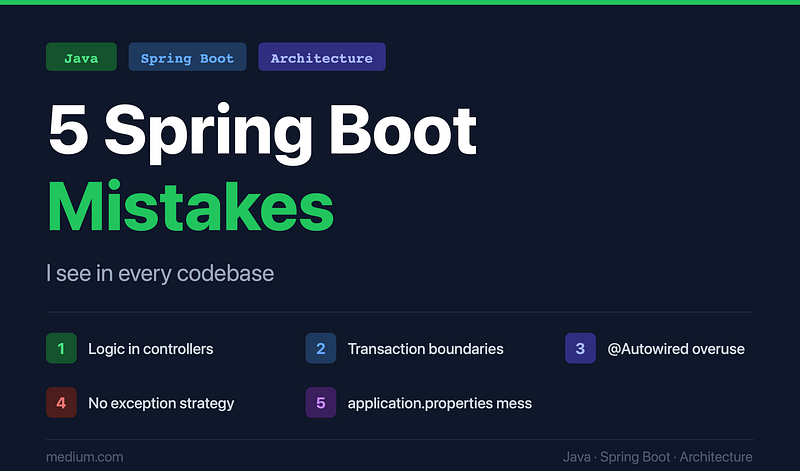

*And why senior developers keep making them*



I’ve reviewed a lot of Spring Boot codebases. Startups burning through their runway trying to scale. Enterprises with ten-year-old monoliths being carved into microservices. Teams of three and teams of fifty. Different industries, different sizes, different levels of experience.

The mistakes are almost always the same.

That’s not an insult — it’s actually the interesting part. These aren’t beginner errors. Most of the teams I work with are smart, experienced engineers who made reasonable decisions under pressure. The problem is that Spring Boot is so productive, so frictionless, that bad patterns compound quietly. You ship fast. The tests pass. Production looks fine. And then six months later you’re staring at a 2,000-line controller and wondering how it got there.

This article is about the five patterns I see most often, why they happen, and — more importantly — how to fix them without rewriting everything from scratch.

### Mistake 1: Putting business logic in controllers

This is the most common one by a significant margin. It usually starts innocently: a small validation check here, a conditional there, a bit of data transformation before calling a service. Before long, your `@RestController` is making decisions it has no business making.

Here’s what it looks like in the wild:

```java
@PostMapping("/orders")
public ResponseEntity<OrderResponse> createOrder(@RequestBody OrderRequest request) {
    if (request.getItems().isEmpty()) {
        return ResponseEntity.badRequest().build();
    }

    BigDecimal total = request.getItems().stream()
        .map(item -> item.getPrice().multiply(BigDecimal.valueOf(item.getQuantity())))
        .reduce(BigDecimal.ZERO, BigDecimal::add);
    if (total.compareTo(new BigDecimal("10000")) > 0 && !userService.isPremium(request.getUserId())) {
        return ResponseEntity.status(HttpStatus.FORBIDDEN).build();
    }
    // ... and it keeps going
}
```

The controller now knows about pricing rules, user tiers, and order validation. None of that belongs here.

**Why it happens:** Controllers are the entry point, so they feel like the natural place to “handle” things. Also, injecting a service and calling one method feels like overkill for “just a quick check.”

**Why it matters:** Business logic in controllers can’t be unit tested without spinning up the web layer. It can’t be reused from a message consumer, a scheduled job, or a CLI command. It’s invisible to anyone who looks at your service layer expecting to understand the domain.

**The fix:** Your controller should do exactly three things — deserialise the request, call a service method, and serialise the response. Every conditional, every calculation, every rule goes into a service or domain object. If your controller has an `if`statement that isn't about HTTP concerns, move it.

```java
@PostMapping("/orders")
public ResponseEntity<OrderResponse> createOrder(@RequestBody OrderRequest request) {
    OrderResponse order = orderService.createOrder(request);
    return ResponseEntity.ok(order);
}
```

Boring. Perfect.

### Mistake 2: Ignoring transaction boundaries

Transaction management is one of those topics where a little knowledge is genuinely dangerous. Most developers know `@Transactional` exists. Fewer understand where to put it, what it actually does, and — critically — what it *doesn't* do.

The most painful version of this mistake looks like this:

```java
@Service
public class PaymentService {
    @Transactional
    public void processPayment(Long orderId) {
        Order order = orderRepository.findById(orderId).orElseThrow();
        order.setStatus(OrderStatus.PAID);
        orderRepository.save(order);
        
        // This call is to an external HTTP service.
        // If it fails, the order status update is rolled back.
        // If it succeeds but the next line throws, you've charged
        // the customer but their order is still PENDING.
        paymentGateway.charge(order.getAmount());
        
        inventoryService.reserve(order.getItems()); // can throw
    }
}
```

The transaction boundary wraps an external HTTP call and a separate service call. The atomicity guarantee you think you have doesn’t exist across those boundaries.

**Why it happens:** `@Transactional` feels like a safety net you throw over anything that looks important. It's easy to apply and invisible when it's wrong.

**Why it matters:** Inconsistent data is the hardest class of bug to diagnose and fix in production. By the time you notice, the damage is already done.

**The fix:** Be deliberate about what your transaction actually protects. Keep transactions short, keep them within a single data source, and handle external calls outside the transactional boundary. Consider the outbox pattern for operations that need to be reliably paired with an external call. And always ask: “if this line throws, what state am I leaving the database in?”

Also watch out for the self-invocation trap — calling a `@Transactional` method from within the same class bypasses the proxy and silently does nothing. This one has burned almost every team I've worked with.

### Mistake 3: Overusing `@Autowired` everywhere

Field injection is convenient. It’s also the option that makes your code harder to test, harder to reason about, and full of hidden dependencies you only discover at runtime.

```java
@Service
public class ReportService {
    @Autowired
    private UserRepository userRepository;
    @Autowired
    private OrderRepository orderRepository;
    @Autowired
    private EmailService emailService;
    @Autowired
    private PdfGenerator pdfGenerator;
    @Autowired
    private AuditService auditService;
    ...
}
```

Five dependencies injected invisibly. You can’t instantiate this class in a test without a Spring context, or without reaching for `@MockBean` and a full application bootstrap. You also can't see — at a glance — that this class might be doing too much.

**Why it happens:** Field injection is fewer lines of code and Spring supports it, so it feels fine. Early tutorials often show it this way and the habit sticks.

**Why it matters:** Constructor injection makes dependencies explicit and visible. It enables plain unit tests without a Spring context. It makes circular dependencies a compile-time error rather than a runtime surprise. And when a class has eight constructor parameters, that’s a signal — a service with eight dependencies probably has too many responsibilities.

**The fix:** Use constructor injection. Always. Since Spring 4.3 you don’t even need `@Autowired` on a single-constructor class. If you're using Lombok, `@RequiredArgsConstructor` on `final` fields gives you this for free.

```kotlin
@Service
@RequiredArgsConstructor
public class ReportService {
    private final UserRepository userRepository;
    private final OrderRepository orderRepository;
    private final EmailService emailService;
    ...
}
```

If the constructor starts to look unwieldy, take that as the feedback it is.

### Mistake 4: No proper exception handling strategy

Every codebase has exception handling. Very few have an *exception handling strategy*. The difference shows up as a patchwork of try-catch blocks scattered across service methods, inconsistent error responses from your API, and stack traces leaking into production responses.

Common signs you don’t have a strategy:

```java
// In one service:
try {
    return userRepository.findById(id).orElseThrow();
} catch (Exception e) {
    log.error("Error", e);
    return null; // 🚩 silent failure
}

// In another:
if (user == null) throw new RuntimeException("User not found"); // 🚩 generic exception

// In a third:
} catch (UserNotFoundException e) {
    return ResponseEntity.status(500).body("Something went wrong"); // 🚩 wrong status code
```

**Why it happens:** Exception handling feels like plumbing — unglamorous work that gets deferred and then done inconsistently across a team over months or years.

**Why it matters:** Inconsistent error handling makes your API unpredictable for consumers, makes debugging painful, and creates security risk when internal details leak into responses.

**The fix:** Define a small hierarchy of domain exceptions (`ResourceNotFoundException`, `ValidationException`, `ConflictException`) and throw those deliberately rather than wrapping everything in `RuntimeException`. Then handle them all in one place using `@RestControllerAdvice`:

```java
@RestControllerAdvice
public class GlobalExceptionHandler {
    @ExceptionHandler(ResourceNotFoundException.class)
    public ResponseEntity<ErrorResponse> handleNotFound(ResourceNotFoundException ex) {
        return ResponseEntity.status(HttpStatus.NOT_FOUND)
            .body(new ErrorResponse("NOT_FOUND", ex.getMessage()));
    }

    @ExceptionHandler(ValidationException.class)
    public ResponseEntity<ErrorResponse> handleValidation(ValidationException ex) {
        return ResponseEntity.status(HttpStatus.BAD_REQUEST)
            .body(new ErrorResponse("VALIDATION_ERROR", ex.getMessage()));
    }

    @ExceptionHandler(Exception.class)
    public ResponseEntity<ErrorResponse> handleUnexpected(Exception ex) {
        log.error("Unexpected error", ex);
        return ResponseEntity.status(HttpStatus.INTERNAL_SERVER_ERROR)
            .body(new ErrorResponse("INTERNAL_ERROR", "An unexpected error occurred"));
    }
}
```

One place. Consistent responses. No stack traces in production. Done.

### Mistake 5: Treating `application.properties` as a dumping ground

This one starts as a minor annoyance and grows into a genuine operational problem. A file that begins as twelve lines of database config becomes three hundred lines of undocumented magic numbers, environment-specific hacks, feature flags, and credentials that probably shouldn’t be there at all.

```ini
# What does this do? Who added it? Is it still needed?
some.service.timeout=5000
other.thing.enabled=true
legacy.mode=false
max.retry.count=3
feature.new-checkout=true
internal.api.key=sk_live_abc123...
```

**Why it happens:** `application.properties` is the path of least resistance for any config that doesn't obviously belong somewhere else. Nobody wants to create a new `@ConfigurationProperties` class for one value.

**Why it matters:** At scale, unstructured configuration is an operational risk. Properties get duplicated across environments, credentials end up in version control, values change without anyone knowing what breaks, and onboarding a new developer becomes a treasure hunt.

**The fix:** Group related configuration using `@ConfigurationProperties` with typed, documented classes:

```java
@ConfigurationProperties(prefix = "payment")
@Validated
public record PaymentProperties(
    @NotBlank String apiKey,
    @Min(1) @Max(30) int timeoutSeconds,
    @Min(0) int maxRetries
) {}
```

This gives you type safety, validation on startup, IDE autocomplete, and a single place to document what each value does. Secrets should come from environment variables or a secrets manager — never committed to a repository. And if a property hasn’t been touched in six months, it probably shouldn’t exist.

### Closing: a quick checklist to self-audit your codebase

You don’t need to fix everything at once. Run through this in an hour and you’ll know exactly where to focus.

**Controllers**

- Do any controllers contain `if` statements unrelated to HTTP status?
- Are there calculations or data transformations happening before a service call?
- Is any business rule enforced at the controller level?

**Transactions**

- Are there `@Transactional` methods that call external HTTP services?
- Are there `@Transactional` methods calling other `@Transactional` methods on the same class?
- Do you know what state the database is in if any line in a transactional method throws?

**Dependency injection**

- Are you using field injection (`@Autowired` on fields)?
- Can you instantiate your service classes in a unit test without a Spring context?
- Are there any services with more than five or six dependencies?

**Exception handling**

- Do you have a `@RestControllerAdvice` that handles all exceptions in one place?
- Are you catching `Exception` in service methods and returning null or swallowing errors?
- Are stack traces or internal error messages reaching API responses in production?

**Configuration**

- Is `application.properties` longer than 50 lines with no grouping or comments?
- Are any secrets or API keys committed to version control?
- Are there properties whose purpose isn’t immediately obvious?

If you ticked more than three of those boxes, your codebase is normal — this is just what production software looks like after a few years of growth under pressure. The good news is that every one of these issues is fixable incrementally, without a rewrite, one pull request at a time.
