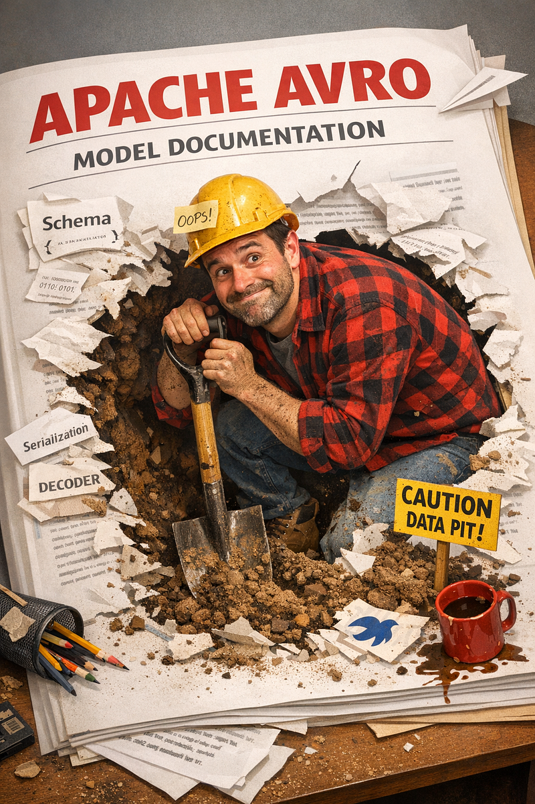

Binary serialization sounds scary until you realize it’s just a very efficient way of saying “I’ll describe the data once, then send only the bytes I need.” Let’s demystify Avro — from raw bytes to Schema Registry to versioning — with real Java code and zero hand-waving.

### What is Avro, and why should you care?

Avro is Apache’s answer to “JSON is too fat and XML makes me cry.” It’s a binary serialization formatthat stores data alongside a schema — a JSON document that describes the structure of your data. Think of it as a very strict contract between producer and consumer.

> *“Avro is what happens when you tell JSON to stop carrying around its key names every single time.”*

Unlike JSON, Avro doesn’t repeat field names with every record. The schema is sent once (or stored in a registry), and the actual data is pure binary — compact, fast, and type-safe. Your Java objects become a stream of bytes that know exactly what they are.

> 🎭 THE ELEVATOR PITCH

> Imagine sending a spreadsheet. JSON is like printing the column headers on every single row. Avro sends the headers once, then just the values. 10 million rows later, your network team buys you coffee.

### Why not just use JSON?

JSON is great for REST APIs where humans might read the data. But for high-throughput systems — millions of messages per second — JSON is a bandwidth and CPU hog. Avro gives you:

- **~5–10x smaller payload** than equivalent JSON
- **Schema evolution** — add fields without breaking consumers
- **Type safety** — no more `"count": "42"` sneaking into your integers
- **Code generation** — compile-time safety with generated Java POJOs

### Where you’ll actually meet Avro in the wild

You’re not going to randomly pick Avro for your REST API (please don’t). It shines in specific contexts, almost always involving large volumes of structured data moving through a pipeline.

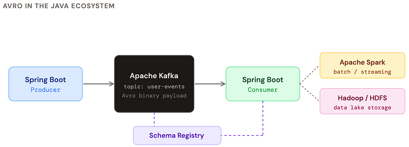

The main places you’ll encounter Avro:

- **Kafka messaging** — the most common use case. Avro is the default serialization format in Confluent’s ecosystem.
- **Apache Spark** — efficient columnar-style storage and processing of large datasets.
- **Hadoop / HDFS** — Avro files are a first-class citizen in big data pipelines.
- **Microservice event buses** — anywhere events need schema contracts enforced at runtime.
- **Data pipelines (Flink, Debezium)** — CDC and streaming ETL jobs love Avro’s compactness.

### A real Avro schema, from scratch

An Avro schema is just a JSON file that describes your record. Add it to your project under `src/main/avro/` and the Maven/Gradle plugin generates Java classes for you. Let's model a simple user event.

```json
{
  "type": "record",
  "name": "UserEvent",
  "namespace": "com.example.events",
  "doc": "Fired every time a user does something interesting",
  "fields": [
    {
      "name": "userId",
      "type": "long",
      "doc": "Internal user ID"
    },
    {
      "name": "username",
      "type": "string"
    },
    {
      "name": "action",
      "type": {
        "type": "enum",
        "name": "Action",
        "symbols": ["LOGIN", "LOGOUT", "PURCHASE", "VIEW"]
      }
    },
    {
      "name": "timestamp",
      "type": "long",
      "logicalType": "timestamp-millis"
    },
    {
      "name": "metadata",
      "type": ["null", {"type": "map", "values": "string"}],
      "default": null  // nullable field — always put null first in union!
    }
  ]
}
```

> ⚠️ THE NULL UNION TRAP

> When you have a nullable field, the union must be `["null", "YourType"]` with `null` first AND `"default": null`. Get this wrong and schema evolution will bite you later. First type in the union = default type.

### Spring Boot setup with Maven

```xml
<!-- Avro dependency -->
<dependency>
  <groupId>org.apache.avro</groupId>
  <artifactId>avro</artifactId>
  <version>1.11.3</version>
</dependency>

<!-- For Kafka: Confluent serializer -->
<dependency>
  <groupId>io.confluent</groupId>
  <artifactId>kafka-avro-serializer</artifactId>
  <version>7.5.0</version>
</dependency>

<!-- Code generation plugin -->
<plugin>
  <groupId>org.apache.avro</groupId>
  <artifactId>avro-maven-plugin</artifactId>
  <version>1.11.3</version>
  <executions>
    <execution>
      <phase>generate-sources</phase>
      <goals><goal>schema</goal></goals>
      <configuration>
        <sourceDirectory>src/main/avro</sourceDirectory>
        <outputDirectory>target/generated-sources</outputDirectory>
        <stringType>String</stringType> <!-- use java.lang.String not CharSequence -->
      </configuration>
    </execution>
  </executions>
</plugin>
```

### Using the generated class in Spring Boot

```typescript
@Service
public class KafkaProducerService {
    private final KafkaTemplate<String, UserEvent> kafkaTemplate;

    public void sendUserEvent(long userId, String username, Action action) {
        UserEvent event = UserEvent.newBuilder()   // generated Builder pattern
            .setUserId(userId)
            .setUsername(username)
            .setAction(action)
            .setTimestamp(System.currentTimeMillis())
            .setMetadata(null)
            .build();
        kafkaTemplate.send("user-events", String.valueOf(userId), event);
    }
}
```

### What serialized Avro actually looks like

Let’s lift the curtain. When Avro serializes a record, it produces a compact binary stream. No field names. No wasted space. Just bytes, in the order the schema defines them.

#### Serializing manually (no Kafka, no registry)

```java
import org.apache.avro.io.*;
import org.apache.avro.specific.SpecificDatumWriter;

UserEvent event = UserEvent.newBuilder()
    .setUserId(42L)
    .setUsername("alice")
    .setAction(Action.LOGIN)
    .setTimestamp(1700000000000L)
    .setMetadata(null)
    .build();

// Serialize to bytes
ByteArrayOutputStream out = new ByteArrayOutputStream();

DatumWriter<UserEvent> writer = new SpecificDatumWriter<>(UserEvent.class);
BinaryEncoder encoder = EncoderFactory.get().binaryEncoder(out, null);
writer.write(event, encoder);
encoder.flush();

byte[] bytes = out.toByteArray();
System.out.println("Size: " + bytes.length + " bytes");
System.out.println("Hex: " + HexFormat.of().formatHex(bytes));
// Output: 54 0a 616c 6963 65 00 80 b2 ...
// That's: userId=42, "alice", action=0(LOGIN), timestamp...
```

#### What those bytes actually mean

Let’s decode the binary output of our `UserEvent` record visually. Avro uses zigzag encoding for integers and length-prefixed strings.

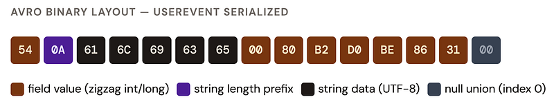

> ZIGZAG ENCODING

> Avro encodes integers using zigzag + variable-length encoding. Small numbers take fewer bytes: the number `42` becomes `0x54` (one byte!). `-1` becomes `0x01`. Large numbers can take up to 10 bytes. There are no wasted sign bits. Clever.

#### With Confluent Schema Registry (magic byte!)

When using the Confluent serializer with a Schema Registry, 5 extra bytes are prepended:

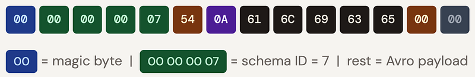

#### Deserialization, step by step

Deserialization is the reverse journey: bytes → Java object. The key insight is that Avro needs *two* schemas: the writer schema (what was used to write the data) and the reader schema (what your current code expects). When they match, it’s trivial. When they differ, Avro resolves the differences. That’s the magic of schema evolution.

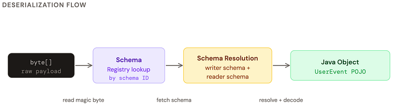

```java
import org.apache.avro.io.*;
import org.apache.avro.specific.SpecificDatumReader;

byte[] bytes = /* bytes from somewhere */;
DatumReader<UserEvent> reader = new SpecificDatumReader<>(UserEvent.class);
BinaryDecoder decoder = DecoderFactory.get().binaryDecoder(bytes, null);

UserEvent event = reader.read(null, decoder);
System.out.println(event.getUserId());   // 42
System.out.println(event.getUsername()); // "alice"
System.out.println(event.getAction());   // LOGIN

// With writer/reader schema resolution (different versions):
Schema writerSchema = /* schema that was used to write */;
Schema readerSchema = UserEvent.getClassSchema(); // your current version
DatumReader<UserEvent> resolver =
    new SpecificDatumReader<>(writerSchema, readerSchema);
// Avro will fill defaults for new fields, skip unknown fields
```

```java
// application.yml
// spring.kafka.consumer.value-deserializer:
//   io.confluent.kafka.serializers.KafkaAvroDeserializer
// spring.kafka.consumer.properties:
//   schema.registry.url: http://localhost:8081
//   specific.avro.reader: true  ← generate specific class, not GenericRecord
@KafkaListener(topics = "user-events", groupId = "my-service")
public void handleUserEvent(UserEvent event) {
    // Already deserialized! Spring + Confluent did all the heavy lifting.
    log.info("User {} performed {}", event.getUsername(), event.getAction());
    userEventProcessor.process(event);
}
```

### How to debug raw Avro — it’s not as dark as it looks

You got a byte array. Your consumer is blowing up. The logs say something unhelpful like `EOFException: Unexpected end of stream`. Welcome to Avro debugging. Let's fix this.

> 🔍 THE DEBUGGING MINDSET

> Raw Avro bytes without a schema are like IKEA furniture without instructions. You can tell something should go somewhere, but good luck figuring out which end is up. Always start with the schema.

#### Tool 1: avro-tools (official CLI)

```bash
# Download: https://avro.apache.org/releases.html
wget https://downloads.apache.org/avro/avro-1.11.3/java/avro-tools-1.11.3.jar

# Inspect an .avro file (has schema embedded in header)
java -jar avro-tools-1.11.3.jar tojson --pretty my-data.avro

# Get the schema from an .avro file
java -jar avro-tools-1.11.3.jar getschema my-data.avro

# Convert JSON → Avro binary (useful for test data)
java -jar avro-tools-1.11.3.jar fromjson \
  --schema-file user-event.avsc \
  input.json > output.avro

# Check if a file is valid Avro
java -jar avro-tools-1.11.3.jar cat my-data.avro | head -5
```

#### Tool 2: Decode in Java with GenericRecord

```java
// GenericRecord = schema-driven map-like object. No generated class needed.
byte[] suspiciousBytes = /* from Kafka, file, network */;

// If you have the schema:
Schema schema = new Schema.Parser().parse(new File("user-event.avsc"));
DatumReader<GenericRecord> reader = new GenericDatumReader<>(schema);
BinaryDecoder decoder = DecoderFactory.get().binaryDecoder(suspiciousBytes, 
                                                           null);
GenericRecord record = reader.read(null, decoder);

// Walk all fields dynamically
schema.getFields().forEach(field ->
    System.out.printf("%-20s = %s%n", field.name(), record.get(field.name()))
);

// Or convert to JSON for readability
String json = record.toString(); // GenericRecord.toString() returns JSON
System.out.println(json);
// {"userId": 42, "username": "alice", "action": "LOGIN", ...}
```

#### Tool 3: Hex dump + manual decode

```java
public static void hexDump(byte[] bytes) {
    StringBuilder sb = new StringBuilder();
    for (int i = 0; i < bytes.length; i++) {
        if (i % 16 == 0) sb.append(String.format("%n%04X: ", i));
        sb.append(String.format("%02X ", bytes[i] & 0xFF));
    }
    System.out.println(sb);
}

// Check for Confluent magic byte
if (bytes[0] == 0x00) {
    int schemaId = ByteBuffer.wrap(bytes, 1, 4).getInt();
    System.out.println("Confluent format, schema ID: " + schemaId);
    // actual payload starts at byte[5]
    byte[] payload = Arrays.copyOfRange(bytes, 5, bytes.length);
}
```

### Check the schema type without full deserialization

Sometimes you receive Avro bytes on a shared topic and need to decide which deserializer to use — *before* you know the type. Don’t deserialize everything just to throw it away. Peek at the bytes first.

```java
// Confluent wire format: [0x00][schema-id (4 bytes)][avro payload]
public Optional<String> peekSchemaName(byte[] bytes, 
                                       SchemaRegistryClient registry) {
    if (bytes == null || bytes.length < 5 || bytes[0] != 0x00) {
        return Optional.empty(); // not Confluent Avro
    }
    int schemaId = ByteBuffer.wrap(bytes, 1, 4).getInt();
    try {
        SchemaMetadata meta = registry.getSchemaMetadata(schemaId);
        return Optional.of(meta.getSchemaType()); // "AVRO"
    } catch (Exception e) {
        return Optional.empty();
    }
}

// Get the full schema without deserializing the payload
public Schema getSchemaFromBytes(byte[] bytes, SchemaRegistryClient registry)
        throws Exception {
    int schemaId = ByteBuffer.wrap(bytes, 1, 4).getInt();
    return new Schema.Parser().parse(
        registry.getById(schemaId).toString()
    );
}

// Route messages by schema name - dispatch pattern
public void routeMessage(byte[] bytes) {
    int schemaId = ByteBuffer.wrap(bytes, 1, 4).getInt();
    Schema schema = registry.getById(schemaId);
    switch (schema.getName()) {
        case "UserEvent"   -> handleUser(deserialize(bytes, UserEvent.class));
        case "OrderEvent"  -> handleOrder(deserialize(bytes, OrderEvent.class));
        case "PaymentEvent"-> handlePayment(deserialize(bytes, PaymentEvent.class));
        default -> log.warn("Unknown schema: {}", schema.getName());
    }
}
```

### Schema Registry — and can you live without it?

Schema Registry is a central server that stores and versions your Avro schemas. Instead of embedding the full schema in every message (that would defeat the purpose), you store an integer ID and look up the schema when needed.

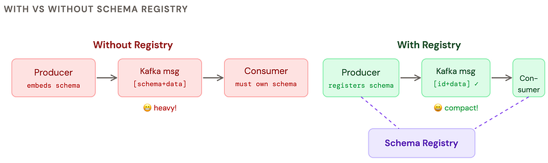

#### Can you work without Schema Registry?

Yes, absolutely. Here are your options:

#### ✅ Option 1: Embed schema in file

*Avro container files (*`.avro`*) embed the schema in the file header. Works great for batch jobs, HDFS, and Spark. No registry needed.*

#### ✅ Option 2: Schema in config / classpath

*Ship the*`.avsc` *file with your app. Every service owns a copy. Simple but schema evolution becomes manual coordination across teams.*

#### ⚠️ Option 3: Embed schema in every message

*Technically works but kills the whole point of Avro. Your 15-byte payload is now 800 bytes. Don’t do this for streaming.*

#### ✅ Option 4: Use Schema Registry

*The right choice for Kafka. Confluent’s is free and open-source. Provides compatibility checks, versioning, and central governance. Worth the ops overhead.*

```yaml
spring:
  kafka:
    bootstrap-servers: localhost:9092
    producer:
      value-serializer: io.confluent.kafka.serializers.KafkaAvroSerializer
    consumer:
      value-deserializer: io.confluent.kafka.serializers.KafkaAvroDeserializer
    properties:
      schema.registry.url: http://localhost:8081
      # Compatibility mode: BACKWARD, FORWARD, FULL, NONE
      avro.compatibility.level: BACKWARD
      specific.avro.reader: true
      # auto.register.schemas: false  ← disable in prod!
      # Let CI/CD register schemas, not the app at startup
```

### Performance — good and bad Avro model examples

Avro is fast *by default*, but a poorly designed schema can negate all the advantages. The main culprits: excessive unions, deeply nested records, and string fields where you should use enums.

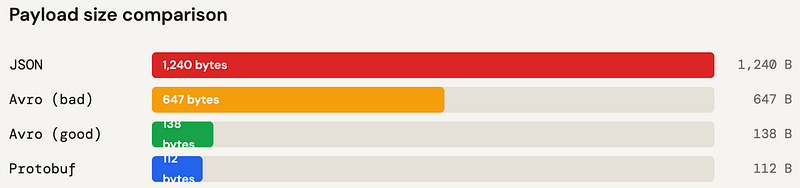

#### 😱 Bad Avro schema

```json
{
  "name": "status",
  "type": "string"  // use enum!
},
{
  "name": "amount",
  "type": "string"  // use double!
},
{
  "name": "tags",
  "type": {
    "type": "array",
    "items": {       // nested unions in
      "type": [      // arrays = slow
        "null",
        "string",
        "int"
      ]
    }
  }
}
```

#### ✅ Good Avro schema

```json
{
  "name": "status",
  "type": {
    "type": "enum",  // int index = 1 byte
    "name": "Status",
    "symbols": ["ACTIVE","INACTIVE"]
  }
},
{
  "name": "amount",
  "type": "double"   // fixed 8 bytes
},
{
  "name": "tags",
  "type": {
    "type": "array",
    "items": "string" // homogeneous!
  },
  "default": []
}
```

### Performance rules of thumb

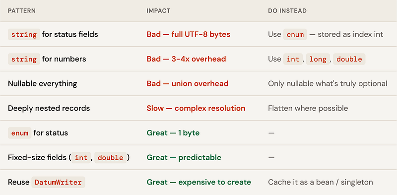

> CACHE YOUR WRITERS AND READERS

> `DatumWriter` and `DatumReader` are expensive to create. Cache them as singletons or Spring beans. Creating one per message under high load will degrade performance significantly — it involves schema parsing and reflection setup.

### Avro vs JSON — the honest comparison

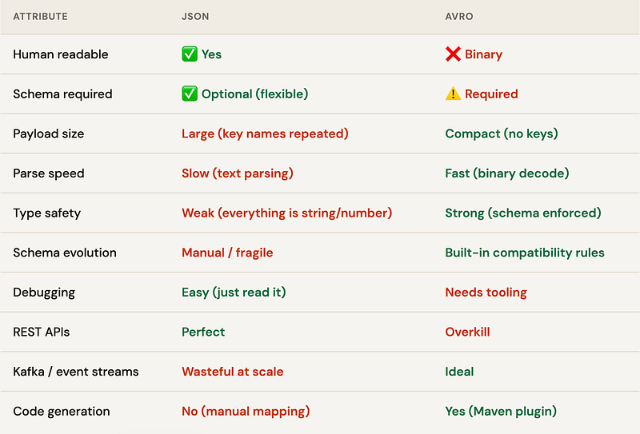

> 🏆 THE VERDICT

> Use JSON for REST APIs, config files, and anything humans read. Use Avro for event streaming, big data pipelines, and anywhere you have a schema contract between services producing and consuming millions of records. They’re not competitors — they’re different tools for different jobs.

### Versioning — how Avro handles change

This is where Avro genuinely shines over JSON. Schema evolution is a first-class feature. The rules are simple: always add fields with defaults, never remove required fields, never change types.

#### Compatibility modes

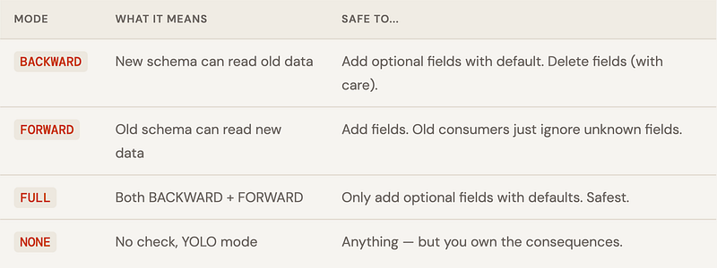

#### Safe schema changes

```json
// v1 schema
{ "name": "userId",   "type": "long" },
{ "name": "username", "type": "string" },
{ "name": "action",   "type": "..." }

// v2 schema - SAFE: added optional field with default
{ "name": "userId",    "type": "long" },
{ "name": "username",  "type": "string" },
{ "name": "action",    "type": "..." },
{ "name": "userAgent", "type": ["null", "string"], "default": null }, // ✅
{ "name": "version",   "type": "int", "default": 1 }  // ✅
// v2 reading v1 data → userAgent=null, version=1 (from defaults)
// v1 reading v2 data → userAgent and version ignored
```

#### Dangerous schema changes

```json
// ❌ BREAKING: renaming a field
{ "name": "user_id", "type": "long" }  // was "userId" — old data unreadable

// ❌ BREAKING: changing type
{ "name": "userId", "type": "string" }  // was "long" - parse error

// ❌ BREAKING: removing a required field
// (field without default - old data still has it, decoder confused)
// ✅ "Renaming" safely via aliases
{
  "name": "user_id",
  "type": "long",
  "aliases": ["userId"]   // reader can find old "userId" field by alias
}

// ✅ Adding to enum - put new values at the END
"symbols": ["LOGIN", "LOGOUT", "PURCHASE", "VIEW", "SHARE"]  // SHARE is new
// Old consumers reading new data get the default enum value
```

#### The versioning workflow with Schema Registry

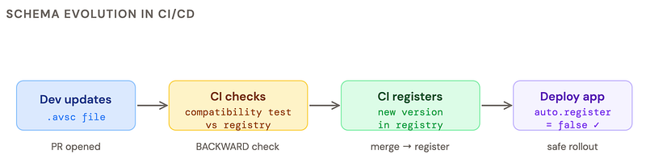

> GOLDEN RULE OF AVRO VERSIONING

> Set `auto.register.schemas=false` in production. Let your CI/CD pipeline register schemas after a compatibility check. If a developer's schema breaks backwards compatibility, you want to catch it in the PR — not at 3am in production.

#### Version badges: what each change means

#### ✅ Non-breaking

*Add optional field with default · Add enum value at end · Add alias · Add doc string*

#### ⚠️ Compatible (FULL)

*Remove optional field · Widen numeric type (int→long) with resolution*

#### ❌ Breaking

*Rename field · Change type · Remove required field · Reorder enum values · Add required field*

### The cheat sheet

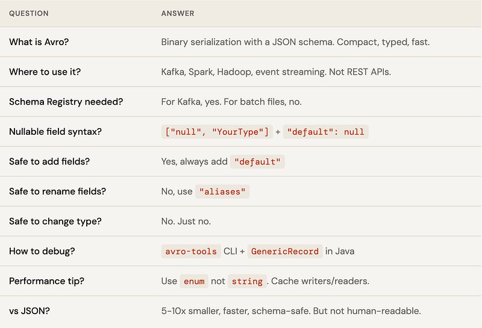
