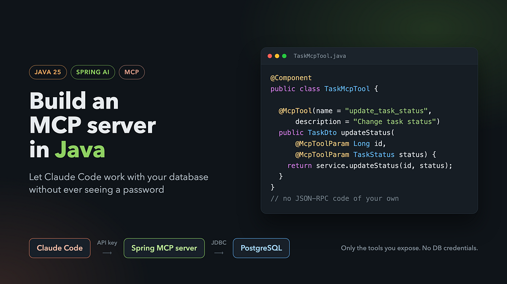
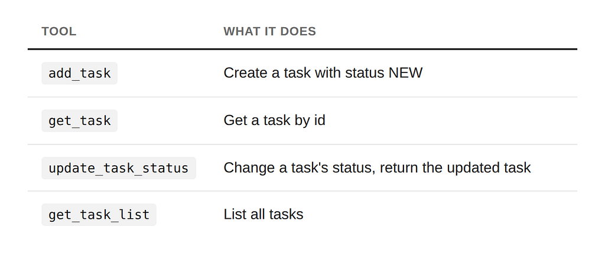
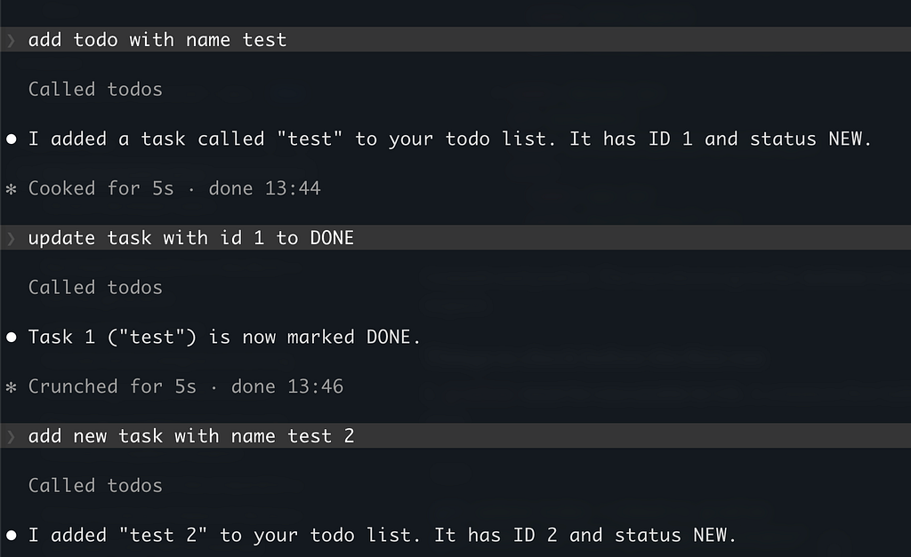

### Building an MCP Server in Java with Spring AI: Let Claude Code Use Your Database Without Seeing a Password

*Four annotated methods, one security config, and no JSON-RPC code of your own.*



In my [previous article](https://medium.com/@sukach.v.v/mcp-the-protocol-that-finally-taught-ai-to-stop-being-useless-759de3745b79) I built an MCP server from scratch in Python. I wrote the JSON-RPC 2.0 message handling, declared tool schemas by hand and wired up the STDIO transport myself. It’s a good way to learn how the protocol works on the wire.

Python isn’t the only option, though. Most of the systems I work on are Java and Spring, and that’s where the data lives. So this time I built the same kind of server in Java.

It turns out you don’t need to implement JSON-RPC yourself. Spring AI has a Boot starter for MCP servers. It handles the protocol, the transport, schema generation and tool registration. You write ordinary Spring beans and add a few annotations.

The full code is on GitHub: [SukachVitally/mcp-demo](https://github.com/SukachVitally/mcp-demo).

### Why bother: the server is the boundary

The business logic here is deliberately boring. It’s a task list: you create tasks, move them through statuses, and finish or cancel them. Swap in your own domain; the MCP part stays the same.

The point is how Claude Code reaches the data:

```
Claude Code ──HTTP + API key──▶ MCP server (Spring) ──JDBC──▶ PostgreSQL
```

- **Claude never sees database credentials.** The server holds the connection. Claude holds only an API key that works for the MCP endpoint and nothing else.
- **Claude can only do what you expose.** There’s no SQL console. If you don’t write a delete\_task tool, tasks can't be deleted, however the prompt is phrased.
- **Your validation and transactions still apply.** Every call goes through the same service layer as the rest of your application.

Giving an agent a database URL and a password is quick, but you can’t take it back. An MCP server gives the agent a small, typed and auditable API instead.

### What we’re building

A PostgreSQL table of tasks. Each task has a name and one of four statuses: NEW, IN\_PROGRESS, DONE or CANCELLED. The server exposes four tools:



Stack: Java 25, Spring Boot 4, Spring AI 2.0 MCP server, PostgreSQL 18 with Liquibase, and Spring Security.

### Step 1: Dependencies

*Source:* [*build.gradle*](https://github.com/SukachVitally/mcp-demo/blob/main/build.gradle)

```
dependencies {
    implementation 'org.springframework.boot:spring-boot-starter-data-jpa'
    implementation 'org.springframework.boot:spring-boot-starter-liquibase'
    implementation 'org.springframework.boot:spring-boot-starter-webmvc'
    implementation 'org.springframework.boot:spring-boot-starter-security'
    implementation 'org.springframework.boot:spring-boot-starter-validation'
    implementation platform('org.springframework.ai:spring-ai-bom:2.0.1')
    implementation 'org.springframework.ai:spring-ai-starter-mcp-server-webmvc'
    implementation 'org.springaicommunity:mcp-server-security-spring-boot:0.1.14'
    runtimeOnly 'org.postgresql:postgresql'
}
```

Two lines do the MCP work:

- spring-ai-starter-mcp-server-webmvc is the MCP server over HTTP on Spring MVC. There's a -webflux variant for reactive apps, and a plain spring-ai-starter-mcp-server for stdio.
- mcp-server-security-spring-boot from the [spring-ai-community/mcp-security](https://github.com/spring-ai-community/mcp-security) project adds API-key and OAuth2 support on top of Spring Security. We'll come back to it.

### Step 2: Configure the server

*Source:* [*application.yaml*](https://github.com/SukachVitally/mcp-demo/blob/main/src/main/resources/application.yaml)

```
spring:
  ai:
    mcp:
      server:
        protocol: STATELESS
        type: sync
        name: "Task MCP demo"
        instructions: >-
          Manages a simple task list. Create tasks with add_task, look them up with get_task or
          get_task_list, and move them through the statuses NEW, IN_PROGRESS, DONE and CANCELLED
          with update_task_status.
        streamable-http:
          mcp-endpoint: /mcp
```

What these settings mean:

- **protocol: STATELESS**: plain HTTP request and response, with no session kept between calls. Our tools never need to push anything back to the client, so we don't need sessions, and the server scales horizontally like any other REST service. Use STREAMABLE if you need server-to-client messages. The older SSE option is deprecated since Spring AI 2.0.
- **type: sync**: tools are ordinary blocking methods. With async, they return Reactor Mono/Flux types instead.
- **instructions**: sent to the client when it connects. It's the server's short explanation to the model of how the tools fit together. Treat it as part of the prompt.
- **mcp-endpoint: /mcp**: the URL that Claude Code will call.

### Step 3: Business logic (keep it boring)

Nothing here knows about MCP. It’s a normal JPA entity, repository and service:

*Source:* [*TaskService.java*](https://github.com/SukachVitally/mcp-demo/blob/main/src/main/java/org/example/mcpdemo/service/TaskService.java)

```
@Service
@Validated
@RequiredArgsConstructor
@Transactional(readOnly = true)
public class TaskService {
    public static final int NAME_MAX_LEN
GTH = 255;
    private final TaskRepository repository;
    private final TaskMapper mapper;
    @Transactional
    public TaskDto create(@NotBlank @Size(max = NAME_MAX_LENGTH) String name) {
        var entity = new TaskEntity();
        entity.setName(name);
        entity.setStatus(TaskStatus.NEW);
        return mapper.toDto(repository.save(entity));
    }
    @Transactional
    public TaskDto updateStatus(Long id, @NotNull TaskStatus status) {
        var entity = findEntity(id);
        entity.setStatus(status);
        return mapper.toDto(entity);
    }
    // get(id), getList(), findEntity(id) throws TaskNotFoundException ...
}
```

The service returns a small record, not the entity:

*Source:* [*TaskDto.java*](https://github.com/SukachVitally/mcp-demo/blob/main/src/main/java/org/example/mcpdemo/dto/TaskDto.java)

```
public record TaskDto(Long id, String name, TaskStatus status) {}
```

That matters more than it looks. Whatever a tool returns is serialized and handed to the model, so the DTO decides exactly which fields leave your system.

### Step 4: TaskMcpTool, the actual MCP server

This is the whole MCP layer:

*Source:* [*TaskMcpTool.java*](https://github.com/SukachVitally/mcp-demo/blob/main/src/main/java/org/example/mcpdemo/mcp/TaskMcpTool.java)

```
@Component
@RequiredArgsConstructor
public class TaskMcpTool {
    private final TaskService service;
    @McpTool(name = "add_task", description = "Create a new task with status NEW and return it")
    public TaskDto add(@McpToolParam(description = "Task name, 1-255 characters") String name) {
        return service.create(name);
    }
    @McpTool(name = "get_task", description = "Get a task by its id. Fails if the task does not exist")
    public TaskDto get(@McpToolParam(description = "Task id") Long id) {
        return service.get(id);
    }
    @McpTool(name = "update_task_status",
            description = "Change the status of a task and return the updated task. Fails if the task does not exist")
    public TaskDto updateStatus(@McpToolParam(description = "Task id") Long id,
                                @McpToolParam(description = "New task status") TaskStatus status) {
        return service.updateStatus(id, status);
    }
    @McpTool(name = "get_task_list", description = "List all tasks")
    public List<TaskDto> getList() {
        return service.getList();
    }
}
```

Only a thin adapter: each method delegates to the service. Most of the work happens in the annotations.

### How the tools get registered

The class is a plain @Component. When the application starts, Spring AI's annotation scanner finds every bean method annotated with @McpTool and registers it as an MCP tool. You don't need a registry, a ToolCallback list or any manual wiring. To add a tool, write another annotated method.

### @McpTool: the name and description the model sees

- **name** is the tool id the model calls. I use snake\_case verbs (add\_task, get\_task\_list) because that's the convention across MCP servers, and models pick such names up reliably. Without a name, the Java method name is used, and add on its own tells the model very little.
- **description** is the most important string in the class. It's the only thing the model reads when deciding which tool to call and what to expect back. Say what the tool does, what it returns and when it fails ("Fails if the task does not exist"). A vague description gives you a model that guesses.

### @McpToolParam: the schema is generated for you

Each parameter gets a description, and Spring AI builds a JSON Schema from the Java type. Here’s what the server actually returns for update\_task\_status when Claude Code asks for tools/list:

```
{
  "name": "update_task_status",
  "description": "Change the status of a task and return the updated task. Fails if the task does not exist",
  "inputSchema": {
    "type": "object",
    "properties": {
      "id":     { "type": "integer", "format": "int64", "description": "Task id" },
      "status": { "type": "string",
                  "enum": ["NEW", "IN_PROGRESS", "DONE", "CANCELLED"],
                  "description": "New task status" }
    },
    "required": ["id", "status"]
  }
}
```

Things to notice:

- **Long became** **integer with** **int64 format.** You don't write any schema by hand.
- **Parameters are required by default** (required = true). Set @McpToolParam(required = false) for optional ones.
- **The** **TaskStatus enum became a JSON** **enum.** The model sees the four allowed values up front, so it can't invent a status like DELETED. If it tries, the call is rejected by schema validation before your method runs:

```
Tool (update_task_status) input validation failed: ... /status: does not 
have a value in the enumeration ["NEW", "IN_PROGRESS", "DONE", "CANCELLED"]
```

Use enums for anything with a fixed set of values. You get validation and documentation in one place.

### Return values and errors

You return a normal Java object, and Spring AI serializes it to JSON as the tool result. TaskDto and List<TaskDto> just work.

Exceptions work too. When TaskService throws TaskNotFoundException, the client doesn't get a stack trace or a broken JSON-RPC response. It gets a tool result with isError: true and the exception message as the text:

```
{ 
  "content": [{ "type": "text", "text": "Task with id -1 is not found" }], 
  "isError": true 
}
```

That’s the behaviour you want: the model reads the message, understands what went wrong and can recover, for example by calling get\_task\_list to find the right id. Write exception messages for the model to read, not just for your logs.

The same applies to Bean Validation. A blank name fails @NotBlank in the service and comes back to the model as an error result, not a 500.

### A tip: add behaviour hints

If you look at the full tools/list response, every tool reports "readOnlyHint": false, "destructiveHint": true, including get\_task\_list. Those are the defaults. Clients such as Claude Code can use these hints to decide how cautious to be, so it's worth being honest about read-only tools:

```
@McpTool(name = "get_task_list", description = "List all tasks",
        annotations = @McpTool.McpAnnotations(readOnlyHint = true, 
                                              destructiveHint = false))
```

These are hints, not enforcement. What actually protects your data is the fact that the tool only reads.

### Step 5: SecurityConfig, briefly

By default, an HTTP MCP endpoint is an unauthenticated JSON-RPC endpoint. Anyone who can reach /mcp can call your tools. The mcp-security library closes it with a few lines:

*Source:* [*SecurityConfig.java*](https://github.com/SukachVitally/mcp-demo/blob/main/src/main/java/org/example/mcpdemo/config/SecurityConfig.java)

```
@Configuration
@EnableWebSecurity
class SecurityConfig {
    @Bean
    SecurityFilterChain securityFilterChain(HttpSecurity http,
                                            ApiKeyEntityRepository<ApiKeyEntityImpl> apiKeyRepository) {
        return http
                .authorizeHttpRequests(auth -> auth.anyRequest().authenticated())
                .with(mcpServerApiKey(), apiKey -> apiKey.apiKeyRepository(apiKeyRepository))
                .build();
    }
    @Bean
    ApiKeyEntityRepository<ApiKeyEntityImpl> apiKeyRepository(@Value("${app.mcp.api-key.secret}") String secret) {
        var key = ApiKeyEntityImpl.builder()
                .name("demo key")
                .id("demo")
                .secret(secret)
                .build();
        return new InMemoryApiKeyEntityRepository<>(List.of(key));
    }
}
```

- mcpServerApiKey() plugs API-key authentication into the normal Spring Security filter chain.
- The client sends an X-API-key header in the form `<id>.<secret>`, so `demo.<your secret>` here. Requests without it get 401.

### Step 6: Run it and connect Claude Code

Start PostgreSQL and the app:

*Source:* [*docker-compose.yaml*](https://github.com/SukachVitally/mcp-demo/blob/main/docker-compose.yaml)*,*[*.env.tpl*](https://github.com/SukachVitally/mcp-demo/blob/main/.env.tpl)*,* [*README*](https://github.com/SukachVitally/mcp-demo/blob/main/README.md)

```
cp .env.tpl .env          # sets MCP_API_KEY_SECRET
docker compose up -d
./gradlew bootRun
```

Register the server with Claude Code:

```
claude mcp add --transport http todos http://localhost:8080/mcp \
  --header "X-API-key: demo.mcp-demo-test-secret"
```

Then ask in plain language:



“Add todo with name test” becomes an add\_task call. "Update task with id 1 to DONE" becomes update\_task\_status with a valid enum value. Claude never saw a JDBC URL, a username or a password.

To inspect the server without Claude, use the MCP Inspector (npx @modelcontextprotocol/inspector). Choose the Streamable HTTP transport and add the same header.

### Testing

Because the server speaks standard MCP, the tests can use the official Java MCP client against a real server started by @SpringBootTest, with PostgreSQL in Testcontainers:

*Source:* [*TaskMcpToolTest.java*](https://github.com/SukachVitally/mcp-demo/blob/main/src/test/java/org/example/mcpdemo/mcp/TaskMcpToolTest.java)

```
var transport = HttpClientStreamableHttpTransport
        .builder("http://localhost:" + port)
        .httpRequestCustomizer((builder, method, endpoint, body, context) ->
                builder.header("X-API-key", "demo." + API_KEY_SECRET))
        .build();
client = McpClient.sync(transport).build();
client.initialize();
var result = client.callTool(McpSchema.CallToolRequest.builder("get_task")
        .arguments(Map.of("id", -1L)).build());
assertThat(result.isError()).isTrue();
```

This covers the whole chain in one test: authentication, schema, serialization, error mapping and the database.

### Takeaways

- **You don’t write JSON-RPC in Java.** spring-ai-starter-mcp-server-webmvc handles the protocol, the transport and tool discovery.
- **An MCP tool is an annotated Spring bean method.** @McpTool names and describes it, and @McpToolParam describes its inputs. The JSON Schema is generated from your Java types.
- **Descriptions and error messages are prompts.** The model reads them, so write them for the model.
- **Use enums and DTOs** to control what the model can send in and what it gets back.
- **Secure the endpoint.** API keys via mcp-security take ten lines, and OAuth2 is available when you need it.
- **The MCP server is the security boundary.** Claude Code works with your data through the operations you choose, never with your credentials.

The Python version showed how MCP works on the wire. The Spring version shows how little code you need once a framework handles it. Take the repo, replace tasks with your own domain, and give your agent an API instead of a password.

**Links**

- Demo code: [github.com/SukachVitally/mcp-demo](https://github.com/SukachVitally/mcp-demo)
- Spring AI MCP Server Boot Starter: [docs.spring.io](https://docs.spring.io/spring-ai/reference/api/mcp/mcp-server-boot-starter-docs.html)
- MCP security for Spring: [github.com/spring-ai-community/mcp-security](https://github.com/spring-ai-community/mcp-security/tree/main)
- Previous article, MCP in Python from scratch: [MCP: The Protocol That Finally Taught AI to Stop Being Useless](https://medium.com/@sukach.v.v/mcp-the-protocol-that-finally-taught-ai-to-stop-being-useless-759de3745b79)
