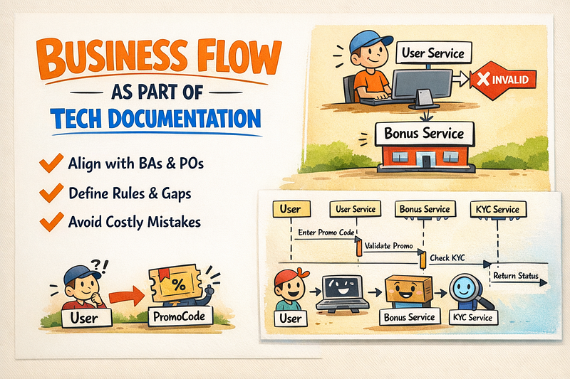
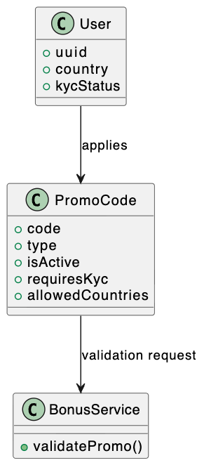
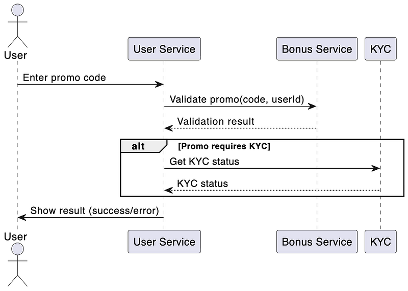

Every developer has faced the same painful situation: a huge task from a Business Analyst that doesn’t align with the technical architecture, is full of gaps, or ignores corner cases entirely.

Some developers implement only the “happy path.” Others follow the requirements literally, even when the logic becomes unnecessarily complicated. And after implementation, QA finds a long list of bugs — mostly in those forgotten corner cases.

Why does this happen? Because the business flow is unclear, incomplete, or not aligned with how the system actually works.

So the real question is: **what can we do about it?**

### The Problem: Requirements Without Technical Reality

When requirements are unclear, developers start asking dozens of questions. This often leads to:

- endless discussions
- huge text descriptions nobody wants to read
- BA writing tasks without proper refinement
- no long‑term vision of how the feature will evolve
- unpredictable complexity during implementation

In many cases, BAs don’t have the full requirements in advance. So developers cannot predict how to make the code extensible or in which direction the feature will grow.

### A Practical Example: Promo Code Validation

Imagine a simple feature:

> *“User enters a promo code during registration.”*

BA writes a task:

- Validate promo code
- Apply bonus
- Show error if invalid

But they don’t know:

- validation is done by another service
- promo codes can expire
- some promo codes require KYC
- some promo codes are region‑restricted
- some promo codes cannot be used during registration

Developers implement the happy path. QA finds 12 bugs. Business says: “We didn’t think about these cases.”

This is exactly where **technical documentation with business flow** saves the project.

### Step 1: Start With a Clean Page

Create a technical document for the new feature.

Include:

- general information
- goals
- links to BA tasks
- assumptions
- non‑goals

This becomes the foundation for the entire team.

### Step 2: Introduce Domain Models

Before writing any code, define the domain model.

#### Example Domain Model (PlantUML)

This already clarifies:

- what data is needed
- what validations exist
- what dependencies are involved

### Step 3: Use Sequence Diagrams to Show the Real Flow

This is where PlantUML becomes your best friend.

#### Example Sequence Diagram

This diagram shows:

- dependencies
- order of operations
- conditional logic
- where delays may occur
- where errors may appear

BAs can read it and finally understand the technical reality. Developers get a clear, visual flow instead of long text. QA gets a map of what to test.

### Step 4: Add Technical Restrictions and Limitations

This is the most important part.

#### Example Restrictions

- Promo validation must be asynchronous.
- KYC service has 500ms latency.
- Bonus Service rejects expired or region‑restricted promos.
- User Service cannot override Bonus Service decisions.
- Promo cannot be applied after registration is completed.

This prevents unrealistic expectations and protects the team from unnecessary refactoring later.

### Step 5: Review With the BA Team

Schedule a short call.

Walk through:

- the diagrams
- the flow
- the limitations
- the corner cases

BAs will usually adjust the business flow after seeing the technical reality. Together, you choose the best solution — not just the fastest or the most “business‑friendly.”

After the review, get approval. Now you have an official document that covers the entire feature.

### Step 6: Use the Document as the Task Description

Instead of writing long Jira descriptions, simply:

- add a short introduction
- attach a link to the documentation
- include the relevant documentation block

Every developer can open the document and see the full picture.

This also enables TDD or BDD because the flow is fully defined.

### Step 7: Maintain the Document After Release

When the feature goes to production:

- create a “Bugs” section
- add every issue found
- note which ones are not bugs
- update the flow if needed

Support teams can start from this document before asking questions. The documentation evolves naturally and stays alive.

### Final Benefit

BAs become aware of all technical limitations. Next time, there are no surprises like “we need a total refactoring.” And if refactoring is required, it becomes a shared responsibility — not just a development problem.
