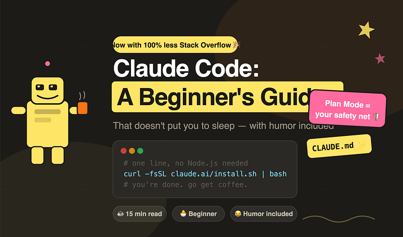
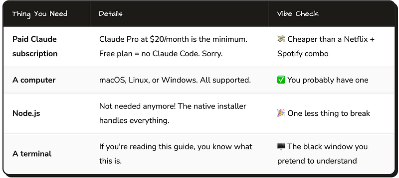
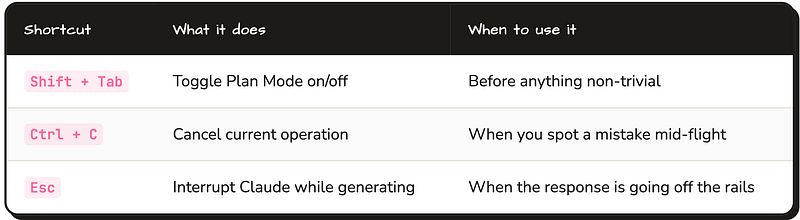
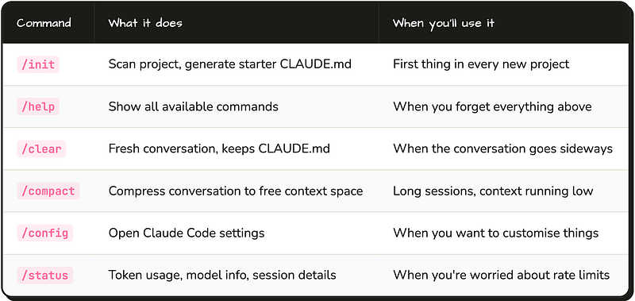

For developers who want an AI in their terminal and still have no idea what CLAUDE.md is. You’ve come to the right place.



### 🤔 What Even IS Claude Code?

Okay so you’ve heard of GitHub Copilot, right? Claude Code is like that, except instead of whispering suggestions into your IDE like a shy intern, it’s a **full-blown agentic assistant that lives in your terminal** and acts like a senior developer who has had three espressos and is ready to ship.

It can read your *entire codebase*, plan multi-step changes, edit multiple files, run your tests, and even commit code. All from the command line. No IDE plugin. No browser tab. Just you, your terminal, and your new AI best friend who never judges you for that 200-line method you wrote at 2am.

> 🧠 Fun fact

> Claude Code holds up to **200,000 tokens** of context in memory. That’s your entire project, your architecture docs, and probably your unfinished README — all at once. Copilot gets about 8,000. Do the math.

The key difference from other AI tools: Claude Code is **agentic**. It doesn’t just suggest — it *does*. Ask it to “add authentication to the user service” and it’ll actually read your code, figure out what you’re using, and make it happen. It’s the difference between a GPS giving you directions and a GPS that also drives the car.

> “I used to Google ‘how to reverse a string in Java’ every single time. Now Claude just does it for me. My Google history has never been cleaner.”

### 💳 Prerequisites (Yes, You Need to Pay)

Sorry, no free lunch here. But the good news is the cheapest plan already includes everything you need to get started:



> ⚠️ Heads up

> If you run a lot of Claude Code sessions simultaneously, you’ll burn through your rate limits faster than a frontend dev burning through `console.log()` statements. Claude Max ($100–200/month) exists for that use case.

### ⚙️ Installation (The Easy Part, We Promise)

One line. That’s it. No npm, no Homebrew tap, no reading a 47-step Medium article. Just paste this and go make a coffee while it installs:

#### macOS / Linux

```bash
# This one line is doing more work than you did all morning
curl -fsSL https://claude.ai/install.sh | bash

# Make sure it worked
claude --version
```

#### Windows (PowerShell)

```bash
# For our Windows friends. No judgment. (Okay, maybe a little.)
irm https://claude.ai/install.ps1 | iex
```

### Homebrew (macOS, if you’re fancy)

```css
brew install --cask claude-code
```

> 🚫 Don’t do this

> The old way — `npm install -g @anthropic-ai/claude-code` — is **officially deprecated**. If you used it before, run `claude install` to migrate. Your npm-installed past is a mistake you can fix.

### First launch: authenticate

Run `claude` in any directory. A browser window opens, you log in with your Claude account, and boom — you're in. If you're behind a corporate firewall that blocks OAuth callbacks (classic), use an API key via the `ANTHROPIC_API_KEY` environment variable instead.

> 💡 Pro tip

> If it fails to authenticate, check your `.claudeignore` isn't too aggressive. Actually wait — you don't have one yet. Never mind, you're fine. Keep going.

### 🐣 Your First Session (Don’t Panic)

Navigate to your project and type `claude`. You'll see the Claude Code prompt. Here's the crucial part: **don't just immediately say "build me a feature."** That's like hiring a new developer and skipping the entire onboarding process. Claude needs context. Give it a tour first.

1. **Run** `/init`**— Let Claude scan your project***This generates a starter* `CLAUDE.md` *file. Claude reads your directory structure, sniffs out your build system and test framework, and writes a first draft. It's like Claude doing its own onboarding. Adorable and useful.*
2. **Ask Claude to explain things before touching them***Try: “Explain the architecture of this project.” or “How does authentication work here?” Claude builds a mental model of your code. You’ll get better results when it actually understands what it’s working with.*
3. **Enable Plan Mode with Shift+Tab before any change***Claude will describe exactly what it intends to do before touching a single file. Think of it as asking a surgeon to show you the plan before they start cutting. Highly recommended.*
4. **Review → Approve → Commit → Repeat***Read the diff. Run your tests. Commit small. If Claude did something weird, a small commit is easy to revert. “I deleted the database” is much funnier as a story than an actual incident.*

### ✨ The CLAUDE.md File (Where the Magic Lives)

This is the most important thing in this whole guide. Read it twice.

`CLAUDE.md` is a Markdown file you put in your project root. Claude reads it **automatically at the start of every single session**. It's like a briefing document for your AI colleague — except unlike your actual team's onboarding docs, people actually read this one.

Without it, Claude starts every session with zero context about your project, your conventions, your stack, your rules. *With* it, Claude starts every session knowing exactly how you work.

> **🎯 The one-sentence summary:** CLAUDE.md is your project’s brain dump, and Claude will actually remember and use everything you put in it — unlike that Wiki your team hasn’t touched since 2022.

#### A real CLAUDE.md for a Spring Boot project

Here’s a solid example for a Java/Spring Boot/PostgreSQL stack:

```markdown
# CLAUDE.MD
## Project
REST API for customer order management. Java 17, Spring Boot 3,
PostgreSQL 15, deployed on AWS EKS via Helm + ArgoCD.

## Commands
- Build:   `./mvnw clean package -DskipTests`
- Test:    `./mvnw test`
- Run:     `./mvnw spring-boot:run`
- Lint:    `./mvnw checkstyle:check`
## Architecture
- Layered: Controller → Service → Repository (Spring Data JPA)
- Async events via Spring ApplicationEventPublisher
- DB migrations: Flyway (src/main/resources/db/migration)
- All config via environment variables. No hardcoded secrets. Ever.
## Conventions
- Constructor injection only. @Autowired on fields is a war crime.
- All endpoints return ResponseEntity with standard error envelope
- Unit tests: JUnit 5 + Mockito. Integration tests: @SpringBootTest + Testcontainers
- Commits: imperative mood, max 72 chars ("Add order validation", not "Added")
## Hard Rules
- Never modify existing Flyway migration files. Never.
- Never commit .env or application-local.properties
- No wildcard imports
```

> 💡 Pro tip

> **Commit your CLAUDE.md to Git.** Every teammate then gets the same Claude setup automatically. No more Claude giving one dev constructor injection advice and another dev `@Autowired` advice in the same codebase.

### 📝 CLAUDE.md Best Practices (What Actually Works)

#### Keep it under 100 lines

Seriously. For every line you add, ask: *“Would removing this cause Claude to make a mistake?”* If no, delete it. A fat CLAUDE.md with 500 lines of noise is worse than a lean one with 60 lines of signal. Less is more. (Yes, the same rule applies to your commit messages.)

#### Use the WHY / WHAT / HOW structure

- **WHY** — One paragraph on what the project exists to do. Domain context matters. Claude giving advice on an e-commerce API vs a healthcare API should feel different.
- **WHAT** — Tech stack, key dependencies, deployment target. Be specific about versions.
- **HOW** — Exact commands. Exact conventions. Your team’s particular quirks. The stuff Claude can’t infer from the code alone.

#### ✅ Good things to put in CLAUDE.md

- Build, test, lint, run commands — saves Claude from guessing and running the wrong thing
- Architecture summary — layers, patterns, where important things live
- Non-obvious rules — things that would surprise a new dev (“never modify migration files”)
- Testing philosophy — unit vs integration, which frameworks, naming conventions
- Things that have burned you before — sprinkle your trauma in there

#### 🚫 Things NOT to put in CLAUDE.md

- Code style rules your linter already enforces — don’t tell Claude twice what Checkstyle already screams about
- Secrets, passwords, API keys — you know this, but we’re saying it anyway
- Entire config files pasted in — link or summarise, don’t paste 200 lines of XML
- Your personal frustrations about legacy code — Claude doesn’t need your trauma dump

#### Bonus: Sub-directory CLAUDE.md for big projects

Monorepo? Complex project with distinct modules? Put a `CLAUDE.md` inside subdirectories too. Claude reads and merges them — the root file is the global rules, the subdirectory file adds module-specific context. Like a company handbook + a team-specific playbook.

```bash
# SRC/NOTIFICATION-SERVICE/CLAUDE.MD
## Notification Service
Handles email + push via AWS SES and SNS.
Templates: src/main/resources/templates (Thymeleaf).

## Module Rules
- All outbound calls MUST go through NotificationGateway
- Do not call SES/SNS directly from service classes
- Retry logic: Spring Retry handles it. Don't add your own loops.
```

### 🙈 The .claudeignore File

Like `.gitignore` but for Claude. It tells Claude which files to skip so it doesn't waste context on your `target/` folder and doesn't accidentally read your `.env` file out loud during pair programming.

```bash
# .CLAUDEIGNORE# Build output — Claude doesn't need to read your compiled bytecode
target/
build/
dist/

# Secrets - for the love of all that is holy
.env
.env.local
application-local.properties
*.pem
*.key
# Dependencies - it knows what Spring Boot is, trust it
node_modules/
.gradle/
# Generated code (if you don't want Claude accidentally "fixing" it)
src/generated/
```

> 🚫 Classic mistake

> Adding something too broad like `*.java` to `.claudeignore`. Now Claude can't read any of your source files. It will be very polite about it but also completely useless. Be specific with your ignore patterns.

### 🛡️ Plan Mode (Look Before You Leap)

Plan Mode is what separates “Claude deleted half my project” stories from “Claude is amazing” stories. Before making any changes, Claude tells you *exactly* what it plans to do: which files it’ll touch, what changes it’ll make, and why. You say yes or no. Then it acts.

> **⌨️ Just press** `Shift + Tab` **to toggle it on.** That's it. Best keyboard shortcut you'll use today.



> 😌 Wisdom

> As a beginner, use Plan Mode for *everything*. As you build trust in Claude’s output quality (and your own CLAUDE.md), you can skip it for small, well-understood tasks. Think of it like asking your junior dev to write tests first vs. just letting your senior dev rip.

### 🔄 The Holy Workflow: Explore → Plan → Implement → Commit

This is Anthropic’s official recommended workflow. It sounds obvious but most beginners skip the first two steps, and that’s why they end up on Reddit asking why Claude rewrote their entire service layer.

1. **🔍 Explore — read before you write***Ask Claude to explain the relevant parts of your code before asking it to change anything. “How does order processing work in this project?” Claude builds a proper mental model. Future changes will actually fit your architecture.*
2. **📋 Plan — agree on the approach***Enable Plan Mode. Describe what you want. Push back on the plan if something seems wrong. This is the cheapest place to catch misunderstandings — before any code is written.*
3. **⚙️ Implement — let Claude cook***With the plan approved, Claude implements. Watch the output. If something looks off, hit* `Ctrl+C`*. Don't let it finish a 15-file change that you already know is wrong by file 3.*
4. **✅ Commit — small and often***Review the diff. Run tests. Commit. Small commits are your insurance policy. “Revert one small commit” is a two-second job. “Unravel three hours of AI-generated changes” is a Thursday afternoon you’ll never get back.*

“I skipped the Explore step, asked Claude to ‘refactor auth’, and watched it replace my entire session management layer in 45 seconds. It was beautiful and terrifying in equal measure.”

### ⌨️ Commands Cheat Sheet

Type these inside an active Claude Code session (the ones starting with `/`):



### CI/CD / Scripting mode

Claude Code has a `--print` flag for non-interactive use. Perfect for Jenkins pipelines, GitLab CI jobs, or any situation where you want Claude to run and exit without waiting for your input:

```bash
# Run a single command and exit — great for pipelines
claude --print "Summarise changes in the last 5 commits"

# Works great in your Jenkinsfile or .gitlab-ci.yml
claude --print "Check this changeset for obvious bugs" --no-color
```

> 💡 Bonus tip

> The `/clear` command is your friend. When a conversation has gone on too long and Claude starts giving weird answers, clear it. CLAUDE.md re-loads automatically, so you lose the conversation but not the context. Fresh start, same configuration.

### 🎒 The “I’m Late to a Meeting” Summary

- Install with one `curl` command — no Node.js, no npm, no fuss
- You need a paid plan — Claude Pro at $20/mo is enough to start
- Run `/init` in every new project. Do it now. Do it always.
- CLAUDE.md = Claude’s briefing doc. 50–100 lines, WHY/WHAT/HOW structure
- Commit CLAUDE.md to Git — the whole team benefits, zero extra effort
- Always use Plan Mode (`Shift+Tab`) before non-trivial changes
- Workflow: Explore → Plan → Implement → Commit. In that order. Always.
- Use .claudeignore to keep secrets and build junk out of Claude’s sight
- Keep commits small — your future self will thank you
- Update your CLAUDE.md as your project grows — stale instructions cause chaos
