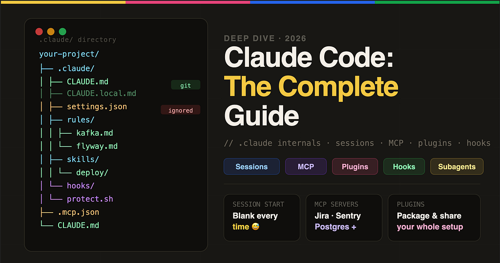

### The Agentic Loop (How Claude Actually Thinks)

Before anything else, you need to understand what makes Claude Code different from your IDE’s autocomplete. Autocomplete guesses the next word. Claude Code runs a loop — it gathers context, takes action, verifies results, then repeats until the task is done. Think of it less like a text editor feature and more like a developer who works asynchronously while you make coffee.

The loop has three phases that blend together depending on the task:

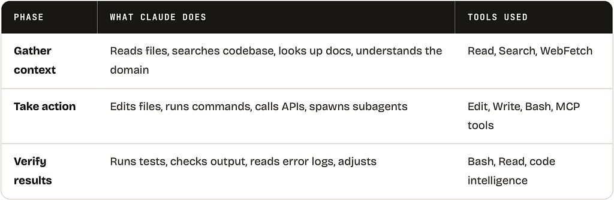

The loop adapts to what you ask. A question might only hit phase 1. A bug fix cycles through all three phases multiple times. A full feature might chain dozens of tool calls before Claude surfaces for air. You’re part of the loop too — you can interrupt at any point with Ctrl+C and steer it in a different direction.

> **THE HONEST SUMMARY**

> Claude Code is basically a language model with access to your entire computer strapped to it. It can read everything, run anything you could run from a terminal, and it just keeps going until it either finishes the task or you tell it to stop. This is either exhilarating or terrifying depending on how much you trust your test coverage.

### Sessions & How Claude Remembers (Or Doesn’t)

Here’s the thing about Claude: **every session starts with a completely blank memory.** No recollection of last week’s chat. No memory of that convention you mentioned. Tabula rasa. Every. Single. Time. If you don’t explicitly persist knowledge, it’s gone when the session closes.

This isn’t a bug — it’s how LLMs work. But Claude Code gives you two mechanisms to work around it:

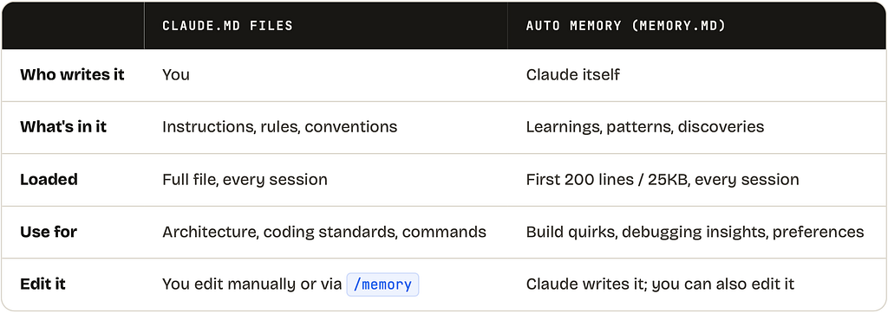

#### How a session actually starts

When you run claude in a directory, here's what happens in the first few seconds before you've typed anything:

1. **Settings load (all scopes)**Global ~/.claude/settings.json → project .claude/settings.json → local .claude/settings.local.json. Scalar settings use the most specific value; array settings (like permissions) merge across all scopes.
2. **MCP servers connect**All configured MCP servers from .mcp.json and ~/.claude.json start up. Tool schemas are deferred and load on demand. If a server fails to connect, Claude continues without it — it just loses those tools.
3. **CLAUDE.md files load into context**Org-level → user-level (~/.claude/CLAUDE.md) → project-level (./CLAUDE.md) → local (./CLAUDE.local.md). Plus your ~/.claude/MEMORY.md auto memory. All of this costs context window tokens immediately.
4. **Plugins activate**All enabled plugins load their skills, hooks, MCP servers, and settings. Run /reload-plugins to activate changes mid-session.
5. **Session is ready**You see the prompt. Everything above has already happened. Claude now has your project context and is ready to work.

> **CONTEXT WINDOW BUDGET**

> Everything loaded at startup costs tokens before you type a single character. A bloated CLAUDE.md, a dozen MCP servers, and a large MEMORY.md can eat a significant chunk of your context window. Run /status to see current token usage. Use /compact when a session gets long.

### The .claude Directory — Every Folder Explained

The .claude/ folder is Claude Code's configuration home in your project. There's also ~/.claude/ in your home directory for global settings. Here's the complete layout with every file and folder you'll actually encounter:

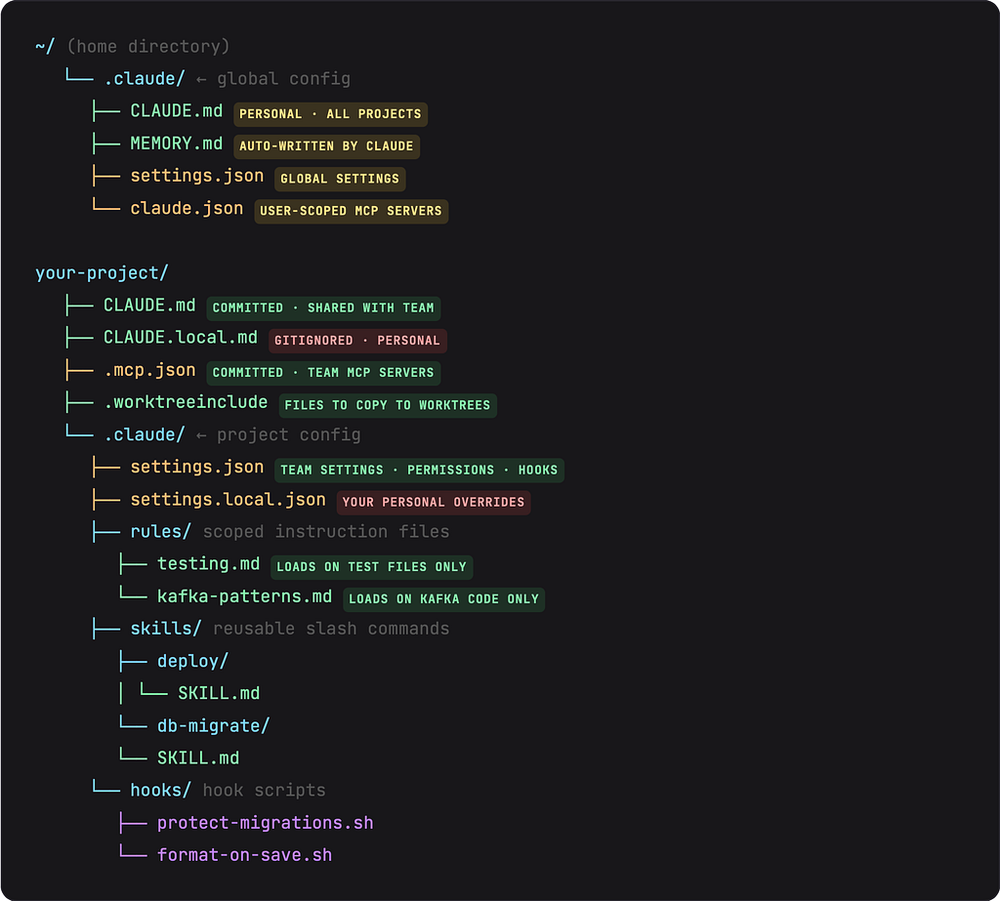

> **COMMIT STRATEGY**

> Everything marked **committed** should go in Git so your whole team gets the same Claude setup. Everything marked **gitignored** is personal — Claude automatically adds settings.local.json to your global Git ignore. Add CLAUDE.local.md to your project's .gitignore manually.

### CLAUDE.md — The Full Story

You’ve heard about CLAUDE.md. Everyone mentions it. But few people explain the *entire* system behind it, which has four separate scope levels that load in a specific order:

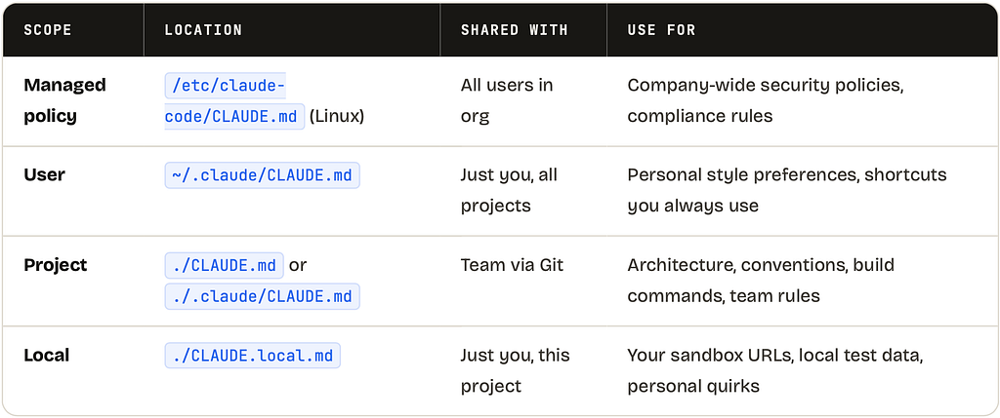

They load in that order — managed first, local last. More specific scopes appear later in the context window, giving them higher effective priority.

#### What to actually put in CLAUDE.md

The golden rule: add something to CLAUDE.md when Claude makes the same mistake a second time. Here’s a battle-tested example for a Spring Boot project:

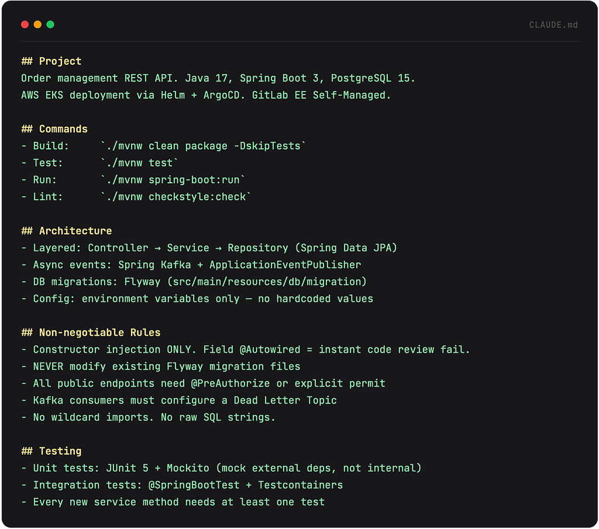

> **SIZE MATTERS**

> Target under 200 lines per CLAUDE.md. Longer files still load fully but adherence drops. If it’s getting long, split topic-specific rules into .claude/rules/ files and skills for complex procedures — they load conditionally and save your context window.

#### Auto Memory (MEMORY.md)

This is the magical part most people miss. Claude can write its own notes — automatically. When you correct Claude, it optionally remembers that correction for next session in ~/.claude/MEMORY.md. The first 200 lines or 25KB load at the start of every session.

Enable it with /memory in session or toggle it in settings. Then: tell Claude something once, it remembers it forever (until you delete the entry). This is how you get a Claude that feels like it's been on your team for months.

### settings.json — The Enforcement Layer

There’s a critical distinction most people miss: **CLAUDE.md is guidance Claude reads.settings.json is configuration Claude Code enforces.** One is a polite suggestion. The other is a locked door.

Settings live in .claude/settings.json (project/team) and .claude/settings.local.json(personal overrides). Here's what you can configure:

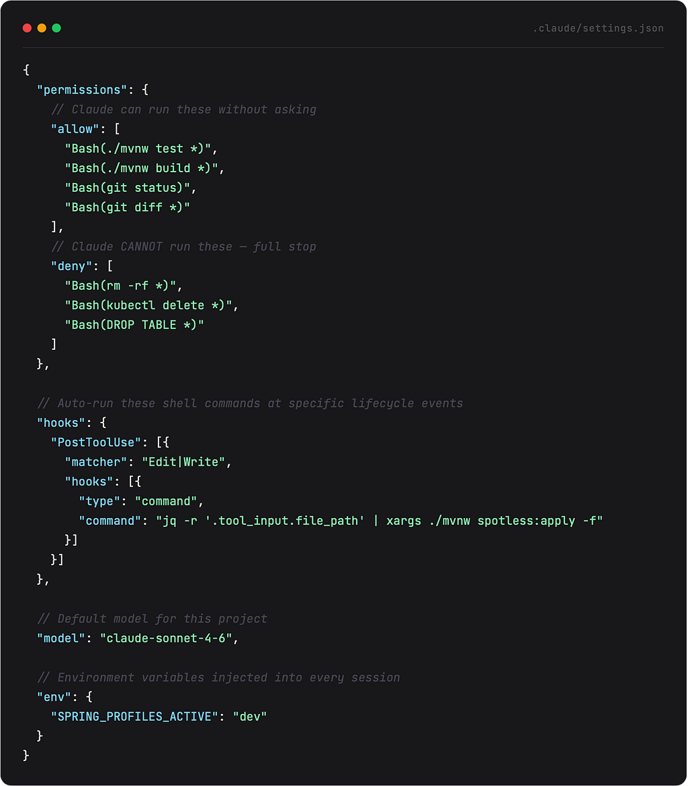

> **ALLOW VS DENY PRECEDENCE**

> Deny rules always win over allow rules. If you allow Bash(kubectl \*) and deny Bash(kubectl delete \*), the delete command is blocked. Patterns support wildcards — Bash(npm test \*)matches any command starting with npm test.

### rules/ — Scoped Instructions That Load On Demand

Once your CLAUDE.md hits 200 lines, start splitting it into .claude/rules/. Rules are Markdown files that can load *conditionally* based on which files Claude is working with — only when it reads a file that matches the rule's path pattern. This keeps your global context lean while ensuring Claude gets the right rules at the right time.

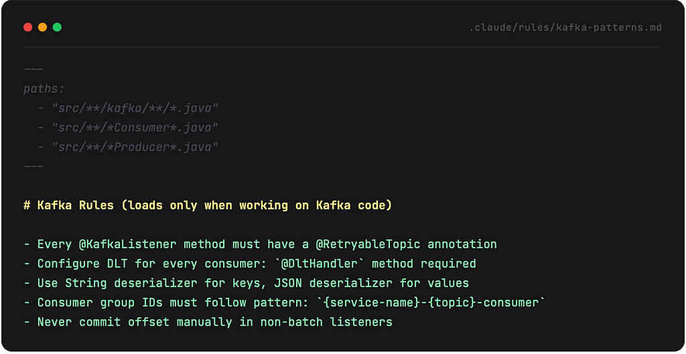

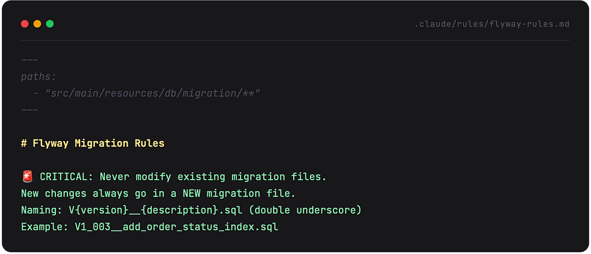

> **THE REAL POWER**

> A rule file without paths: frontmatter loads every session like CLAUDE.md. A rule WITH paths:only loads when Claude reads a matching file. This means your Kafka rules don't eat context window during a CLAUDE.md update, and your migration rules only appear when Claude actually opens a migration file.

### skills/ — Your Custom Slash Commands

Skills are reusable prompts you or Claude can invoke by name using /skill-name. Think of them as saved workflows — things you do repeatedly that are more than a one-liner but less than a custom tool. You write the instructions once in a SKILL.md, and invoke it whenever you need it.

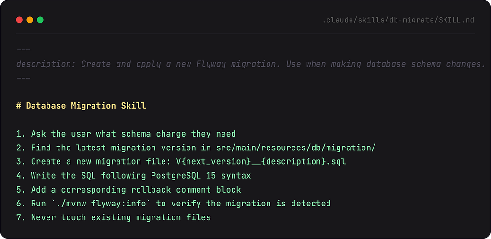

Now you type /db-migrate and Claude walks through all seven steps. No more explaining the process from scratch every time. Skills also accept arguments via $ARGUMENTS:

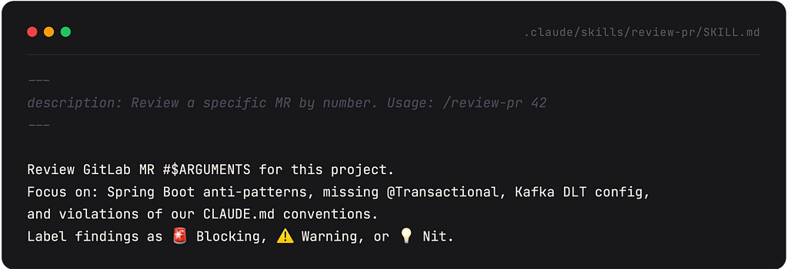

Usage: /review-pr 127 — Claude reviews MR #127 with your exact conventions baked in.

> SKILLS VS COMMANDS

> You may see references to .claude/commands/ in older docs — this is the same mechanism as skills. For new workflows, use skills/ instead: same /name invocation, plus you can bundle supporting files alongside the SKILL.md.

### Hooks — The Automation Engine

Hooks are shell commands that fire automatically at specific points in Claude’s lifecycle. They’re deterministic — they *always* run when triggered, regardless of what Claude decides. This is the difference between “please format the file” (Claude might forget) and “PostToolUse hook runs Spotless” (it definitely happens).

#### Available hook events

**PreToolUse***Fires before any tool call. Can block execution (exit 2). Use to protect files or validate commands.*

**PostToolUse***Fires after a tool completes. Perfect for auto-formatting files after Claude edits them.*

**Notification***Fires when Claude needs your input. Desktop notification so you don’t stare at the terminal.*

**SessionStart***Fires when a session begins. Inject additional context, set environment, run setup scripts.*

**PreCompact***Fires before conversation compaction. Re-inject context that would otherwise be lost.*

**Stop***Fires when Claude finishes a response. Useful for post-response validation or logging.*

### Practical examples for a Java/Spring Boot project

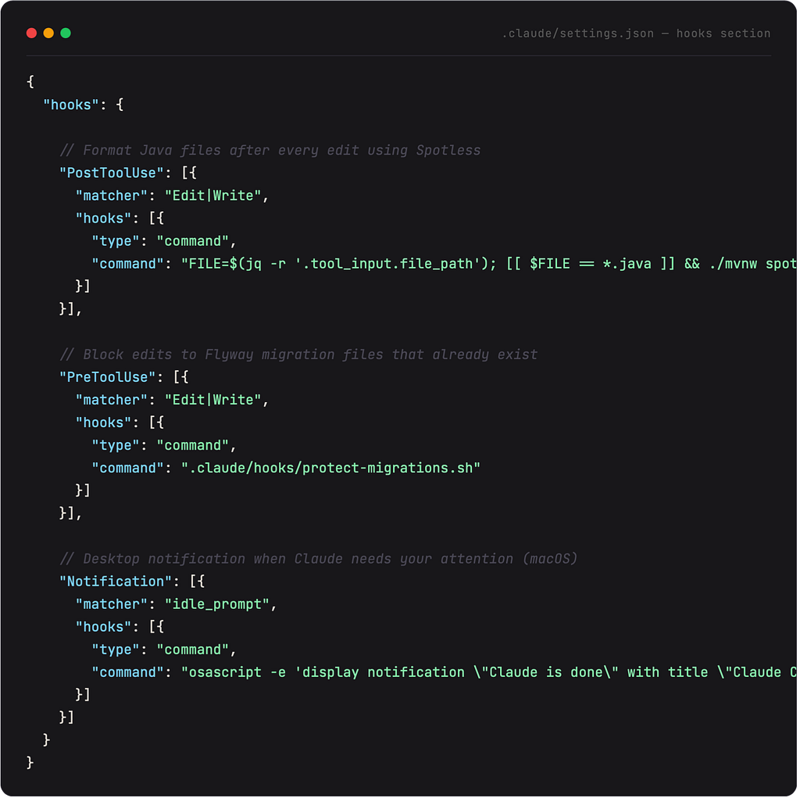

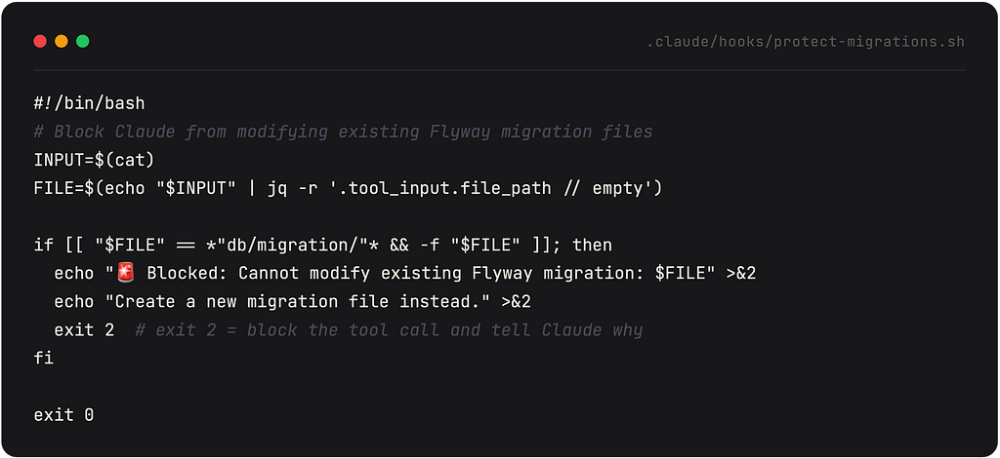

> **EXIT CODES MATTER**

> exit 0 = allow. exit 1 = warn Claude but let it continue. exit 2 = hard block — Claude gets told why and has to try something else. It's the digital equivalent of a bouncer who also explains the dress code.

### MCP — Connecting Claude to the World

Model Context Protocol (MCP) is an open standard for connecting AI to external tools. Without MCP, Claude can only see your filesystem and run terminal commands. With MCP, Claude can query your Jira board, check Sentry errors, read Slack messages, query your PostgreSQL database, and more — all without you copying and pasting anything.

> **THE MENTAL MODEL**

> MCP is how Claude gets a login to your tools. Without it: “here’s a pasted error from Sentry.” With it: “Claude, check what errors happened in prod in the last hour and correlate them with my recent commits.”

#### Three types of MCP servers

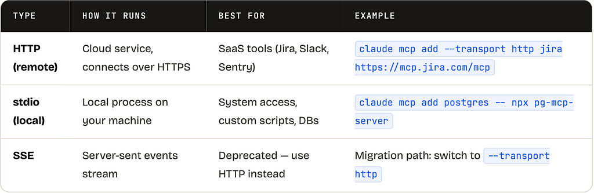

#### Project-scoped MCP (.mcp.json)

Put your team’s MCP servers in .mcp.json at the project root. This file gets committed to Git so everyone on the team gets the same tools:

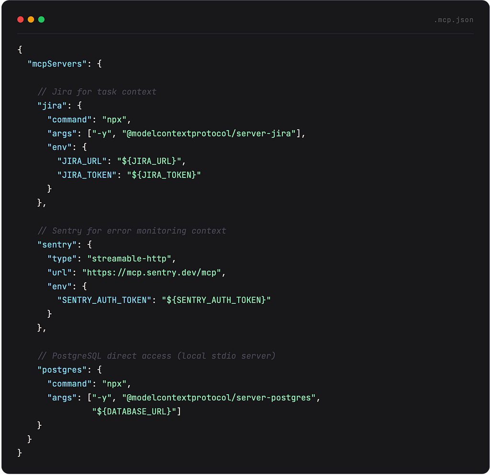

#### User-scoped MCP (personal tools)

For tools only you need (not your team), use the --scope user flag. This writes to ~/.claude.json instead of .mcp.json:

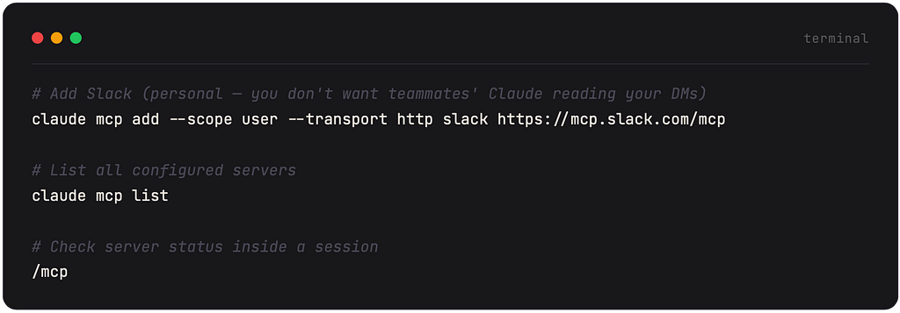

> **CHANNELS: MCP THAT PUSHES TO CLAUDE**

> Normal MCP is pull — Claude queries a server when it needs something. Channels flip this: an MCP server *pushes* messages into your running session. This means Claude can react to CI results, monitoring alerts, or Slack messages while you’re doing something else. Enable with --channelsflag on startup.

### Plugins — Package & Share Everything

Everything you’ve built — skills, hooks, MCP servers, rules — can be packaged into a **plugin** and shared with your team, your org, or the whole world. Plugins are just directories with a .claude-plugin/plugin.json manifest. They're the difference between "config that lives in one project" and "config that lives everywhere."

#### Standalone config vs plugins

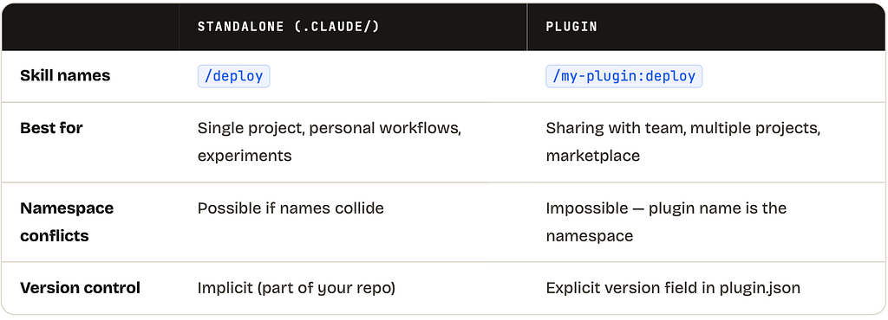

#### Plugin structure

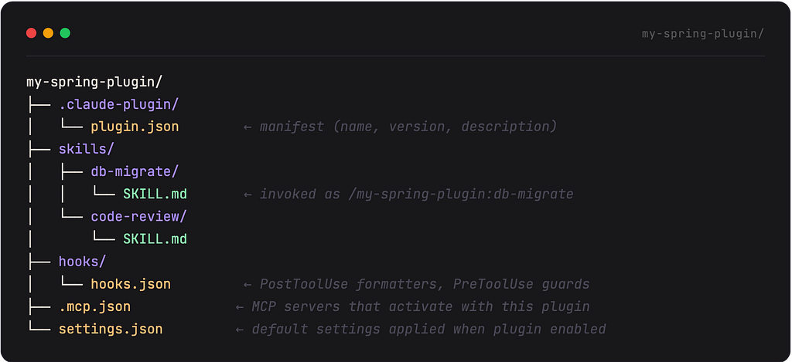

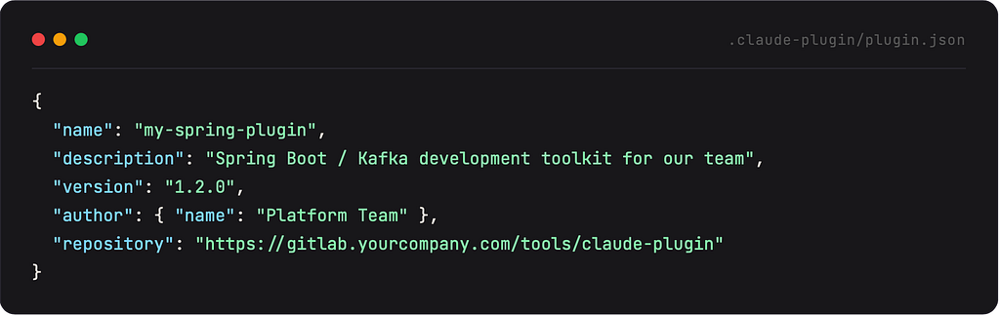

#### Installing a plugin

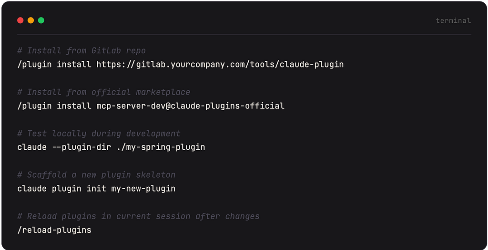

> **THE REAL VALUE**

> Your platform team builds a plugin once with all the Spring Boot conventions, Kafka rules, code review skills, and MCP servers your org uses. Every developer installs it once. Every project gets the same setup. No more “did you add the Flyway rules to your CLAUDE.md?” Slack messages.

### Subagents — Claude Spawning Claude

This is the part where things get genuinely science-fiction. Subagents let Claude spin up *other Claude instances* to handle subtasks in parallel or in isolated contexts. The main Claude orchestrates; the subagents execute. Think distributed computing, but the workers are also AI and can also spawn more workers.

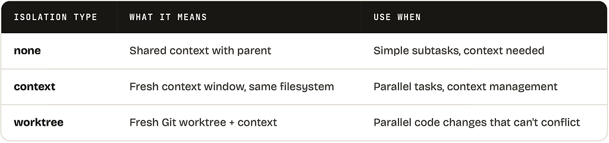

Subagents can maintain their own MEMORY.md too. Imagine a "database specialist" subagent that remembers every schema change it's ever helped with. That's the direction this is heading.

> **WHEN TO USE SUBAGENTS**

> For most day-to-day tasks, you don’t need subagents. They’re most useful when you have truly parallel workstreams (implement feature A and feature B simultaneously without conflicts), when you need a clean context for a specific task, or when you’re building automation pipelines that run without human interaction.

### Complete Quick Reference

- **.claude/settings.json** — permissions + hooks + model config. Enforced, not just read.
- **CLAUDE.md** — persistent instructions. Team version in ./CLAUDE.md, personal in ~/.claude/CLAUDE.md.
- **MEMORY.md** — auto-written by Claude. Persists learnings across sessions (200 lines / 25KB limit).
- **.claude/rules/** — conditional instruction files. Use paths: frontmatter to load only for relevant files.
- **.claude/skills/** — custom /commands. Each skill = a folder with SKILL.md. Accepts $ARGUMENTS.
- **hooks** — deterministic automation. PreToolUse (block/allow), PostToolUse (format), Notification (alert).
- **.mcp.json** — team MCP servers (committed). ~/.claude.json for personal servers.
- **Plugins** — packaged, shareable bundles of skills + hooks + MCP + settings. Install with /plugin install.
- **Subagents** — parallel Claude instances for complex multi-track workflows. Three isolation levels.
- **/init** — always run first in a new project. Generates CLAUDE.md automatically.
- **/compact** — compresses long sessions. **/clear** = fresh start (CLAUDE.md reloads).
- **/mcp** — shows server status + tool count. **/hooks** — shows configured hooks. **/memory** — edit CLAUDE.md.
