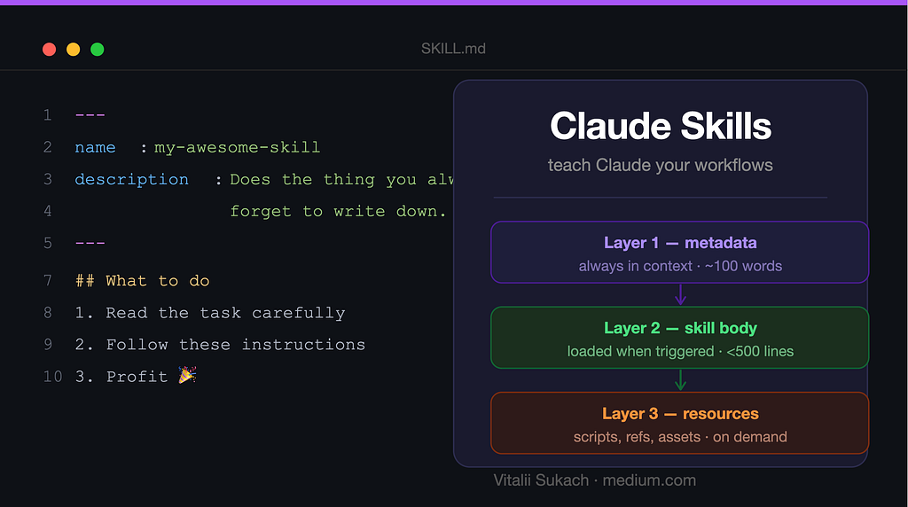
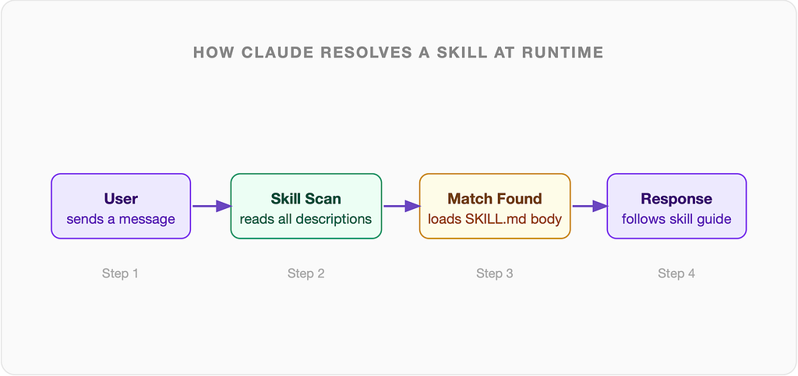
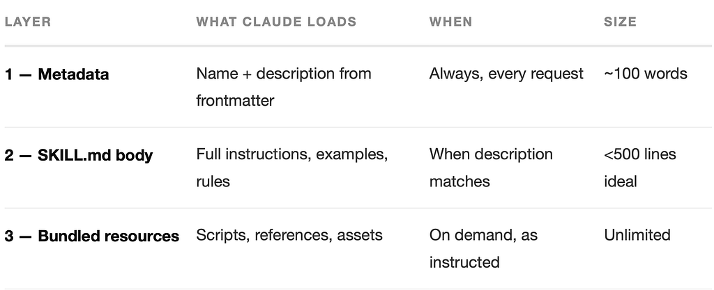
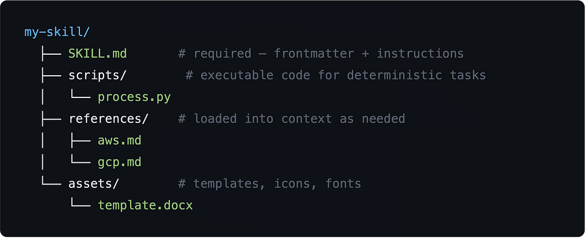
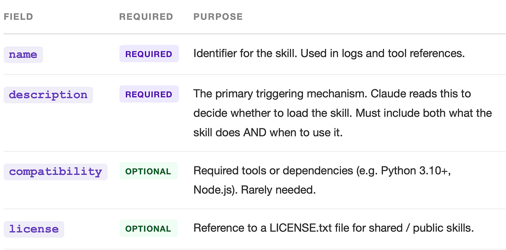
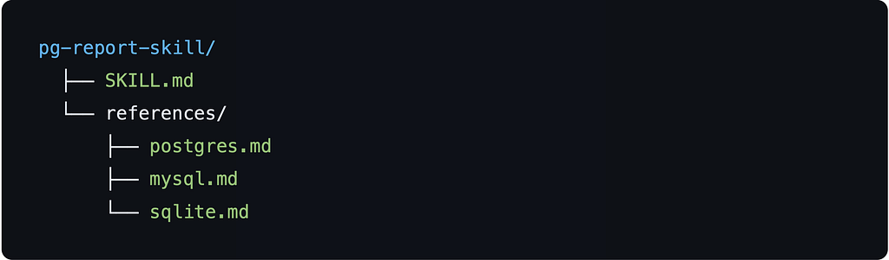

*How Claude loads specialised instructions on demand — and how you can write your own to transform workflows forever.*



Every time you open Claude and ask it to create a Word document, build a data analysis pipeline, or write presentation slides — something invisible happens first. Claude scans a directory of *skills*, finds the most relevant one, reads it, and only then starts working.

This system is called **Claude Skills**. It is one of the most underappreciated features in the entire Claude ecosystem. And once you understand how it works, you will see why it changes everything about how you build AI-powered workflows.

> “Skills are how Claude learns domain-specific workflows without retraining. They are runtime instructions, not model weights.”

### What Is a Skill?

A skill is a directory containing a SKILL.md file (and optionally supporting assets, scripts, and reference documents). When Claude starts handling a request, it reads the *name* and *description* of every available skill. If a description matches the current task, Claude loads the full SKILL.md body and follows its instructions.

Think of it like a context-sensitive manual. When a carpenter picks up a dovetail saw, they know exactly how to use it — not because they memorised every detail about every tool upfront, but because they learned the right technique for the right moment. Skills work the same way for Claude.



### The Three-Layer Loading System

Skills use progressive disclosure — Claude never loads everything at once. There are three distinct layers, each loaded only as needed:



This is elegant engineering. Layer 1 is tiny — just enough for Claude to decide *whether* a skill applies. Layer 2 gives full instructions once relevant. Layer 3 provides deep reference material only when needed, keeping context usage lean.

### Anatomy of a Skill Directory

A skill is a folder with a predictable structure. Here is the full layout:



Only SKILL.md is required. Everything else is optional and only loaded when the skill itself explicitly references it.

### Inside SKILL.md — The Configuration Fields

The file starts with a YAML frontmatter block (between --- delimiters), followed by markdown instructions. Here is every supported field:



> **KEY INSIGHT**The description field is the most important part of any skill. Claude decides whether to load your skill based solely on this field — the body never loads unless the description matches. Write it with real triggers, real contexts, and a slight "push" to combat under-triggering.

### A Minimal Skill — Step by Step

Let’s build a real skill from scratch. Imagine you regularly need to convert raw PostgreSQL query results into nicely formatted Markdown reports. Here is how to package that as a skill.

#### Step 1 — Create the directory

```
mkdir pg-report-skill
cd pg-report-skill
touch SKILL.md
```

#### Step 2 — Write the frontmatter

```
---
name: pg-report
description: |
  Converts raw PostgreSQL query results into formatted Markdown reports
  with tables, summary stats, and query metadata. Use whenever the user
  pastes SQL output, mentions "format this query result", or wants to
  turn database output into a readable report or document. Also trigger
  when user asks to summarise a dataset from a .csv or .tsv that looks
  like a DB export.
---
```

> **TIP: WRITE THE DESCRIPTION LIKE A TRIGGER RULESET**Notice how the description lists multiple phrasings (“pastes SQL output”, “format this query result”, “summarise a dataset”). This breadth is intentional — Claude uses fuzzy matching, so covering several natural phrasings dramatically improves trigger reliability.

#### Step 3 — Write the skill body

```
# PostgreSQL Report Formatter
## What this skill does
Formats raw PostgreSQL tabular output into clean Markdown reports.
## Required output sections
1. A ## Summary block: row count, column count, date range (if present)
2. A ## Data block: full Markdown table with aligned columns
3. A ## Observations block: 3-5 key insights from the data
## Formatting rules
- Numeric columns: right-align, add thousand separators
- Date columns: format as YYYY-MM-DD
- NULL values: render as `—` (em dash), never blank
- Column headers: Title Case
## Example input
```
 id | user_name | total_orders | revenue
----+-----------+--------------+---------
  1 | alice     |           12 | 4500.00
  2 | bob       |            3 |  890.50
```
## Example output
### Summary
- **Rows:** 2  |  **Columns:** 4  |  **Total revenue:** $5,390.50
### Data
| ID | User Name | Total Orders | Revenue |
|----|-----------|-------------:|--------:|
|  1 | Alice     |           12 | $4,500.00 |
|  2 | Bob       |            3 |   $890.50 |
```

### Step 4 — Add a reference file (optional)

If your skill needs to handle multiple database types — PostgreSQL, MySQL, SQLite — you can create a references/ folder and have the skill body instruct Claude to load the right one:



In your SKILL.md body, you then write:

```
## Database-specific rules
Detect which database produced the output from syntax clues.
- If `||` concatenation → read references/sqlite.md
- If `AUTO_INCREMENT` → read references/mysql.md
- Default → read references/postgres.md
```

Claude will read only the relevant file, keeping the context window lean and responses accurate.

### Real-World Example: The Built-in DOCX Skill

Claude ships with several built-in skills. The docx skill is a great example of production-quality configuration. Here is its description field, distilled:

```
description: |
  Use this skill whenever the user wants to create, read, edit, or
  manipulate Word documents (.docx files). Triggers include: any
  mention of 'Word doc', 'word document', '.docx', or requests to
  produce professional documents with formatting like tables of
  contents, headings, page numbers, or letterheads. Also use when
  extracting content from .docx files, inserting images, performing
  find-and-replace, working with tracked changes, or converting
  content into a polished Word document.
```

Notice the pattern: the description is almost a checklist. Every plausible user phrasing that should trigger the skill is listed. This is intentional — Claude has a natural tendency to *under-trigger* skills, so descriptions are deliberately thorough.

> **WARNING: AVOID GENERIC DESCRIPTIONS**

> A description like “Helps with documents” will rarely trigger. Claude needs enough specificity to distinguish your skill from general knowledge. Name the exact task, the exact file types, and the exact user phrases that should activate it.

### The Progressive Disclosure Principle

The most important architectural decision in skill design is knowing what goes where. The three-layer rule is simple:

#### 1. Description = triggering logic only

Never put instructions in the description. It exists solely to help Claude decide whether to load the skill. Keep it focused on “when to use” language, not “how to do”.

#### 2. SKILL.md body = core workflow

Put the main instructions, output format rules, required sections, formatting guidelines, and examples here. Target under 500 lines. If you need more, move deep content into reference files.

#### 3. References + scripts = deep knowledge

Detailed documentation, database-specific rules, platform-specific templates, and executable scripts go in subfolders. The SKILL.md body tells Claude when to read them.

### Writing Descriptions That Actually Trigger

The description field is the hardest part to get right. Here is a battle-tested template:

```
description: |
  [What the skill does in one sentence].
  Use this skill when: [scenario A], [scenario B], [scenario C].
  Also trigger when the user [natural phrase], [natural phrase],
  or mentions [keyword / file type / tool name].
  Do NOT use for [explicit exclusion to avoid false positives].
```

And a concrete example for a “Java Code Review” skill:

```
description: |
  Reviews Java source files for correctness, performance, thread
  safety, and style — producing structured inline feedback.
  Use whenever the user shares Java code and asks for review,
  feedback, improvements, or a PR review. Also trigger on phrases
  like "check my code", "what's wrong here", or "how can I improve
  this" when the code is Java. Trigger on .java files even without
  an explicit review request.
  Do NOT use for Kotlin, Scala, or general architecture questions
  without code attached.
```

### When Skills Use Scripts

For deterministic or repetitive transformations — file conversions, data extraction, package generation — skills can include executable scripts. Claude reads the script path from the SKILL.md body, runs it via the bash tool, and uses the output.

The built-in docx skill, for example, uses a Python script to write .docxfiles using the python-docx library. The skill body contains step-by-step instructions for calling the script correctly — Claude follows them at runtime.

```
## Creating a DOCX file
1. Generate Python code using python-docx from the template at
   scripts/create_doc.py
2. Run: python scripts/create_doc.py output.docx
3. Copy result to /mnt/user-data/outputs/
4. Present to user with present_files tool
```

### Testing Your Skill

Before deploying, write 5–10 test prompts that should trigger your skill, and 3–5 that should not. Run Claude with the skill installed and check whether it loads correctly.

Good test prompts for a “pg-report” skill:

```
# Should trigger:
"Here's my query result, can you format it nicely?"
"Turn this SQL output into a report"
"I exported this CSV from my database, summarise it"
# Should NOT trigger:
"How do I write a JOIN query?"
"What is normalisation in databases?"
```

> **PRO TIP: QUANTITATIVE EVALUATION**If you are building skills at scale, the skill-creator meta-skill includes an automated optimization loop. It splits your test set 60/40 (train/held-out), runs Claude against each case multiple times, proposes description improvements, and iterates up to 5 rounds — outputting the best-performing description with before/after scores.

### Packaging and Sharing Skills

A finished skill can be packaged into a .skill file for distribution. Anyone can install it by dropping the file into their skills directory. The package script handles archiving:

```
python -m scripts.package_skill path/to/pg-report-skill/
# → outputs pg-report-skill.skill
```

### The Bigger Picture

Skills are not just a convenience feature. They are the mechanism by which Claude becomes *domain-aware* without retraining. A legal firm can build a contract-review skill. A data team can build a dashboard-generation skill. A game studio can build a Godot export skill. Each one runs inside the same Claude — just with different runtime instructions.

The architecture is deliberately modular. Skills compose. A single request might trigger the pdf-reading skill to extract content, then the docx skill to write the output. Each stays in its lane, and Claude orchestrates.

> “You don’t teach Claude new tricks by changing the model. You teach it by writing better skills.”

For solo developers and small teams, this is genuinely powerful. You can codify your best workflows once, as a skill, and they run reliably on every request — without prompting, without repetition, and without hoping Claude happens to “know” your preferred format.

Start small. Pick one workflow you repeat every week. Write a 30-line SKILL.md. Test it on five prompts. Then iterate. That is all it takes to start building your own personalised AI toolkit.

**RESOURCES**The skills discussed in this article — including docx, pdf, pptx, xlsx, and skill-creator — are built into Claude's computer-use environment. You can explore them at /mnt/skills/public/ in any Claude session with computer use enabled.
