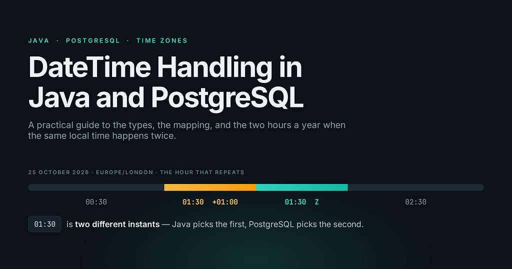
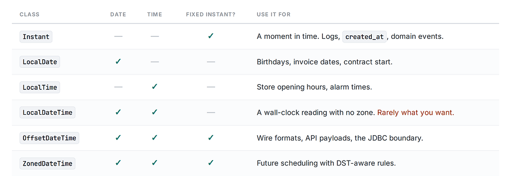
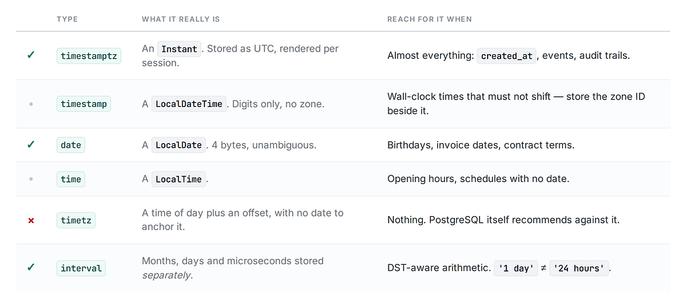
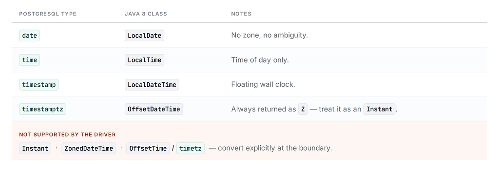
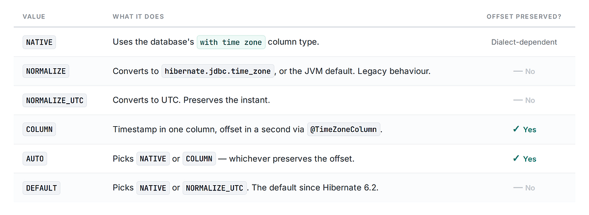

*Everything I wish someone had told me before I stored a meeting time in a* *timestamp column.*



There is a specific kind of bug that only shows up in production, only in October, and only for users in one country. It gets closed as “not reproducible” twice before someone finally sits down with a coffee and reads the column definition.

It is almost always a datetime bug.

The frustrating part is that both Java and PostgreSQL have *excellent* date/time support. java.time is one of the best-designed APIs in the JDK. PostgreSQL's temporal types are precise and well documented. The bugs happen at the seam — in the assumptions each side makes about what the other means, and in the two or three words in the type names that mean the opposite of what you'd guess.

This guide walks through both models, then spends real time on the part that actually causes outages: time zones.

Every code output and query result below was executed — Java 21 and PostgreSQL 16 — not written from memory.

### Part 1: The Java Side

#### Ask three questions, get one type

Every java.time class is an answer to some combination of three questions:

1. Do I know the **date**?
2. Do I know the **time of day**?
3. Do I know which **point on the global timeline** this is?

That last one is the important one, and it’s the one people skip. Here’s the map:



The single most useful sentence in this article: **LocalDateTime is not a point in time.** 2026-08-15T12:00 is twelve o'clock *somewhere*, and until you say where, it refers to a 26-hour-wide smear across the planet. If you have an Instant and you call .toLocalDateTime(), you have thrown away information and the compiler will not warn you.

#### Instant is the boring, correct default

```
Instant now = Instant.now();     // 2026-08-15T10:00:00.123456789Z
```

An Instant is nanoseconds since the epoch. No zone, no offset, no calendar. When it prints with a Z, that isn't a stored time zone — it's the ISO-8601 way of rendering an epoch value.

Anything that *happened* — a login, a payment, a row insert — is an Instant. Reach for something else only when you have a reason.

#### ZoneId vs ZoneOffset: not the same thing

This distinction matters more than any other in this article.

```
ZoneId.of("Europe/London")  // -> java.time.ZoneRegion
ZoneId.of("+01:00")         // -> java.time.ZoneOffset
```

A **ZoneOffset** is a fixed number of hours and minutes from UTC. +01:00. That's the whole thing. It's a fact about one moment.

A **ZoneId** (specifically a ZoneRegion, like Europe/London) is a *rulebook*. It knows that London was +00:00 in January, +01:00 in August, and it knows the exact instants at which it flips — going back decades and forward as far as legislators have declared.

ZoneOffset is a value. ZoneId is a function from instant to offset. Confusing them is the root cause of most scheduling bugs.

#### OffsetDateTime vs ZonedDateTime

Both identify a real instant. The difference is what survives.

```
ZonedDateTime nyc = ZonedDateTime.of(2026, 7, 4, 12, 0, 0, 0,
                                     ZoneId.of("America/New_York"));
nyc                    // 2026-07-04T12:00-04:00[America/New_York]
nyc.toOffsetDateTime() // 2026-07-04T12:00-04:00
nyc.toInstant()        // 2026-07-04T16:00:00Z
```

All three describe the same moment. But the ZonedDateTime still knows it's in New York, so if you add six months to it, it will correctly land on -05:00. The OffsetDateTime has been flattened — it remembers *that* the offset was -04:00, not *why*. Add six months and you get a wrong wall-clock time.

Rule of thumb: ZonedDateTime for calculating, OffsetDateTime for transporting, Instant for storing.

#### Duration vs Period

```
LocalDate.of(2026, 1, 31).plusMonths(1)  // 2026-02-28
```

Duration is exact elapsed time — seconds and nanos. Period is calendar time — years, months, days. "One month" is not a fixed number of seconds, and plusMonths clamps rather than overflowing. Both behaviors are correct; mixing them up is not.

This distinction resurfaces the moment DST enters the picture, and we’ll come back to it.

#### A word on the old API

java.util.Date is a mislabeled Instant (it has no time zone despite what toString() implies). Calendar is mutable and lenient. java.sql.Timestamp extends java.util.Date and adds nanoseconds while breaking the equals contract.

If you’re on a legacy codebase, convert at the boundary and never let them into your domain:

```
Instant i = oldDate.toInstant();
Date    d = Date.from(instant);
```

### Part 2: The PostgreSQL Side

#### timestamptz does not store a time zone

This is the single biggest source of confusion, and it comes straight from the type name. TIMESTAMP WITH TIME ZONE is an 8-byte value. So is TIMESTAMP WITHOUT TIME ZONE. There is no room in there for a zone, and PostgreSQL doesn't try:

```
SELECT pg_column_size('2026-08-15 12:00:00'::timestamp)     AS ts_bytes,     
       --  8
       pg_column_size('2026-08-15 12:00:00+02'::timestamptz) AS tstz_bytes,  
       --  8
       pg_column_size('12:00:00+02'::timetz)                 AS timetz_bytes; 
       -- 12
```

What timestamptz actually does is **convert to UTC on write and convert back on read**. The offset you supplied on input is used and then discarded. From the [official docs](https://www.postgresql.org/docs/current/datatype-datetime.html):

> *In either case, the value is stored internally as UTC, and the originally stated or assumed time zone is not retained.*

A better mental model: timestamptz is Instant. timestamp is LocalDateTime. The names lie; the semantics don't.

#### The demo that makes it click

Insert the same two literals into both column types, with the session zone set to London:

```
SET TimeZone = 'Europe/London';
CREATE TABLE t (id int, ts timestamp, tstz timestamptz);
INSERT INTO t VALUES (1, '2026-08-15 12:00:00',    '2026-08-15 12:00:00');
INSERT INTO t VALUES (2, '2026-08-15 12:00:00+00', '2026-08-15 12:00:00+00');
SELECT * FROM t;
```

```
 id |         ts          |          tstz
----+---------------------+------------------------
  1 | 2026-08-15 12:00:00 | 2026-08-15 12:00:00+01
  2 | 2026-08-15 12:00:00 | 2026-08-15 13:00:00+01
```

Two things happened. Row 1’s tstz had no offset, so PostgreSQL *assumed* the session zone. Row 2's explicit +00 was honoured and re-rendered as 13:00+01. Meanwhile the ts column ignored the offset entirely and stored the digits.

Now reconnect from New York and run the identical SELECT:

```
 id |         ts          |          tstz
----+---------------------+------------------------
  1 | 2026-08-15 12:00:00 | 2026-08-15 07:00:00-04
  2 | 2026-08-15 12:00:00 | 2026-08-15 08:00:00-04
```

The tstz column re-renders per client. The ts column is frozen. **Neither row changed on disk.**

That last point deserves emphasis, because it’s where the panic starts: when a developer sees a different value than QA saw, the instinct is “the data is corrupted.” It isn’t. Two clients with different TimeZone settings are looking at the same UTC value through different windows.

#### AT TIME ZONE runs both ways

AT TIME ZONE is the one operator you need, and its behavior flips depending on the input type:

```
-- timestamptz -> timestamp: "what does the clock read there?"
SELECT '2026-08-15 12:00:00+00'::timestamptz AT TIME ZONE 'Asia/Tokyo';
-- 2026-08-15 21:00:00   (type: timestamp without time zone)
```

```
-- timestamp -> timestamptz: "this wall clock reading WAS in Tokyo"
SELECT '2026-08-15 12:00:00'::timestamp AT TIME ZONE 'Asia/Tokyo';
-- 2026-08-15 03:00:00+00   (type: timestamp with time zone)
```

One removes zone context, the other attaches it. Read it as “interpret this value in that zone.” The function form timezone('Asia/Tokyo', value) is identical.

#### The rest of the family

- **date** — 4 bytes, no zone, no ambiguity. Great for things that are genuinely dates.
- **time** — time of day, no zone.
- **timetz** — 12 bytes, and [PostgreSQL itself recommends against it](https://www.postgresql.org/docs/current/datatype-datetime.html). A time of day with an offset but no date can't resolve DST, so it's not meaningfully anchored. It won't even accept a zone name:

```
SELECT '12:00:00 Europe/London'::timetz; -- ERROR: invalid input syntax for type time with time zone
```

- **interval** — 16 bytes storing months, days, and microseconds *separately*, which is exactly why it can be DST-aware.

#### now() vs localtimestamp

```
SELECT pg_typeof(now()),            -- timestamp with time zone
       pg_typeof(current_timestamp), -- timestamp with time zone
       pg_typeof(localtimestamp),    -- timestamp without time zone
       pg_typeof(current_date);      -- date
```

now() and current\_timestamp are timestamptz and are safe. localtimestamp and current\_date are evaluated in the session zone, which means a DEFAULT current\_date column produces different answers for different clients. Be deliberate.

#### So which do you pick?



The short version: **use** **timestamptz for essentially everything.** Reach for timestamp only when you genuinely mean a floating wall-clock time that must not shift — "the store opens at 09:00 local, whatever local means at that branch" — and store the zone ID beside it.

### Part 3: Time Zones, Properly

This is where the real complexity lives, so let’s slow down.

#### Three things called “time zone”

1. **An offset** — +01:00. A number.
2. **An IANA zone ID** — Europe/London. A named set of historical and future rules. PostgreSQL ships ~499 of these in pg\_timezone\_names; Java reads the same tzdata.
3. **An abbreviation** — EST, BST, IST. Ambiguous, unversioned, and a trap.

That third one is genuinely dangerous:

```
SELECT '2026-08-15 12:00:00 EST'::timestamptz,               -- 2026-08-15 17:00:00+00
       '2026-08-15 12:00:00 America/New_York'::timestamptz;  -- 2026-08-15 16:00:00+00
```

One hour apart. EST is a *fixed* -05:00 in PostgreSQL — it does not mean "Eastern time," it means "Eastern Standard Time, always." In August, New York is on -04:00. If you accept zone abbreviations from user input, you have already shipped a bug. (IST is worse — it can mean India, Ireland, or Israel depending on who you ask.)

**Always use full IANA names.**

Offsets aren’t zones either. Nepal is +05:45; the Chatham Islands are +12:45:

```
ZonedDateTime.of(2026,8,15,12,0,0,0, ZoneId.of("Asia/Kathmandu"))
// 2026-08-15T12:00+05:45[Asia/Kathmandu]
```

If your API contract says “offset in whole hours,” it’s wrong.

### Where PostgreSQL’s session zone comes from

The TimeZone GUC is a **per-connection setting**. Its value is decided by, in order: an explicit SET TimeZone, the connection's startup parameters, the postgresql.conf value, and finally the server's OS zone.

That last fallback is why the same query returns different results on a developer laptop and in CI. And with connection pooling, SET TimeZone on a borrowed connection leaks to whoever gets it next.

Pin it. Set timezone = 'UTC' in postgresql.conf, and add it to the JDBC URL so it survives pool reuse:

```
jdbc:postgresql://host:5432/db?options=-c%20TimeZone%3DUTC
```

Then make the client responsible for rendering. Formatting a timestamp for a human is a presentation concern, not a database one.

#### The spring-forward gap

On 29 March 2026, London jumps from 01:00 to 02:00. The local times between them **do not exist**.

Ask Java for one anyway:

```
LocalDateTime gap = LocalDateTime.of(2026, 3, 29, 1, 30);
gap.atZone(ZoneId.of("Europe/London"));
// 2026-03-29T02:30+01:00[Europe/London]
ZoneId.of("Europe/London").getRules().getTransition(gap);
// Transition[Gap at 2026-03-29T01:00Z to +01:00]
```

Java doesn’t throw. It silently pushes the value forward by the length of the gap. PostgreSQL does the same thing:

```
SET TimeZone='Europe/London';
SELECT '2026-03-29 01:30:00'::timestamptz;
-- 2026-03-29 02:30:00+01
```

Both are “correct” — but neither told you. If a user sets a 01:30 alarm on that date, you should be validating with getTransition() and telling them, not letting the platform quietly reschedule.

#### The fall-back overlap — where Java and PostgreSQL disagree

On 25 October 2026, London goes from 02:00 back to 01:00. Local times between 01:00 and 02:00 happen **twice**, one hour apart.

Java’s rules expose both:

```
ZoneId london = ZoneId.of("Europe/London");
LocalDateTime overlap = LocalDateTime.of(2026, 10, 25, 1, 30);
london.getRules().getValidOffsets(overlap);
// [+01:00, Z]
ZonedDateTime earlier = overlap.atZone(london);
// 2026-10-25T01:30+01:00[Europe/London]  instant = 2026-10-25T00:30:00Z
ZonedDateTime later = earlier.withLaterOffsetAtOverlap();
// 2026-10-25T01:30Z[Europe/London]       instant = 2026-10-25T01:30:00Z
```

Java’s default for an ambiguous local time is the **earlier** offset — 00:30Z.

Now ask PostgreSQL the same question:

```
SELECT '2026-10-25 01:30:00'::timestamp AT TIME ZONE 'Europe/London';
-- 2026-10-25 01:30:00+00
```

PostgreSQL picked 01:30Z — the **later** one.

Same input, same tzdata, one hour apart. If your application resolves an ambiguous local time in Java and your reporting job resolves it in SQL, they will disagree for one hour, twice a year, in every DST zone.

There is no clever fix. The lesson is: **never let a** **LocalDateTime cross the boundary and get resolved on the other side.** Resolve to an Instant in exactly one place, with explicit overlap handling, and send the instant.

#### DST arithmetic: plusDays is not plusHours(24)

```
ZonedDateTime start = ZonedDateTime.of(2026, 3, 28, 12, 0, 0, 0, london);
// 2026-03-28T12:00Z[Europe/London]
start.plusDays(1);                 // 2026-03-29T12:00+01:00  (23 real hours)
start.plus(Duration.ofDays(1));    // 2026-03-29T13:00+01:00  (24 real hours)
start.plusHours(24);               // 2026-03-29T13:00+01:00
```

plusDays preserves the wall clock. Duration preserves elapsed time. PostgreSQL draws the same line, using the same value:

```
SET TimeZone='Europe/London';
SELECT '2026-03-28 12:00:00+00'::timestamptz + interval '1 day',   -- 2026-03-29 12:00:00+01
       '2026-03-28 12:00:00+00'::timestamptz + interval '24 hours'; -- 2026-03-29 13:00:00+01
```

This is one place the two platforms agree beautifully — interval '1 day' and plusDays(1) mean the same thing, and interval '24 hours' and Duration.ofDays(1) mean the same thing. "Every day at 9am" is plusDays / interval '1 day'. "Every 24 hours" is Duration / interval '24 hours'. Pick the one the product actually means.

#### Future events: an instant is not enough

```
ZoneId ny = ZoneId.of("America/New_York");
ZonedDateTime.of(2027, 1, 15, 9, 0, 0, 0, ny).withZoneSameInstant(UTC); // 2027-01-15T14:00Z
ZonedDateTime.of(2027, 7, 15, 9, 0, 0, 0, ny).withZoneSameInstant(UTC); // 2027-07-15T13:00Z
```

“9am in New York” is a different UTC instant depending on the date. So if a user schedules a recurring 9am standup and a government later changes DST rules — which happens several times a year somewhere — the stored instant becomes wrong.

For **past events**, store the instant. That’s history; it can’t change.

For **future user-scheduled events**, store three things:

```
CREATE TABLE meetings (
  id            bigserial PRIMARY KEY,
  local_start   timestamp   NOT NULL,  -- 2027-01-15 09:00
  zone_id       text        NOT NULL,  -- 'America/New_York'
  computed_utc  timestamptz NOT NULL   -- cache; recompute on tzdata update
);
```

The first two are the truth. The third is a derived index for querying, refreshed when tzdata changes.

#### tzdata is a moving target

Java bundles a copy of the IANA database (2025b on the JDK I ran this on); PostgreSQL bundles its own; your OS has a third. They drift. When Java and PostgreSQL are on different tzdata versions, they will resolve recently-changed zones differently.

Check what you have:

```
ZoneRulesProvider.getVersions("Europe/London").lastKey();  // 2025b
```

```
SELECT name, utc_offset, is_dst FROM pg_timezone_names WHERE name = 'Europe/London';
```

Pin tzdata in your base images, and treat a tzdata bump as a deployment that requires recomputing cached future instants.

### Part 4: Wiring Java to PostgreSQL

#### The mapping table

Per the [pgJDBC documentation](https://jdbc.postgresql.org/documentation/query/):



Note the omission, in the driver’s own words:

> *ZonedDateTime, Instant and OffsetTime / TIME WITH TIME ZONE are not supported.*

So don’t hand the driver an Instant and hope — depending on the driver version you'll either get a Can't infer the SQL type to use for an instance of java.time.Instant exception or undocumented behavior. Convert explicitly at the boundary instead:

```
// write
ps.setObject(1, instant.atOffset(ZoneOffset.UTC));
// read
Instant i = rs.getObject("occurred_at", OffsetDateTime.class).toInstant();
```

Note that reading a timestamptz gives you an OffsetDateTime normalized to UTC — the driver's offset is always Z, because that's what the backend holds. The offset carries no information. Convert straight to Instant and don't be tempted to read meaning into it.

#### Avoid setTimestamp / getTimestamp

The java.sql.Timestamp overloads convert using the **JVM default time zone** unless you pass an explicit Calendar. That makes your persistence layer's correctness depend on the container's TZ environment variable. Use the java.time setObject/getObject methods instead — they're unambiguous.

If you must keep the JVM zone from mattering at all, set it explicitly at startup:

```
-Duser.timezone=UTC
```

Belt and braces, not a substitute for correct types.

#### Precision: Java has nanos, PostgreSQL has micros

```
Instant.parse("2026-08-15T10:00:00.123456789Z")           // .123456789
    .truncatedTo(ChronoUnit.MICROS)                        // .123456
```

PostgreSQL stores microseconds. Those last three digits are gone on the round trip, and PostgreSQL may **round** rather than truncate:

```
SELECT '2026-08-15 10:00:00.123456789'::timestamptz;  -- 10:00:00.123457
```

If you have an equality test or an optimistic-lock check comparing an in-memory Instant to one that's been through the database, truncate to micros *before* you persist so both sides agree.

#### Don’t wrap the column in a function

Because timestamptz is stored as UTC, "give me everything that happened on 1 Feb in New York" tempts you into this:

```
EXPLAIN SELECT count(*) FROM events
WHERE (occurred_at AT TIME ZONE 'America/New_York')::date = DATE '2026-02-01';
--  Seq Scan on events
```

Index gone. Compute the boundary instants instead and do a half-open range scan:

```
SELECT (DATE '2026-02-01' + time '00:00') AT TIME ZONE 'America/New_York',  -- 2026-02-01 05:00+00
       (DATE '2026-02-02' + time '00:00') AT TIME ZONE 'America/New_York';  -- 2026-02-02 05:00+00
EXPLAIN SELECT count(*) FROM events
WHERE occurred_at >= '2026-02-01 05:00:00+00'
  AND occurred_at <  '2026-02-02 05:00:00+00';
--  Index Only Scan using events_occurred_at_idx
```

Note that this “day” is 24 hours only because February has no DST transition. On a transition day it’s 23 or 25 — which the boundary-instant approach handles correctly and a naive + interval '24 hours' does not. Half-open ranges (>= and <) also dodge the microsecond-boundary problem that BETWEEN creates.

### Part 5: JPA and Hibernate

Hibernate 6 made zoned types a first-class concern via TimeZoneStorageType:



For PostgreSQL, the practical consequence is settled by the database, not the ORM: timestamptz discards the offset, so under DEFAULT your OffsetDateTime round-trips as UTC. Which is fine — as long as you expected it.

Sensible defaults:

```
spring:
  jpa:
    properties:
      hibernate:
        jdbc:
          time_zone: UTC
        timezone:
          default_storage: NORMALIZE_UTC
```

And in the entity, be explicit about intent:

```
@Entity
public class Booking {
    
    // A moment. Maps to timestamptz.
    @Column(nullable = false)
    private Instant createdAt;
    
    // A date. Not a moment.
    @Column(nullable = false)
    private LocalDate serviceDate;
    
    // A wall-clock time that must not shift. Maps to timestamp.
    @Column(nullable = false)
    private LocalDateTime localStart;
    
    @Column(nullable = false)
    private String zoneId;   // 'Europe/London'
    
    public ZonedDateTime start() {
        return localStart.atZone(ZoneId.of(zoneId));
    }
}
```

If you genuinely need the user’s original offset preserved, @TimeZoneStorage(TimeZoneStorageType.COLUMN) with @TimeZoneColumn writes it to a companion column. Use it when the offset is *data* — an audit trail of what the user's device claimed — not as a default.

### Part 6: Testing This Stuff

Datetime bugs are only cheap if you catch them before the clocks change. Three habits do most of the work.

#### 1. Inject a Clock

Instant.now() scattered through business logic is untestable. Inject java.time.Clock and you can move time at will:

```
@Bean Clock clock() { return Clock.systemUTC(); }
// in a test
Clock fixed = Clock.fixed(Instant.parse("2026-10-25T00:30:00Z"), ZoneOffset.UTC);
```

#### 2. Run CI in a hostile time zone

If your JVM, your database, and your CI runner are all UTC, every zone bug hides until production. Force one of them somewhere awkward:

```
-Duser.timezone=Pacific/Chatham
```

+12:45 and it observes DST. If your test suite survives Chatham, it will survive most things. Do the same for the PostgreSQL container:

```
@Container
static PostgreSQLContainer<?> pg = new PostgreSQLContainer<>("postgres:16")
        .withEnv("TZ", "Asia/Kathmandu")
        .withUrlParam("options", "-c TimeZone=Asia/Kathmandu");
```

The point isn’t that production runs there — it’s that a test which only passes in UTC is a test that has proven nothing about zone handling.

#### 3. Write the four transition tests

For any code that converts between local and instant, pin these explicitly:

```
static final ZoneId LONDON = ZoneId.of("Europe/London");
@Test void gapTimesAreRejectedNotSilentlyShifted() {
    LocalDateTime gap = LocalDateTime.of(2026, 3, 29, 1, 30);
    assertThat(LONDON.getRules().getValidOffsets(gap)).isEmpty();
    assertThatThrownBy(() -> scheduler.schedule(gap, LONDON))
        .isInstanceOf(NonExistentLocalTimeException.class);
}
@Test void overlapTimesResolveToTheDocumentedChoice() {
    LocalDateTime overlap = LocalDateTime.of(2026, 10, 25, 1, 30);
    assertThat(LONDON.getRules().getValidOffsets(overlap)).hasSize(2);
    assertThat(scheduler.resolve(overlap, LONDON))
        .isEqualTo(Instant.parse("2026-10-25T00:30:00Z")); // earlier, by policy
}
@Test void dailyRecurrenceKeepsWallClockAcrossDst() {
    ZonedDateTime start = ZonedDateTime.of(2026, 3, 28, 9, 0, 0, 0, LONDON);
    assertThat(recurrence.next(start).toLocalTime()).isEqualTo(LocalTime.of(9, 0));
}
@Test void instantSurvivesTheDatabaseRoundTrip() {
    Instant original = Instant.now().truncatedTo(ChronoUnit.MICROS);
    repository.save(new Event(original));
    assertThat(repository.findLatest().occurredAt()).isEqualTo(original);
}
```

The fourth one catches more real bugs than you’d expect — it’s the one that fails when someone quietly changes a column from timestamptz to timestamp.

### The Short Version

If you skim one section, make it this one.

**Schema**

- timestamptz by default. It's the same 8 bytes and it's unambiguous.
- timestamp only for wall-clock times that must not shift — and store the zone ID beside it.
- date for dates. timetz for nothing.
- Pin timezone = 'UTC' in postgresql.conf and in the JDBC URL.

**Java**

- Instant for things that happened. LocalDate for dates. ZonedDateTime for scheduling. OffsetDateTime at the JDBC boundary.
- LocalDateTime is not a point in time. Treat every use as a question to answer, not an answer.
- Never accept zone abbreviations. Full IANA names only.
- plusDays ≠ plus(Duration.ofDays(1)). Know which one your product means.

**The seam**

- pgJDBC speaks LocalDate/LocalTime/LocalDateTime/OffsetDateTime. Convert Instant explicitly.
- Avoid setTimestamp/getTimestamp — they use the JVM default zone.
- Truncate to microseconds before persisting.
- Don’t wrap indexed timestamp columns in AT TIME ZONE; compute boundary instants instead.

**And the one that bites hardest**

Java resolves an ambiguous local time to the *earlier* offset. PostgreSQL picks the *later* one. Resolve ambiguity in exactly one place, deliberately, and pass instants across the boundary — never local times.

Store the instant, render the local time, and keep the zone rules in exactly one layer. Most datetime bugs are just that rule, broken somewhere.

*All examples verified on OpenJDK 21.0.10 (tzdata 2025b) and PostgreSQL 16.13.*

**Sources**

- [PostgreSQL: Date/Time Types](https://www.postgresql.org/docs/current/datatype-datetime.html)
- [pgJDBC: Using Java 8 Date and Time classes](https://jdbc.postgresql.org/documentation/query/)
- [Hibernate](https://docs.hibernate.org/orm/6.4/javadocs/org/hibernate/annotations/TimeZoneStorageType.html) [TimeZoneStorageType Javadoc](https://docs.hibernate.org/orm/6.4/javadocs/org/hibernate/annotations/TimeZoneStorageType.html)
- [Hibernate 6 migration guide](https://docs.hibernate.org/orm/6.2/migration-guide/)
- [Thorben Janssen: TimezoneStorageType](https://thorben-janssen.com/hibernate-6-offsetdatetime-and-zoneddatetime/)
