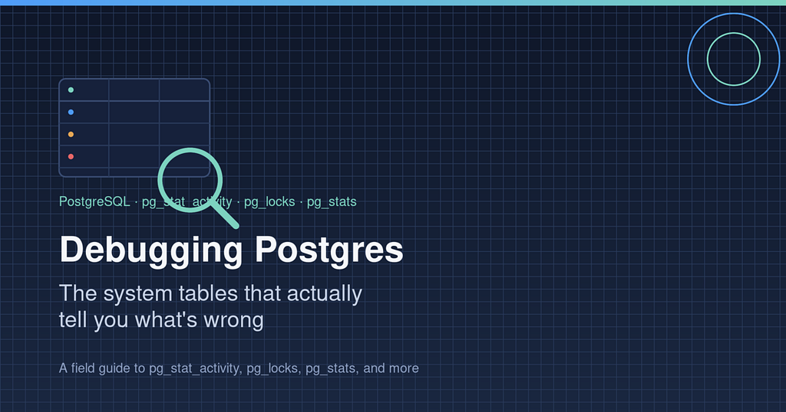

When a migration hangs, a query slows to a crawl, or a deploy just sits there, most people reach for the same first move: kill it and try again. That works about as often as it doesn’t. Postgres already knows what’s wrong — it’s just keeping the answer in a handful of system catalogs and stats views that almost nobody looks at until things are already on fire.

This is a walkthrough of the tables I actually check, in the order I check them, when something breaks — with a running example: a migration that adds a NOT NULL column and backfills it on a 20-million-row orders table, which has been "running" for 25 minutes with no sign of finishing.

### Start with: is it even running?

Before touching statistics or query plans, find out if the process is alive, blocked, or just slow.

```
SELECT pid, state, wait_event_type, wait_event, query, query_start
FROM pg_stat_activity
WHERE state != 'idle';
```

pg\_stat\_activity is a live snapshot of every connection to the database. The columns that matter most here are wait\_event\_type and wait\_event. If a process shows wait\_event\_type = 'Lock', it isn't broken — it's queued behind something else. If it shows Client or IO, that's a different problem entirely (waiting on the client, or waiting on disk).

For the orders migration, this comes back with:

```
pid  | state  | wait_event_type | wait_event | query
-----+--------+-----------------+------------+----------------------------------
8842 | active | Lock            | relation   | ALTER TABLE orders ADD COLUMN ...
```

wait\_event\_type = Lock tells us immediately: the migration isn't slow, it's stuck behind something else that holds a conflicting lock on orders.

If you see a lock wait, the next stop is obvious:

```
SELECT blocked_locks.pid AS blocked_pid,
       blocking_locks.pid AS blocking_pid,
       blocked_activity.query AS blocked_query,
       blocking_activity.query AS blocking_query
FROM pg_locks blocked_locks
JOIN pg_stat_activity blocked_activity ON blocked_activity.pid = blocked_locks.pid
JOIN pg_locks blocking_locks
  ON blocking_locks.locktype = blocked_locks.locktype
  AND blocking_locks.database IS NOT DISTINCT FROM blocked_locks.database
  AND blocking_locks.relation IS NOT DISTINCT FROM blocked_locks.relation
  AND blocking_locks.pid != blocked_locks.pid
JOIN pg_stat_activity blocking_activity ON blocking_activity.pid = blocking_locks.pid
WHERE NOT blocked_locks.granted;
```

This join is the single most useful query in Postgres debugging. It tells you exactly which session is blocking which, and what each of them is running. Most “stuck migration” incidents end here: some other transaction — often a long-running read, an ORM that forgot to close a connection, or a previous deploy that never finished — is sitting on a lock the migration needs.

Running it for the orders case turns up the problem:

```
blocked_pid | blocking_pid | blocked_query                   | blocking_query
------------+--------------+---------------------------------+---------------------------------------------
 8842       | 6110         | ALTER TABLE orders ADD COLUMN.. | SELECT * FROM orders WHERE ... (idle in txn)
```

PID 6110 is an analytics job that opened a transaction, ran a read, and never committed — “idle in transaction” — leaving an ACCESS SHARE lock on orders that blocks the migration's ACCESS EXCLUSIVE lock. The fix here isn't in the migration at all: it's killing or fixing PID 6110 (SELECT pg\_terminate\_backend(6110); if you're sure it's safe to end it).

### If it’s a long-running operation, check its actual progress

Postgres exposes live progress for the operations that most commonly make migrations feel frozen:

```
SELECT * FROM pg_stat_progress_create_index;
SELECT * FROM pg_stat_progress_vacuum;
SELECT * FROM pg_stat_progress_analyze;
```

If you’re running CREATE INDEX CONCURRENTLY as part of a migration, pg\_stat\_progress\_create\_index shows you the current phase (building index, index validation, etc.) and how many tuples it has scanned versus the total. This turns "is this hung or just big?" from a guess into a fact.

Say the next step of the migration adds an index on the new column instead of blocking on a lock — the progress view might show:

```
pid  | phase                         | tuples_total | tuples_done
-----+-------------------------------+--------------+-------------
9021 | building index: scanning table| 20450112     | 14300556
```

That’s roughly 70% through a single scan phase, moving steadily — not stuck, just genuinely working through 20 million rows. Compare that against a snapshot taken a minute later: if tuples\_done hasn't moved, now you know it actually is stalled, and it's worth going back to pg\_locks.

### If nothing’s blocked, suspect the query plan

Not every broken migration is a lock problem. Sometimes the migration runs, but a backfill step or an added index makes the planner choose a catastrophically bad plan. That’s a statistics problem, and it lives in two places.

**pg\_stat\_user\_tables** tells you whether Postgres has been keeping its stats up to date on the table in question:

```
SELECT relname, n_live_tup, n_dead_tup, n_mod_since_analyze,
       last_vacuum, last_autovacuum, last_analyze, last_autoanalyze
FROM pg_stat_user_tables
WHERE relname = 'your_table';
```

If n\_mod\_since\_analyze is large relative to n\_live\_tup, or last\_autoanalyze is suspiciously old, the planner is working off outdated information. This happens constantly during migrations, because a migration that inserts, updates, or deletes a large chunk of a table changes its shape faster than autovacuum's default thresholds react to.

For orders, after the backfill step runs:

```
relname | n_live_tup | n_dead_tup | n_mod_since_analyze | last_autoanalyze
--------+------------+------------+---------------------+-------------------
orders  | 20450112   | 3800000    | 18900000            | 2026-07-28 03:14
```

18.9 million modified rows since the last analyze, against 20 million live rows — nearly the entire table has changed and autovacuum hasn’t caught up yet (last\_autoanalyze is five days old). Any query the migration runs after this point is planning against numbers that are effectively meaningless.

**pg\_stats** (the readable view over the raw pg\_statistic catalog) shows what the planner actually believes about each column:

```
SELECT attname, n_distinct, correlation, null_frac, most_common_vals
FROM pg_stats
WHERE tablename = 'your_table';
```

n\_distinct and correlation drive index-vs-sequential-scan decisions. If a migration adds a new index and the planner still refuses to use it, stale stats here are the usual suspect.

On the new orders.status column right after the backfill, before an ANALYZE:

```
 attname | n_distinct | correlation | null_frac
---------+------------+-------------+-----------
 status  | 1          | 1           | 1.0
```

The planner still believes every row is null (null\_frac = 1.0) because that was true before the backfill ran. Any query filtering on status will get a wildly wrong row estimate and likely pick a sequential scan or a bad join order. The fix is almost always to run ANALYZE your\_table; — either before the migration, or as an explicit step inside it, rather than waiting for autovacuum to get around to it. After ANALYZE orders;, the same query returns something like n\_distinct = 4, null\_frac = 0.0 — matching reality, and the planner's decisions follow accordingly.

**pg\_class** holds the planner's cached size estimates directly:

```
SELECT relname, reltuples, relpages
FROM pg_class
WHERE relname = 'your_table';
```

reltuples is an estimate, not a live count — it's only refreshed by ANALYZE or VACUUM. If this number is wildly off from the real row count, every cost estimate downstream is wrong too. For orders, reltuples might read 20450112 while a SELECT count(\*) returns closer to 24000000 — a four-million-row gap that skews every cost estimate the planner builds on top of it.

### If you need the exact query and its cost, not just the table

pg\_stat\_statements (an extension, so it needs to be enabled) aggregates every distinct query the server has run, with real timing:

```
SELECT query, calls, total_exec_time, mean_exec_time, rows
FROM pg_stat_statements
ORDER BY total_exec_time DESC
LIMIT 20;
```

This is the difference between “the migration is slow” and “this specific UPDATE inside the migration is slow, and it’s been called 40,000 times.” For the orders backfill, this might show:

```
query                                        | calls | mean_exec_time | rows
---------------------------------------------+-------+----------------+--------
 UPDATE orders SET status = $1 WHERE id = $2 | 40000 | 812.4 ms       | 40000
```

40,000 single-row updates averaging 800ms each explains a lot on its own — that’s batching the backfill row-by-row instead of in bulk, and it would still be slow even with perfect statistics. If it’s enabled in your environment, it’s usually the fastest way to go from vague suspicion to a concrete line of SQL to fix — in this case, rewriting the backfill as a single set-based UPDATE ... WHERE status IS NULL in batches, rather than one row at a time.

### A rough order of operations

Put together, a sensible debugging sequence looks like this: check pg\_stat\_activity to see if the process is alive and what it's waiting on; if it's waiting on a lock, join into pg\_locks to find the blocker; if it's a long index build or vacuum, check the matching pg\_stat\_progress\_\* view for real progress; if nothing is blocked but it's still slow, check pg\_stat\_user\_tables and pg\_stats for stale statistics, and pg\_class for stale row estimates; and if pg\_stat\_statements is available, use it to find the exact query eating the time.

None of these tables are exotic. They ship with every Postgres install (aside from pg\_stat\_statements, which just needs CREATE EXTENSION). The only real skill here is knowing which one answers which question — and reaching for pg\_stat\_activity and pg\_locks before assuming it's a statistics problem, since lock contention is a far more common cause of a "broken" migration than a bad query plan.
