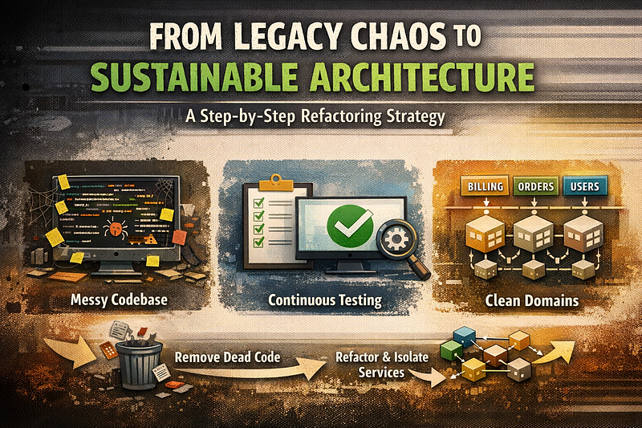

Legacy systems are rarely “just bad code”. Usually, they’re the result of years of rushed decisions, unclear requirements, and survival‑mode delivery.

I’ve faced this situation more than once, and developed a practical methodology that lets you **improve the system while still shipping features** — without a big‑bang rewrite.

### The three core problems

In troubled projects, the same three issues appear again and again:

1. **Business logic is complex and undocumented** You can’t be sure if a “better” solution is actually correct, because nobody fully understands the current behaviour.
2. **The team is under pressure and chooses the easiest path** Deadlines dominate. Developers implement quick fixes instead of proper solutions, increasing entropy over time.
3. **Domain logic is scattered across the codebase** There is no clear separation of concerns. The same domain is implemented in multiple places, in different ways.

You can’t fix this with a single refactor. You need a **strategy**.

### Step 1: Enforce integration tests in CI

The first move is simple but non‑negotiable:

- **Introduce integration tests** and make them part of the CI pipeline.
- The pipeline **must fail** if tests fail.

At this stage, don’t aim for perfect coverage. Your goal is to **freeze current behaviour** so you can safely change internals later.

Focus on **functional/integration tests**, not unit tests. Unit tests are too tied to current class structure, which you plan to change.

### Step 2: Require coverage for all new code

Don’t try to cover the entire legacy system at once — that’s a trap.

Instead:

- **Introduce a rule**: all *new* classes (or significantly new logic) must have at least **80% coverage**.
- Keep a file like `legacy-classes.txt` with all existing uncovered classes.
- Configure your coverage tool to **ignore** those legacy classes for now.

This way:

- Legacy code is tolerated but contained.
- New code is held to a higher standard.
- Over time, the “good” part of the system grows.

### Step 3: Touch legacy? Then test it.

Add one more rule for the team —*if you modify legacy code, you must:*

- remove the affected classes from `legacy-classes.txt`
- add proper tests for them.

This gradually converts legacy areas into **tested, safer zones**. You don’t stop feature work — you just **attach improvement to change**.

After a few months, you’ll notice something important: your coverage and confidence have increased **without a big refactor**.

### Step 4: Identify and remove dead code

Once you have better test coverage and more confidence, start cleaning up.

A simple approach:

1. Mark suspected legacy code as`@Deprecated`.
2. Add an aspect or interceptor that **logs every call** to deprecated methods in production.
3. Wait a couple of months and analyse the logs.

If a deprecated method hasn’t been called in production for a long time, it’s probably dead. Review it carefully — and then **remove it**.

This reduces noise and makes the remaining code easier to reason about.

### Step 5: Group logic by domain

Now that the system is safer and cleaner, you can start addressing the real problem: **domain logic scattered everywhere**.

Steps:

- Identify the **domains** in your system (billing, users, orders, CRM, etc.).
- Move domain logic into dedicated modules or packages.
- Keep the behaviour the same — your integration tests should still pass.

You don’t need heavy refactoring yet. Just **physically group** related logic so each domain has a clear “home”.

Domain‑Driven Design (DDD) concepts help here, but you don’t need to implement full DDD to benefit from **bounded contexts** and **clear boundaries**.

### Step 6: Isolate data access per domain

Once domains are clearer, start isolating data access:

- Create **domain services** that own the logic for a specific domain.
- Each service uses its own repositories and exposes **domain models**, not raw entities.
- Keep SQL queries inside the domain boundary, not spread across controllers and helpers.

At this stage, you may hit performance issues. That’s normal.

Tactics:

- Keep your database **normalized** as a baseline.
- Where performance is critical, introduce **denormalized read models** or **NoSQL stores** for specific use cases.
- Ensure denormalized structures are updated within the same transaction or via reliable async mechanisms.

The key is to **understand the trade‑offs**, not blindly optimize.

### Step 7: Refine service boundaries and APIs

Now your services are more coherent. Time to make them **consistent**:

- Each service should own **one domain model** and work with **one type of domain DTO**.
- Controllers, listeners, and tasks handle API‑level concerns (validation, mapping, HTTP, messaging).
- Services focus on **business rules**, not transport details.

Your controllers may look a bit messy for a while. That’s acceptable. The important part is that **business logic is now in one place**.

At this point, you can start documenting the core flows and validating them with product owners. You’re no longer guessing — you have structure.

### Step 8: Evolve your public API

As your internal model stabilizes, you’ll notice:

- some APIs are redundant,
- some can be unified,
- some no longer reflect the real domain.

Instead of breaking clients, introduce **API versioning**:

- Design a cleaner **v2 API** aligned with your new domain model.
- Keep **v1** for backward compatibility for a while.
- Gradually migrate consumers to v2.

This lets you modernize without forcing a painful, immediate migration.

### Step 9: Extract microservices only when ready

Only now — after:

- tests are in place,
- dead code is removed,
- domains are clear,
- services are cohesive

…does it make sense to talk about **microservices**.

You can:

- identify services that are truly independent,
- give them their own database,
- migrate them out carefully.

There will still be risks: network latency, distributed transactions, operational overhead. But now you’re moving from a **position of understanding**, not chaos.

### Final thought

This methodology is not about hero refactors or perfect architecture. It’s about **creating safety first**, then **improving structure step by step**, while the business keeps moving.
