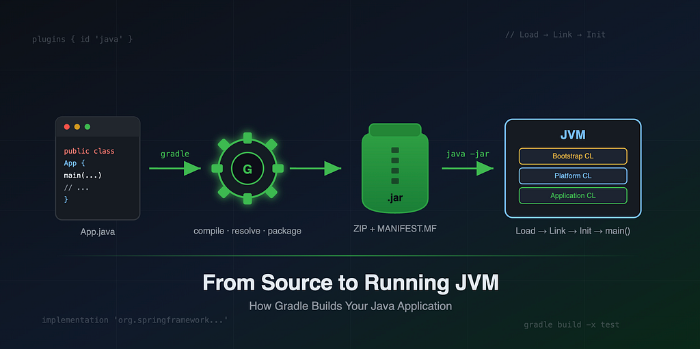
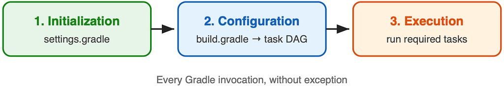
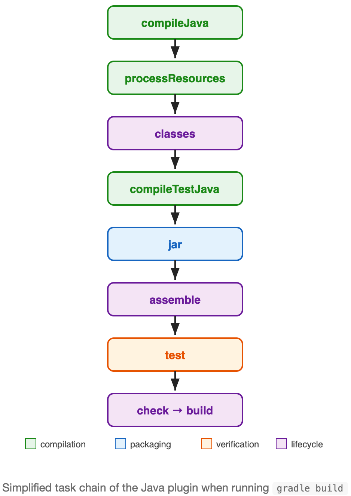
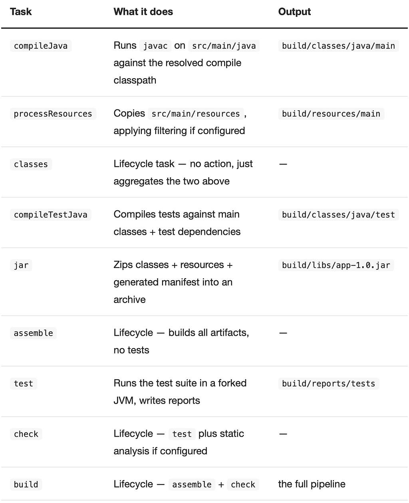
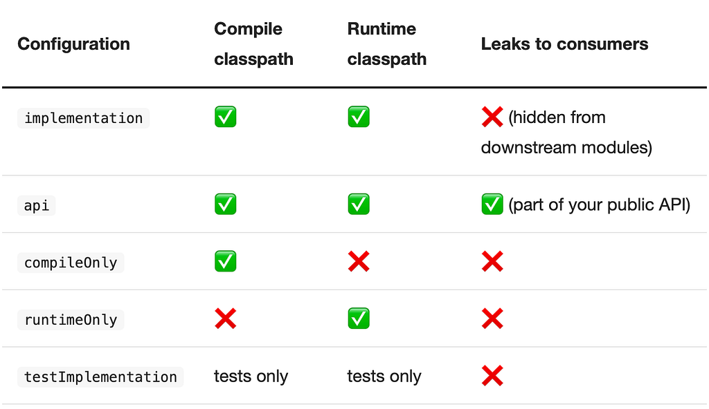
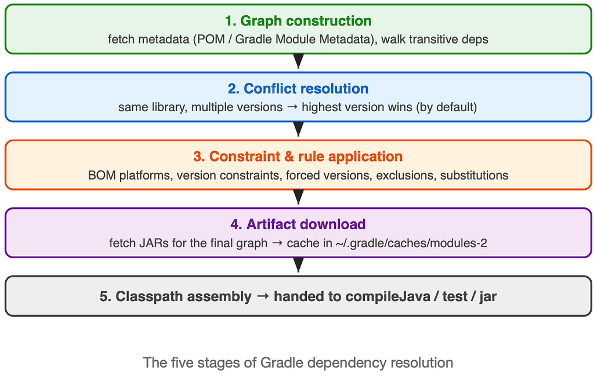
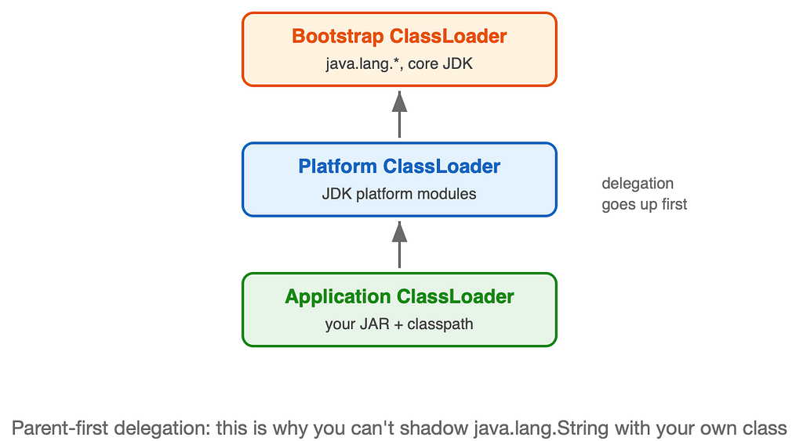

Build phases, task graphs, dependency resolution, and what actually happens when the JVM opens your JAR

You type gradle build, wait a few seconds, and out comes a JAR. Most Java developers use this pipeline every day without ever looking inside it. But when a build gets slow, a dependency conflict appears, or a NoClassDefFoundError shows up in production at 2 AM, understanding the machinery underneath is the difference between guessing and fixing.

This article walks the full journey: Gradle’s three build phases, the Java plugin’s task graph, how dependency resolution actually works stage by stage, what a JAR file really is, and how the JVM reads and executes it.



### Part 1: The Three Phases Every Gradle Build Goes Through

Before a single line of your code is compiled, Gradle itself runs through a fixed lifecycle of three phases. This is true for every build, every plugin, every project.



#### Phase 1 — Initialization

Gradle reads settings.gradle(.kts) and answers one question: *which projects are part of this build?* For a single-module app that's trivial; for a multi-module monorepo this is where include(":core", ":api", ":app") gets evaluated and a Project object is created for each module.

#### Phase 2 — Configuration

Now every build.gradle(.kts) script executes top to bottom. This is the phase people misunderstand most. Your build script is *code that runs* — and it runs here, on every invocation, regardless of which task you asked for. The output of this phase is the **task graph**: a directed acyclic graph (DAG) of all tasks and their dependencies. Tasks are registered and wired together, but none of their actions execute yet.

> *A* *println at the top level of build.gradle prints during Configuration — even if you run* *gradle help. Task actions run later. This trips up nearly everyone once.*

#### Phase 3 — Execution

Gradle takes the task you requested, computes the minimal subgraph of tasks needed to produce it, and executes them in dependency order. Tasks whose inputs and outputs haven’t changed since the last run are marked UP-TO-DATE and skipped entirely — this is Gradle's incremental build engine, and it's why the second build is always faster than the first.

### Part 2: The Java Plugin Task Graph

Applying the java plugin registers a standard chain of tasks. When you run gradle build, this is the graph that gets executed:





The practical shortcuts worth memorizing:

```
# fastest feedback: compile only
gradle compileJava
# package without running tests
gradle jar
# full build, skip test execution
gradle build -x test
# nuke build/ and start clean
gradle clean build
```

### Part 3: How Gradle Dependency Resolution Actually Works

This is the part of Gradle most developers treat as magic. You write three lines in a dependencies block, and somehow the right JARs appear on your classpath. Here's the machinery, stage by stage.

#### Configurations: buckets of dependencies

Every dependency you declare goes into a named **configuration** — a bucket with specific rules about where those dependencies are visible:

```
dependencies {
    implementation 'org.springframework.boot:spring-boot-starter-web:3.3.1'
    api 'com.fasterxml.jackson.core:jackson-databind:2.17.1'
    compileOnly 'org.projectlombok:lombok:1.18.32'
    annotationProcessor 'org.projectlombok:lombok:1.18.32'
    runtimeOnly 'org.postgresql:postgresql:42.7.3'
    testImplementation 'org.junit.jupiter:junit-jupiter:5.10.2'
}
```



The implementation vs api distinction matters in multi-module builds: implementation dependencies don't appear on the compile classpath of modules that depend on yours. That means fewer recompilations when they change, and a cleaner API boundary. Default to implementation; reach for api only when a type from that dependency appears in your public method signatures.

#### The resolution stages

Declared dependencies are just coordinates on paper. Resolution is the process of turning them into actual files, and it happens **lazily** — only when a task first needs a classpath (typically compileJava during Execution). The stages:



**Stage 1 — Graph construction.** For each declared coordinate (group:name:version), Gradle queries your repositories *in the order they're declared* and downloads only the *metadata* first: the POM file or Gradle Module Metadata. That metadata lists the dependency's own dependencies, so Gradle recursively walks outward until the full transitive graph is known. No JARs have been downloaded yet — just descriptors.

**Stage 2 — Conflict resolution.** Real dependency graphs always contain the same library requested at different versions (your app wants Jackson 2.17, some transitive path wants 2.15). Gradle’s default strategy is *highest version wins* — unlike Maven, which picks the “nearest” declaration in the tree. This default is usually right, but you can override it:

```
configurations.all {
    resolutionStrategy {
        // hard-pin a version, overriding everything
        force 'com.fasterxml.jackson.core:jackson-databind:2.17.1'
        // or turn conflicts into build failures
        failOnVersionConflict()
    }
}
```

**Stage 3 — Constraints and rules.** Before the graph is finalized, Gradle applies platforms (BOMs), version constraints, exclusions, and dependency substitutions. This is how Spring Boot keeps hundreds of libraries version-aligned with one line:

```
dependencies {
    implementation platform('org.springframework.boot:spring-boot-dependencies:3.3.1')
    // now version numbers can be omitted — the BOM supplies them
    implementation 'org.springframework.boot:spring-boot-starter-web'
}
```

Exclusions cut unwanted transitive branches at the declaration site:

```
implementation('org.springframework.boot:spring-boot-starter-web') {
    exclude group: 'org.springframework.boot', module: 'spring-boot-starter-tomcat'
}
```

**Stage 4 — Artifact download.** Only now, with the final graph settled, does Gradle download the actual JAR files — and only for modules that survived resolution. Everything lands in the shared cache at ~/.gradle/caches/modules-2, keyed by checksum, shared across all projects on your machine. A dependency is downloaded once, ever, per machine (dynamic versions like 1.+ and snapshots get re-checked periodically).

**Stage 5 — Classpath assembly.** The resolved files are ordered into a classpath and handed to whichever task requested them: compileClasspath to javac, runtimeClasspath to the test JVM, and so on.

#### Debugging resolution

Two commands answer 90% of “why is this version on my classpath” questions:

```
# full resolved tree per configuration
gradle dependencies --configuration runtimeClasspath
# trace one library: who pulls it in, which versions were requested,
# and why the winner won
gradle dependencyInsight --dependency jackson-databind
```

### Part 4: What a JAR File Really Is

The output of the jar task is nothing exotic — it's a ZIP archive with an agreed-upon internal layout. Rename it to .zip and any archive tool will open it:

```
myapp.jar
├── META-INF/
│   └── MANIFEST.MF          ← metadata
├── com/example/App.class     ← bytecode, path = package name
├── com/example/util/Helper.class
└── application.properties    ← resources sit alongside classes
```

The manifest is a plain-text key-value file. The line that matters most for a runnable JAR:

```
Manifest-Version: 1.0
Main-Class: com.example.App
```

One important caveat: the plain jar task packages *only your classes*. Your dependencies are not inside. For a self-contained deployable artifact you need a fat JAR — with the Shadow plugin, or Spring Boot's bootJar, which nests dependency JARs and adds its own launcher.

```
plugins {
    id 'com.github.johnrengelman.shadow' version '8.1.1'
}
// gradle shadowJar → one JAR containing everything
```

### Part 5: How the JVM Reads Your JAR

You run java -jar myapp.jar. Here's the sequence, and it's more interesting than it looks.

#### Step 1 — The launcher reads the manifest

The java launcher opens the JAR as a ZIP, reads META-INF/MANIFEST.MF, and extracts Main-Class. Note a classic gotcha: with -jar, any -cp argument on the command line is **silently ignored**. The JAR itself (plus manifest Class-Path entries) becomes the entire application classpath.

#### Step 2 — The classloader hierarchy

Classes are loaded by a chain of classloaders using **parent-first delegation**: every load request travels up to the top of the chain first, and only comes back down if no ancestor can satisfy it.



#### Step 3 — Lazy loading

The JVM does **not** load every class in the JAR at startup. A class is loaded the first time it’s actively used — instantiated, statically referenced, reflected upon. This is why a missing transitive dependency can let your app boot cleanly and then blow up with NoClassDefFoundError twenty minutes later, the first time a rarely-used code path runs.

#### Step 4 — Load, Link, Initialize

Per the JVM specification, every class goes through three phases before it’s usable:

1. **Loading** — the class bytes are read from the JAR, parsed, and a Class object is created in metaspace.
2. **Linking** — three sub-steps:  
   - Verification: the bytecode is checked for structural and type safety (stack shapes, valid jumps, access rules).  
   - Preparation: static fields are allocated and set to defaults — 0, null, false. Not your values yet.  
   - Resolution: symbolic references to other classes, methods, and fields are resolved to concrete ones (often lazily).
3. **Initialization** — static initializer blocks and static field assignments run, in source order, exactly once, on first active use. This is the point where static { ... } blocks fire.

### Step 5 — main() and the JIT

Once Main-Class is loaded, linked, and initialized, the JVM invokes main(String[] args) on the main thread. Execution starts in the interpreter. As methods get hot — called thousands of times — the JIT compiler (tiered: C1 first for fast, lightly-optimized code, then C2 for aggressively optimized code) compiles them to native machine code. That's why JVM applications famously get *faster* after warm-up.

### The Whole Picture

```
src/main/java  ──javac──▶  build/classes  ──jar──▶  myapp.jar
                                                        │
                                             java -jar myapp.jar
                                                        │
                       read MANIFEST.MF → find Main-Class
                                                        │
                 classloader delegation (parent-first)
                                                        │
                 Load → Link (verify/prepare/resolve) → Init
                                                        │
                            main() runs, classes load lazily,
                            JIT compiles hot paths as you go
```

None of this is knowledge you need daily. But the day your build takes four minutes instead of forty seconds, or two versions of the same library fight on your classpath, or a class mysteriously fails to load in production — this is the map you’ll be reading. Better to have seen it before that day arrives.
