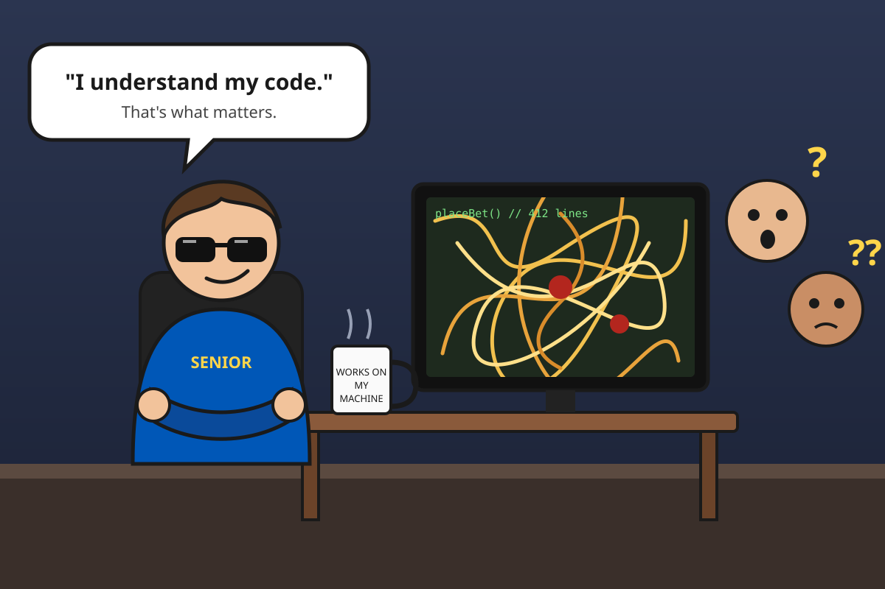
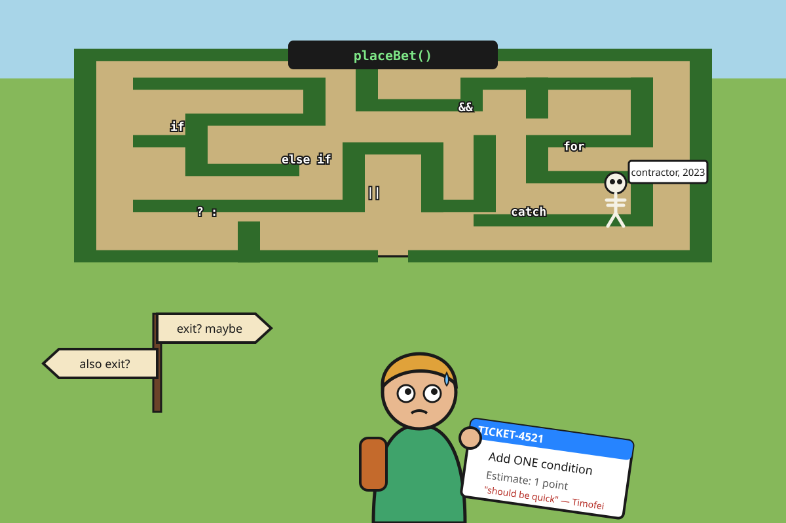
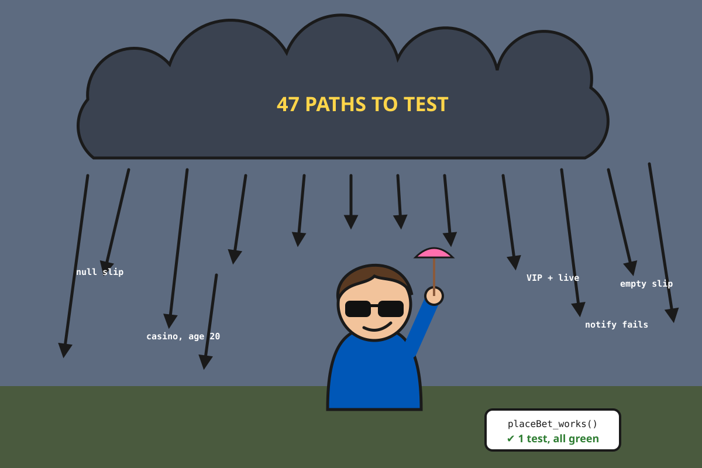
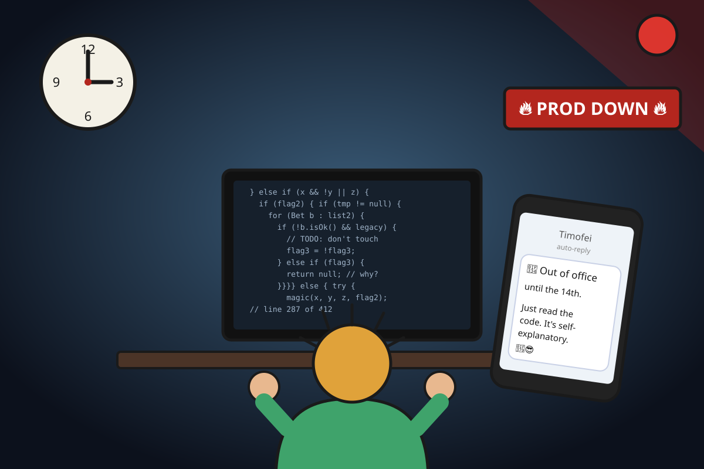
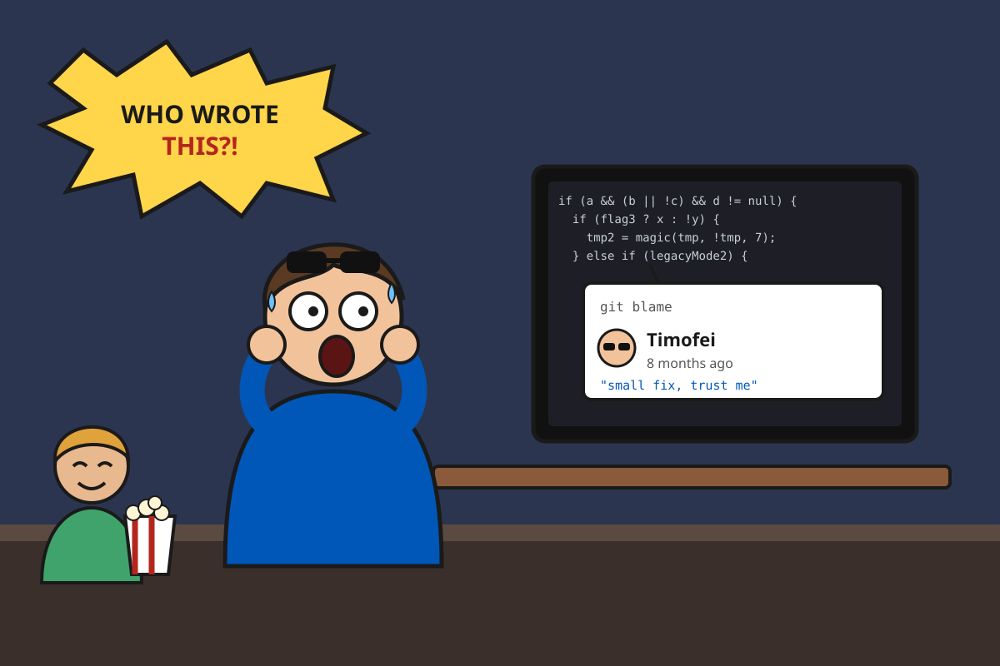
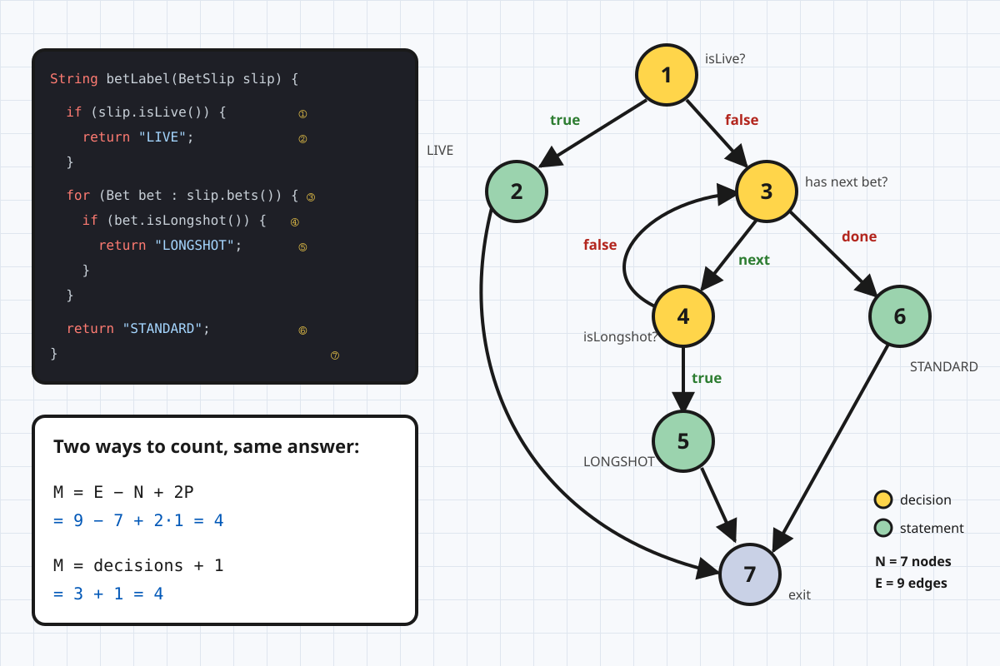
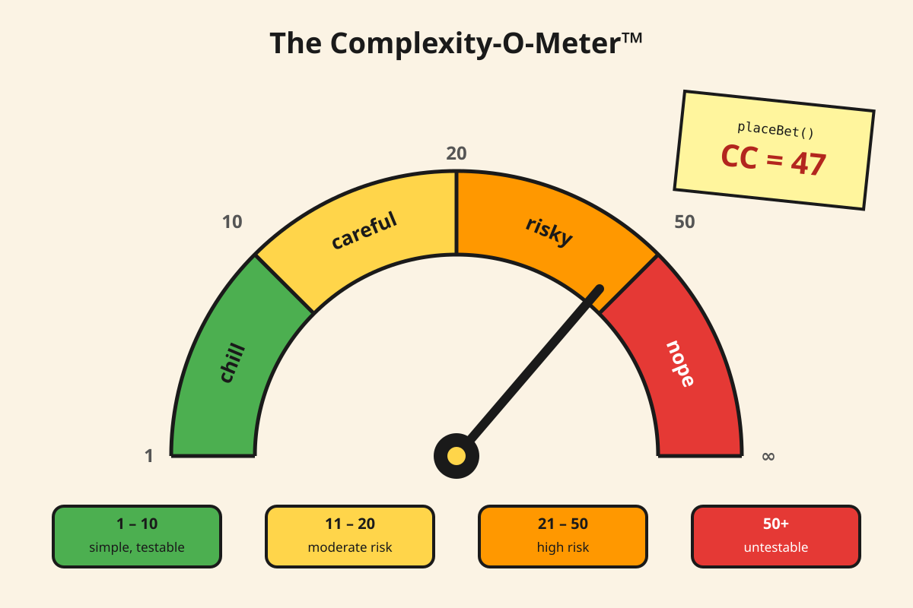
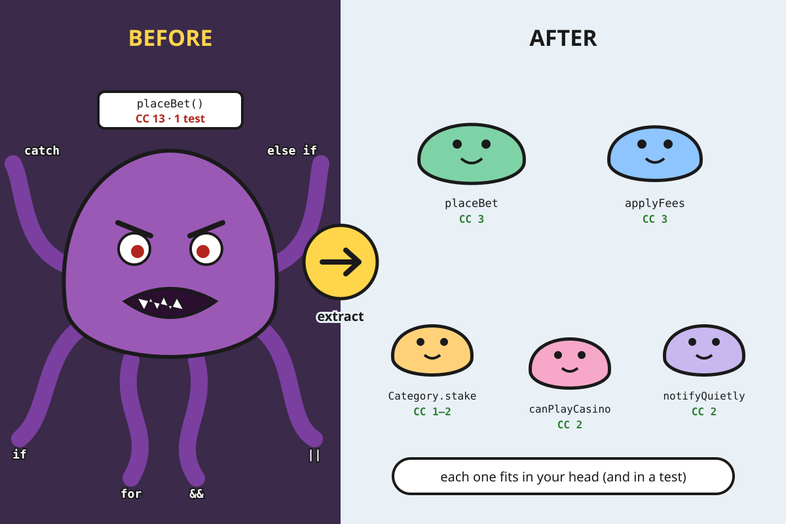

*A short story about Timofei. You've worked with Timofei. There's a chance you are Timofei.*



### Chapter 1: The Genius

Every team has a Timofei.

Timofei is a senior developer. We know this because Timofei says so. Timofei has worked in IT his whole life, and he knows everything. Just ask him. Actually, you don't have to ask, he will tell you anyway. He has been at the company since the very beginning, and he writes code the way Picasso painted: every piece is a masterpiece, and nobody can tell where the nose is supposed to be. Timofei does not write comments, because "good code is self-explanatory". Timofei does not split methods, because "jumping between files slows me down". Timofei does not need code review, because he has never once lost an argument in one. He just keeps typing until the reviewer gets tired.

Timofei's masterpiece is called `placeBet()`. It has 412 lines. It calculates stakes, applies betting taxes, checks the player's age, handles VIP cashback, adds live-betting fees, sends notifications, and on Tuesdays (nobody knows why) it rounds the odds differently.

When someone asks how it works, Timofei leans back, crosses his arms and says the sentence that became the team motto:

> "I understand my code. If you don't, that's your problem."

And honestly? He's right. He does understand it. It works. It's been in production for two years. What could possibly go wrong?

### Chapter 2: The New Guy



Meet Tom. Tom joined the team on Monday. On Tuesday, Tom got his first ticket:

> **TICKET-4521:** Players from Poland get live betting without the live fee. Estimate: 1 point. *"Should be quick" — Timofei*

One condition. One `if`. Tom opened `placeBet()`.

At line 40 Tom found a `for` loop. Inside the loop there was an `if`. Inside the `if` there was an `else if`, and inside that an `if` with three `&&` and one `||` that Tom read four times and still couldn't explain out loud. At line 180 there was a variable called `flag2`. At line 230 `flag2` was set to `!flag2`, for reasons. At line 301 there was a comment: `// don't touch`. Nothing else, just that.

Tom found where the live fee was calculated. Then he found the *second* place where the live fee was calculated. Then a third one, inside a `catch` block.

Tom asked Timofei. Timofei said "it's obvious, just read the code" and went to lunch.

The ticket took eleven days. The PR had 3 lines of code and 40 comments. Tom's estimate for the next ticket was 8 points, and the team lead asked him in the retro why he was "so slow".

### Chapter 3: The Tests



During the post-mortem for the Polish live betting feature (it charged Polish VIP players twice, but only on live bets, and only if one of the matches on the slip was suspended), somebody asked a dangerous question:

"Where are the tests for `placeBet()`?"

Timofei proudly opened `BetServiceTest.java`. It had one test. It was called `placeBet_works()`. It created a slip with one active football bet, no VIP status, no live betting, and checked that the total was not null.

It was green. It had always been green. It was green the day Polish VIPs were charged twice.

"We have coverage," Timofei said, and showed the report: 61% line coverage. The other 39% was "obvious stuff, it doesn't need tests".

Nobody in the room knew how many tests the method actually needed. Five? Ten? A hundred? You can't really answer that question by staring at 412 lines of nested `if`s. *(Spoiler: there is an exact answer, and it's coming.)*

### Chapter 4: 3 AM



Saturday, 3:07 AM. The pager goes off. Bets are failing for every player who has a casino game on the slip. In the middle of a Champions League weekend. The revenue graph looks like a ski jump.

Timofei is on a beach. Timofei's auto-reply says: *"Out of office until the 14th. Just read the code, it's self-explanatory 🍹"*.

Tom is on call. Tom opens `placeBet()` and starts tracing. The age check is in one branch. But there's also an `adminOverride` flag that skips the age check. Except when `legacyMode2` is on. Except when it's a live bet, where a different branch calculates the casino tax again, and that branch throws an exception if the player object has no birth date, and that exception is caught by a `catch` that sends a notification, and the notification fails, and the failure is caught by another `catch` that returns `null`.

Tom fixes it at 6:40 AM by adding another `if`. The method now has 413 lines. The complexity just went up again, and the next person to read this code will have one more path to keep in their head.

That's how these methods grow. Nobody sits down and writes a monster on purpose. It grows one `if` per incident.

### Chapter 5: Who Wrote This?!



Timofei comes back from vacation. Tan, relaxed, ready to fix whatever "the juniors broke". He opens `placeBet()` to review Tom's 3 AM fix.

He scrolls. He scrolls back. He reads line 287 out loud, slowly. He reads it again.

"Who wrote this garbage?"

He clicks *git blame*.

**Timofei. 8 months ago. Commit message: "small fix, trust me".**

Tom eats popcorn very quietly.

This is the part of the story that I like the most, because it's the part everybody has lived through. "I understand my code" has an expiration date. For most people it's about three weeks. After that, your own code is written by a stranger who had context you no longer have. Timofei wasn't writing code for "people who don't get it". He was writing code for nobody, including future Timofei.

So what was actually wrong with `placeBet()`? It wasn't the length, exactly. You can have a 400-line method that's boring and fine (a long list of field mappings, for example). It wasn't the naming, although `flag2` didn't help.

The problem was the number of different ways to go through it. And that number has a name, a formula, and a tool that will happily scream at Timofei in CI.

It's called **cyclomatic complexity**.

---

### What cyclomatic complexity actually is

Cyclomatic complexity (CC) was introduced by Thomas McCabe in 1976. The idea is simple: **it counts the number of linearly independent paths through a piece of code.** In plain words, it's how many different routes the execution can take through a method.

Code with no branches has exactly one route: top to bottom. Every `if` adds a fork in the road. Every loop adds a fork ("go around again, or leave?"). Every `&&` and `||` adds a fork too, because of short-circuit evaluation: `a && b` doesn't evaluate `b` when `a` is false, so there are two different routes there.

There are two ways to calculate it, and they give the same answer.

**The formal way, using the control flow graph:**

```
M = E − N + 2P
```

- `E` is the number of edges (arrows) in the graph
- `N` is the number of nodes (blocks of code)
- `P` is the number of connected components, which for a single method is just 1

**The practical way, which is what you'll actually use:**

```
M = number of decision points + 1
```

Let's do both on a small method so you can see that they agree.

### Counting it by hand

```java
String betLabel(BetSlip slip) {
    if (slip.isLive()) {                     // decision 1
        return "LIVE";
    }
    for (Bet bet : slip.bets()) {            // decision 2
        if (bet.isLongshot()) {              // decision 3
            return "LONGSHOT";
        }
    }
    return "STANDARD";
}
```

Three decision points, plus one. **CC = 4.**

Now the same method drawn as a graph:



Seven nodes, nine edges: `9 − 7 + 2 = 4`. Same answer.

And those 4 paths are real things you can name:

1. Live slip → `"LIVE"`
2. Not live, no bets → `"STANDARD"`
3. Not live, has a longshot bet → `"LONGSHOT"`
4. Not live, has bets, none of them longshots → `"STANDARD"`

That's four test cases. Not "one test, it's green", not "a hundred tests to be safe". Four. This is the most practical thing about cyclomatic complexity: **it tells you how many tests a method needs for every branch to be taken in both directions.** Strictly speaking, CC is an upper bound for full branch coverage and a lower bound for full path coverage. In practice, "CC tests per method" is a very good starting number.

```java
@Test void liveSlipGetsLiveLabel()               { ... }
@Test void emptySlipGetsStandardLabel()          { ... }
@Test void longshotBetGetsLongshotLabel()        { ... }
@Test void regularBetsGetStandardLabel()         { ... }
```

If you write fewer tests than CC, some path is untested. That's not an opinion, it's arithmetic.

### What counts as a decision point

This is where people get confused, so here's the list for Java. Each of these adds **+1**:

| Construct | Why |
|---|---|
| `if` | two ways out |
| `else if` | it's another `if` |
| `for`, `for-each`, `while`, `do-while` | loop again or exit |
| `case` in a `switch` (each one) | each case is a separate route |
| `catch` | the exceptional route |
| `? :` (ternary) | it's an `if` in disguise |
| `&&`, `\|\|` in a condition | short-circuit creates a route |

And these do **not** add anything:

| Construct | Why not |
|---|---|
| `else` | it's the other side of an `if` that was already counted |
| `default` in a `switch` | it's the fallback, not a new decision |
| `try`, `finally` | they always run |
| `return`, `throw`, `break` | they end a route, they don't create one |
| method calls | the complexity lives in the called method |

One honest note: tools disagree on details. Checkstyle can count a whole `switch` as one decision if you set `switchBlockAsSingleDecisionPoint`. Some tools count `&&` and `||`, and some older ones don't. Don't argue with your linter about 11 vs 12. Argue about 12 vs 47.

### Let's count Timofei

Here's `placeBet()`, shrunk down to fit in a blog post. The real one was 412 lines with CC 47. This is just the trailer:

```java
public BigDecimal placeBet(BetSlip slip, Player player, boolean live) {
    BigDecimal total = BigDecimal.ZERO;
    if (slip != null && slip.getBets() != null) {                     // +2
        for (Bet bet : slip.getBets()) {                              // +1
            if (bet.isActive()) {                                     // +1
                if (bet.getCategory() == Category.SPORTS) {           // +1
                    total = total.add(bet.getStake());
                } else if (bet.getCategory() == Category.CASINO) {    // +1
                    if (player.getAge() >= 21 || player.isAdminOverride()) { // +2
                        total = total.add(bet.getStake().multiply(CASINO_TAX));
                    } else {
                        throw new IllegalStateException("Too young");
                    }
                } else {
                    total = total.add(bet.getStake().multiply(DEFAULT_TAX));
                }
            }
        }
        if (player.isVip() && !live) {                                // +2
            total = total.multiply(VIP_CASHBACK);
        } else if (live) {                                            // +1
            total = total.add(LIVE_FEE);
        }
        try {
            notifier.send(player, total);
        } catch (NotificationException e) {                           // +1
            log.warn("whatever");
        }
    }
    return total;
}
```

12 decision points + 1 = **CC 13**. Thirteen tests for this tiny version. Timofei had one.

Also notice what CC *doesn't* tell you directly but you can feel anyway: to understand the casino branch you have to keep in your head that the slip is not null, the bets are not null, you're inside a loop, the bet is active, and it's not sports. That's five things of context before you even get to the age check. That's what Tom was drowning in.

### How much is too much



McCabe himself suggested 10 as the upper limit for a method, and that number stuck. The commonly used scale (from the Software Engineering Institute) looks like this:

| CC | What it means |
|---|---|
| 1–10 | Simple, low risk, easy to test |
| 11–20 | More complex, moderate risk |
| 21–50 | Complex, high risk |
| 50+ | Untestable in practice, very high risk |

These aren't laws of physics. A `switch` mapping 15 enum values to 15 strings has CC 16 and is perfectly readable. But when a method with nested `if`s goes above 10, it's almost always a sign that it's doing more than one thing. Studies over the years have consistently found a correlation between high complexity and defect density, which matches every on-call shift I've ever had.

### How to bring it down

The goal is not to make the number smaller for the sake of the number. The goal is that **every method fits in one person's head** and can be tested with a reasonable number of tests. The total amount of logic in the system usually stays about the same. You're just cutting it into pieces that can be understood one at a time.



#### 1. Extract method

The simplest and most effective one. Find a block that does one thing and give it a name.

```java
public BigDecimal placeBet(BetSlip slip, Player player, boolean live) {
    if (slip == null || slip.getBets() == null) {                     // CC 3
        return BigDecimal.ZERO;
    }
    BigDecimal total = slip.getBets().stream()
            .filter(Bet::isActive)
            .map(bet -> bet.getCategory().stake(bet, player))
            .reduce(BigDecimal.ZERO, BigDecimal::add);
    total = applyFees(total, player, live);
    notifyQuietly(player, total);
    return total;
}

private BigDecimal applyFees(BigDecimal total, Player player, boolean live) {
    if (live) {                                                       // CC 3
        return total.add(LIVE_FEE);
    }
    if (player.isVip()) {
        return total.multiply(VIP_CASHBACK);
    }
    return total;
}

private void notifyQuietly(Player player, BigDecimal total) {
    try {                                                             // CC 2
        notifier.send(player, total);
    } catch (NotificationException e) {
        log.warn("Failed to notify player {} about bet total", player.getId(), e);
    }
}
```

`placeBet()` now reads like a table of contents. You can understand what it does in five seconds, and you only go deeper into the part you actually care about. Tom's ticket about Polish live betting would have been a change in `applyFees()` with three tests next to it.

Notice that `applyFees()` also untangled the `isVip() && !live` / `else if (live)` combo. Same behavior, but now the order of the checks tells the story: live first, then VIP. Untangling boolean logic often removes decisions on its own.

#### 2. Replace conditionals with polymorphism

The `if (SPORTS) ... else if (CASINO) ... else` chain is a classic sign that the logic belongs to the type itself. In Java, an enum with behavior handles this really well:

```java
public enum Category {
    SPORTS {
        @Override
        BigDecimal stake(Bet bet, Player player) {                    // CC 1
            return bet.getStake();
        }
    },
    CASINO {
        @Override
        BigDecimal stake(Bet bet, Player player) {                    // CC 2
            if (!player.canPlayCasino()) {
                throw new IllegalStateException("Too young");
            }
            return bet.getStake().multiply(Taxes.CASINO);
        }
    },
    OTHER {
        @Override
        BigDecimal stake(Bet bet, Player player) {                    // CC 1
            return bet.getStake().multiply(Taxes.DEFAULT);
        }
    };

    abstract BigDecimal stake(Bet bet, Player player);
}
```

Adding a new game category no longer means finding the right `else if` in a 400-line method. You add a constant, and the compiler forces you to implement `stake()`.

If you're on Java 21, sealed interfaces with pattern matching are another option. They're a great fit when the variants carry different data:

```java
sealed interface Market permits PreMatch, Live, Outright {}
record PreMatch() implements Market {}
record Live(Duration betDelay) implements Market {}
record Outright(String tournamentId) implements Market {}

BigDecimal fee(Market market) {
    return switch (market) {
        case PreMatch p -> BigDecimal.ZERO;
        case Live l     -> LIVE_FEE;
        case Outright o -> BigDecimal.ZERO;
    };
}
```

Strictly by the numbers this `switch` still has CC 4, because each `case` counts. But it's flat, there's no nesting, and the compiler tells you when you forget a case. Which brings us to an important point a bit later.

#### 3. Move the condition to where the data lives

`player.getAge() >= 21 || player.isAdminOverride()` is a business rule about players, sitting inside a betting method. Give it a name and put it on `Player`:

```java
public boolean canPlayCasino() {                                      // CC 2
    return age >= 21 || adminOverride;
}
```

The complexity didn't disappear, it moved. But now it's in one place, it has a name that explains the intent, and it's tested once instead of being copy-pasted into three branches of `placeBet()` (which, remember, is exactly what happened with the live fee).

#### 4. Replace branching with data

A lot of `switch` and `if/else if` chains are really just lookup tables wearing a costume:

```java
// CC 5
BigDecimal bettingTaxRate(Country country) {
    if (country == Country.UA) return new BigDecimal("0.18");
    else if (country == Country.GB) return new BigDecimal("0.15");
    else if (country == Country.PL) return new BigDecimal("0.12");
    else if (country == Country.DE) return new BigDecimal("0.053");
    return DEFAULT_BETTING_TAX;
}
```

```java
// CC 1
private static final Map<Country, BigDecimal> BETTING_TAX = Map.of(
        Country.UA, new BigDecimal("0.18"),
        Country.GB, new BigDecimal("0.15"),
        Country.PL, new BigDecimal("0.12"),
        Country.DE, new BigDecimal("0.053"));

BigDecimal bettingTaxRate(Country country) {
    return BETTING_TAX.getOrDefault(country, DEFAULT_BETTING_TAX);
}
```

This one is a real reduction. The decisions are gone, not moved. And when rates live in data, they can come from config or a database later without touching code.

#### 5. Guard clauses (and a little honesty)

You'll see "use guard clauses" in every list of tips for reducing complexity. Here's the thing: guard clauses usually **don't** change the cyclomatic complexity number. This:

```java
if (bet != null) {
    if (bet.isWon()) {
        if (!bet.isPaidOut()) {
            payOut(bet);
        }
    }
}
```

and this:

```java
if (bet == null) return;
if (!bet.isWon()) return;
if (bet.isPaidOut()) return;
payOut(bet);
```

both have CC 4. Same number of decisions. But the second one is clearly easier to read, because you never have to remember three levels of "we're inside of...". That's a real improvement that cyclomatic complexity just can't see. Which leads to...

### Cyclomatic complexity's younger sibling

Cyclomatic complexity measures **how hard code is to test**. It doesn't measure very well **how hard code is to read**. A flat `switch` with 12 cases and a pyramid of 4 nested `if`s can have similar CC, but one of them makes you want to quit your job.

That's why SonarSource introduced **cognitive complexity** in 2017. It also adds +1 for each branch, but it adds *extra* points for nesting, and it counts a whole `switch` as just +1:

```java
// Cyclomatic: 4    Cognitive: 6
if (a) {                    // +1
    for (Bet bet : bets) {  // +2 (nested once)
        if (b) {            // +3 (nested twice)
            ...
        }
    }
}
```

```java
// Cyclomatic: 13   Cognitive: 1
return switch (status) {
    case PENDING -> ...;
    case WON -> ...;
    // ... 10 more cases
};
```

Use both. Cyclomatic complexity tells you how many tests to write. Cognitive complexity tells you how much your colleagues will curse you. Timofei's method was terrible on both.

### Making the robots tell Timofei

Nobody wants to be the person who says "your method is too complex" in every code review. Let a tool do it. Then it's not personal, it's the build.

**Checkstyle** (`config/checkstyle/checkstyle.xml`):

```xml
<module name="TreeWalker">
    <module name="CyclomaticComplexity">
        <property name="max" value="10"/>
        <property name="switchBlockAsSingleDecisionPoint" value="true"/>
    </module>
</module>
```

```groovy
// build.gradle
plugins {
    id 'checkstyle'
}

checkstyle {
    maxWarnings = 0
}
```

**PMD** has the same rule, with separate limits for methods and whole classes:

```xml
<rule ref="category/java/design.xml/CyclomaticComplexity">
    <properties>
        <property name="methodReportLevel" value="10"/>
        <property name="classReportLevel" value="80"/>
    </properties>
</rule>
<rule ref="category/java/design.xml/CognitiveComplexity"/>
```

**SonarQube / SonarCloud** has both rules out of the box: S1541 for cyclomatic complexity and S3776 for cognitive complexity (default threshold 15).

**In IntelliJ IDEA**, the *MetricsReloaded* plugin shows CC for every method in the project and lets you sort by it. Run it once on your codebase. The top 10 will be very familiar to whoever is on call most often.

On a legacy project you can't turn on `max=10` and fail the build tomorrow. Start with whatever your worst method is (say, 47), set the limit there so things can't get worse, and lower it a little every sprint. The boy scout rule, but enforced by CI.

### Epilogue

Timofei still works on the team. But `placeBet()` is now five methods and an enum, the biggest of them has CC 3, and there are 19 tests where there used to be one.

Last week Tom got a ticket to add a new game category. It was 1 point. It took 1 point.

Timofei reviewed it. He said "looks fine", and then, after a pause, "that's actually easy to read".

He still says "I understand my code". He just added a second part: "...and so does the build".

### Quick checklist

- Do you know the CC of the five methods that cause the most incidents? (They're probably the same five.)
- Does any method have fewer tests than its cyclomatic complexity?
- Is there a CC limit in your build, even a high one?
- Do you have `if/else if` chains on an enum or a type field that could be polymorphism or a `Map`?
- Is the same business rule (age checks, VIP checks, live fees) copy-pasted into several branches?
- When you write "I understand this", would you still understand it in three weeks, at 3 AM, without your sunglasses?
