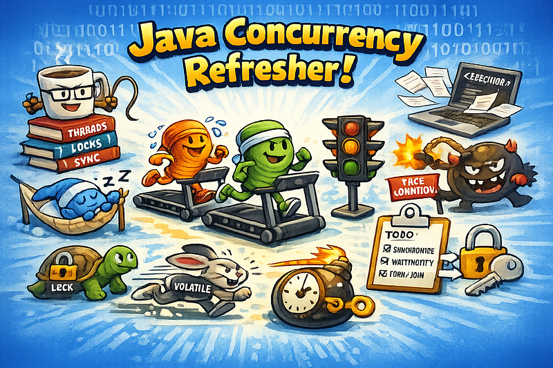
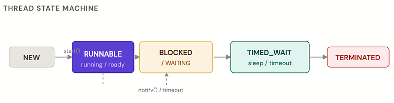
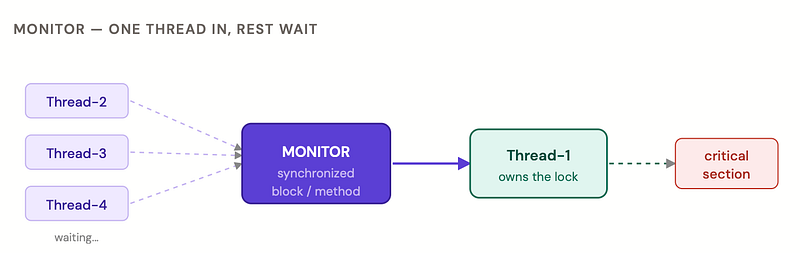
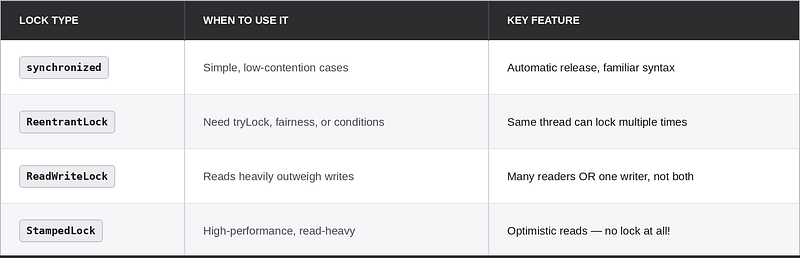
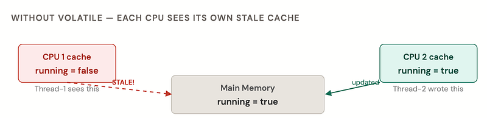
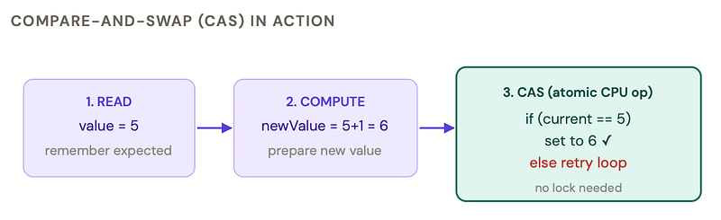
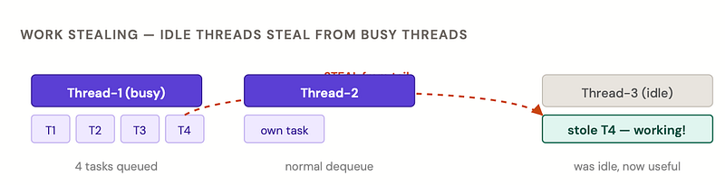
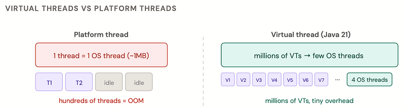
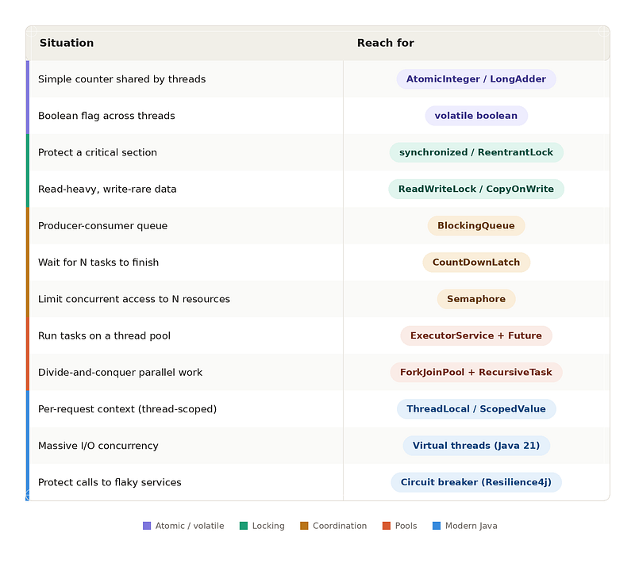

You’ve dealt with threads in production. You’ve seen the race conditions, the deadlocks, the “works on my machine” moments. This is a casual, example-first refresher — not a textbook.

### What even is a Thread?

A thread is the smallest unit of execution. Your JVM always has at least one — the main thread. Every thread has its own call stack, but they share heap memory, which is exactly why concurrency is both powerful and terrifying.

> *“Two threads walk into a bar. The bartender asks who’s first. Neither knows.”*

There are two classic ways to create a thread. Extend `Thread`, or implement `Runnable`. In practice you'll almost always use `Runnable` — or better yet, a lambda.

#### **Creating threads**

```java
// Option A: extend Thread (old school, limits inheritance)
class MyThread extends Thread {
    public void run() {
        System.out.println("I'm running on: " 
            + Thread.currentThread().getName());
    }
}

// Option B: Runnable (preferred - separates task from thread)
Runnable task = () -> System.out.println("Hello from a lambda thread!");
Thread t = new Thread(task, "my-worker");
t.start();   // spawns a new OS thread - DON'T call run() directly!
             // calling run() just executes it on the current thread
```

### Thread lifecycle

A thread goes through these states. It’s not always a straight line — it can bounce between *BLOCKED*, *WAITING*, and *RUNNABLE* while alive.



### Stopping a thread & join()

Java deprecated `Thread.stop()` long ago because it left objects in broken states. The right way is to use an interrupt flag and check it cooperatively inside your loop.

#### Stopping a thread gracefully + join()

```java
Thread worker = new Thread(() -> {
    while (!Thread.currentThread().isInterrupted()) {
        doSomeWork();
    }
    System.out.println("Thread stopping cleanly");
});

worker.start();
Thread.sleep(2000); // let it run 2 seconds
worker.interrupt(); // sets the interrupt flag - the thread will see it
worker.join();      // current thread blocks until worker is TERMINATED
worker.join(5000); // or with a 5s timeout - safer
System.out.println("Worker is done, continuing...");

// If your thread sleeps, InterruptedException is thrown when interrupted
Runnable sleeper = () -> {
    try {
        Thread.sleep(10_000);
    } catch (InterruptedException e) {
        Thread.currentThread().interrupt(); // re-set the flag!
        System.out.println("Woken up early, cleaning up");
    }
};
```

> ***CLASSIC MISTAKE***

> When catching `InterruptedException`, always call `Thread.currentThread().interrupt()`afterward. Catching the exception clears the interrupt flag — if you don't re-set it, the rest of the call stack will never know the thread was interrupted.

### Synchronization, monitors, wait & notify

Every Java object has a built-in monitor (also called an intrinsic lock). When you mark a method or block as `synchronized`, only one thread can hold that lock at a time. Everyone else queues up.



```java
class BankAccount {
    private double balance = 1000.0;
    // synchronized method - lock is the BankAccount instance

    public synchronized void withdraw(double amount) {
        if (amount > balance) throw new IllegalStateException("Insufficient funds");
        balance -= amount;
    }

    // synchronized block - more fine-grained, shorter lock duration
    public void deposit(double amount) {
        doSomeNonCriticalWork(); // runs without lock
        synchronized (this) {
            balance += amount;  // only this part is protected
        }
    }
}
```

### wait(), notify(), notifyAll()

These methods let threads *communicate through a shared object*. `wait()` releases the lock and puts the thread to sleep. `notify()` wakes one waiting thread. `notifyAll()` wakes them all. Classic producer-consumer:

#### Producer-Consumer with wait/notify

```java
class MessageBus {
    private String message;
    private boolean hasMessage = false;

    public synchronized void produce(String msg) throws InterruptedException {
        while (hasMessage) {
            wait(); // buffer full - release lock and sleep
        }
        message = msg;
        hasMessage = true;
        notifyAll(); // wake up consumer(s)
    }

    public synchronized String consume() throws InterruptedException {
        while (!hasMessage) {
            wait(); // nothing to consume - release lock and sleep
        }
        hasMessage = false;
        notifyAll(); // wake up producer
        return message;
    }
}
// Always use while() not if() - spurious wakeups are real!
```

> ***ALWAYS USE WHILE, NOT IF !!!***

> Wrap `wait()` in a `while` loop that re-checks the condition. Spurious wakeups (where a thread wakes up for no reason) are a real thing in the JVM spec. A `while` guards against them; an `if`doesn't.

### Types of Locks

`synchronized` is simple but limited. `java.util.concurrent.locks` gives you more power: try to acquire without blocking, set timeouts, choose fairness policy, and separate read from write access.



```java
ReentrantLock lock = new ReentrantLock();      // default: non-fair
ReentrantLock fairLock = new ReentrantLock(true); // threads served in order

// Always unlock in finally!
lock.lock();
try {
    doWork();
} finally {
    lock.unlock();
}

// tryLock - non-blocking. Perfect for avoiding deadlocks
if (lock.tryLock(100, TimeUnit.MILLISECONDS)) {
    try { doWork(); }
    finally { lock.unlock(); }
} else {
    System.out.println("Couldn't get the lock - moving on");
}

// ReadWriteLock - readers don't block each other
ReadWriteLock rwLock = new ReentrantReadWriteLock();
void read() {
    rwLock.readLock().lock();  // many threads can read simultaneously
    try { /* read */ }
    finally { rwLock.readLock().unlock(); }
}

void write(String val) {
    rwLock.writeLock().lock(); // exclusive - blocks all readers too
    try { /* write */ }
    finally { rwLock.writeLock().unlock(); }
}
```

### Lock Conditions — upgrade your wait/notify

Conditions are `wait()/notify()` but tied to a specific `ReentrantLock`. The big win: you can have *multiple conditions per lock* — wake only the producers, or only the consumers, not everyone.

#### Lock Conditions — targeted wake-up

```java
ReentrantLock lock = new ReentrantLock();
Condition notFull  = lock.newCondition(); // producers wait here
Condition notEmpty = lock.newCondition(); // consumers wait here
Queue<String> buffer = new LinkedList<>();
int capacity = 10;

void produce(String item) throws InterruptedException {
    lock.lock();
    try {
        while (buffer.size() == capacity) notFull.await();
        buffer.add(item);
        notEmpty.signal(); // wake ONE consumer, not everyone
    } finally { lock.unlock(); }
}

String consume() throws InterruptedException {
    lock.lock();
    try {
        while (buffer.isEmpty()) notEmpty.await();
        String item = buffer.poll();
        notFull.signal(); // wake ONE producer
        return item;
    } finally { lock.unlock(); }
}
```

### Volatile — the visibility keyword

Without `volatile`, threads can cache variables in CPU registers and never see updates made by other threads. `volatile` tells the JVM: **"always read this from and write this to main memory."**



```java
class Worker implements Runnable {
    private volatile boolean running = true; // always read from main memory
    
    public void run() {
        while (running) {
            doWork();
        }
        System.out.println("Stopped!");
    }

    public void stop() {
        running = false; // visible to all threads immediately
    }
}

// volatile also prevents instruction reordering across the write
// Useful for the "double-checked locking" singleton pattern:
class Singleton {
    private static volatile Singleton instance;
    public static Singleton getInstance() {
        if (instance == null) {
            synchronized (Singleton.class) {
                if (instance == null) {
                    instance = new Singleton(); // volatile needed here
                }
            }
        }
        return instance;
    }
}
```

> ***VOLATILE ≠ ATOMIC***

> `volatile int count; count++;` is still NOT thread-safe. Increment is three operations (read, add, write). Use `AtomicInteger` instead. `volatile` only guarantees visibility, not compound atomicity.

### Atomic variables, CAS & CPU cache

`java.util.concurrent.atomic` classes use Compare-And-Swap (CAS) — a single CPU instruction. It checks if a value is what you expect; if yes, swaps it atomically. If no (another thread changed it), it retries. No locks. No blocking. Very fast.



```java
AtomicInteger counter = new AtomicInteger(0);
counter.incrementAndGet();         // returns new value (++count)
counter.getAndIncrement();         // returns old value (count++)
counter.addAndGet(5);             // counter += 5
counter.compareAndSet(5, 10);    // if 5, set to 10 - returns true/false

// AtomicReference for any object
AtomicReference<String> ref = new AtomicReference<>("old");
ref.compareAndSet("old", "new"); // thread-safe swap

// LongAdder - faster than AtomicLong under HIGH contention
// Uses multiple cells internally to reduce CAS collisions
LongAdder adder = new LongAdder();
adder.increment();
adder.add(42L);
long total = adder.sum(); // slightly eventual - sums all cells

// AtomicStampedReference - fixes the ABA problem
// (value changes A→B→A; CAS wrongly thinks nothing changed)
AtomicStampedReference<String> stamped =
    new AtomicStampedReference<>("A", 0);
stamped.compareAndSet("A", "B", 0, 1); // must match stamp too
```

### Daemon threads

A daemon thread is a background thread that the JVM will kill as soon as all non-daemon (user) threads finish. It doesn’t prevent the JVM from exiting. Think: garbage collector, log flusher, heartbeat pinger.

#### User thread (default)

*JVM waits for it to finish. Use for your app’s main work — processing requests, writing to DB, etc.*

#### Daemon thread

*JVM kills it abruptly when all user threads exit. Use for background housekeeping that should NOT block shutdown.*

```java
Thread heartbeat = new Thread(() -> {
    while (true) {
        sendPing();
        Thread.sleep(5000);
    }
});

heartbeat.setDaemon(true); // MUST be set before start()!
heartbeat.start();
// When main thread ends → JVM exits → heartbeat is killed
// No waiting, no graceful shutdown, just poof
// Check if a thread is daemon:
boolean isDaemon = heartbeat.isDaemon(); // true
```

> ***DON’T DO I/O IN DAEMON THREADS***

> Daemon threads get killed mid-operation — no finally blocks, no cleanup. Never do database writes, file flushes, or any state-critical work in a daemon thread. It will be cut off without warning.

### ExecutorService & Future

Creating raw threads is wasteful — each costs ~1MB of stack. `ExecutorService` manages a pool of reusable threads. You submit tasks; it runs them. Done.

`Callable` is like `Runnable` but it can return a value and throw checked exceptions. Submitting a `Callable` gives you a `Future` — a promise for the result.

```java
ExecutorService pool = Executors.newFixedThreadPool(4);

// Submit a Callable - returns a Future
Future<String> future = pool.submit(() -> {
    Thread.sleep(1000);
    return "Data from DB"; // can return values!
});
System.out.println("Doing other stuff while DB query runs...");

// get() blocks until done - or throws on error/timeout
String result = future.get(5, TimeUnit.SECONDS);
System.out.println(result);

// invokeAll - submit a batch, wait for ALL
List<Callable<Integer>> tasks = List.of(
    () -> computeA(),
    () -> computeB(),
    () -> computeC()
);
List<Future<Integer>> results = pool.invokeAll(tasks, 10, TimeUnit.SECONDS);

// invokeAny - return first result, cancel the rest (hedged requests!)
Integer fastest = pool.invokeAny(tasks);

// Always shut down! An ExecutorService keeps the JVM alive
pool.shutdown();
if (!pool.awaitTermination(30, TimeUnit.SECONDS)) {
    pool.shutdownNow();
}
```

### Thread Pool types

Java gives you factory methods for common pool configurations. In production, you’ll often configure `ThreadPoolExecutor` directly to know exactly what you're running on.

#### newFixedThreadPool(n)

*N threads, unlimited queue. Good for CPU-bound work. Risk: queue grows unbounded under sustained load.*

#### newCachedThreadPool()

*Unlimited threads, 60s idle timeout. Good for bursty short tasks. Danger: thread explosion under sustained load.*

#### newSingleThreadExecutor()

*One thread, sequential. Like a lock-free serial queue. Great for ordered processing.*

#### newScheduledThreadPool(n)

*Delay and periodic tasks. Replacement for* `Timer`*— one exception won't kill future runs.*

```java
ThreadPoolExecutor executor = new ThreadPoolExecutor(
    4,                                      // corePoolSize — always-alive threads
    16,                                     // maxPoolSize — burst capacity
    60L, TimeUnit.SECONDS,                  // idle thread keepalive
    new LinkedBlockingQueue<>(200),        // bounded queue — prevents OOM
    r -> {
        Thread t = new Thread(r, "api-worker-" + counter.incrementAndGet());
        t.setDaemon(true);
        return t;
    },
    new ThreadPoolExecutor.CallerRunsPolicy() // backpressure: caller runs it
);

// Rejection policies when queue is full:
// AbortPolicy      → throws RejectedExecutionException (default)
// CallerRunsPolicy → caller thread executes the task (natural throttle)
// DiscardPolicy    → silently drops the task (risky!)
// DiscardOldestPolicy → drops the oldest queued task and retries
// Monitor your pool in production:
executor.getActiveCount();         // threads currently working
executor.getQueue().size();        // tasks waiting - this growing = bottleneck!
executor.getCompletedTaskCount();  // total completed tasks
```

### ForkJoinPool & recursive tasks

Regular thread pools are bad at recursive divide-and-conquer: a thread splits a task into subtasks and then blocks waiting for them — wasting a thread. `ForkJoinPool` uses work stealing: idle threads steal subtasks from busy threads' queues. Nobody sits idle.



```java
import java.util.concurrent.*;

class SumTask extends RecursiveTask<Long> {
    private final int[] data;
    private final int from, to;
    static final int THRESHOLD = 1000; // split until chunk is small enough
    SumTask(int[] data, int from, int to) {
        this.data = data; this.from = from; this.to = to;
    }
    protected Long compute() {
        if (to - from <= THRESHOLD) {
            long sum = 0;
            for (int i = from; i < to; i++) sum += data[i];
            return sum;
        }
        int mid = (from + to) / 2;
        SumTask left = new SumTask(data, from, mid);
        SumTask right = new SumTask(data, mid, to);
        left.fork();              // push left to thread pool
        long rightResult = right.compute(); // run right inline
        return left.join() + rightResult;   // join left result
    }
}
ForkJoinPool fjp = ForkJoinPool.commonPool(); // shared JVM-wide pool
long total = fjp.invoke(new SumTask(bigArray, 0, bigArray.length));
// RecursiveAction for void tasks (no return value)
```

### CountDownLatch

A `CountDownLatch` is a one-time gate. You initialize it with a count. Threads call `countDown()` to decrement it. Anyone waiting on `await()` is released when it hits zero. Think of it as a race starting pistol — or waiting for all microservices to warm up before accepting traffic.

```java
int workerCount = 5;
CountDownLatch latch = new CountDownLatch(workerCount);
ExecutorService pool = Executors.newFixedThreadPool(workerCount);

for (int i = 0; i < workerCount; i++) {
    final int id = i;
    pool.submit(() -> {
        try {
            processChunk(id);
        } finally {
            latch.countDown(); // ALWAYS in finally - even on exception
        }
    });
}
latch.await();        // main thread blocks here
// latch.await(10, TimeUnit.SECONDS); // or with timeout
System.out.println("All chunks processed!");
// Starting gun pattern - release all threads simultaneously
CountDownLatch startGun = new CountDownLatch(1);
for (int i = 0; i < 10; i++) {
    new Thread(() -> {
        startGun.await(); // all 10 threads wait here
        runBenchmark();
    }).start();
}
startGun.countDown(); // fires - all 10 released at the same instant
```

### Semaphore

A `Semaphore` controls access to a limited pool of resources. Think: connection pool with N connections, or a rate limiter that caps concurrent requests. It maintains a count of *permits*. Threads acquire permits; if none are available, they block. When done, they release.

```java
// Only 3 DB connections available
Semaphore dbPool = new Semaphore(3);
void queryDatabase() throws InterruptedException {
    dbPool.acquire();   // blocks if all 3 permits are taken
    try {
        runQuery();
    } finally {
        dbPool.release(); // always release in finally!
    }
}

// tryAcquire - non-blocking version
if (dbPool.tryAcquire(500, TimeUnit.MILLISECONDS)) {
    try { runQuery(); }
    finally { dbPool.release(); }
} else {
    returnCachedResult(); // graceful fallback
}

// Semaphore(1) = mutex (similar to synchronized, but acquirable across methods)
Semaphore mutex = new Semaphore(1);

// Fair semaphore - threads served in arrival order (no starvation)
Semaphore fair = new Semaphore(5, true);
```

### CopyOnWrite collections

`CopyOnWriteArrayList` and `CopyOnWriteArraySet` trade write performance for read performance. Every write creates a fresh copy of the underlying array. Readers always see a consistent snapshot. Zero locking on reads.

#### Perfect for…

*Event listener lists. Configuration snapshots. Anything read many times, updated rarely (like once per deployment).*

#### Terrible for…

*Large collections with frequent writes. Every add/remove copies the entire array — O(n) memory allocation per write.*

```java
CopyOnWriteArrayList<EventListener> listeners = new CopyOnWriteArrayList<>();

// Write - creates a new internal array, old readers unaffected
listeners.add(myListener);
listeners.remove(oldListener);

// Read - snapshot, safe without any locking
// Iterating CopyOnWriteArrayList never throws ConcurrentModificationException
for (EventListener l : listeners) {
    l.onEvent(event); // concurrent add/remove won't break this loop
}

// Regular ArrayList under the same scenario would need:
List<EventListener> synced = Collections.synchronizedList(new ArrayList<>());
synchronized (synced) { // must manually sync iteration!
    for (EventListener l : synced) l.onEvent(event);
}
```

### ThreadLocal

`ThreadLocal` gives each thread its own isolated copy of a variable. No sharing, no synchronization needed. Classic uses: per-request user context, database connection per thread, or formatters (which aren't thread-safe).

```java
// Static ThreadLocal — each thread gets its own value
static ThreadLocal<User> currentUser = new ThreadLocal<>();

// Set at the start of a request (e.g. in a filter/interceptor)
currentUser.set(authenticatedUser);

// Anywhere deep in the call stack - no need to pass the user around
User user = currentUser.get();

// CRITICAL: always clean up! Thread pools reuse threads.
// Old value from a previous request will leak to the next!
try {
    currentUser.set(user);
    handleRequest();
} finally {
    currentUser.remove(); // prevents memory leaks in thread pools
}

// ThreadLocal with default value
ThreadLocal<SimpleDateFormat> formatter =
    ThreadLocal.withInitial(() -> new SimpleDateFormat("yyyy-MM-dd"));

// InheritableThreadLocal - child threads inherit parent's value
InheritableThreadLocal<String> traceId = new InheritableThreadLocal<>();
traceId.set("req-abc-123");
new Thread(() -> System.out.println(traceId.get())).start(); // "req-abc-123"
```

> ***MEMORY LEAK TRAP***

> In a thread pool, threads are reused indefinitely. If you set a `ThreadLocal` and never call `remove()`, the value stays attached to that thread forever — causing memory leaks and data leaking between requests. Always clean up in a `finally` block.

### Virtual Threads (Java 21)

Traditional platform threads map 1:1 to OS threads. 1 MB stack. ~10,000 max before things get painful. Virtual threads are JVM-managed — lightweight, cheap to create by the million. When a virtual thread blocks (I/O, sleep, lock), the JVM *unmounts* it from the carrier OS thread and parks it. The carrier is free to run another virtual thread. Magic.



```java
// Create a single virtual thread
Thread vt = Thread.ofVirtual().name("my-vt").start(() -> handleRequest());

// Virtual thread per task - executor backed by virtual threads
try (ExecutorService executor = Executors.newVirtualThreadPerTaskExecutor()) {
    for (Request req : incoming) {
        executor.submit(() -> handle(req)); // each gets a new virtual thread
    }
} // auto-shutdown on close

// Blocking I/O is now FINE - JVM unmounts the virtual thread while waiting
// No need for reactive/async code just to avoid blocking
// Check if a thread is virtual:

Thread.currentThread().isVirtual(); // true
// What NOT to do with virtual threads:
// 1. Don't pin with synchronized + blocking I/O (use ReentrantLock instead)
// 2. Don't use thread pools of virtual threads (defeats the purpose)
// 3. ThreadLocal still works but be careful with large values at scale
```

> ***WHEN TO USE VIRTUAL THREADS***

> They shine for I/O-bound, high-concurrency work — HTTP servers, database calls, file reads. They don’t help CPU-bound work (you’re still limited by CPU cores). If you’re using Spring Boot 3.2+, you can enable virtual threads with a single property: `spring.threads.virtual.enabled=true`.

### ScopedValue (Java 25)

`ScopedValue` is the modern answer to `ThreadLocal`. The problems with `ThreadLocal`: mutable (anyone can change it), inherited unboundedly (leaks to child threads), and requires manual cleanup. `ScopedValue` is immutable per scope, automatically scoped to a bounded call tree, and works naturally with virtual threads and structured concurrency.

#### ThreadLocal

*Mutable. Lives as long as the thread (or until* `remove()`*). Can leak. Doesn't compose well with virtual threads at scale.*

#### ScopedValue

*Immutable within scope. Auto-cleaned when scope exits. No leaks. Designed for virtual threads and structured concurrency.*

```java
// Declare a ScopedValue (like a typed key)
static final ScopedValue<User> CURRENT_USER = ScopedValue.newInstance();

// Bind a value for the duration of a lambda
ScopedValue.where(CURRENT_USER, authenticatedUser)
    .run(() -> {
        processRequest();    // can read CURRENT_USER
        callServiceLayer();  // and so can anything it calls
    });

// scope exits → binding is gone. No cleanup needed.
// Read it anywhere inside the scope
void processRequest() {
    User user = CURRENT_USER.get(); // works!
    System.out.println("Processing for: " + user.name());
}

// Re-bind for child scope (doesn't mutate parent)
ScopedValue.where(CURRENT_USER, adminUser)
    .run(() -> {
        User u = CURRENT_USER.get(); // adminUser here
    });

// Back here: CURRENT_USER is still authenticatedUser
// Works great with structured concurrency (Java 21+)
try (var scope = new StructuredTaskScope.ShutdownOnFailure()) {
    scope.fork(() -> callServiceA()); // CURRENT_USER is inherited
    scope.fork(() -> callServiceB()); // automatically - no ThreadLocal tricks
    scope.join().throwIfFailed();
}
```

> ***STATUS***

> ScopedValue is finalized in Java 25 (JEP 487). It was in preview since Java 21. If you’re on Java 21–24, add `--enable-preview` to use it. It pairs naturally with `StructuredTaskScope` for structured concurrency.

### Cheat sheet — pick your tool


