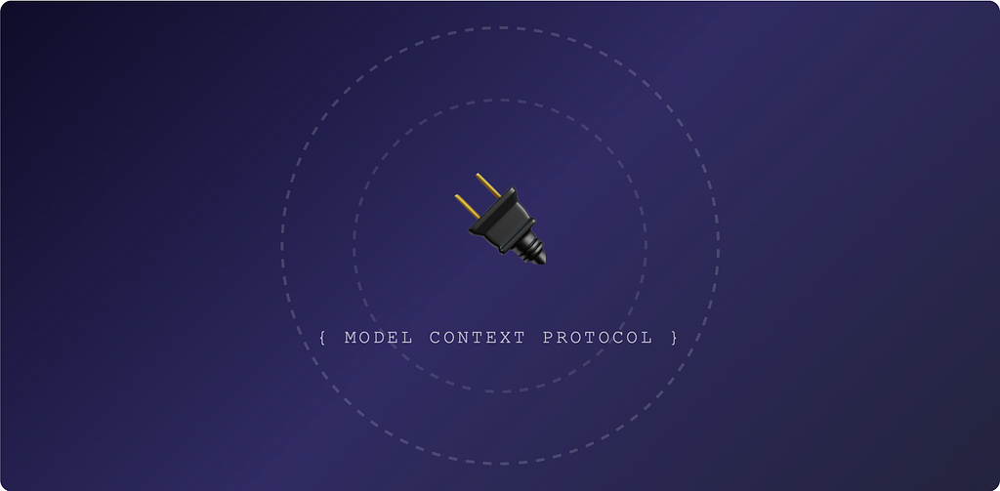
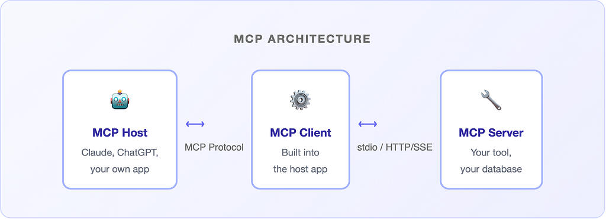
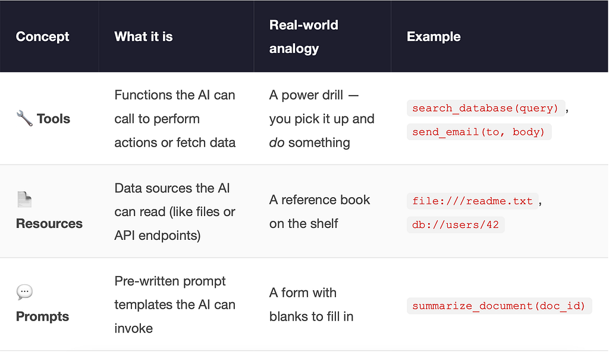
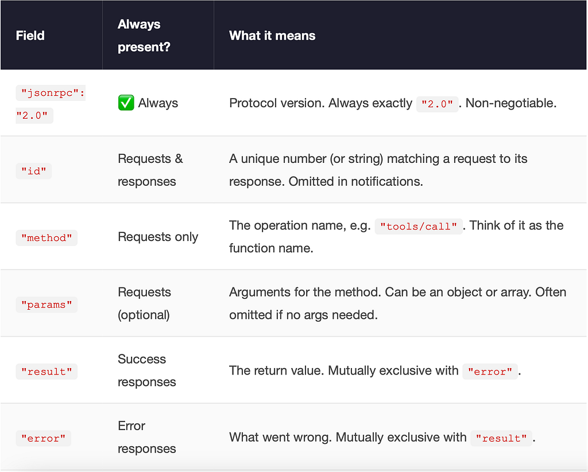
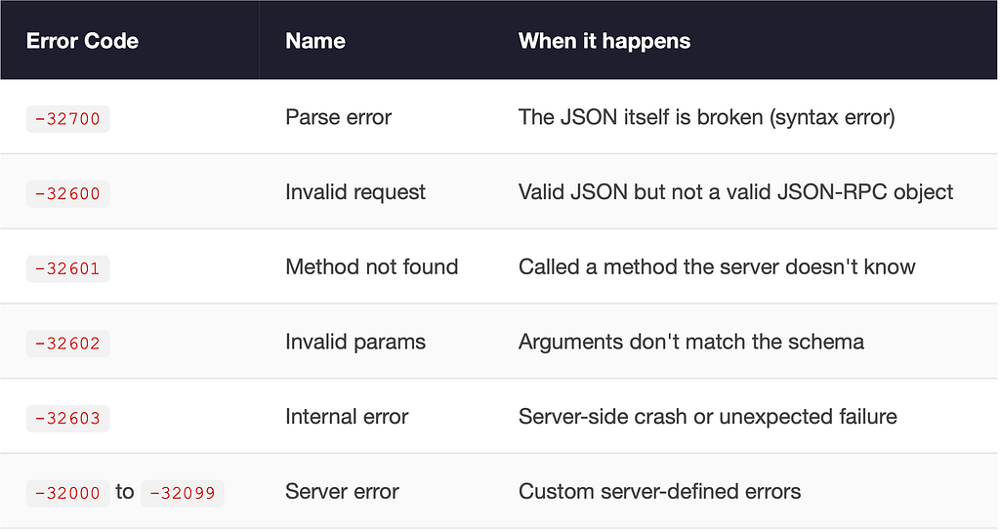
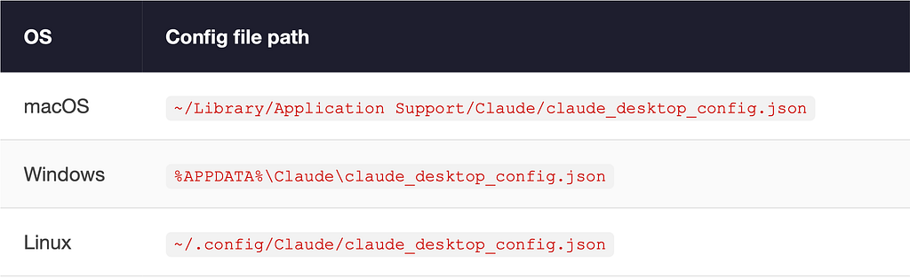
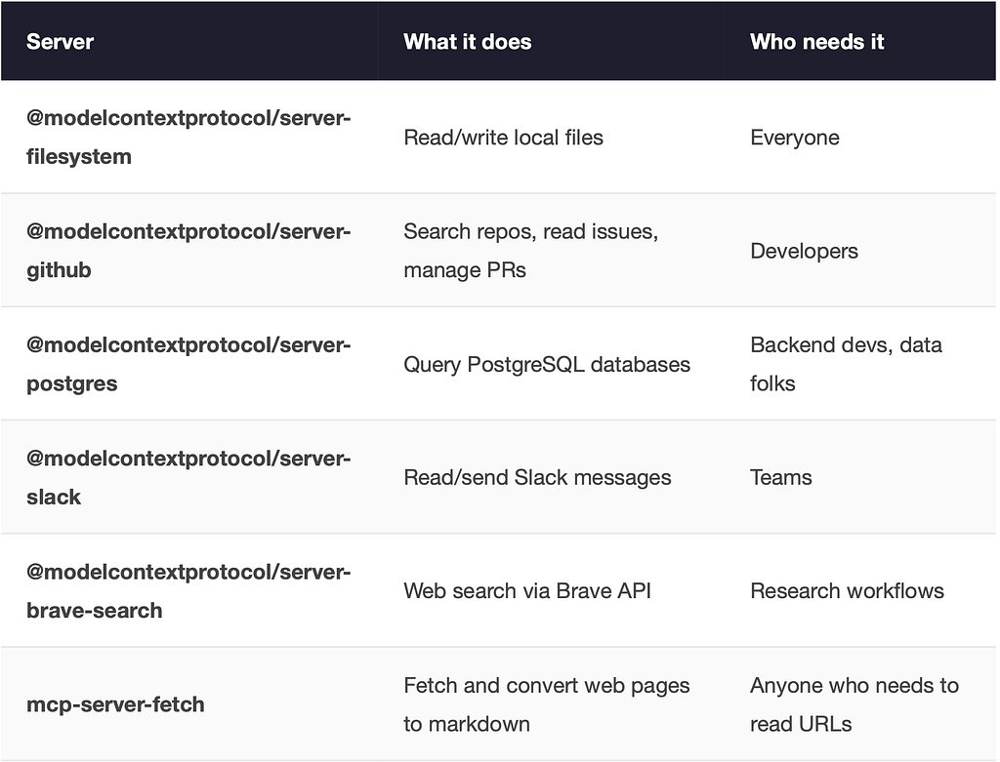

*A beginner’s guide to Model Context Protocol — the thing that lets your AI assistant actually do stuff, not just talk about doing stuff.*



Picture this: you’ve got the most brilliant assistant in the world. Knows everything. Speaks 50 languages. Can explain quantum physics and write poetry at the same time. But here’s the catch — **they’re locked in a glass box**. They can see your computer screen. They can describe what they’d do if they could reach it. But touch anything? Nope. Read a file? Uh-uh. Check your calendar? Dream on.

That was AI assistants until very recently. Incredibly smart, utterly helpless. Like hiring Einstein to organize your sock drawer and then refusing to let him into the room.

Enter **MCP — the Model Context Protocol**. The thing that breaks the glass and lets your AI assistant actually *do the thing*.

> *MCP is essentially a USB standard for AI. Before USB, every device needed its own special plug. Now there’s one protocol, and everything just… works.*

By the end of this article you’ll understand what MCP is, why it exists, how it works, and — most importantly — you’ll build your own working MCP server from scratch and connect it to Claude. Buckle up.

### A Brief History of AI’s Helplessness Problem

To understand why MCP is a big deal, we need to appreciate just how spectacularly bad the situation was before it.

> **EARLY 2023**

> Large Language Models (LLMs) become genuinely impressive. Everyone rushes to build assistants. The dream: AI that manages your life. The reality: AI that describes your life back to you very eloquently.

> **MID 2023**

> “Function calling” arrives. Now you can tell the AI: “hey, you can call these functions.” Progress! But every app invents its own format. A plugin for ChatGPT works nowhere else. A LangChain tool chain doesn’t talk to Claude. It’s the Wild West, but with JSON.

> **LATE 2023–2024**

> Developers build increasingly elaborate custom integrations. Everyone reinvents the wheel. Slightly differently. Slightly wrongly. A thousand incompatible “AI tool” standards bloom. This is the Tower of Babel, Silicon Valley edition.

> **NOVEMBER 2024**

> **Anthropic releases the Model Context Protocol**. An open standard. One protocol to rule them all. The developer community collectively exhales. Finally.

> **2025**

> MCP adoption explodes. OpenAI, Google, Microsoft all announce support. Hundreds of MCP servers appear on GitHub. Your AI can now read files, browse the web, query databases, control your computer, send Slack messages, and order pizza. (Well, almost.)

The key insight Anthropic had was embarrassingly simple: **instead of every AI model learning to speak every tool’s language, make every tool learn one common language**. The result is MCP.

### What Is MCP, Actually?

MCP stands for **Model Context Protocol**. It’s an open standard (meaning anyone can use it, free of charge) that defines how AI models communicate with external tools and data sources.

Think of it as a formal language that both sides agree to speak. The AI model is one speaker. Your tool (a file reader, a database, a weather API, your smart fridge) is the other speaker. MCP is the language between them.

> **The one-sentence explanation:**  
> MCP lets AI models talk to *any* tool through a single standardized protocol, so you write the connector once and it works everywhere.

Technically, MCP is a client-server architecture built on top of [**JSON-RPC**](https://www.jsonrpc.org/specification) **2.0**. Don’t be scared by that. It means messages are passed as readable JSON objects, and there’s a strict format for how requests and responses look. Clean, simple, predictable.

### The Architecture: Three Amigos

MCP has three main characters. Let’s meet them:



#### The Host

> The application running the AI. Could be Claude Desktop, VS Code with Copilot, or your own app. The host is the conductor — it decides when the AI needs a tool and coordinates everything.

#### The Client

> Technically a component *inside* the host. It handles the actual MCP communication — sends requests to servers, gets back results, feeds them to the AI. You don’t usually build this yourself.

#### The Server

> **This is what you build.** An MCP server exposes capabilities — tools, resources, and prompts — that the AI can use. Your server could wrap a database, a REST API, the local file system, or anything else. This is where the magic you write lives.

### Core Concepts: Tools, Resources & Prompts

MCP servers expose three types of things to AI models. Think of these as different kinds of “capabilities”:



For most real-world use cases you’ll mainly deal with **Tools**. That’s where the action is.

### How They Talk: The MCP Message Format

MCP messages are JSON objects following the [**JSON-RPC 2.0**](https://www.jsonrpc.org/specification) specification. Every single message — whether it’s a greeting, a tool call, or an error — follows the same envelope structure. Once you learn the envelope, the rest is just filling in the blanks.

#### The Anatomy of Every Message

All JSON-RPC messages share the same top-level fields. Let’s dissect them:



### Phase 1 — The Handshake: initialize

Before any tools are called, the host and server must introduce themselves. This is the very first exchange that happens when Claude Desktop spawns your server process. Think of it as two people shaking hands and agreeing on a common language before getting to business.

1A. HOST → SERVER: INITIALIZE REQUEST

```
{
  "jsonrpc": "2.0",
  "id": 0,
  "method": "initialize",
  "params": {
    "protocolVersion": "2024-11-05",        // MCP spec version the host supports
    "capabilities": {
      "roots": { "listChanged": true },    // Host can notify server about root changes
      "sampling": {}                         // Host supports LLM sampling requests
    },
    "clientInfo": {
      "name": "Claude Desktop",
      "version": "0.7.0"
    }
  }
}
```

1B. SERVER → HOST: INITIALIZE RESPONSE

```
{
  "jsonrpc": "2.0",
  "id": 0,                                    // Same id — this is the matching reply
  "result": {
    "protocolVersion": "2024-11-05",        // Server confirms the version
    "capabilities": {
      "tools": { "listChanged": false }    // Server exposes tools (and won't hot-reload them)
    },
    "serverInfo": {
      "name": "my-first-mcp-server",
      "version": "1.0.0"
    }
  }
}
```

1C. HOST → SERVER: INITIALIZED NOTIFICATION (NO REPLY EXPECTED)

```
{
  "jsonrpc": "2.0",
  "method": "notifications/initialized"
  // No "id" field — this is a notification, not a request.
  // Notifications are fire-and-forget; the server never replies.
}
```

After this three-step handshake, the connection is live and both sides know what the other can do. Now the real fun begins.

### Phase 2 — Tool Discovery: tools/list

The host immediately asks: “OK, what tools do you have?” This lets the AI know its full menu of capabilities before the user types a single character.

2A. HOST → SERVER: TOOLS/LIST REQUEST

```
{
  "jsonrpc": "2.0",
  "id": 1,
  "method": "tools/list"
  // No "params" needed — just asking for the full list.
}
```

2B. SERVER → HOST: TOOLS/LIST RESPONSE (WITH FULL INPUTSCHEMA)

```
{
  "jsonrpc": "2.0",
  "id": 1,
  "result": {
    "tools": [
      {
        "name": "get_weather",
        "description": "Get current weather for any city.",
        "inputSchema": {          // Standard JSON Schema object
          "type": "object",
          "properties": {
            "city": {
              "type": "string",
              "description": "City name, e.g. Belfast"
            },
            "unit": {
              "type": "string",
              "enum": ["celsius", "fahrenheit"],   // Constrained to specific values
              "default": "celsius"
            }
          },
          "required": ["city"]            // "unit" is optional, "city" is not
        }
      },
      {
        "name": "search_database",
        "description": "Search products by keyword with optional filters.",
        "inputSchema": {
          "type": "object",
          "properties": {
            "query": { "type": "string" },
            "limit": {
              "type": "integer",
              "minimum": 1,
              "maximum": 100,
              "default": 10
            },
            "tags": {
              "type": "array",              // Arrays of primitives are fine
              "items": { "type": "string" }
            }
          },
          "required": ["query"]
        }
      }
    ]
  }
}
```

> The inputSchema is standard [**JSON Schema**](https://json-schema.org/understanding-json-schema/about). You can use type, enum, minimum, maximum, default, array, nested object — any JSON Schema feature. The AI model reads this schema and uses it to build valid arguments automatically. Good schemas = fewer mistakes by the AI.

### Phase 3 — Tool Execution: tools/call

The user says something. The AI decides a tool is needed. It fires a tools/callwith the arguments it constructed from the schema.

3A. SIMPLE CALL — ONE STRING ARGUMENT

```
{
  "jsonrpc": "2.0",
  "id": 2,
  "method": "tools/call",
  "params": {
    "name": "get_weather",
    "arguments": {
      "city": "Belfast"           // Only the required field; "unit" uses its default
    }
  }
}
```

3B. COMPLEX CALL — MULTIPLE TYPES INCLUDING ARRAY

```
{
  "jsonrpc": "2.0",
  "id": 3,
  "method": "tools/call",
  "params": {
    "name": "search_database",
    "arguments": {
      "query": "wireless headphones",
      "limit": 5,                  // integer
      "tags": ["bluetooth", "noise-cancelling"]  // array
    }
  }
}
```

3C. SUCCESS RESPONSE — TEXT CONTENT

```
{
  "jsonrpc": "2.0",
  "id": 2,
  "result": {
    "content": [
      {
        "type": "text",
        "text": "Current weather in Belfast: 12°C, wind 18 km/h"
      }
    ],
    "isError": false          // Optional. Explicitly marks success.
  }
}
```

3D. SUCCESS RESPONSE — MULTIPLE CONTENT BLOCKS

```
{
  "jsonrpc": "2.0",
  "id": 3,
  "result": {
    "content": [
      {
        "type": "text",
        "text": "Found 2 results for 'wireless headphones':"
      },
      {
        "type": "text",         // Second block — same message, more content
        "text": "1. Sony WH-1000XM5 — £279\n2. Bose QC45 — £249"
      }
      // Could also include "image" blocks with base64 data,
      // or "resource" blocks referencing URIs
    ]
  }
}
```

### Phase 4 — When Things Go Wrong: Error Responses

There are two distinct flavours of error in MCP. Don’t mix them up — they mean very different things.

PROTOCOL ERROR — THE REQUEST ITSELF WAS MALFORMED

```
{
  "jsonrpc": "2.0",
  "id": 4,
  "error": {                         // "error" field, NOT "result"
    "code": -32602,                  // Standard JSON-RPC error code
    "message": "Invalid params",
    "data": {
      "details": "Required field 'city' is missing"
    }
  }
}
```



TOOL-LEVEL ERROR — THE TOOL RAN BUT THE OPERATION FAILED

```
{
  "jsonrpc": "2.0",
  "id": 5,
  "result": {                        // Still "result", NOT "error" !
    "content": [
      {
        "type": "text",
        "text": "City 'Narnia' not found in geocoding database."
      }
    ],
    "isError": true               // Flag tells the AI: tool ran, but reported failure
  }
}
```

> **Key distinction:** A *protocol error* (using the "error" field) means the communication broke — bad JSON, unknown method, missing required fields. A *tool error* (using "result" with "isError": true) means the tool ran fine but the operation itself failed — user not found, city doesn't exist, API returned 404. Always use isError: true for business logic failures so the AI can read the message and react intelligently.

### Bonus: Resource Reads and Notifications

Tools aren’t the only thing MCP can do. Here’s what a **resource read** looks like — useful when you want to expose file contents or database records the AI can browse:

RESOURCES/READ REQUEST AND RESPONSE

```
// Request
{
  "jsonrpc": "2.0",
  "id": 6,
  "method": "resources/read",
  "params": {
    "uri": "file:///home/user/notes.txt"    // Resource URIs identify the data source
  }
}
// Response
{
  "jsonrpc": "2.0",
  "id": 6,
  "result": {
    "contents": [
      {
        "uri": "file:///home/user/notes.txt",
        "mimeType": "text/plain",
        "text": "Buy milk. Deploy the thing. Don't forget stand-up."
      }
    ]
  }
}
```

And a **server notification** — fire-and-forget messages the server sends without being asked (no id, no reply expected):

SERVER → HOST NOTIFICATION (NO REPLY)

```
{
  "jsonrpc": "2.0",
  "method": "notifications/tools/list_changed",
  // No "id" — this is a push notification.
  // The server is telling the host: "Hey, my tool list changed.
  //  Please call tools/list again to refresh."
}
```

Clean and readable. No magic, no wizardry. Just JSON going back and forth. This predictability is exactly what makes MCP powerful — any language, any framework, any tool can implement it.

### Two Ways to Connect: stdio vs HTTP/SSE

MCP servers can communicate via two transport mechanisms:

**stdio (Standard I/O)** — The simplest option. Your server reads from stdin and writes to stdout. The host app spawns the server as a subprocess. Perfect for local tools running on the same machine.

**HTTP + SSE (Server-Sent Events)** — For remote servers. The client sends POST requests to the server, and the server streams events back. Use this when your MCP server lives on a different machine (a cloud server, a colleague’s computer, etc.).

> Start with **stdio**. It’s simpler, requires no networking setup, and is perfect for local tooling. You can always switch to HTTP later.

### Tutorial: Building server.py Step by Step

Enough theory. Let’s write the actual code. Below is a complete, annotated server.py that exposes three tools: a dad joke generator, a task list, and a real live weather lookup. We'll build it section by section so nothing is a mystery.

📦**Install first:** pip install mcp — that's the only dependency. Python 3.10+ required.

#### Part 1 — Imports & Server Instantiation

The MCP SDK ships everything you need in the mcp package. We create a Server instance and tell it our name and version — this is what Claude Desktop sees in the handshake.

**server.py — Part 1: imports and setup**

```
# Standard library — no extra installs needed for HTTP calls
import asyncio
import random
import json
import urllib.request
import urllib.parse
import sys                   # needed for stderr debug output
# MCP SDK - install with: pip install mcp
from mcp.server import Server
from mcp.server.stdio import stdio_server
from mcp import types
# Create the server. The name/version appear during the MCP handshake.
# Claude Desktop displays this name in its connected servers list.
app = Server("my-first-mcp-server")
```

#### Part 2 — Declaring Tools with @app.list\_tools()

This decorator registers the handler that responds to tools/list requests. The AI calls this automatically on startup to discover your full menu of capabilities. **The descriptions you write here are read by the AI** — write them like you're explaining the tool to a smart colleague, not a compiler.

**server.py — Part 2: tool declarations**

```
@app.list_tools()
async def list_tools() -> list[types.Tool]:
    return [
        # ── Tool 1: dad_joke ──────────────────────────────────────
        # No arguments. The inputSchema is an empty object.
        # The AI will call this whenever the user needs cheering up.
        types.Tool(
            name="dad_joke",
            description="Returns a random, gloriously terrible dad joke. Use when morale is low.",
            inputSchema={
                "type": "object",
                "properties": {},    # no arguments - jokes are free
                "required": [],
            },
        ),
        # ── Tool 2: get_tasks ─────────────────────────────────────
        # One required string argument: username.
        # "required" list enforces that the AI must supply it.
        types.Tool(
            name="get_tasks",
            description="Returns the task list for a given user.",
            inputSchema={
                "type": "object",
                "properties": {
                    "username": {
                        "type": "string",
                        "description": "The username whose tasks to fetch, e.g. 'alice'",
                    },
                },
                "required": ["username"],
            },
        ),
        # ── Tool 3: get_weather ───────────────────────────────────
        # Calls the real Open-Meteo API. No API key required.
        # "unit" is optional - has a default value in the handler.
        types.Tool(
            name="get_weather",
            description="Get current weather for any city. Uses Open-Meteo (free, no API key needed).",
            inputSchema={
                "type": "object",
                "properties": {
                    "city": {
                        "type": "string",
                        "description": "City name, e.g. Belfast, Tokyo, New York",
                    },
                    "unit": {
                        "type": "string",
                        "enum": ["celsius", "fahrenheit"],
                        "description": "Temperature unit. Defaults to celsius.",
                    },
                },
                "required": ["city"],   # "unit" is optional - omit from required
            },
        ),
    ]
```

#### Part 3 — Handling Tool Calls with @app.call\_tool()

When the AI decides to invoke a tool, this handler fires. It receives the tool name and the arguments dict the AI built from your schema. Return a list of TextContent objects — even if there's only one. Always return a list; the protocol expects it.

**server.py — Part 3: tool logic**

```
@app.call_tool()
async def call_tool(name: str, arguments: dict) -> list[types.TextContent]:
# ── dad_joke ──────────────────────────────────────────────
    if name == "dad_joke":
        jokes = [
            "Why don't scientists trust atoms? Because they make up everything.",
            "I told my wife she was drawing her eyebrows too high. She looked surprised.",
            "Why do programmers prefer dark mode? Because light attracts bugs.",
            "I asked my dog what two minus two is. He said nothing.",
            "Why did the MCP server go to therapy? Too many unhandled exceptions.",
        ]
        return [types.TextContent(type="text", text=random.choice(jokes))]
    # ── get_tasks ─────────────────────────────────────────────
    # In real life you'd query a DB here. We use a dict for clarity.
    if name == "get_tasks":
        username = arguments.get("username", "").lower()
        fake_tasks = {
            "alice": ["Review PR #42", "Update docs", "Fix that bug you've been ignoring"],
            "bob":   ["Stand-up meeting", "Drink coffee", "Question all life choices"],
        }
        tasks = fake_tasks.get(username, ["No tasks found. Either very productive or very lazy."])
        formatted = "\n".join(f"{i+1}. {t}" for i, t in enumerate(tasks))
        return [types.TextContent(type="text", text=f"Tasks for {username}:\n{formatted}")]
    # ── get_weather ───────────────────────────────────────────
    # Two HTTP calls: geocode the city name → get weather by lat/lon.
    # Uses urllib (stdlib) so no extra dependencies.
    if name == "get_weather":
        city = arguments.get("city", "")
        unit = arguments.get("unit", "celsius")   # default if AI omits it
        # Step 1 - turn city name into coordinates
        geo_url = (
            "https://geocoding-api.open-meteo.com/v1/search"
            f"?name={urllib.parse.quote(city)}&count=1"
        )
        with urllib.request.urlopen(geo_url) as r:
            geo = json.loads(r.read())
        if not geo.get("results"):
            # Tool ran fine, but the operation failed - use isError flag
            return [types.TextContent(type="text", text=f'City "{city}" not found.')]
        result = geo["results"][0]
        lat, lon, found_name = result["latitude"], result["longitude"], result["name"]
        # Step 2 - fetch current weather for those coordinates
        wx_url = (
            "https://api.open-meteo.com/v1/forecast"
            f"?latitude={lat}&longitude={lon}"
            f"¤t_weather=true&temperature_unit={unit}"
        )
        with urllib.request.urlopen(wx_url) as r:
            wx = json.loads(r.read())
        cw = wx["current_weather"]
        symbol = "°C" if unit == "celsius" else "°F"
        return [types.TextContent(            type="text",            text=f"{found_name}: {cw['temperature']}{symbol}, wind {cw['windspeed']} km/h",        )]
    # Unknown tool - raise so MCP returns a proper protocol error
    raise ValueError(f"Unknown tool: {name}")
```

### Part 4 — Wiring Up stdio Transport

The final piece connects the server to the MCP host via stdin/stdout. stdio\_server() returns two async streams; we hand them to app.run() and it takes care of the rest. The key thing to remember: **never** **print() to stdout** anywhere in your code — that channel belongs to MCP. Debug with sys.stderr only.

server.py — Part 4: entry point

```
async def main():
    # stdio_server() yields (read_stream, write_stream) for the MCP host.
    # Everything inside this block is the server's lifetime.
    async with stdio_server() as (read_stream, write_stream):
        print("MCP server started", file=sys.stderr)   # stderr is safe for debug
        await app.run(
            read_stream,
            write_stream,
            app.create_initialization_options(),
        )
if __name__ == "__main__":
    asyncio.run(main())
```

💡**Why** **async?** MCP uses async I/O because servers often wait on multiple things at once — the host, network calls, file reads. Python's asyncio lets a single thread handle all of that without blocking. You don't need to understand the internals; just know that every handler must be async def, and use await before any I/O call.

### Connecting Your Server to Claude Desktop

Once you’ve written your server.py, plugging it into Claude Desktop takes two minutes. Download Claude Desktop from **claude.ai/download** — it's free and has an MCP client built in. Then locate the config file for your OS:



Register your server by adding it to that file:

CLAUDE\_DESKTOP\_CONFIG.JSON

```
{
  "mcpServers": {
    "my-first-mcp-server": {
      "command": "python",
      "args": [
        "/absolute/path/to/my-first-mcp-server/server.py"
      ],
      "env": {
        "MY_API_KEY": "sk-..."    // Pass secrets here; read with os.environ in Python
      }
    }
  }
}
```

> **Important:** Use the *absolute path* to your server.py file. No tildes, no relative paths. Get the path with pwd on Mac/Linux or cd on Windows, and paste the full thing in.

Fully quit Claude Desktop (not just close the window) and reopen it. Look for the 🔧 tools icon in the chat input — that means MCP is connected. Then just ask Claude naturally: *“Tell me a dad joke”* or *“What tasks does Alice have?”* — it figures out on its own when to call your tools. No special syntax needed.

### Best Practices (a.k.a. Mistakes I’m Saving You From)

**Write excellent descriptions**

> The AI reads your tool descriptions to decide when to use them. Vague descriptions = confused AI = bad results. Be specific: what does the tool do, when should it be used, what do the arguments mean?

**Never** **print() to stdout for debug output**

> In stdio transport, stdout is the MCP communication channel. Any stray print() call will corrupt the protocol stream. Always write debug output to stderr: print("debug", file=sys.stderr).

**Validate your inputs**

> The AI sometimes passes unexpected values. Check that required arguments exist. Validate formats. Return helpful error messages rather than cryptic crashes.

**Keep tools focused**

> One tool, one job. Don’t build a do\_everything() tool. Small, well-named tools are easier for the AI to reason about and call correctly. Think Unix philosophy: do one thing well.

**Use environment variables for secrets**

> Never hardcode API keys. Pass them via the env key in your claude\_desktop\_config.json: "env": { "API\_KEY": "your-key-here" }. Read with os.environ["API\_KEY"] in your server.

### The MCP Ecosystem: You Don’t Have to Build Everything

Here’s some great news: the open-source community has already built hundreds of MCP servers you can just plug in and use. Some highlights:



Find these and more at **github.com/modelcontextprotocol/servers** — the official repo — and on **mcp.so**, a community directory. There’s a good chance what you need already exists.

### Wrapping Up: Why This Matters

MCP isn’t just a neat technical standard. It represents a fundamental shift in what AI assistants actually are.

Before MCP: AI as an *oracle*. You ask, it tells. Great for knowledge questions. Useless for action.

After MCP: AI as an *agent*. You describe what you want, it figures out which tools to use, calls them, interprets the results, and gets the job done. The AI becomes an active participant rather than a fancy search engine.

> The future isn’t AI that can describe how to fix your code. It’s AI that fixes your code, runs the tests, creates the PR, and messages your team. MCP is the foundation that makes all of that possible.

You’ve now seen the full picture: the history, the architecture, the wire format, and a working server from scratch. The next step is yours. Pick a tool you use daily — a database, an API, a local service — and wrap it in an MCP server. Once you’ve done it once, you’ll find excuses to do it for everything.

Happy building. 🚀
