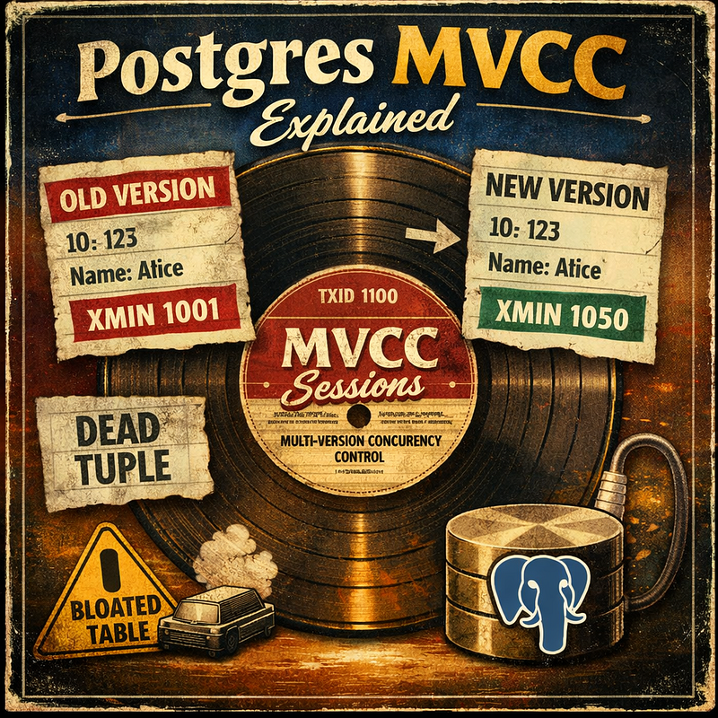
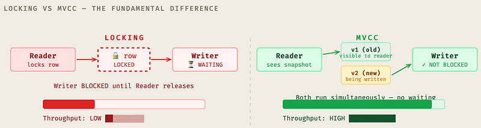
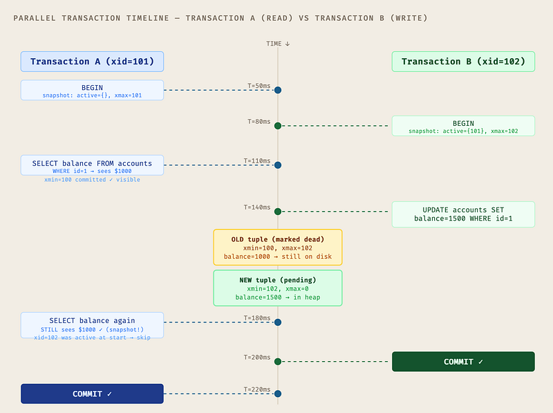
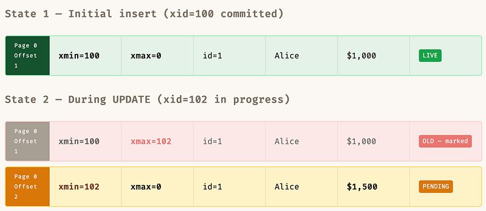
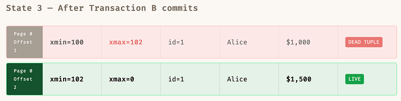
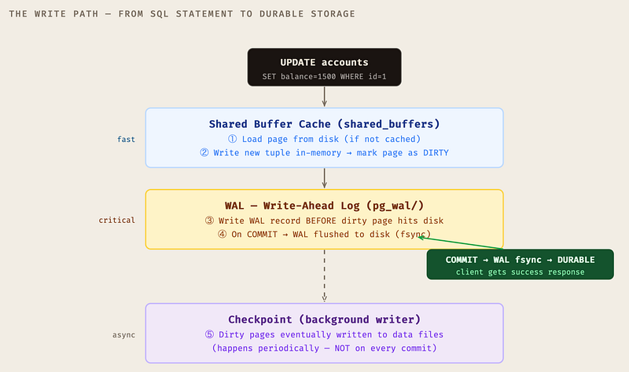
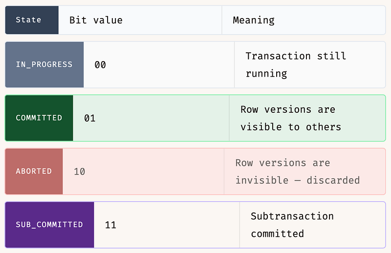
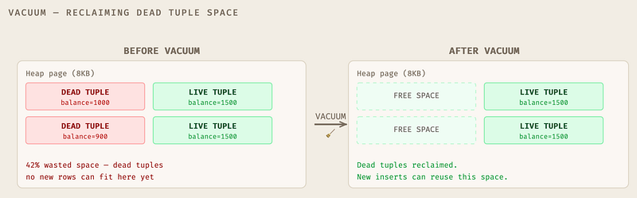
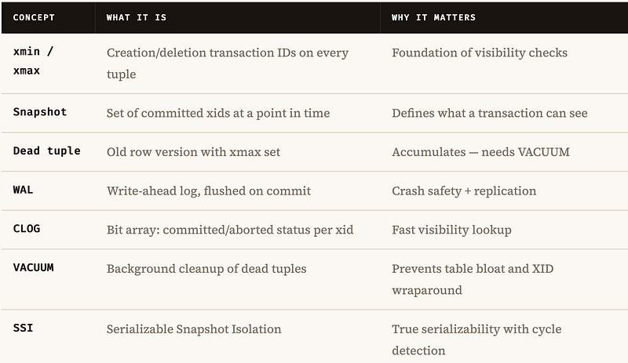

Every time two transactions run at the same time in PostgreSQL, something remarkable happens under the hood. Nobody locks the table. Nobody waits. Yet everyone sees a consistent view of the data. This is MVCC — Multi-Version Concurrency Control — and once you understand it, you’ll never look at your database the same way again.

### What is MVCC?

Imagine a library where every book has a version number. When you check out a book to read it, the librarian doesn’t lock it away from everyone else. Instead, they hand you the version that existed at the moment you arrived. If someone else rewrites the book while you’re reading — you still see the original. You’re reading a snapshot in time.

That’s MVCC. Multi-Version Concurrency Control means PostgreSQL keeps multiple versions of each row simultaneously. Readers see a consistent snapshot of the database at the moment their transaction started. Writers create new versions without touching what readers see. Readers never block writers. Writers never block readers.

> *In PostgreSQL, every transaction lives in its own bubble of reality — a consistent snapshot of the world at the moment it began.*

### The problem it solves

The naive approach to concurrent database access is locking — when someone reads a row, lock it so nobody can write it. When someone writes, lock the whole table. This works, but it turns your high-throughput database into a single-file queue. MVCC replaces most of those locks with versioned row history.



### The core mechanism: transaction IDs

Every transaction in PostgreSQL gets a monotonically increasing transaction ID (called `xid`). When a row is created or modified, PostgreSQL stamps it with the transaction IDs of who created it and who deleted it. These stamps — stored directly in the row header — are what make MVCC work.

> **🔑 THE TWO HIDDEN COLUMNS EVERY ROW CARRIES**

> `xmin` — the transaction ID that created (inserted) this row version.  
> `xmax` — the transaction ID that deleted or superseded this row version. `0` means the row is still live.

> You can actually query these: `SELECT xmin, xmax, * FROM your_table;`

### Two transactions, one table, zero drama

Let’s walk through exactly what happens when two transactions run at the same time. We’ll watch every step — from snapshot creation to commit — with the actual row versions PostgreSQL maintains internally.

Our table: a simple `accounts` table. Alice has $1000. Transaction A is going to read her balance. Transaction B is going to update it. Watch how they never get in each other's way.

```sql
CREATE TABLE accounts (
    id      INT PRIMARY KEY,
    name    TEXT,
    balance NUMERIC
);

INSERT INTO accounts VALUES (1, 'Alice', 1000);
-- Inserted by transaction xid=100, so xmin=100, xmax=0

-- What PostgreSQL actually stores internally:
-- | xmin | xmax | id | name  | balance |
-- |  100 |    0 |  1 | Alice |    1000 |
```

### The timeline — step by step



> **💡 THE KEY INSIGHT**

> When Transaction A reads Alice’s balance at T=180ms — *after* Transaction B has already modified it — it still sees $1000. Because when A started, B’s xid (102) was in the active transaction list. A’s snapshot says: “treat everything from xid=102 as if it doesn’t exist.” This is the snapshot isolation guarantee.

### How PostgreSQL evaluates row visibility

For every row a transaction encounters, PostgreSQL runs a visibility check. It’s essentially a set of rules against the row’s `xmin` and `xmax`:

```sql
is_visible(row, my_snapshot):
  -- Rule 1: creator must have committed before my snapshot
  IF row.xmin NOT IN my_snapshot.committed:
    RETURN false   -- creator not committed yet

  -- Rule 2: creator must not be in my active list
  IF row.xmin IN my_snapshot.active:
    RETURN false   -- creator was in-flight when I started

  -- Rule 3: if deleted, deleter must NOT have committed before me
  IF row.xmax != 0:
    IF row.xmax IN my_snapshot.committed
       AND row.xmax NOT IN my_snapshot.active:
      RETURN false  -- deleter committed → row is dead to me

  RETURN true  -- this row version is visible to me
```

### Row versions on disk — what the heap actually looks like

PostgreSQL stores rows in heap pages — 8KB chunks on disk. Every row version (called a tuple) has a header containing the MVCC metadata. When you UPDATE a row, the old tuple isn’t erased — it gets a new `xmax` stamp and a new tuple is inserted right next to it. Both live on the same page (or a new one if it's full).

> 📐 TUPLE HEADER FIELDS

> `t_xmin` — xid of the inserting transaction | `t_xmax` — xid of the deleting/updating transaction | `t_ctid` — physical location (page, offset) of the latest version of this row | `t_infomask` — bitfield of flags (committed? rolled back? frozen?)

### Watching the heap through an UPDATE

Let’s trace the exact state of the heap after each operation on Alice’s row:



*↑ Transaction A (xid=101) reads Offset 1 only — Offset 2 has xmin=102 which is in A’s active set → invisible*



*↑ Offset 1 is now a dead tuple — wasting space until VACUUM runs. New transactions see only Offset 2.*

> **⚠️ THE UPDATE IS ACTUALLY INSERT + LOGICAL DELETE**

> PostgreSQL never updates a row in place. Every `UPDATE` creates a brand new tuple and marks the old one as dead by setting its `xmax`. This is why long-running UPDATE-heavy workloads cause table bloat — dead tuples accumulate until VACUUM reclaims the space.

### The ctid chain

Each old tuple’s `t_ctid` field points to the location of the next version. This creates a version chain that PostgreSQL follows to find the latest valid version of a row. You can inspect this with:

```sql
-- See the hidden MVCC columns on any table
SELECT
    ctid,              -- physical location: (page, offset)
    xmin,              -- creating transaction ID
    xmax,              -- deleting transaction ID (0 = live)
    xmin::text::bigint,
    age(xmax::text::xid) AS xmax_age,
    *
FROM accounts;

-- Result during a concurrent update:
-- ctid  | xmin | xmax | id | name  | balance
-- (0,1) |  100 |  102 |  1 | Alice |    1000  ← dead, xmax set
-- (0,2) |  102 |    0 |  1 | Alice |    1500  ← live, new version

-- See how many dead tuples are in a table
SELECT
    n_live_tup,
    n_dead_tup,
    last_autovacuum,
    last_vacuum
FROM pg_stat_user_tables
WHERE relname = 'accounts';
```

### How updates persist — from buffer to disk

When Transaction B runs `UPDATE accounts SET balance=1500`, it doesn't immediately go to the database file on disk. That would be catastrophically slow. Instead, PostgreSQL uses a layered architecture that keeps changes in memory until it's safe and efficient to flush them.



### The WAL — your durability guarantee

The Write-Ahead Log is PostgreSQL’s crash safety mechanism. The rule is simple: *before any dirty page can be written to the data file, its changes must first be recorded in the WAL and flushed to disk.*

When you `COMMIT`, PostgreSQL writes a commit record to WAL and calls `fsync()`. That's what makes your data durable. If PostgreSQL crashes between commit and checkpoint, recovery replays the WAL to restore the committed state. Your $1500 is safe.

> 📌 WHAT HAPPENS DURING THE TRANSACTION (BEFORE COMMIT)

> The new tuple (`xmin=102, balance=1500`) sits in the shared buffer cache with a pending status. The WAL record has been written for crash recovery purposes, but the page isn't flushed to the main data file yet. Other sessions can't see the new version because `xmin=102` is still in the active transaction list of their snapshots.

### CLOG — tracking commit status

How does a transaction know whether `xmin=102` is committed or rolled back? PostgreSQL maintains the Commit Log (CLOG) — a compact bit array where each transaction ID maps to one of four states:



When a transaction commits, PostgreSQL updates the CLOG bit from `IN_PROGRESS` to `COMMITTED`. This is the moment other transactions can start seeing the new tuple. The CLOG update is fast — it's just a bit flip in a shared-memory structure — and PostgreSQL caches the status of recently-seen transactions in tuple header hint bits to avoid CLOG lookups on every read.

```sql
-- Session A: start a transaction and update
BEGIN;
SELECT pg_backend_pid(), txid_current();
-- pid=12345, txid=105

UPDATE accounts SET balance=1500 WHERE id=1;

-- From Session B (while A is still open):
SELECT xmin, xmax, balance FROM accounts WHERE id=1;
-- xmin=100, xmax=105, balance=1000   ← sees OLD tuple
-- The new tuple (xmin=105) exists but is invisible (xid=105 active)

-- From Session A itself:
SELECT xmin, xmax, balance FROM accounts WHERE id=1;
-- xmin=105, xmax=0, balance=1500  ← sees its OWN pending change

-- Now commit in Session A:
COMMIT;
-- CLOG[105] = COMMITTED

-- Session B reads again:
SELECT xmin, xmax, balance FROM accounts WHERE id=1;
-- xmin=105, xmax=0, balance=1500  ← now sees the new version
```

### VACUUM — the janitor that nobody talks about

Dead tuples don’t disappear on their own. Every `UPDATE` and `DELETE` leaves dead row versions in the heap. If nothing cleaned them up, your tables would grow forever. Enter VACUUM — PostgreSQL's background cleanup process.

VACUUM does several things: it marks dead tuples as free space so new rows can reuse the pages, it updates `pg_stat_user_tables` with current dead tuple counts, and critically, it advances the transaction ID horizon to prevent XID wraparound — which is the apocalyptic scenario where PostgreSQL has cycled through all 4 billion transaction IDs and can't tell if old data is newer or older than current data.



```sql
-- Standard VACUUM — marks dead space, doesn't return to OS
VACUUM accounts;

-- VACUUM FULL — rewrites table, returns space to OS (locks table!)
VACUUM FULL accounts;

-- VACUUM ANALYZE — vacuum + update query planner statistics
VACUUM ANALYZE accounts;

-- Check autovacuum health — run this regularly in prod
SELECT
    schemaname,
    relname AS table_name,
    n_live_tup,
    n_dead_tup,
    ROUND(n_dead_tup::numeric / NULLIF(n_live_tup, 0) * 100, 1) AS dead_pct,
    last_autovacuum,
    autovacuum_count
FROM pg_stat_user_tables
ORDER BY n_dead_tup DESC
LIMIT 10;

-- If dead_pct > 20%, autovacuum might not be keeping up
-- Tune: autovacuum_vacuum_scale_factor (default 0.2 = 20%)
```

### The mental model

MVCC in PostgreSQL is built on four simple ideas that compose into something powerful:

1. **Every row version is stamped** with the transaction that created it (`xmin`) and the one that deleted it (`xmax`).
2. **Every transaction gets a snapshot** — a list of committed transactions at the moment the snapshot is taken. The snapshot determines what’s visible.
3. **Writers create new versions**, they never overwrite old ones. Readers and writers coexist without locking.
4. **Dead versions accumulate** until VACUUM reclaims them. Monitor your dead tuple ratio in production.



> **THE ONE THING TO REMEMBER**

> “Readers never block writers, writers never block readers.” Everything else in MVCC is the mechanism that makes that true. Understand the snapshot, understand xmin/xmax, and you understand 80% of what PostgreSQL is doing under every query you write.
