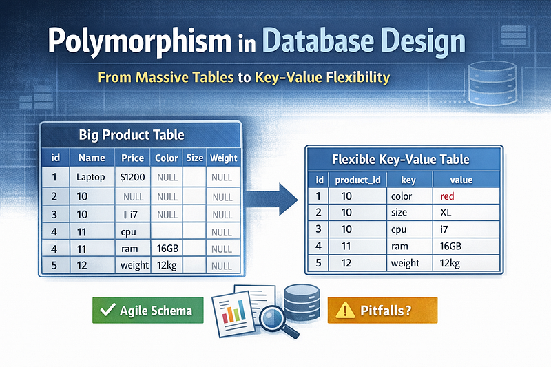
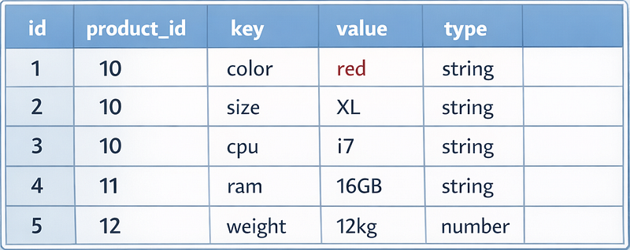

Modern systems evolve fast. New features appear, requirements change, and data models grow in unexpected directions. If you’ve ever worked with a “god table” — a huge table with dozens or hundreds of columns — you know how painful schema evolution can be:

- every new feature requires a migration
- many columns stay empty for most rows
- the table becomes harder to maintain
- the schema no longer reflects real business logic

One way to avoid this is to use **polymorphism in the database** through a **key–value (EAV) table**. Instead of adding new columns, you store flexible attributes as rows.

This article explains how this pattern works, when it’s useful, and where it can go wrong — with a simple example you can study and experiment with.

### 🔍 What Problem Does This Solve?

Imagine you have a table `products`:

id | name | price | color | size | weight | material | warranty | …

As the business grows, new product types appear:

- electronics
- clothes
- furniture
- digital goods

Each type needs different attributes. You end up adding more and more columns:

- `screen_size`
- `cpu`
- `ram`
- `fabric_type`
- `dimensions`
- `download_url`
- `license_key`

Most of these columns are NULL for most rows. Migrations become constant. The schema becomes a mess.

### The Polymorphic Key–Value Solution

Instead of adding new columns, we store attributes in a **simple, flexible table**:

#### product\_attributes



#### SQL schema:

```sql
CREATE TABLE product_attributes (
    id SERIAL PRIMARY KEY,
    product_id INTEGER NOT NULL,
    key VARCHAR(100) NOT NULL,
    value TEXT NOT NULL,
    type VARCHAR(20) NOT NULL, -- string, number, boolean, json
    created_at TIMESTAMP DEFAULT NOW()
);
```

Now you can store **any attribute** without touching the schema.

#### Simple Example: Storing Dynamic Product Data

#### Insert attributes for a T‑shirt:

```sql
INSERT INTO product_attributes (product_id, key, value, type)
VALUES
(10, 'color', 'red', 'string'),
(10, 'size', 'XL', 'string'),
(10, 'material', 'cotton', 'string');
```

#### Insert attributes for a laptop:

```sql
INSERT INTO product_attributes (product_id, key, value, type)
VALUES
(11, 'cpu', 'i7', 'string'),
(11, 'ram', '16GB', 'string'),
(11, 'screen_size', '15.6', 'number');
```

#### Query: Get all attributes for a product

```sql
SELECT key, value
FROM product_attributes
WHERE product_id = 11;
```

#### Query: Find all products with a specific attribute

```sql
SELECT product_id
FROM product_attributes
WHERE key = 'color' AND value = 'red';
```

This is the essence of polymorphism: **one table, many types of data, no schema changes.**

### Benefits of This Approach

#### 1. No more schema migrations

New attributes = new rows, not new columns.

This is extremely useful when:

- requirements change often
- product types vary
- you don’t control the schema (SaaS, plugins, integrations)

#### 2. Flexible and future‑proof

You can add attributes dynamically:

- from admin panels
- from configuration
- from user input
- from external systems

No DBA involvement needed.

#### 3. Works well for sparse data

If only 5% of products have a `screen_size`, why create a column for everyone?

#### 4. Great for prototyping

You can start fast without designing a perfect schema.

#### 5. Easy to extend with JSON

You can store complex values:

```sql
INSERT INTO product_attributes (product_id, key, value, type)
VALUES (12, 'dimensions', '{"w": 100, "h": 50}', 'json');
```

### Pitfalls and How to Avoid Them

This pattern is powerful — but dangerous if misused.

#### 1. Harder to query

Filtering becomes more complex:

```sql
SELECT p.id
FROM products p
JOIN product_attributes a1 ON a1.product_id = p.id AND a1.key = 'color' AND a1.value = 'red'
JOIN product_attributes a2 ON a2.product_id = p.id AND a2.key = 'size' AND a2.value = 'XL';
```

**Solution:** Use materialized views or caching for common queries.

#### 2. No strong typing

Everything is stored as text unless you enforce types manually.

**Solution:** Use a `type` column and validate in the application layer.

#### 3. Harder to enforce constraints

You can’t easily enforce:

- required attributes
- allowed values
- foreign keys

**Solution:** Use application‑level validation or attribute metadata tables.

#### 4. Performance issues at scale

A product with 50 attributes = 50 rows. A million products = 50 million rows.

**Solution:**

- add indexes on `(product_id)` and `(key, value)`
- shard by product type
- use caching (Redis)

#### 5. Overuse leads to chaos

If *everything* becomes key–value, you lose structure.

**Solution:** Use this pattern only for **dynamic** or **optional** attributes. Keep core fields in the main table.

### When Should You Use This Pattern?

#### Good use cases:

- product catalogs
- CMS metadata
- user preferences
- feature flags
- IoT sensor data
- audit logs
- dynamic forms

#### Bad use cases:

- financial transactions
- core business entities
- data requiring strict validation
- heavy analytical workloads

### Final Thoughts

Polymorphism in database design — especially through a key–value table — is a powerful tool for building flexible, evolving systems. It helps avoid schema bloat, reduces migration overhead, and supports dynamic data models.

But like any abstraction, it must be used intentionally.

**Use it for dynamic, optional, or unpredictable attributes.** **Avoid it for core, validated, business‑critical data.**

If you balance flexibility with structure, this pattern becomes a reliable foundation for scalable, maintainable systems — especially in fast‑moving domains like e‑commerce, gaming, SaaS, and content platforms.
