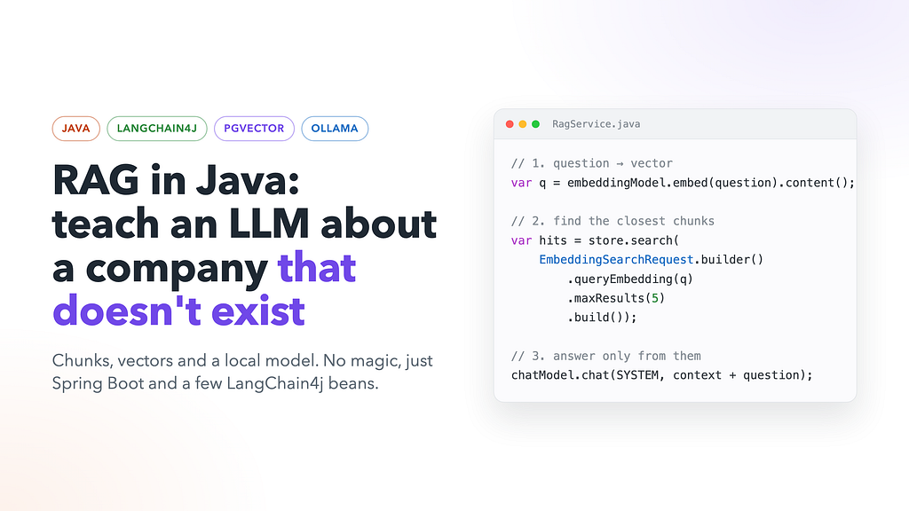
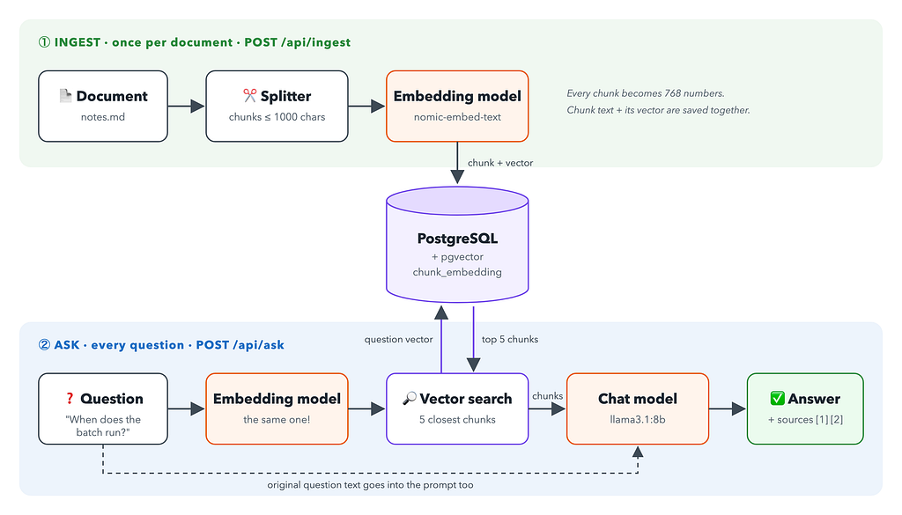
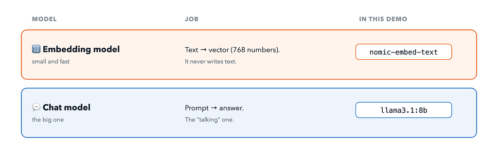
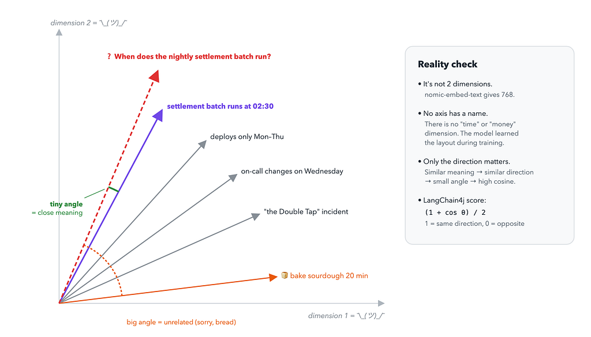
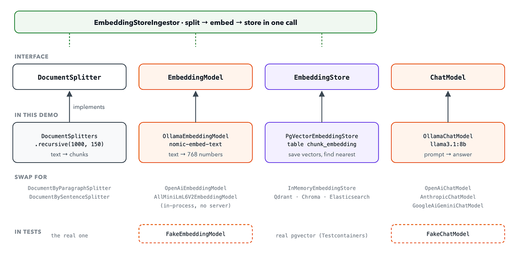
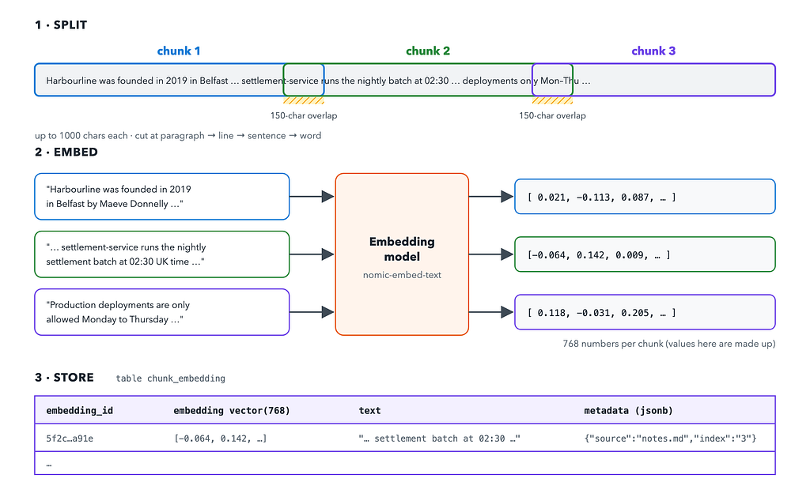

*Chunks, vectors, a bit of geometry, and no magic. Everything runs on your laptop.*



Ask an LLM “When does the nightly settlement batch run at Harbourline Payments?” and one of two things happens.

The polite model says it doesn’t know. The confident model says “Usually around midnight!” with the energy of a student who didn’t read the book but really wants a good mark.

Both are fair, because Harbourline Payments doesn’t exist. I made it up. It’s a fictional company with a fictional engineering handbook: founders, services, deploy rules, on-call pay, and even a famous incident called “the Double Tap”. No model has seen this text during training.

That’s exactly why it’s a good test. If the model answers “02:30 UK time” correctly, it didn’t remember it. It **found** it. That’s RAG.

In this article we’ll build a small RAG service in Java with Spring Boot, LangChain4j, PostgreSQL with pgvector, and Ollama. No cloud, no API keys, no bill at the end of the month.

The full code is on GitHub: [SukachVitally/rag-demo](https://github.com/SukachVitally/rag-demo).

### What is RAG, in one exam

RAG stands for **Retrieval-Augmented Generation**. Long name, simple idea.

Think about two exams:

- **Closed-book exam.** The student answers from memory. This is a normal LLM. It knows a lot, but only what it learned during training. It knows nothing about your company’s wiki, last week’s incident, or your internal rules. If it doesn’t know, it may still try to sound smart.
- **Open-book exam.** Before answering, the student finds the right pages in the book and reads them. This is RAG.

So RAG doesn’t make the model smarter. It gives the model a cheat sheet for each question: “Here are 5 pieces of text that look relevant. Answer using only these.”

Why not just put the whole handbook into the prompt? For one small file you can. But real knowledge bases have thousands of documents. They don’t fit into the context window, and even when they do, you pay for every token on every question. RAG sends only the few pieces that matter.

### The big idea

The whole thing is two flows.



**Ingest (once per document):**

1. Take the text and split it into small pieces called **chunks**.
2. Ask an **embedding model** to turn each chunk into a vector: a long list of numbers.
3. Save each chunk together with its vector in the database.

**Ask (every question):**

1. Ask the **same** embedding model to turn the question into a vector.
2. Find the chunks whose vectors are **closest** to the question vector.
3. Send the question and those chunks to a **chat model** and ask it to answer using only these chunks.

That’s it. The rest of this article is details.

Notice that there are **two different models**:



The embedding model is small and fast. The chat model is the big one. Both run locally in Ollama.

### Wait, what is this vector?

This is the most interesting part, so let’s slow down a little.

An embedding model reads a piece of text and returns a fixed-size array of numbers. nomic-embed-text returns **768** numbers for any text, whether it's one word or a full paragraph:

```
"settlement batch runs at 02:30"  →  [-0.064, 0.142, 0.009, ... 765 more ...]
```

The model is trained so that texts with **similar meaning** get vectors that point in a **similar direction**. “When does the nightly batch run?” and “settlement-service runs the nightly batch at 02:30” share almost no grammar, but their meaning is close, so their vectors are close too.

Now the fun part. It’s natural to think that each number means something: dimension 17 is “money”, dimension 302 is “time of day”, dimension 555 is “how angry the on-call engineer is”. It doesn’t work like that.

**No single dimension has a physical meaning.** Nobody designed these axes. The model learned the layout by itself during training. Meaning is spread across all 768 numbers at once, a bit like a smell is spread across many different molecules. You can’t point at one number and say “this is the time part”. Only the vector as a whole means something, and only when you compare it with other vectors.

Here’s a 2D sketch of what that looks like. The real space has 768 dimensions, and I have only two axes on my screen:



The question vector points almost in the same direction as the “settlement batch runs at 02:30” chunk. The sourdough recipe chunk points somewhere else entirely. So for a computer, “similar meaning” becomes simple geometry: **a small angle between two vectors**.

The usual way to measure this is **cosine similarity**, the cosine of that angle:

- 1: same direction, very similar
- 0: unrelated
- -1: opposite direction

LangChain4j turns it into a friendlier score from 0 to 1: (1 + cos θ) / 2. That's the score you'll see in the API response later.

One important rule: vectors from different embedding models are **not compatible**. Each model builds its own space with its own layout. If you change the embedding model, you have to re-embed all your documents. It’s like changing the map projection: the old coordinates don’t match the new map.

### The stack

- **Java 25** and **Spring Boot 4.1**: the usual REST app.
- **LangChain4j 1.22**: the Java library that does the AI work.
- **Ollama**: runs both models locally.
- **PostgreSQL 17 + pgvector**: stores chunks and vectors, and searches by similarity.
- **Testcontainers**: for functional tests with a real database.

Run the infrastructure with one command:

*Source:* [*docker-compose.yaml*](https://github.com/SukachVitally/rag-demo/blob/main/docker-compose.yaml)

```
services:
  db:
    image: pgvector/pgvector:pg17
    environment:
      POSTGRES_DB: rag
      POSTGRES_USER: rag
      POSTGRES_PASSWORD: rag
    ports: ["5432:5432"]
  ollama:
    image: ollama/ollama
    ports: ["11434:11434"]
    volumes:
      - ollama-models:/root/.ollama   # keeps downloaded models between restarts
  ollama-init:
    image: ollama/ollama
    depends_on: [ollama]
    environment:
      OLLAMA_HOST: ollama:11434
    entrypoint: ["sh", "-c", "sleep 5 && ollama pull nomic-embed-text && ollama pull llama3.1:8b"]
volumes:
  ollama-models:
```

The ollama-init container is a one-off job that downloads the models. The first time it pulls a few GB, so it's a good moment to make some tea.

### LangChain4j: AI LEGO for Java

LangChain4j is to AI roughly what Spring Data is to databases. It gives you small interfaces with many implementations, so your code doesn’t depend on a specific vendor.

The demo uses four building blocks, plus one helper that glues three of them together:



- **DocumentSplitter** cuts text into chunks.
- **EmbeddingModel** turns text into a vector. Here it's OllamaEmbeddingModel.
- **EmbeddingStore<TextSegment>** saves vectors and finds the nearest ones. Here it's PgVectorEmbeddingStore.
- **ChatModel** sends a prompt and gets an answer. Here it's OllamaChatModel.
- **EmbeddingStoreIngestor** runs split → embed → store in one call.

The nice part is the bottom of that picture. Want OpenAI instead of Ollama? Change one bean. Want Qdrant instead of Postgres? Change one bean. The services don’t care.

### Dependencies

*Source:* [*build.gradle*](https://github.com/SukachVitally/rag-demo/blob/main/build.gradle)

```
dependencies {
    implementation 'org.springframework.boot:spring-boot-starter-jdbc'
    implementation 'org.springframework.boot:spring-boot-starter-webmvc'
    implementation 'dev.langchain4j:langchain4j:1.22.0'
    implementation 'dev.langchain4j:langchain4j-ollama:1.22.0'
    implementation 'dev.langchain4j:langchain4j-pgvector:1.22.0-beta32'
    runtimeOnly 'org.postgresql:postgresql'
}
```

Three LangChain4j modules: the core, the Ollama integration and the pgvector store. That’s all.

### Wiring the beans

*Source:* [*LangChain4jConfig.java*](https://github.com/SukachVitally/rag-demo/blob/main/src/main/java/org/example/ragdemo/config/LangChain4jConfig.java)

```
@Configuration
public class LangChain4jConfig {
    public static final String CHUNK_TABLE = "chunk_embedding";
    @Bean
    EmbeddingModel embeddingModel(OllamaClientProperty property) {
        return OllamaEmbeddingModel.builder()
                .baseUrl(property.baseUrl())
                .modelName(property.embedModel())
                .build();
    }
    @Bean
    ChatModel chatModel(OllamaClientProperty property) {
        return OllamaChatModel.builder()
                .baseUrl(property.baseUrl())
                .modelName(property.chatModel())
                .build();
    }
    @Bean
    DocumentSplitter documentSplitter(ChunkProperty property) {
        return DocumentSplitters.recursive(property.size(), property.overlap());
    }
    @Bean
    EmbeddingStore<TextSegment> embeddingStore(DataSource dataSource) {
        return PgVectorEmbeddingStore.datasourceBuilder()
                .datasource(dataSource)
                .table(CHUNK_TABLE)
                .createTable(false)
                .skipCreateVectorExtension(true)
                .metadataStorageConfig(DefaultMetadataStorageConfig.builder()
                        .storageMode(MetadataStorageMode.COMBINED_JSONB)
                        .columnDefinitions(List.of("metadata JSONB NULL"))
                        .build())
                .build();
    }
}
```

The embedding store reuses Spring’s DataSource, so there's one connection pool and one config. I also told it **not** to create the table (createTable(false)) because I prefer to own the schema myself:

*Source:* [*schema.sql*](https://github.com/SukachVitally/rag-demo/blob/main/src/main/resources/schema.sql)

```
CREATE EXTENSION IF NOT EXISTS vector;
CREATE TABLE IF NOT EXISTS chunk_embedding (
    embedding_id UUID PRIMARY KEY,
    embedding    vector(768) NOT NULL,
    text         TEXT NULL,
    metadata     JSONB NULL
);
CREATE INDEX IF NOT EXISTS chunk_embedding_hnsw
    ON chunk_embedding USING hnsw (embedding vector_cosine_ops);
```

Two things to notice:

- vector(768) is the pgvector column type. 768 must match the embedding model's output. If you switch to a model with 1024 dimensions, this column has to change too.
- The **HNSW index** with vector\_cosine\_ops makes nearest-neighbour search fast. Without it, Postgres compares the question with every row. That's fine for 9 chunks, but not for 9 million. HNSW is an approximate search: it trades a tiny bit of accuracy for a lot of speed.

Everything is configurable in application.yaml:

```
app:
  olama-client:
    base-url: http://localhost:11434
    embed-model: nomic-embed-text
    chat-model: llama3.1:8b
  chunk:
    size: 1000
    overlap: 150
```

### Part 1: Ingest, or feeding the database

Here’s what happens to a document on the way in:



### Why chunks?

Why not embed the whole document as one vector? Because one vector for a whole handbook would be an average of everything: founders, deploy rules, on-call pay, the sourdough recipe someone accidentally uploaded. It would be “kind of about everything”, and that means it’s close to nothing.

Small chunks keep the meaning sharp. One chunk is about the settlement batch, another is about deploy windows. Now the search can find the right one.

The demo uses DocumentSplitters.recursive(1000, 150):

- **1000**: the maximum chunk size in characters.
- **150**: overlap. Each chunk repeats about 150 characters from the end of the previous one. So if an important sentence lands on a border, it’s still complete in at least one chunk.
- **Recursive** means it tries to cut nicely. First by paragraphs. If a paragraph is too big, then by lines, then by sentences, then by words. It cuts the text like a polite butcher, not with a chainsaw.

### The ingest service

*Source:* [*IngestService.java*](https://github.com/SukachVitally/rag-demo/blob/main/src/main/java/org/example/ragdemo/service/IngestService.java)

```
@Service
@RequiredArgsConstructor
public class IngestService {
    public static final String SOURCE = "source";
    private final DocumentSplitter splitter;
    private final EmbeddingModel embeddingModel;
    private final EmbeddingStore<TextSegment> store;
    
    public int ingest(String source, String text) {
        if (text.isBlank()) return 0;
        var chunks = new AtomicInteger();
        EmbeddingStoreIngestor.builder()
                .documentSplitter(splitter)
                .textSegmentTransformer(segment -> { chunks.incrementAndGet(); return segment; })
                .embeddingModel(embeddingModel)
                .embeddingStore(store)
                .build()
                .ingest(Document.from(text, Metadata.from(SOURCE, source)));
        return chunks.get();
    }
}
```

EmbeddingStoreIngestor does all three steps for us: split, embed, store. The textSegmentTransformer is a hook that runs for every chunk. Here I only use it to count chunks for the API response, but it's also the right place to clean text or add extra metadata.

The source metadata (the file name) travels with every chunk into the metadata JSONB column. Later it lets the answer say *where* the information came from.

The controller is a plain multipart upload:

*Source:* [*RagController.java*](https://github.com/SukachVitally/rag-demo/blob/main/src/main/java/org/example/ragdemo/controller/RagController.java)

```
@PostMapping(value = "/ingest", consumes = MediaType.MULTIPART_FORM_DATA_VALUE)
public Map<String, Object> upload(@RequestParam MultipartFile file) throws IOException {
    String text = new String(file.getBytes(), StandardCharsets.UTF_8);
    return Map.of("chunks", ingest.ingest(file.getOriginalFilename(), text));
}
```

Let’s feed it the Harbourline handbook:

```
curl -F file=@docs/notes.md http://localhost:8080/api/ingest
```

```
{ "chunks": 9 }
```

Nine chunks, nine vectors, nine rows. The database now knows about a company that doesn’t exist.

### Part 2: Ask, or the open-book exam

*Source:* [*RagService.java*](https://github.com/SukachVitally/rag-demo/blob/main/src/main/java/org/example/ragdemo/service/RagService.java)

```
@Service
@RequiredArgsConstructor
public class RagService {
    private final EmbeddingModel embeddingModel;
    private final EmbeddingStore<TextSegment> store;
    private final ChatModel chatModel;
    private static final String SYSTEM = """
        Answer using ONLY the provided context. If the answer is not in the
        context, say you don't know. Cite sources as [1], [2]...""";
    
public record Answer(String answer, List<Hit> sources) {}
    public Answer ask(String question) {
        var q = embeddingModel.embed(question).content();
        var hits = store.search(EmbeddingSearchRequest.builder().queryEmbedding(q).maxResults(5).build())
                .matches().stream()
                .map(m -> new Hit(m.embedded().metadata().getString(IngestService.SOURCE), m.embedded().text(), m.score()))
                .toList();
        var ctx = new StringBuilder();
        for (int i = 0; i < hits.size(); i++)
            ctx.append("[").append(i + 1).append("] (").append(hits.get(i).source()).append(")\n")
                    .append(hits.get(i).content()).append("\n\n");
        String prompt = "Context:\n" + ctx + "\nQuestion: " + question;
        return new Answer(chatModel.chat(SystemMessage.from(SYSTEM), UserMessage.from(prompt)).aiMessage().text(), hits);
    }
}
```

This is the heart of the project, and it follows the plan exactly:

1. **Embed the question** with the same model we used for the chunks. Same model means same space, so the distances make sense.
2. **Search** the store for the 5 nearest vectors. Under the hood, pgvector uses the HNSW index and cosine distance.
3. **Build the context**: number each chunk and add its source.
4. **Ask the chat model** with a strict system message: use only the context, say “I don’t know” if the answer isn’t there, and cite sources.

This is roughly what llama actually receives:

```
SYSTEM:
Answer using ONLY the provided context. If the answer is not in the
context, say you don't know. Cite sources as [1], [2]...
```

```
USER:
Context:
[1] (notes.md)
... settlement-service — runs the nightly settlement batch at 02:30 UK time ...
```

```
[2] (notes.md)
...
```

```
Question: When does the nightly settlement batch run?
```

The chat model never sees the database, the vectors or the other chunks. It sees a small, focused cheat sheet and a question. Its job is now easy: read and summarise.

Let’s try it:

```
curl -H 'Content-Type: application/json' \
     -d '{"question": "When does the nightly settlement batch run?"}' \
     http://localhost:8080/api/ask
```

```
{
  "answer": "According to the context in [3] (notes.md), the nightly settlement batch runs at 02:30 UK time.",
  "sources": [
    { "source": "notes.md", "content": "...", "score": 0.79 }
  ]
}
```

02:30 UK time. Correct, and with a source. Open-book exam passed. 🎓

The sources list matters as much as the answer. You can show it to users, so they can check where the answer came from instead of trusting the model blindly. Trust, but verify, especially with an 8B model.

### Things to keep in mind

The demo is small on purpose. Before you take it to production, think about these:

- **Chunk size is a trade-off.** Too small, and a chunk loses context (“it runs at 02:30”, but what is “it”?). Too big, and the meaning gets blurry again. 1000/150 is a reasonable start, not a law.
- **The top 5 are always returned,** even when nothing is relevant. Ask about pizza, and you’ll still get the 5 “least irrelevant” chunks. The strict system prompt helps the model say “I don’t know”. In a real system I’d also add a minimum score (EmbeddingSearchRequest supports minScore).
- **Changing the embedding model means re-ingesting everything.** Different model, different space, different vector(N) column.
- **Re-uploading the same file creates duplicates.** The demo only appends. A real system needs to update or delete chunks by source.
- **Garbage in, garbage out.** RAG is only as good as the documents you give it. If the wiki is wrong, the answer will be wrong, but now with a citation.

### Summary

RAG sounds like a fancy AI term, but in code it’s a short pipeline:

- **Ingest:** split text into chunks → embed each chunk into a vector → store the text and vector in pgvector.
- **Ask:** embed the question → find the closest chunk vectors → give the question and those chunks to the chat model → answer with sources.

The vectors are the only “magic” part. They are 768 numbers with no human meaning in any single dimension, but their direction captures meaning. Similar text means a small angle, and a small angle is something a database can search.

LangChain4j turns each step into one small interface, so the whole service is a handful of Spring beans. You can swap Ollama for OpenAI, or pgvector for Qdrant, without touching the business code.

And now a local 8B model knows when Harbourline’s settlement batch runs. Harbourline still doesn’t exist, but at least its batch is on time. ⏰

The full code is on GitHub: [SukachVitally/rag-demo](https://github.com/SukachVitally/rag-demo). Clone it, run docker compose up -d, upload your own notes and ask them questions.
