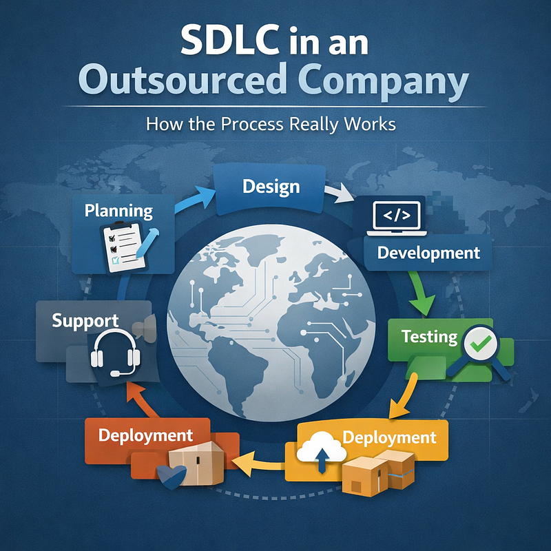
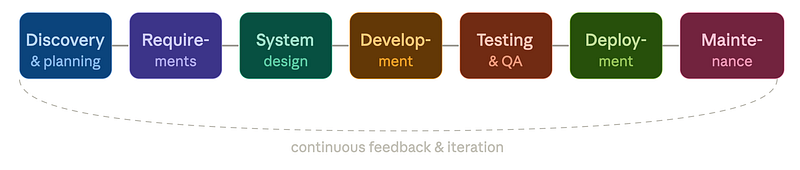
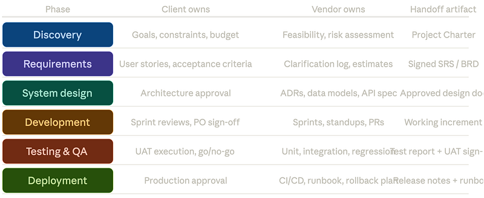
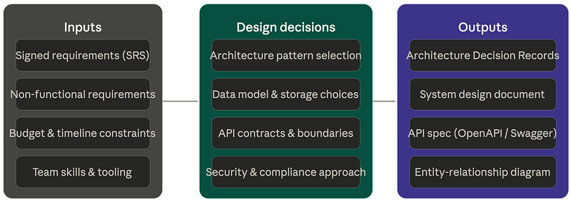
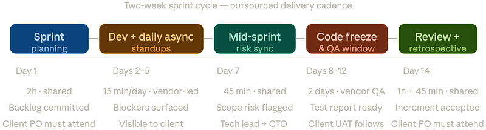
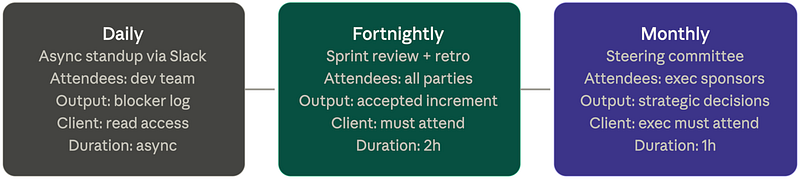

How distributed teams structure the Software Development Life Cycle — governance models, communication contracts, phase-by-phase responsibilities, and the hidden failure modes that kill outsourced projects before launch.

### What makes outsourced SDLC different

Every software team runs some version of the SDLC — a structured sequence of phases that takes an idea from concept to running code. When delivery is handled by an external vendor, the same phases exist, but the dynamics between them change completely.

In a co-located team, context flows informally: a developer can tap the product manager on the shoulder, an architect can sketch on a whiteboard in the hallway. In an outsourced engagement, none of that happens. Every shared understanding has to be written down, formally agreed, and deliberately transmitted. What a co-located team resolves in a five-minute hallway conversation requires an async message thread, a clarification document, and a sign-off in outsourcing.

This is not a disadvantage — it is a discipline. Outsourced teams that develop rigorous documentation habits often produce more traceable, better-specified software than co-located teams where “everyone just knows” how things work. The SDLC is the framework that makes this discipline systematic.

> CORE PRINCIPLE

> The client owns the ***what*** — product vision, business goals, acceptance criteria, and ultimate decision authority. The vendor owns the ***how*** — technical approach, tooling choices, implementation detail, and day-to-day engineering execution. The SDLC is the interface between them.

*Figure 1 — The seven SDLC phases in outsourced delivery. Click any phase to explore it. The dashed arc represents the feedback loop from maintenance back into discovery for the next cycle.*

### The dual-ownership model

The most important structural concept in outsourced SDLC is dual ownership: two distinct parties hold responsibility for different layers of the project simultaneously. This is not a hierarchy — the client is not “above” the vendor — it is a division of accountability along a clear interface.

Confusion about ownership is the single most common root cause of outsourced project failure. When both parties believe they are responsible for the same thing (or each believes the other is responsible), gaps appear and deliverables fall through.

#### CLIENT SIDE

**Product ownership layer**

- Business requirements and user needs
- Acceptance criteria and Definition of Done
- Backlog prioritisation and scope decisions
- UAT sign-off and production approval
- Regulatory and compliance requirements
- Budget authority and contract governance

#### VENDOR SIDE

**Engineering execution layer**

- Technical architecture and tooling selection
- Sprint planning and capacity management
- Code quality, test coverage, and CI/CD
- Daily engineering decisions and trade-offs
- Infrastructure setup and monitoring
- Technical documentation and ADRs

#### SHARED

**Interface & governance**

- Sprint reviews and retrospectives
- Risk register and escalation path
- Change request evaluation and impact
- Definition of Ready for sprint entry
- Release decision and go/no-go gates

#### KEY ROLES

**Who sits at the interface**

- Client: Product Owner + Technical Lead
- Vendor: Project Manager + Tech Lead
- These four people own the interface
- All escalations route through them first

> MOST COMMON FAILURE MODE

> Projects fail when the client Product Owner is not genuinely available. If the PO attends only one ceremony per sprint, ambiguities accumulate, the vendor makes assumptions, and by Month 3 the product being built is not the product the client imagined. PO availability is a project risk, not a courtesy.

### Phase 1 — discovery & planning

Discovery is where the project is defined before a line of code is written. In outsourcing, this phase is often compressed or skipped entirely — and it is the single biggest predictor of whether the engagement will succeed. A well-run discovery produces a shared understanding of what is being built, why it matters, what it does not include, and how success will be measured.

The outputs of discovery are not optional. They form the contractual baseline for the engagement. Any change to scope relative to the discovery outputs is a change request — a formal negotiation, not a verbal agreement.

#### Discovery outputs — the mandatory artifact set

- Project Charter — business goals, success metrics, constraints, and named stakeholders with decision authority
- High-level roadmap — time-boxed phases with milestone deliverables and payment tranches tied to each
- Scope boundary document — an explicit list of what is in scope and what is explicitly out of scope for this engagement
- Technical feasibility assessment — vendor’s initial evaluation of risk, unknowns, and proposed technology approach
- Communication protocol — meeting cadence, tools, async response SLAs (Service Level Agreement), and escalation path
- Definition of Done — the conditions every deliverable must satisfy before the client signs off

> TIME INVESTMENT

> For a six-month project, expect discovery to take two to four weeks and cost 5–8% of total budget. This is not overhead — it is insurance. Every hour spent in discovery typically saves three to five hours of rework later.

*Figure 2 — Ownership swimlane across SDLC phases. Click any phase row to explore the ownership detail. Every phase ends with a formal handoff artifact — nothing advances without a signed-off output.*

### Phase 2 — requirements

Requirements gathering in outsourcing is a negotiation, not a dictation. The client provides the business intent; the vendor translates it into implementable specifications and raises every ambiguity in writing. The output — typically a Software Requirements Specification or a groomed product backlog with acceptance criteria — is the contract for the build phase.

The two most common failure modes at this phase are: the client providing requirements that are too high-level (“the user should have a good experience”), and the vendor accepting ambiguous requirements without escalating. Both failures are preventable with process discipline.

> REQUIREMENTS QUALITY TEST

> Every user story must answer three questions unambiguously: Who is the actor? What do they want to do? Why does it matter to the business? If any of the three is vague, the story is not ready for development. The vendor’s QA on requirements is as important as the client’s initial authorship.

#### The Requirements Clarification Log

Every ambiguity the vendor identifies must be logged in a shared document — the Requirements Clarification Log — with a status of Open, Answered, or Accepted. This log is reviewed at the start of every sprint planning session. Any story with open clarifications cannot be pulled into the sprint.

### Phase 3 — system design

System design is where technical architecture is decided and documented before implementation begins. In outsourcing, this phase serves an additional function: it is the moment when the vendor demonstrates technical competence and the client gains confidence (or identifies concerns) in the approach before committing to the build.

The key outputs are **Architecture Decision Records** — short documents that capture each significant technical decision, the alternatives considered, and the rationale for the chosen approach. ADRs are owned by the vendor but approved by the client’s technical lead. They survive team turnover and serve as institutional memory for the lifetime of the codebase.

*Figure 3 — System design phase: what goes in, what is decided, and what comes out. Every output requires client technical lead approval before development begins.*

### Phases 4–5 — development and testing

Development is typically the longest phase and the one where outsourcing relationships are most stress-tested. The vendor team is executing sprints; the client team is reviewing, testing, and making real-time decisions about scope. The quality of the interface between the two determines whether this phase runs smoothly or deteriorates into confusion and rework.

Testing in an outsourced context has two layers: the vendor is responsible for technical correctness (unit tests, integration tests, regression suites), while the client is responsible for business correctness (User Acceptance Testing). Neither can substitute for the other. A bug-free system that does the wrong thing is a failed deliverable; a system with business-correct behaviour but fragile code is a maintenance liability.

#### Sprint planning

**SHARED CEREMONY**

*Stories are pulled from the refined backlog. Vendor estimates and commits. Client PO confirms priorities and clarifies ambiguities before sprint begins — not during it.*

#### Daily async standup

**VENDOR-LED, CLIENT-VISIBLE**

*A structured async update (Slack, Linear, or similar) covering progress, plan, and blockers. Client can read but should not generate work requests through this channel.*

#### Code review protocol

**VENDOR PROCESS**

*Every pull request requires at least one peer review before merge. Client retains repository access and may review code, but day-to-day code review is a vendor responsibility.*

#### Sprint review / demo

**SHARED CEREMONY**

*The vendor demos working software against the sprint goal. Client stakeholders provide feedback in the session. Verbal feedback is captured in writing before the session closes.*

#### Vendor QA

**VENDOR-OWNED**

*Unit, integration, and regression tests run in CI on every commit. Test coverage and pass rate are reported to the client at each sprint review as part of the standard dashboard.*

#### Client UAT

**CLIENT-OWNED**

*Client team tests against acceptance criteria in the staging environment. UAT is time-boxed: a defined window, a defined scope, a written pass/fail result. Unbounded UAT stalls releases.*

> TESTING ANTI-PATTERN TO AVOID

> Never treat UAT as a second round of development. If the client discovers a new requirement during UAT, it is a change request — not a bug. The distinction matters for both schedule and budget. Document the difference in the Definition of Done agreed in Phase 1.

*Figure 4 — The two-week sprint cycle. Ceremonies marked “shared” require both client and vendor attendance. Skipping shared ceremonies is the most reliable way to accumulate hidden misalignment.*

### Phases 6–7 — deployment and maintenance

Deployment is a production event, and in outsourcing it requires formal client approval before the vendor touches the production environment. This approval should be a written go/no-go decision, not a verbal message. The vendor provides a release runbook — a step-by-step guide to what is being deployed, in what order, with a tested rollback procedure for every step.

Maintenance defines the ongoing relationship after launch. It should be governed by a **Service Level Agreement** that specifies response times for different severity levels, reporting cadence, and the process for prioritising maintenance requests against new feature work. Without a maintenance SLA, the post-launch period becomes a source of friction: the client expects immediate responses; the vendor has moved on to the next engagement.

> MAINTENANCE SLA TIERS — TYPICAL STRUCTURE

> **P0 — Critical**: system down or data loss risk. Response within 1 hour, resolution target 4 hours. **P1 — High**: major feature broken, no workaround. Response within 4 hours. **P2 — Medium**: feature degraded, workaround exists. Response within 1 business day. **P3 — Low**: cosmetic or minor issue. Response within 1 week.

#### Governance and sprint cadence

Governance in outsourcing is not bureaucracy — it is the system that keeps the project honest. Without governance, small misalignments compound into large disputes. With governance, problems surface early when they are still cheap to fix.

The minimum viable governance framework for an outsourced engagement has three components: a sprint governance checklist run at every review, a monthly steering committee with executive-level attendance from both parties, and a risk register updated continuously and reviewed formally each month.

#### Sprint review governance checklist

- All committed stories are either accepted, carried forward with documented reason, or formally descoped — no stories silently dropped
- Sprint velocity is reported. If actual velocity is more than 20% below baseline, a root cause is documented and a recovery plan is presented
- Test coverage report is shared. No story is accepted without its associated tests in the CI suite
- Open bugs are counted and triaged. No P0 or P1 bug is carried forward without a written remediation commitment and target date
- Architecture Decision Records are up to date — any design decision made during the sprint is documented before the review closes
- Risk register is reviewed. New risks are assigned owners. Mitigations on existing risks are status-checked
- Next sprint’s stories are refined, estimated, and in a Definition-of-Ready state before sprint planning begins
- Any change requests received during the sprint are logged with estimated impact on scope, schedule, and budget — not silently absorbed
- Client retains unrestricted access to the repository, CI/CD pipeline, staging environment, and all project documentation

> THE MOST IMPORTANT GOVERNANCE RULE

> Every verbal agreement made during a meeting must be captured in writing before the meeting ends — in the meeting notes, in the ticket, or in a follow-up message that is explicitly acknowledged. “We agreed in the call” is not an agreement in outsourcing. Writing is the agreement.

*Figure 5 — Three-tier governance cadence. Daily standups surface blockers in hours. Fortnightly reviews surface sprint-level misalignment in days. Monthly steering catches strategic drift before it becomes a crisis.*

### Closing: what makes it work

Outsourced SDLC succeeds when both parties treat the engagement as a collaboration rather than a transaction. The vendor is not a code factory executing a specification; they are a technical partner making hundreds of decisions per week that affect the client’s product. The client is not a passive recipient waiting for deliverables; they are an active participant whose availability, clarity, and decision speed directly determines the project’s velocity.

The SDLC framework described here — with its documentation discipline, formal handoffs, shared ceremonies, and governance cadence — is not bureaucracy for its own sake. It is the minimum structure needed to replace the informal coordination that happens naturally in a co-located team. Every element exists because its absence has been shown, repeatedly, to cause projects to fail.
