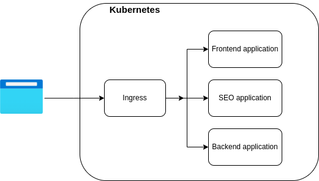

### Problem:

SPA applications face challenges with SEO as they typically return `index.html` for all requests. While one solution involves proxying all requests through a backend application to render SPA layout or traditional HTML for robots, this introduces complexity and disadvantages.

### Kubernetes ingress

Fortunately, Kubernetes’ Ingress controller provides logic to address this issue without additional complexity. Annotations can be used to configure routing for the Ingress.

As an example, let’s redirect all robot requests to our `seo-service`.

### Ingress Controller Example:

```yaml
apiVersion: networking.k8s.io/v1
kind: Ingress
metadata:
  name: main-ingress
  annotations:
    nginx.ingress.kubernetes.io/rewrite-target: $uri
    nginx.ingress.kubernetes.io/server-snippet: |
      set $prerender 0;
      if ($http_user_agent ~* "googlebot|bingbot|yandex|baiduspider|twitterbot|facebookexternalhit|rogerbot|linkedinbot|embedly|quora link preview|showyoubot|outbrain|pinterest|slackbot|vkShare|W3C_Validator") {
          set $prerender 1;
      }

      if ($uri ~* "\.(js|css|xml|less|png|jpg|jpeg|gif|pdf|doc|txt|ico|rss|zip|mp3|rar|exe|wmv|doc|avi|ppt|mpg|mpeg|tif|wav|mov|psd|ai|xls|mp4|m4a|swf|dat|dmg|iso|flv|m4v|torrent|ttf|woff|svg|eot)") {
        set $prerender 0;
      }

      if ($prerender = 1) {            
        rewrite ^(.*)$ /seo$1 break;      
      }
spec:
  rules:
      - host: yoursite.org
        http:
          paths:
            - path: /api
              pathType: Prefix
              backend:
                service:
                  name: backend-service
                  port:
                    number: 30200
            - path: /seo
              pathType: Prefix
              backend:
                service:
                  name: seo-service
                  port:
                    number: 30201
            - path: /
              pathType: Prefix
              backend:
                service:
                  name: frontend-service
                  port:
                    number: 30202
```

### Explanation:

**Services:**

- `backend-service`: Backend application providing API for SPA.
- `seo-service`: Backend application rendering traditional HTML for robots.
- `frontend-service`: Static storage serving SPA files (images, CSS, JS, etc.).

**Rules Block:**

- Responsible for routing requests based on their paths.

**Annotation Block:**

- Annotations are handled before routing, allowing us to modify routing.
- `nginx.ingress.kubernetes.io/rewrite-target: $uri`: Adds the request path to each routed request.
- `nginx.ingress.kubernetes.io/server-snippet`: Contains logic to route robot requests to the `seo-service` by adding the `/seo` prefix.

### Conclusion:

In conclusion, Kubernetes Ingress controllers offer an efficient way to make SPAs more SEO-friendly with minimal effort.
