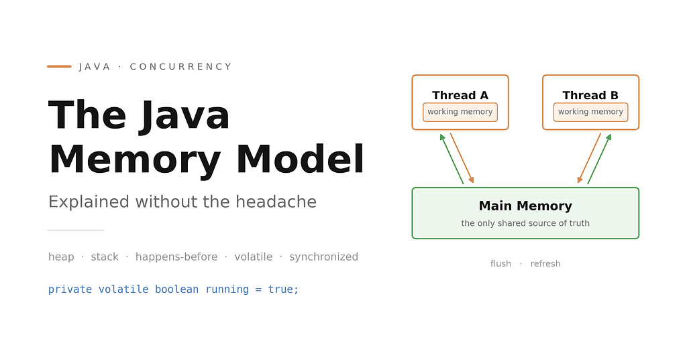
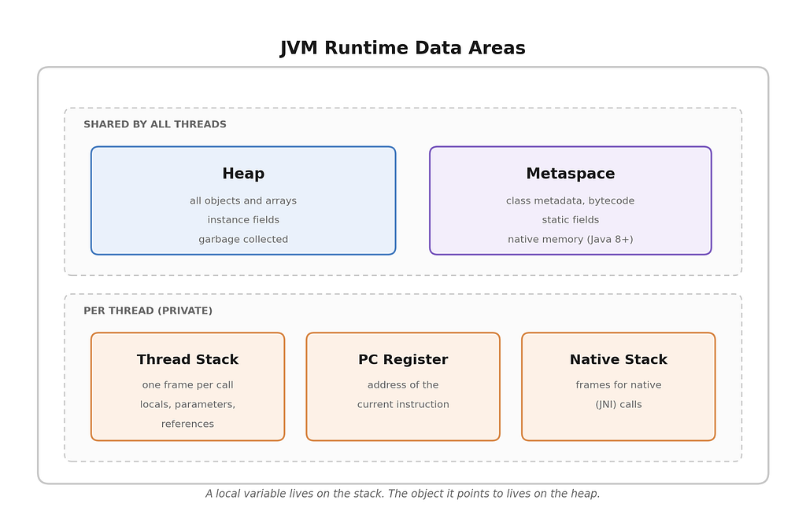
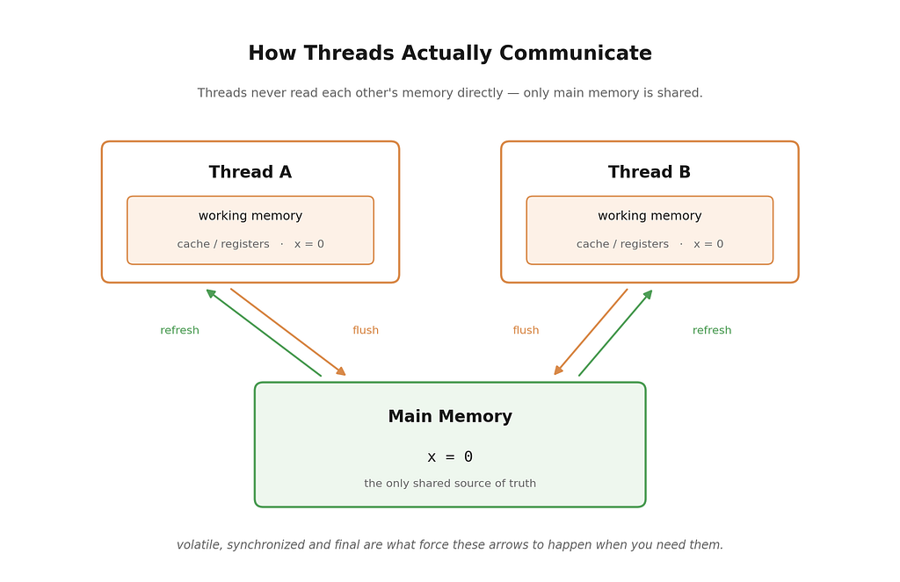
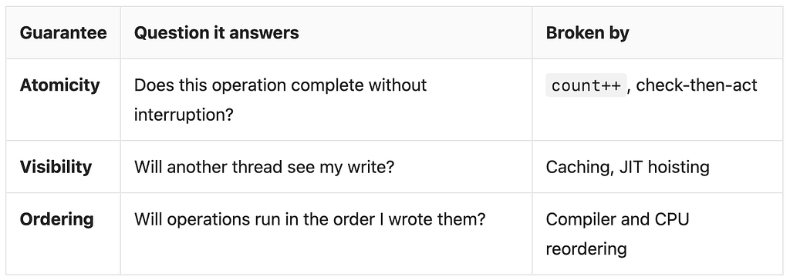

#### What actually happens to your data between two threads — and the small set of tools that let you control it



Ask ten Java developers what “the Java Memory Model” means and you’ll get two different answers.

Half of them will draw a box called *Heap* and another called *Stack*. The other half will start talking about volatile and happens-before.

Both groups are talking about something real, but only the second group is talking about the actual **Java Memory Model (JMM)**. The first group is describing the **runtime data areas** — where objects physically live.

You need both to write correct concurrent code, so let’s go through them in order. Memory layout first, because it’s the easier one, then the JMM proper.

### Part 1: Where your data lives

When the JVM starts, it carves the process memory into a few distinct regions. Each has an owner and a lifetime.



**Heap** — every object and array you ever create lives here. It’s shared, which is exactly why concurrency is hard. Garbage collection happens here. Modern collectors split it further (young generation, old generation, or regions in G1/ZGC), but that’s a GC detail, not a memory model one.

**Metaspace** — class metadata, bytecode, and static fields. It sits in native memory since Java 8, which is why PermGen errors disappeared and Metaspace OOM errors appeared instead.

**Thread stack** — each thread gets its own. Every method call pushes a frame containing local variables, parameters, and the return address. Frame pops when the method returns. This is where StackOverflowError comes from. Nothing here is shared, so locals are never a concurrency problem — unless the *value* they point to is a shared object.

**PC register** — the address of the instruction the thread is currently executing. One per thread.

**Native method stack** — the same idea, but for native (JNI) calls.

One thing worth burning in:

```
Order order = new Order();
```

The variable order is a reference sitting on the **stack**. The Order object itself sits on the **heap**. Two threads can hold two separate stack references pointing to the same heap object. That's the whole source of the trouble.

### Part 2: The actual Java Memory Model

The runtime areas tell you *where* data sits. They tell you nothing about *when* one thread sees a write made by another.

That question is what the JMM answers. It’s a specification (JSR-133, in Chapter 17 of the Java Language Specification) that defines exactly what guarantees you get about reads and writes across threads.

#### The problem it exists to solve

Modern CPUs are fast because they cheat, aggressively and correctly. Two things they do:

**1. Caching.** Each core has its own L1/L2 cache. When a thread writes to a field, that write may sit in the core’s cache or store buffer for a while before it becomes visible to other cores.

**2. Reordering.** The compiler, the JIT, and the CPU are all allowed to reorder instructions, as long as the result looks the same *for a single thread*. That last clause is the trap — nobody promised anything about how it looks to other threads.

So the JMM works with an abstraction:



*Thread A and Thread B never see each other’s working memory. Everything they share has to travel through main memory — and the JMM decides when it does.*

Every thread has a conceptual **working memory** (registers, cache, store buffers) holding copies of the variables it touches. Threads never talk to each other directly — they communicate only through **main memory**. The JMM specifies when a value must be flushed to main memory and when it must be re-read from it.

Here’s the classic demonstration:

```
public class StopFlag {
    private boolean running = true;   // no volatile
    
    public void run() {
        while (running) {
            // do work
        }
        System.out.println("stopped");
    }
    public void stop() {
        running = false;
    }
}
```

Thread A runs run(). Thread B calls stop(). Very often, thread A never stops.

Nothing is broken. The JIT sees that running is never modified inside the loop, so it's free to hoist the read out:

```
boolean r = running;
while (r) { /* work */ }   // now an infinite loop
```

Without a memory model rule forcing it, the JVM has no obligation to ever re-read that field. Your bug is not a race in the “two writes collided” sense — it’s a **visibility** failure.

#### The three guarantees

Every concurrency problem in Java falls into one of these buckets.



count++ is the textbook atomicity failure — it's three operations (read, add, write), and two threads can interleave in the middle. Two increments, one result.

### The base components of the JMM

Here’s the toolbox. It’s smaller than most people expect.

#### 1. happens-before — the rule that underpins everything

Everything else is a special case of this one relation. If action **A** *happens-before* action **B**, then:

- everything A wrote is visible to B, and
- A is guaranteed to appear to occur before B.

It is **not** just “A ran earlier in wall-clock time.” Two actions can be ordered in time and still have no happens-before relationship, which means B may see stale data.

The rules the JLS gives you:

1. **Program order** — within one thread, each statement happens-before the ones written after it.
2. **Monitor lock** — unlocking a monitor happens-before any later lock of the *same* monitor.
3. **volatile** — a write to a volatile field happens-before every later read of that field.
4. **Thread start** — Thread.start() happens-before anything in the started thread.
5. **Thread join** — everything in a thread happens-before another thread’s successful join() on it.
6. **Interruption** — a call to interrupt() happens-before the interrupted thread detects it.
7. **Constructor / finalizer** — the end of a constructor happens-before the start of that object’s finalizer.
8. **Transitivity** — if A hb B and B hb C, then A hb C.

That last one does most of the practical work. It’s why writing a plain field and *then* a volatile flag safely publishes the plain field.

#### 2. volatile — visibility and ordering, no atomicity

```
private volatile boolean running = true;
```

This single keyword fixes the StopFlag example. It gives you:

- **Visibility** — a write goes to main memory immediately; a read comes from main memory, never a cache.
- **Ordering** — the JVM inserts memory barriers so reads and writes can’t be reordered across the volatile access.

What it does **not** give you is atomicity:

```
private volatile int count = 0;
public void increment() {
    count++;   // STILL BROKEN
}
```

Use volatile for flags and for single-writer state. For compound operations, use something else.

#### 3. synchronized — all three guarantees

```
private int count = 0;
public synchronized void increment() {
    count++;   // correct
}
public synchronized int get() {
    return count;   // also needs to be synchronized
}
```

Entering the monitor gives mutual exclusion (atomicity). Exiting flushes to main memory, entering invalidates the local copy (visibility). Barriers around the block prevent reordering out of it.

The most common mistake here is synchronizing the writer but not the reader. Both sides need the *same* lock, or there’s no happens-before edge between them.

ReentrantLock gives you the same memory guarantees, plus tryLock, timeouts, fairness, and multiple conditions.

#### **4.** **final — safe publication for free**

```
public class Config {
    private final String url;
    public Config(String url) {
        this.url = url;   // guaranteed visible after construction
    }
}
```

The JMM guarantees that any thread that sees a properly constructed object sees the correct values of its final fields — no synchronization required. This is why immutable objects are the easiest possible concurrency strategy.

The catch is “properly constructed.” If the constructor leaks this (registering a listener, starting a thread), the guarantee is void.

#### 5. Atomics and VarHandle

java.util.concurrent.atomic gives you lock-free compound operations built on CPU compare-and-swap instructions:

```
private final AtomicInteger count = new AtomicInteger();
public void increment() {
    count.incrementAndGet();   // atomic, visible, ordered
}
```

Under contention LongAdder usually beats AtomicLong — it spreads writes across cells and sums them on read, avoiding cache-line contention. VarHandle (Java 9+) is the modern, supported way to reach for finer-grained modes like getAcquire / setRelease when you know exactly what you're doing.

### Three bugs this explains

**Unsafe publication.** Building an object and handing the reference to another thread without a happens-before edge. The other thread can see a non-null reference to a half-initialized object — fields still at their defaults. Publish through a volatile field, a lock, a final field, or a concurrent collection.

**Double-checked locking without** **volatile.** The infamous one:

```
private static volatile Singleton instance;   // volatile is mandatory
public static Singleton getInstance() {
    if (instance == null) {
        synchronized (Singleton.class) {
            if (instance == null) {
                instance = new Singleton();
            }
        }
    }
    return instance;
}
```

Drop the volatile and it breaks, because instance = new Singleton() is three steps — allocate, construct, assign — and the last two can be reordered. Another thread can grab a reference to an object whose constructor hasn't finished.

**Check-then-act.** if (!map.containsKey(k)) map.put(k, v); is two atomic operations, not one atomic operation. Use putIfAbsent or computeIfAbsent.

### The practical cheat sheet

- **Shared and mutable?** It needs synchronization. Every time.
- **One thread writes a flag, others read it?** volatile.
- **Compound operation on one variable?** An atomic class.
- **Compound operation across several variables?** synchronized or ReentrantLock.
- **Can you make it immutable instead?** Do that. final fields, no setters, no shared mutation, no memory model to reason about.
- **Reading is also access.** Unsynchronized reads of synchronized state are still broken.
- **“It works on my machine” proves nothing.** x86 has a strong memory model that hides many of these bugs. ARM (Apple Silicon, Graviton) doesn’t. Code that ran fine for years on Intel servers can fail the week you move it to ARM instances.

### Wrapping up

The runtime areas — heap, stacks, metaspace — tell you where your data sits. The Java Memory Model tells you when one thread’s writes become visible to another, and it comes down to a handful of pieces: happens-before as the underlying rule, and volatile, synchronized, final, and the atomics as the tools that create it.

You don’t need to memorize the specification. You need one habit: whenever two threads touch the same data, ask what creates the happens-before edge between them. If you can’t name it, it isn’t there.

*If this was useful, the natural next step is Brian Goetz’s* Java Concurrency in Practice *— still the best treatment of this material, twenty years on.*
