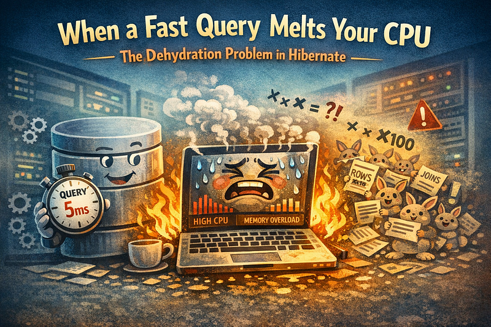

Developers love the idea of a single, elegant SQL query that fetches everything in one go. One round‑trip to the database. One response. One perfect solution.

Except… in Hibernate, that “perfect” query can quietly turn into a **CPU‑burning, memory‑eating disaster**.

This hidden performance trap is known as the **dehydration problem** — when Hibernate tries to hydrate (map) a multiplied result set into your object graph. The SQL is fast, but the ORM mapping becomes painfully slow.

Let’s break down why this happens, how to spot it, and how to avoid it.

### The Real Enemy: Cartesian Explosion

The dehydration problem starts with a simple fact:

> *When you join multiple one‑to‑many or many‑to‑many relations, the database multiplies rows.*

Example domain:

```sql
+---------------------+
|      Order          |
|---------------------|
| id                  |
| date                |
| status              |
|---------------------|
| items (IDs only)    |
+---------------------+

+---------------------+
|    OrderItem        |
|---------------------|
| id                  |
| orderId             |
| productId           |
| quantity            |
+---------------------+

+---------------------+
|      Product        |
|---------------------|
| id                  |
| name                |
| price               |
|---------------------|
| images (IDs only)   |
| tags (IDs only)     |
+---------------------+
```

A typical join:

```sql
SELECT *
FROM orders o
LEFT JOIN order_item oi ON oi.order_id = o.id
LEFT JOIN product p ON p.id = oi.product_id
WHERE o.id = :id;
```

Looks harmless. Runs fast. DB returns rows instantly.

But if:

- Order has **20 items**
- Each product has **3 images**
- Each product has **2 tags**

Then the join becomes:

```sql
20 items × 3 images × 2 tags = 120 rows
```

The database doesn’t care — it just streams rows. Hibernate, however, must reconstruct:

- 1 Order
- 20 OrderItems
- 20 Products
- 60 Images
- 40 Tags

…from **120 multiplied rows**.

This is where the trouble begins.

### Why Hibernate Suffers: Hydration Is Expensive

Hibernate must:

- deduplicate entities
- merge rows into collections
- maintain identity maps
- resolve proxies
- apply lazy/eager rules
- build the entire object graph

This means:

- **High CPU usage**
- **High memory consumption**
- **GC pressure**
- **Slow endpoints**
- **Thread pool starvation**
- Sometimes even **OutOfMemoryError**

The SQL query is fast. The **ORM hydration** is slow.

This is the dehydration problem in action.

### A Concrete Example: Order → OrderItems → Product

### Entities (simplified)

```java
class Order {
    @OneToMany(mappedBy = "order", fetch = FetchType.EAGER)
    List<OrderItem> items;
}

class OrderItem {
    @ManyToOne(fetch = FetchType.EAGER)
    Product product;
}

class Product {
    @OneToMany(fetch = FetchType.LAZY)
    List<ProductImage> images;
    @ManyToMany(fetch = FetchType.LAZY)
    List<Tag> tags;
}
```

Even if you write a simple query, Hibernate loads the entire graph because of **greedy relations**.

### The result?

A single “smart” query becomes a **Cartesian explosion** that Hibernate must painfully hydrate.

### Why Developers Fall Into This Trap

Because the SQL looks good.

- The query is fast.
- The DB plan is efficient.
- The response time is low.

But Hibernate is not a database. It’s an object graph builder.

ORM hydration is the bottleneck — not the SQL.

### The Hidden Culprit: Greedy Relations

The dehydration problem almost always appears when entities contain:

- `@OneToMany(fetch = EAGER)`
- `@ManyToOne(fetch = EAGER)`
- `@ManyToMany(fetch = EAGER)`
- large collections
- deep object graphs
- bidirectional relations

Even if you write a simple query, Hibernate loads everything.

This is why **EAGER fetching is dangerous**.

### Why “One Query” Is Not Always Better

Developers often assume:

> *“One query is faster than multiple queries.”*

Not in ORM world.

Sometimes **3–5 small queries** are dramatically faster than **one huge join**.

Example:

- Load Order
- Load OrderItems
- Load Products
- Load Images
- Load Tags

Each query returns a small, clean dataset. Hibernate hydrates them efficiently.

This is often the correct solution.

### How to Fix the Dehydration Problem

#### 1. Replace joins with multiple smaller queries

Load only what you need, when you need it.

Hibernate handles small result sets extremely well.

#### 2. Use DTO projections instead of entities

```java
@Query("""
    SELECT new OrderItemDTO(oi.id, p.name, p.price)
    FROM OrderItem oi
    JOIN oi.product p
    WHERE oi.order.id = :orderId
""")
```

DTOs avoid hydration entirely.

#### 3. Avoid EAGER fetching

Use:

```java
@OneToMany(fetch = LAZY)
```

And load explicitly.

#### 4. Apply DDD principles

In Domain‑Driven Design:

- Aggregates should be small
- Services should load only the data they own
- Bounded contexts should not hydrate entire graphs

If your Order aggregate loads:

- items
- products
- images
- tags
- categories
- suppliers

…it’s too big.

DDD teaches:

> *Load only what the use case needs.*

### How to Detect the Problem in Production

Look for:

- high CPU usage
- high memory usage
- slow endpoints with “fast” SQL
- GC pauses
- thread pool exhaustion
- huge JSON responses
- thread dumps showing `org.hibernate.loader.Loader.processResultSet`

This is a clear sign of dehydration.

### Conclusion

The dehydration problem is one of the most common — and most misunderstood — performance issues in Hibernate. A single “smart” query can silently trigger a massive Cartesian explosion, causing Hibernate to burn CPU and memory while trying to hydrate an oversized object graph.

#### Key takeaways:

- SQL can be fast while Hibernate is slow
- Cartesian explosions kill performance
- EAGER relations are dangerous
- Multiple small queries are often faster
- DTOs and read models avoid hydration entirely
- DDD helps keep aggregates small and focused

If you design your domain and queries with these principles in mind, you’ll avoid one of the most painful ORM performance traps — and your production services will thank you.
