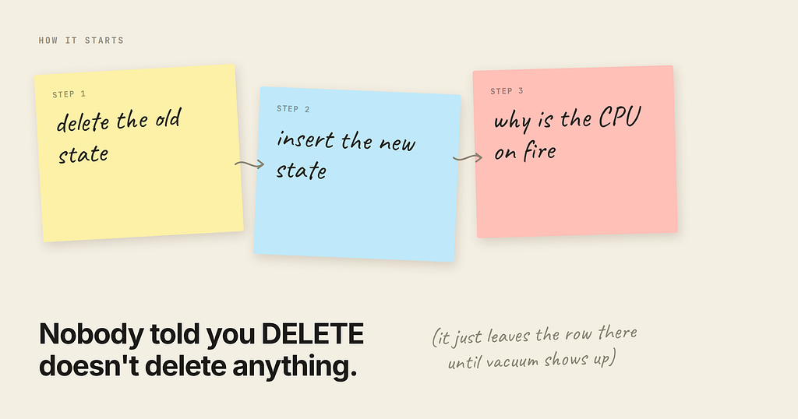
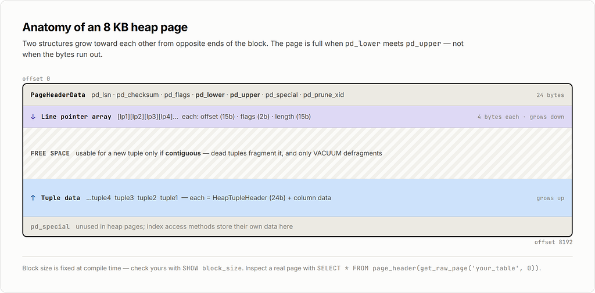
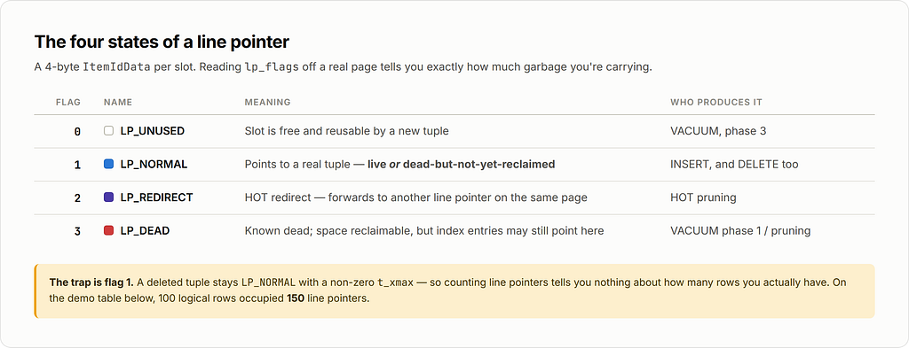
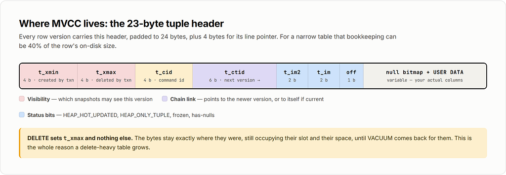
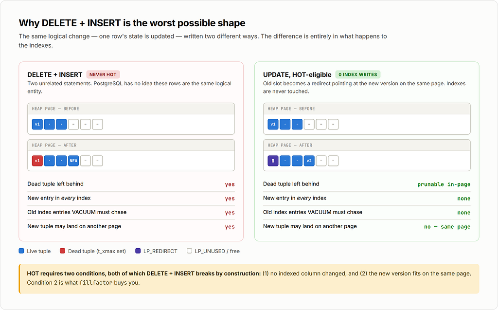
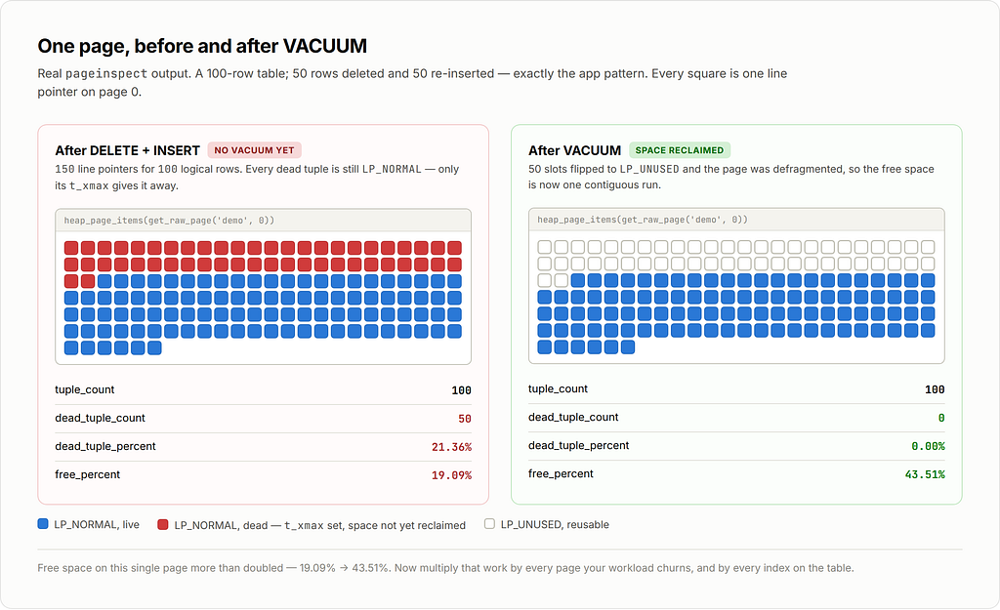
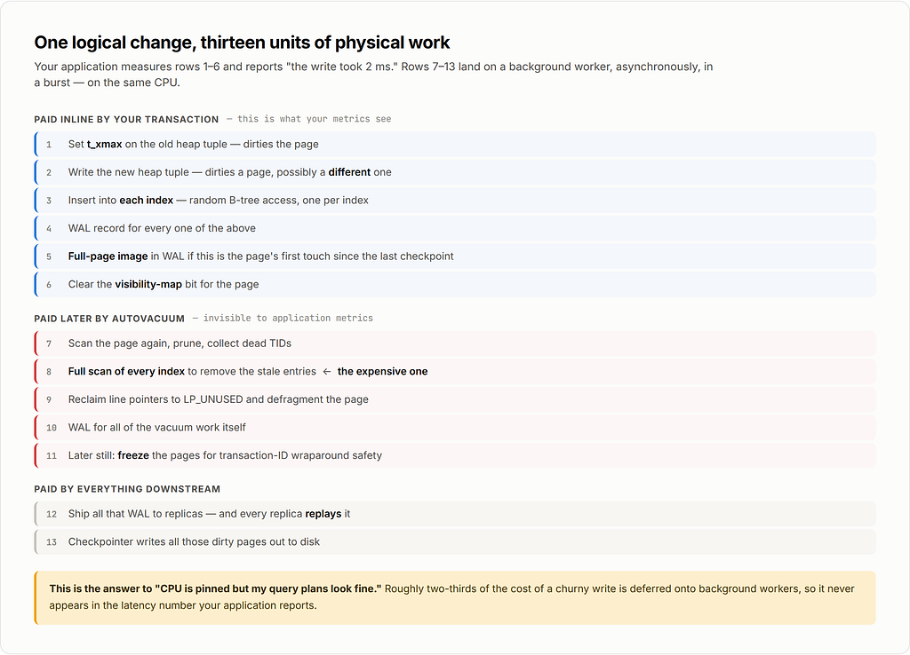
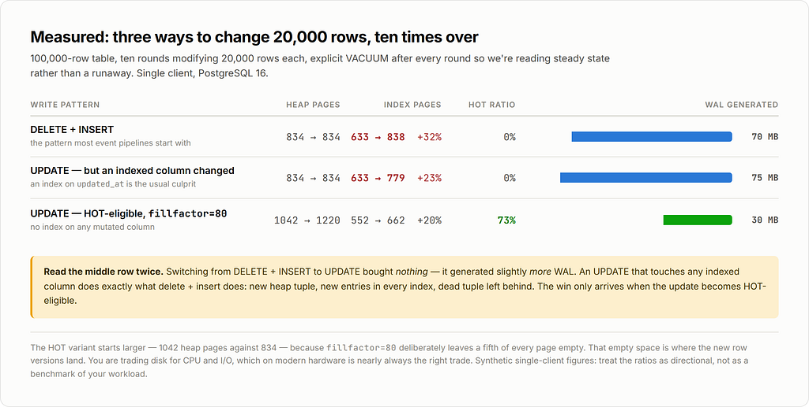

*A deep dive into MVCC, heap pages, vacuum, and what to do when you have billions of rows to update.*



### The symptom

You have a table that stores user state. Something happens — an event arrives — and your code does the obvious thing:

```
BEGIN;
DELETE FROM user_state WHERE user_id = $1;
INSERT INTO user_state (user_id, state, score, updated_at) VALUES ($1, $2, $3, now());
COMMIT;
```

It’s clean. It’s idempotent. It doesn’t require you to think about which columns changed. For a long time it works fine.

Then event volume grows, and PostgreSQL’s CPU starts climbing in a way that nothing in your query plans explains. Your queries are still index scans. Your pg\_stat\_statements top entries look reasonable. But CPU is pinned, replication lag creeps up, and every so often the whole database gets slow for a few minutes and then recovers on its own.

If you look at pg\_stat\_activity during one of those windows, you'll usually find the culprit sitting right there:

```
autovacuum: VACUUM public.user_state
```

That’s the story. But “autovacuum is expensive” is not an explanation — it’s a restatement of the symptom. To actually fix this you need to understand what a DELETE followed by an INSERT does to the physical 8 KB pages on disk, and why that specific shape of write is close to the worst case for PostgreSQL's storage engine.

Let’s go all the way down.

### Part 1: PostgreSQL never modifies a row in place

This is the single fact that everything else follows from.

PostgreSQL implements MVCC (Multi-Version Concurrency Control) by keeping **multiple physical versions of every row** and letting each transaction see the version appropriate to its snapshot. There is no undo log (unlike Oracle or MySQL’s InnoDB, which keep old versions in a separate rollback segment). In PostgreSQL, old row versions live **in the table itself**, mixed in with the live ones.

Concretely:

- INSERT writes a new tuple and stamps it with xmin = the inserting transaction ID.
- DELETE **does not remove anything**. It stamps the existing tuple with xmax = the deleting transaction ID. The bytes stay exactly where they were.
- UPDATE is internally a DELETE + INSERT: it stamps xmax on the old tuple and writes a brand-new tuple somewhere.

So a “deleted” row is still fully present on disk, occupying its bytes, until some later process comes along and physically reclaims it. That process is vacuum.

Here’s this happening for real. A 100-row table, then delete 50 rows and insert 50 new ones:

```
CREATE EXTENSION pageinspect;
CREATE TABLE demo (id int PRIMARY KEY, state text);
INSERT INTO demo SELECT g, 'active' FROM generate_series(1,100) g;
-- delete half, re-insert half (the pattern from our app)
DELETE FROM demo WHERE id <= 50;
INSERT INTO demo SELECT g, 'active' FROM generate_series(1,50) g;
SELECT lp, lp_flags, lp_len, t_xmin, t_xmax
FROM heap_page_items(get_raw_page('demo', 0))
WHERE lp BETWEEN 48 AND 54;
```

```
 lp | lp_flags | lp_len | t_xmin | t_xmax
----+----------+--------+--------+--------
 48 |        1 |     35 |    801 |    802   <- deleted, still on the page
 49 |        1 |     35 |    801 |    802   <- deleted, still on the page
 50 |        1 |     35 |    801 |    802   <- deleted, still on the page
 51 |        1 |     35 |    801 |      0   <- live
 52 |        1 |     35 |    801 |      0   <- live
 53 |        1 |     35 |    801 |      0   <- live
 54 |        1 |     35 |    801 |      0   <- live
```

The deleted tuples have t\_xmax = 802 (the transaction that deleted them) and are still LP\_NORMAL (lp\_flags = 1). They occupy real space. The table now has 150 line pointers where the logical row count is 100.

```
SELECT tuple_count, dead_tuple_count, dead_tuple_percent, free_percent
FROM pgstattuple('demo');
```

```
 tuple_count | dead_tuple_count | dead_tuple_percent | free_percent
-------------+------------------+--------------------+--------------
         100 |               50 |              21.36 |        19.09
```

**21% of that table is garbage.** And that’s after one round.

### Part 2: Anatomy of an 8 KB page

PostgreSQL stores everything in fixed-size blocks — 8 KB by default (SHOW block\_size). Understanding the layout of one page is the key to understanding why churn is expensive.



Two structures grow toward each other from opposite ends: the **line pointer array** from the top, the **tuple data** from the bottom. The page is full when they meet.

The **line pointer** (also called an item identifier, ItemIdData) is a tiny 4-byte struct that says "the tuple at slot N lives at byte offset X and is Y bytes long." It has four possible states, and you'll see all of them in this article:



The **tuple header** (HeapTupleHeader, 23 bytes padded to 24) is where MVCC lives:



That’s **24 bytes of overhead per row version, plus 4 bytes for the line pointer.** For a table storing a user ID, a short state string, and a timestamp, the MVCC bookkeeping can easily be 40% of the row’s on-disk size.

Now here’s the critical bit for our problem:

> *A page’s free space is only usable for a* new *tuple if it is* ***contiguous*** *and the page has a free line pointer or room to add one. Dead tuples fragment the page. Only vacuum can defragment it.*

### Part 3: Why DELETE + INSERT is the worst shape

Compare what the two write patterns do to a page.



A DELETE + INSERT can **never** be a HOT update. HOT (Heap-Only Tuple) is an optimization that only applies to UPDATE, and only when two conditions hold:

1. No indexed column changed.
2. The new version fits **on the same page** as the old one.

When both hold, PostgreSQL writes the new version onto the same page and links it via t\_ctid, leaving the index entries alone. That's an enormous saving: index maintenance is usually the dominant cost of a write, because B-tree inserts are random-access, and every index on the table pays it.

By splitting your logical update into two statements, you’ve told PostgreSQL: *this is a brand-new row that has nothing to do with the old one.* It has no choice but to write full index entries into every index, and to leave a dead tuple behind that vacuum must chase down.

You can see HOT working with pageinspect. In a table where updates *are* HOT-eligible, the page fills up with redirect pointers:

```
SELECT lp, lp_flags, lp_len, t_ctid
FROM heap_page_items(get_raw_page('user_state_hot', 0)) LIMIT 5;
```

```
 lp | lp_flags | lp_len | t_ctid
----+----------+--------+--------
  1 |        2 |      0 |          <- LP_REDIRECT
  2 |        2 |      0 |          <- LP_REDIRECT
  3 |        2 |      0 |          <- LP_REDIRECT
  4 |        2 |      0 |          <- LP_REDIRECT
  5 |        2 |      0 |          <- LP_REDIRECT
```

Those redirect pointers are the physical trace of updates that cost **zero index writes**.

### Part 4: What vacuum actually does

Vacuum is not one operation. A standard (non-full) VACUUM of a table with indexes runs in phases, and understanding the phases explains where the CPU goes.

#### Phase 1 — Heap scan

Vacuum scans the table’s pages (skipping ones the **visibility map** marks all-visible, which is the main reason vacuum on an append-only table is cheap and vacuum on a churned table is not). For each page it:

- Prunes HOT chains and marks reclaimable tuples.
- Collects the **TIDs (page number, line pointer) of dead tuples** into memory.
- Sets LP\_DEAD on their line pointers.

The dead TID list is bounded by maintenance\_work\_mem (or autovacuum\_work\_mem). In PostgreSQL 17+ this list is stored in an adaptive radix tree (TidStore) rather than a flat array, which cut memory usage dramatically and removed the old 1 GB cap — a genuinely large improvement for high-churn tables.

#### Phase 2 — Index vacuum

**This is the expensive part.** For every index on the table, vacuum performs a full scan (a btbulkdelete) and removes every index entry pointing at a dead TID.

Note what that means: **the cost is per index, and it’s a full index scan, not a lookup.** A table with five indexes pays five full index scans per vacuum cycle. This is why “just add an index” decisions compound badly on high-churn tables.

#### Phase 3 — Heap vacuum

Vacuum revisits the pages and turns LP\_DEAD line pointers into LP\_UNUSED, then **defragments** the page: it slides the remaining tuples together so the free space becomes one contiguous block. Now that space is genuinely reusable.

If the dead-TID list overflowed maintenance\_work\_mem in phase 1, vacuum has to loop: scan more heap → vacuum all indexes again → vacuum heap again. A single vacuum of a big churned table can do the full index pass **multiple times**. This is the classic "why has autovacuum been running for six hours" answer.

#### Phase 4 — Freezing

Separately, vacuum replaces old xmin values with a frozen marker so transaction IDs can wrap around safely. Anti-wraparound vacuums are non-cancelable and will run whether you like it or not. PostgreSQL 18 added *eager freezing* (vacuum\_max\_eager\_freeze\_failure\_rate, default 0.03) so that normal vacuums opportunistically freeze pages, spreading this cost out instead of saving it up for one giant emergency vacuum.

#### Phase 5 — Truncation

If there are empty pages at the *end* of the table, vacuum tries to return them to the OS. This requires an ACCESS EXCLUSIVE lock (briefly). Note the word *end*: **vacuum almost never shrinks a bloated table**, because the free space is scattered throughout, not conveniently at the tail. It makes the space reusable by PostgreSQL, not available to your filesystem.

Here’s the before/after on our demo table:

```
VACUUM demo;
SELECT lp_flags, count(*) 
FROM heap_page_items(get_raw_page('demo',0)) GROUP BY 1;
```



Free space on the page went from **19.09% → 43.51%**. That’s the work vacuum did. Now multiply it by every page you churned.

### Part 5: The amplification math

Here is the part people underestimate. One logical “user state changed” event does not cause one write. It causes, at minimum:



Steps 7–13 are *invisible in your application metrics*. Your app measures step 1–6 latency and reports “the insert took 2 ms.” The other two-thirds of the cost lands on a background worker, asynchronously, in a burst, on the same CPU.

That’s the answer to “why does CPU go up but my queries look fine.”

#### **Point 5b: the full-page-image trap**

After each checkpoint, the first write to any page triggers a **full 8 KB page image** written into WAL (full\_page\_writes, on by default, and required for crash safety on most filesystems). If your churn touches many distinct pages, you pay a lot of FPIs. If your churn is concentrated on a few pages, you pay far fewer. Delete+insert scatters writes across pages — the new tuple often lands in a *different* page from the one you dirtied with the xmax write. Two dirty pages instead of one, two FPI candidates instead of one.

#### Point 5c: the read-side cost nobody mentions

Dead tuples also make **reads** slower and CPU-hungrier:

- An index scan follows an index entry to the heap, reads the tuple, checks visibility, discovers it’s dead, and discards it. That’s a wasted buffer access plus a visibility check. You can see this directly: EXPLAIN (ANALYZE, BUFFERS) will show a rising Buffers: shared hit count for a query returning the same number of rows.
- Bloated tables have worse cache locality. The same 100k live rows spread over 2× the pages means 2× the shared buffers to hold them, which evicts *other* things.
- On a read, PostgreSQL may perform **opportunistic HOT pruning** on the page — real CPU work done inside your SELECT.

### Part 6: Measurements

I ran a controlled comparison: 100,000 rows, ten rounds of modifying 20,000 of them, with an explicit VACUUM after each round so we're looking at steady state, not a runaway. Three variants:



Read those rows carefully, because the middle one is the trap.

**Switching from** **DELETE+****INSERT to** **UPDATE bought essentially nothing on its own.** The second variant still generated *more* WAL than the first. Why? Because the UPDATE touched updated\_at, and updated\_at had an index on it. An UPDATE that modifies any indexed column is not HOT-eligible, so it does exactly what delete+insert does: new heap tuple, new entries in every index, dead tuple left behind.

The third variant — same UPDATE, but with no index on the mutated columns and fillfactor lowered to 80 — generated **less than half the WAL** and made 73% of its updates HOT.

The cost of that win is visible too: the HOT table starts at 1042 heap pages instead of 834, because fillfactor=80 deliberately leaves 20% of every page empty. That empty space is what new row versions land in. **You are trading disk space for CPU and I/O**, which on modern hardware is almost always the right trade.

*(These are synthetic single-client numbers on PostgreSQL 16 — treat the ratios as directional, not as a benchmark of your workload.)*

### Part 7: Fixing it, in order of leverage

#### 7.1 Don’t write when nothing changed

The cheapest write is the one that doesn’t happen. A shocking amount of churn in “collect user state” systems is **rewriting a row to the exact same value** because an event arrived that didn’t actually change anything.

```
INSERT INTO user_state (user_id, state, score, updated_at)
VALUES ($1, $2, $3, now())
ON CONFLICT (user_id) DO UPDATE
SET state      = EXCLUDED.state,
    score      = EXCLUDED.score,
    updated_at = now()
WHERE user_state.state  IS DISTINCT FROM EXCLUDED.state
   OR user_state.score  IS DISTINCT FROM EXCLUDED.score;
```

That trailing WHERE on the DO UPDATE clause is the whole trick: if nothing changed, PostgreSQL writes **nothing** — no new tuple, no dead tuple, no index entry, no WAL. In event-driven systems where the same state gets recomputed repeatedly, this alone often removes 50–90% of write volume.

Measure how much you’d save before you build anything else:

```
-- how many of your writes are no-ops?
SELECT count(*) FILTER (WHERE state = $2 AND score = $3) AS would_be_noop,
       count(*) AS total
FROM user_state WHERE user_id = ANY($1);
```

#### 7.2 Make your updates HOT-eligible

Two requirements, both actionable:

**(a) Don’t index the columns that change.** Audit every index against your write path:

```
SELECT i.relname AS index_name,
       array_agg(a.attname ORDER BY x.n) AS indexed_columns,
       s.idx_scan AS times_used
FROM pg_index ix
JOIN pg_class i ON i.oid = ix.indexrelid
JOIN pg_class t ON t.oid = ix.indrelid
JOIN LATERAL unnest(ix.indkey) WITH ORDINALITY AS x(attnum, n) ON true
JOIN pg_attribute a ON a.attrelid = t.oid AND a.attnum = x.attnum
LEFT JOIN pg_stat_user_indexes s ON s.indexrelid = i.oid
WHERE t.relname = 'user_state'
GROUP BY i.relname, s.idx_scan
ORDER BY s.idx_scan NULLS FIRST;
```

An index on updated\_at is the single most common HOT-killer in exactly this kind of table. Ask whether you truly need it, or whether a partial index, a coarser index (date\_trunc('hour', updated\_at) doesn't help — but a separate low-churn audit table might), or no index at all would do.

Unused indexes are pure loss: they cost writes and vacuum passes and return nothing. Drop them.

**(b) Leave room on the page.**

```
ALTER TABLE user_state SET (fillfactor = 80);
-- fillfactor only applies to newly written pages;
-- rewrite the table to apply it to existing data:
VACUUM FULL user_state;   -- takes ACCESS EXCLUSIVE lock
-- or, online:
-- pg_repack -t user_state
```

For a heavily-updated table, 70–85 is a reasonable range. Below ~70 you’re wasting a lot of buffer cache on empty space.

Then confirm it’s working:

```
SELECT relname,
       n_tup_upd,
       n_tup_hot_upd,
       round(100.0 * n_tup_hot_upd / NULLIF(n_tup_upd,0), 1) AS hot_pct
FROM pg_stat_user_tables
WHERE relname = 'user_state';
```

**If** **hot\_pct is near zero on an update-heavy table, that is your bug.** Aim for 80%+.

#### 7.3 Tune autovacuum for this table, not globally

The defaults are tuned for a small table on a small machine. autovacuum\_vacuum\_scale\_factor = 0.2 means vacuum waits until **20% of the table is dead** before acting. On a 500-million-row table that's 100 million dead tuples before anything happens — and then one enormous, disruptive vacuum.

You want the opposite: vacuum **more often, doing less each time.**

```
ALTER TABLE user_state SET (
  autovacuum_vacuum_scale_factor  = 0.01,   -- act at 1% dead, not 20%
  autovacuum_vacuum_threshold     = 1000,
  autovacuum_analyze_scale_factor = 0.02,
  autovacuum_vacuum_cost_delay    = 0,      -- don't throttle this table
  autovacuum_vacuum_cost_limit    = 3000
);
```

And globally, if your hardware is modern (NVMe, many cores), the shipped throttle is far too conservative:

```
autovacuum_max_workers      = 6          # default 3
autovacuum_naptime          = 15s        # default 1min
autovacuum_vacuum_cost_delay = 2ms       # default 2ms; consider 0 on fast storage
vacuum_cost_limit           = 2000       # default 200
maintenance_work_mem        = 2GB        # gives vacuum a big dead-TID store
autovacuum_work_mem         = 1GB
```

The cost-delay mechanism is the one most often left at a value that makes vacuum unable to keep up: vacuum accumulates “cost” (1 per buffer hit, 2 per miss, 20 per dirtied page) and sleeps cost\_delay whenever it exceeds cost\_limit. With the defaults, vacuum is deliberately slowed to something like a few MB/s. On a table generating hundreds of MB of dead tuples per minute, it will never catch up, and dead tuples accumulate forever.

PostgreSQL 18 also added autovacuum\_vacuum\_max\_threshold (default 100,000,000), which caps the scale-factor calculation so very large tables can't defer vacuum indefinitely. It helps, but a per-table scale factor is still better.

#### 7.4 Reconsider the data model

If your state genuinely is “replace the whole thing on every event,” ask whether it belongs in a row-per-user table at all:

- **Collapse many rows into one.** If you’re storing N state rows per user and replacing them all, one row with a jsonb column can turn N deletes + N inserts into one update — and if jsonb is under the TOAST threshold and no indexed column changes, that update can be HOT. (Careful: a large jsonb that gets TOASTed is a whole separate write amplification problem. This works when the document is small, roughly under 2 KB.)
- **Append-only + a materialized “current” view.** Write events to a partitioned append-only table (no updates, no deletes, so almost no vacuum work — just insert-triggered vacuums for freezing), and maintain the current state separately, or compute it with a DISTINCT ON query over a well-indexed event log. Append-only tables are the cheapest thing PostgreSQL does.
- **Move the hottest state out of PostgreSQL.** If a piece of state changes many times per second per user and you only ever need the latest value, Redis or a dedicated KV store is the honest answer. Not everything needs to be transactional and durable.

### Part 8: The hard question — updating billions of rows

This is the case where all the usual advice breaks, so it deserves its own treatment.

#### Why the naive approach fails, precisely

```
UPDATE huge_table SET status = 'migrated' WHERE status = 'pending';
-- 2,000,000,000 rows
```

Four separate disasters:

**1. Table size doubles.** Every updated row writes a new version while the old one stays. A 2 TB table becomes 4 TB mid-statement. Then vacuum makes the space reusable but does *not* return it to the OS. You now permanently need 4 TB of disk for 2 TB of data.

**2. It generates terabytes of WAL** in one burst. Replicas fall behind, archiving falls behind, and if you’re on a cloud provider you may fill the WAL volume and take the primary down.

**3. It holds a single transaction open for hours — and this is the one that hurts most.** Vacuum can only remove tuples older than the oldest running transaction’s snapshot (the *xmin horizon*). A long transaction pins that horizon. So while your giant UPDATE runs, **vacuum cannot clean up dead tuples anywhere in the entire database** — not just this table. Every other table quietly bloats. This is how one migration takes down a whole cluster.

**4. If it fails at 95%, all the work is thrown away** — but the dead tuples it created are not. You get the bloat with none of the benefit.

You can watch the horizon problem happen:

```
SELECT pid, age(backend_xid) AS xid_age, state,
       now() - xact_start AS duration, left(query, 60)
FROM pg_stat_activity
WHERE backend_xid IS NOT NULL
ORDER BY xact_start
LIMIT 5;
```

Also check for the other two horizon-pinners people forget: **replication slots** and **prepared transactions**.

```
SELECT slot_name, active, age(xmin) AS xmin_age,
       pg_size_pretty(pg_wal_lsn_diff(pg_current_wal_lsn(), restart_lsn)) AS retained_wal
FROM pg_replication_slots;
SELECT gid, prepared, age(transaction) FROM pg_prepared_xacts;
```

An inactive replication slot will pin the xmin horizon **forever** and no amount of vacuum tuning will save you.

#### Strategy A: Batched backfill with keyset pagination

The workhorse. Small transactions, each one committing so the xmin horizon advances and vacuum can keep pace.

```
-- Track progress in a real table so the job is resumable
CREATE TABLE IF NOT EXISTS backfill_progress (
  job_name text PRIMARY KEY,
  last_id  bigint NOT NULL,
  updated_at timestamptz NOT NULL DEFAULT now()
);
```

```
-- One batch. Run this in a loop from your application or a scheduler.
WITH bounds AS (
  SELECT last_id FROM backfill_progress WHERE job_name = 'status_migration'
),
batch AS (
  SELECT id FROM huge_table
  WHERE id > (SELECT last_id FROM bounds)
  ORDER BY id
  LIMIT 5000
  FOR UPDATE SKIP LOCKED
),
upd AS (
  UPDATE huge_table t
  SET status = 'migrated'
  FROM batch b
  WHERE t.id = b.id
    AND t.status IS DISTINCT FROM 'migrated'   -- skip no-op writes
  RETURNING t.id
)
UPDATE backfill_progress
SET last_id = COALESCE((SELECT max(id) FROM batch), last_id),
    updated_at = now()
WHERE job_name = 'status_migration'
RETURNING last_id, (SELECT count(*) FROM upd) AS rows_updated;
```

Rules that make the difference between this working and this being a slow disaster:

- **Keyset pagination, never** **OFFSET.** OFFSET 10000000 re-scans ten million rows every batch. WHERE id > $last uses the index.
- **Batch size 1,000–10,000 rows.** Big enough to amortize overhead, small enough that each transaction finishes in well under a second.
- **AND col IS DISTINCT FROM $new** so re-running a batch is free and no-ops don't write.
- **Throttle deliberately.** Sleep 50–200 ms between batches. You are racing autovacuum; give it room to win. Adaptive throttling — sleep longer when replication lag or dead-tuple count rises — is worth the extra code:

```
-- feed this into your loop's sleep decision
SELECT (SELECT n_dead_tup FROM pg_stat_user_tables WHERE relname='huge_table') AS dead,
       (SELECT coalesce(max(pg_wal_lsn_diff(sent_lsn, replay_lsn)), 0)
        FROM pg_stat_replication) AS replica_lag_bytes;
```

- **Run it during a low-traffic window** if you have one, but design it to be safe at any time.

**Expected duration is the thing to be honest about:** 2 billion rows at 5,000 rows/batch with a 100 ms sleep is 400,000 batches ≈ **11+ hours minimum**, realistically a few days. That’s fine. Plan for days, make it resumable, make it observable.

#### Strategy B: Partitioning + partition swap

If your data is naturally partitionable (by time, tenant, hash of user ID), this changes the game completely, because you can rebuild a partition **offline** and swap it in atomically.

```
-- Assume: huge_table PARTITION BY RANGE (created_at)
--         with partition huge_table_2026_03
-- 1. Build the new version at full speed, outside the live table.
CREATE TABLE huge_table_2026_03_new (LIKE huge_table INCLUDING ALL);
INSERT INTO huge_table_2026_03_new
SELECT id, user_id, 'migrated'::text AS status, payload, created_at
FROM huge_table_2026_03;
-- 2. Indexes AFTER the load - far faster than maintaining them during it.
--    No CONCURRENTLY needed: nothing is reading this table yet.
CREATE INDEX ON huge_table_2026_03_new (user_id);
ANALYZE huge_table_2026_03_new;
-- 3. Atomic swap: milliseconds of ACCESS EXCLUSIVE lock, not hours.
BEGIN;
  ALTER TABLE huge_table DETACH PARTITION huge_table_2026_03;
  ALTER TABLE huge_table ATTACH PARTITION huge_table_2026_03_new
    FOR VALUES FROM ('2026-03-01') TO ('2026-04-01');
COMMIT;
-- 4. Keep the old one around until you're confident, then drop it.
-- DROP TABLE huge_table_2026_03;
```

Why this is so much better:

- The bulk INSERT into an empty, unindexed table is **the fastest write path PostgreSQL has**. No dead tuples are created at all.
- Zero vacuum debt: you never made garbage, so there’s nothing to collect.
- The lock window is milliseconds.
- Rollback is trivial: swap the old partition back.
- You can do partitions **one at a time**, over weeks, with a rollback point after each.

There’s a caveat worth knowing: ATTACH PARTITION validates that existing rows satisfy the partition constraint, which requires a scan — unless you add a matching CHECK constraint to the new table first, in which case PostgreSQL skips the scan.

```
ALTER TABLE huge_table_2026_03_new
  ADD CONSTRAINT part_check
  CHECK (created_at >= '2026-03-01' AND created_at < '2026-04-01') NOT VALID;
ALTER TABLE huge_table_2026_03_new VALIDATE CONSTRAINT part_check;
-- now ATTACH is instant
```

**If you have billions of rows and no partitioning, partitioning is probably the actual project** — not the update itself. Everything downstream gets easier: DROP PARTITION replaces mass DELETE (instant, and creates zero dead tuples), vacuum works per-partition in parallel, and index sizes stay manageable.

#### Strategy C: Rebuild and swap the whole table

When the change is uniform and you can’t partition, build a new table and cut over.

For a bloated table with no schema change, pg\_repack does this online: it builds a fresh copy, captures concurrent changes via triggers, replays them, and swaps — taking the exclusive lock only for the final instant.

```
pg_repack -h host -d mydb -t huge_table --jobs 4
```

For a schema/data change, the same idea by hand with logical replication or triggers; tools like pgroll and Percona's approach automate it. The pattern is always: **new table, bulk load, keep in sync, atomic rename.**

Budget for double the disk space. That’s the price of every swap-based strategy.

### Strategy D: Don’t update at all

The strategy people skip past. Ask whether the update is necessary:

- Add a **new column with a default** instead of rewriting values — since PostgreSQL 11, adding a column with a non-volatile default is a metadata-only change that rewrites nothing, no matter how big the table.
- Write a **view** that computes the new value from the old one, and migrate readers to it.
- Use a **generated column** if the new value is derivable.
- Let it happen **lazily**: update rows as they’re naturally touched by the application, with a background job mopping up the long tail over months.

A billion-row update you don’t have to run is strictly better than one you run well.

### Part 9: What to actually watch

Four queries. Put them on a dashboard.

**1. Is vacuum keeping up?**

```
SELECT relname,
       n_live_tup,
       n_dead_tup,
       round(100.0 * n_dead_tup / NULLIF(n_live_tup + n_dead_tup, 0), 2) AS dead_pct,
       last_autovacuum,
       autovacuum_count,
       n_tup_upd,
       n_tup_hot_upd,
       round(100.0 * n_tup_hot_upd / NULLIF(n_tup_upd, 0), 1) AS hot_pct
FROM pg_stat_user_tables
WHERE n_dead_tup > 10000
ORDER BY n_dead_tup DESC
LIMIT 20;
```

Sustained dead\_pct above ~10% on a busy table means vacuum is losing. hot\_pct near zero on an update-heavy table means you're paying full index cost on every write.

**2. What is vacuum doing right now?**

```
SELECT p.pid, p.relid::regclass AS table, p.phase,
       pg_size_pretty(p.heap_blks_total * 8192::bigint) AS total,
       round(100.0 * p.heap_blks_scanned / NULLIF(p.heap_blks_total,0), 1) AS pct_scanned,
       p.index_vacuum_count,
       now() - a.xact_start AS running_for
FROM pg_stat_progress_vacuum p
JOIN pg_stat_activity a USING (pid);
```

index\_vacuum\_count > 1 is the smoking gun for maintenance\_work\_mem being too small — vacuum had to do the index pass more than once.

**3. Is anything pinning the xmin horizon?**

```
SELECT 'backend' AS src, pid::text AS id, age(backend_xmin) AS xmin_age
FROM pg_stat_activity WHERE backend_xmin IS NOT NULL
UNION ALL
SELECT 'slot', slot_name, age(xmin) FROM pg_replication_slots WHERE xmin IS NOT NULL
UNION ALL
SELECT 'prepared_xact', gid, age(transaction) FROM pg_prepared_xacts
ORDER BY xmin_age DESC NULLS LAST
LIMIT 10;
```

Anything with a large age here is preventing vacuum from cleaning up **database-wide.**

**4. How bloated is it, really?**

```
CREATE EXTENSION IF NOT EXISTS pgstattuple;
-- accurate but does a full scan; use the sampling version on huge tables
SELECT * FROM pgstattuple('user_state');
SELECT * FROM pgstattuple_approx('huge_table');
SELECT * FROM pgstatindex('user_state_user_id_idx');
```

For indexes, avg\_leaf\_density below ~50 means the index is worth rebuilding:

```
REINDEX INDEX CONCURRENTLY user_state_user_id_idx;
```

### The checklist

If you’re in the situation this article opened with, do these in order:

1. **Measure first.** dead\_pct, hot\_pct, pg\_stat\_progress\_vacuum, xmin horizon. Don't tune blind.
2. **Kill no-op writes** with ON CONFLICT DO UPDATE ... WHERE ... IS DISTINCT FROM. Usually the biggest single win, and the cheapest to ship.
3. **Convert delete+insert to** **UPDATE** — but only after step 4, or it buys you nothing.
4. **Make updates HOT-eligible.** Drop or move indexes on frequently-changed columns (especially updated\_at). Set fillfactor to 80. Verify hot\_pct climbs above 80%.
5. **Tune autovacuum per-table**: scale factor down to 0.01, cost delay to 0, cost limit way up, maintenance\_work\_mem to gigabytes.
6. **Drop unused indexes.** Every one is a write tax and an extra full scan per vacuum.
7. **Partition** if the table is large and the data has a natural key. This makes every future problem easier.
8. **For mass updates**: batched keyset backfill, or partition rebuild-and-swap. Never one giant statement.

The underlying idea is simple enough to hold in your head: **PostgreSQL is a copy-on-write storage engine that trades write amplification for concurrency.** Delete+insert opts into the maximum possible amplification — no HOT, full index maintenance, guaranteed dead tuples, guaranteed vacuum work. Understanding what happens on the 8 KB page is what turns “the database is slow” into a list of specific, fixable things.

*If this was useful, the two commands worth internalizing are* *pageinspect's* *heap\_page\_items() and* *pgstattuple(). Point them at your hottest table. What you find will probably explain your CPU graph.*

### References

- [PostgreSQL 18: Routine Vacuuming](https://www.postgresql.org/docs/current/routine-vacuuming.html)
- [PostgreSQL 18: Vacuuming configuration parameters](https://www.postgresql.org/docs/current/runtime-config-vacuum.html)
- [PostgreSQL 18 Released](https://www.postgresql.org/about/news/postgresql-18-released-3142/)
- [PostgreSQL 18 Vacuuming Improvements Explained (Microsoft)](https://techcommunity.microsoft.com/blog/adforpostgresql/postgresql-18-vacuuming-improvements-explained/4459484)
- [autovacuum\_vacuum\_max\_threshold in PostgreSQL 18 (dbi services)](https://www.dbi-services.com/blog/postgresql-18-introduce-autovacuum_vacuum_max_threshold/)
- [Faster VACUUM with Adaptive Radix Trees in PostgreSQL 17 (pganalyze)](https://pganalyze.com/blog/5mins-postgres-17-faster-vacuum-adaptive-radix-trees)
- [VACUUM at the Page Level (boringSQL)](https://boringsql.com/posts/vacuum-at-the-page-level/)
